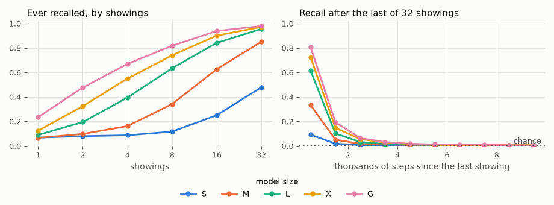

# 00020: Fact Memorization, Forgetting and Relearning

**Date:** 2026-11-03
**Status:** Complete (pending tag)
**Source:** `dev/` (not yet tagged)
**Outputs:** `~/data/research/llm-fundamentals/exp_00020/`
**Task plan:** [`../tasks/00007-fact-memorization.md`](../tasks/00007-fact-memorization.md)

## Goal

How often must a GPT see a fact to recall it, how fast does it forget under a stream of new ones, does size help, and does a forgotten fact come back faster than it was first learned (the owner's savings question)? The design and the readings set before the results are in the task plan.

## Method

- **The facts:** "Zorvan Kelt was born in Mirelith": invented people, and the attribute one of 256 GPT-2 tokens that never occur in TinyStories (8 bits a fact). 32 more tokens are kept for 32 reverse facts with one person each. 61,140 facts in all, the same in every run; no name occurs in TinyStories.
- **The stream:** TinyStories windows of 256 tokens with fact sentences spliced in, each after an `<|endoftext|>`, about one per window. 20,000 steps of 32 windows (8,192 tokens a step), AdamW, learning rate 6e-4 constant after a 500-step warmup.
- **One run covers the three parts:**
  - base facts, 32 showings in the first 4,000 steps;
  - stream facts, 3 new a step, shown 1 to 32 times, 20 or 200 steps apart;
  - 300 test facts learned, forgotten and relearned adaptively, each relearning paired with a fresh fact first learned at the same step. A test fact is shown until recalled (X showings, at most 64), left until it is missed on two probes in a row, then shown again until recalled (Y). Some wait 2 or 4 times as long as they took to forget before relearning;
  - 32 reverse facts.
- **Recall:** the right city ranks first among its kind's cities. Each city is scored by its logit minus its mean logit for 8 never-shown names in the same form, so a city made likely by its own recent showing, whoever is asked, does not count. Chance is 1 in 256.
- **Probes:** the exact sentence cut before the city; a paraphrase ("Where was Zorvan Kelt born? In"); the reverse ("Who was born in Mirelith? It was", chance 1 in 32). Forward passes only, every 500 steps (test facts every 10).
- **Sizes:** S (2 layers, d 128, 0.40M non-embedding parameters), M (4, 256, 3.2M), L (6, 384, 10.6M), X (8, 512, 25M), G (12, 768, 85M, GPT-2 small); two seeds each. Embeddings add 6.4M to 38.6M.
- **Checks before the start:**
  - Untrained, recall is at chance: .002 against 1 in 256, mean rank 126.5 against 127.5; reverse .031 against 1 in 32.
  - The chunked loss equals the plain one (gradients within 3e-8).
  - 1,000- and 3,000-step trial runs.
- **Why the neutral baseline:** a first trial had a test fact "recalled" after one showing, 229 steps into training, because a model that has just seen a city token makes it likely after any name. Scored against the neutral names, that is not recall.

## Notes on the runs

- **Stage 1 (M, two seeds)** ran on the 3090 beside the visual-motor runs on 2026-11-03.
- **Both stage-1 S runs ran out of GPU memory in a probe** there, seed 1 about 2,500 steps in and seed 2 later. The probe computed full-vocabulary logits at every position of up to 2,048 prompts and used only the last. It now computes the last position only, with the same logits. Their logs are kept as `S_s1.crashed.log` and `S_s2.crashed.log`. The M runs, done with the first version of the probe, give the same numbers.
- **Stage 1 slowed vm-00080's 3090 lives** from 3.7 to as low as 1 tick/s.
- **Stage 2 (S again, L, X, G)** ran on 2026-11-04, 09:53–12:15, all eight runs at once: seed 1 on the 4090, seed 2 on the 3090. G took 1:24 on the 4090 and 2:22 on the 3090.
- The Makefile's `make test_all` covers the CUDA GPT-2 code, which this experiment does not touch; it was not rerun.

## Results

From `facts/analyze.py` (`make show`), two seeds pooled per size.

### R1. Repetition: share of facts ever recalled, by showings

| Showings | S | M | L | X | G |
|---|---|---|---|---|---|
| 1 | .068 | .066 | .090 | .124 | .235 |
| 2 | .080 | .098 | .195 | .325 | .477 |
| 4 | .087 | .162 | .395 | .550 | .670 |
| 8 | .117 | .342 | .635 | .740 | .818 |
| 16 | .251 | .627 | .842 | .901 | .939 |
| 32 | .479 | .851 | .956 | .972 | .980 |

Recalled at the end of the run, facts shown 32 times: S .037, M .117, L .181, X .207, G .222.

### R2. Forgetting: recall of facts shown 32 times, by thousands of steps since their last showing

A thousand steps is 8.2M tokens and about 3,000 newer facts.

| Size | 0–1k | 1–2k | 2–3k | 3–4k | 4–5k | 6–7k | 9–10k |
|---|---|---|---|---|---|---|---|
| S | .092 | .019 | .007 | .007 | .004 | .003 | .007 |
| M | .334 | .051 | .018 | .012 | .009 | .004 | .003 |
| L | .614 | .102 | .032 | .017 | .013 | .005 | .003 |
| X | .725 | .148 | .056 | .028 | .016 | .007 | .007 |
| G | .807 | .194 | .064 | .032 | .018 | .009 | .007 |

Kept at 1–2k as a share of 0–1k: S .21, M .15, L .17, X .20, G .24.

**Base facts** (32 showings in the first 4,000 steps): recall peaks when their showings end, at step 4,000 (S .018, M .093, L .441, X .598, G .782), and is .003 to .022 by step 6,000 in every size.

### R3. Extraction, at the end of the run

| Size | Exact, shown 32 times | Paraphrase, shown 32 times | Reverse (chance .031) |
|---|---|---|---|
| S | .037 | .009 | .031 |
| M | .117 | .006 | .062 |
| L | .181 | .005 | .031 |
| X | .207 | .015 | .016 |
| G | .222 | .006 | .000 |

### R4. Savings: the test facts, two seeds

X: showings to first recall. Y: showings to recall again after the fact was lost. Fresh X: a fresh fact's first learning, started at the same step as the relearning.

| Size | Facts | X median | Y median | Fresh X median | Y < X | Y < fresh X | Savings against fresh, delay 1 | Delay 2 | Delay 4 |
|---|---|---|---|---|---|---|---|---|---|
| S | 569 | 21.0 | 7.0 | 21.0 | .91 | .86 | .62 | .39 | .20 |
| M | 600 | 7.5 | 3.0 | 7.0 | .87 | .87 | .56 | .51 | .30 |
| L | 600 | 4.0 | 2.0 | 4.0 | .83 | .84 | .38 | .55 | .40 |
| X | 600 | 3.0 | 2.0 | 3.0 | .82 | .81 | .39 | .54 | .40 |
| G | 600 | 2.0 | 1.0 | 3.0 | .83 | .82 | .33 | .56 | .48 |

Savings against fresh is the mean of (fresh X − Y) / fresh X. The delay is the wait before relearning, in multiples of the time the fact took to be lost. S learned 30 of its 1,179 test facts not at all within 64 showings (they have no Y); M to G learned every one, at most in 57, 23, 14 and 14 showings.

### R5. Held at the end

Facts recalled at the end of the run: S 159, M 442, L 754, X 925, G 1,059. At 8 bits a fact that is .0032, .0011, .00057, .00029 and .00010 bits per non-embedding parameter.

## Readings

1. **Plumbing: met, but for S at 64 showings.** No name occurs in TinyStories, and an untrained model is at chance (before the start). Every test fact was recalled within 64 showings in M to G; in S, 30 of 1,179 were not (2.5%). The test facts' showings are spaced 10 steps apart, not "in a row".
2. **Repetition: met.** Recall rises with showings in every size, and the larger models need fewer: half the facts are recalled at some point after 16 showings in M, 8 in L, 4 in X and 2 to 4 in G, while S falls just short at 32 (.48). The median test fact needs 21 showings in S and 2 in G.
3. **Size and forgetting: the first half met, the second not.**
   - After the same number of later facts, the larger models keep more: at 1–2k steps since the last showing, recall rises from .019 in S to .194 in G. This is measured on recall, not on probability as the reading was worded.
   - Capacity in bits per parameter is not the same across sizes: what is held at the end falls 30 times from S to G per parameter. But no model is near capacity (2 bits per parameter, by the literature): what is held at the end is set by the forgetting, not by the room.
4. **Extraction: met.** The paraphrase recalls .005 to .015 at the end, against .037 to .222 for the exact probe. The reverse is at chance in every size.
5. **Savings: the first half met in every size; the shrinking only in S and M.** A lost fact is relearned in fewer showings than a fresh fact started at the same moment in 81 to 87% of cases, in every size, saving 41 to 46% of the showings on average. The savings fall with the delay in S (.62, .39, .20) and M (.56, .51, .30), not in L, X and G (about .35, .55, .45). In those sizes the median relearning takes 1 or 2 showings, so there is little room left to see a trend.

<!-- figures -->
## Figures

*Left: the share of facts recalled at some probe, by how often they were shown. Right: facts shown 32 times, recall by thousands of steps since their last showing (8.2M tokens and about 3,000 newer facts each); the dotted line is chance. Both seeds pooled.*
<!-- /figures -->

## Analysis

- **Larger models learn a fact from fewer showings.** The median test fact needs 21 showings in S, 7.5 in M, 4 in L, 3 in X and 2 in G. G recalls a quarter of the facts it saw once, at some point.
- **Every size forgets on the same time scale.** Recall falls by a factor of about 5 in the first thousand steps after the last showing and is near chance after about 5,000 (40M tokens, 15,000 newer facts). Size raises where the curve starts (.09 in S, .81 in G) more than how fast it falls: the share kept at 1–2k is .15 to .24 in every size. So what a model holds at any moment is mostly its recent facts, and a larger one holds more of them because it learns them faster, not because it keeps them longer.
- **The base facts show the same.** Shown 32 times over 4,000 steps, G recalls 78% of them when the showings end and 2% two thousand steps later.
- **A forgotten fact leaves a trace.** In every size relearning takes about half the showings of a fresh fact learned at the same moment, so the gain is not just a better-trained model. The trace is invisible to the recall probe (the fact had been missed on two probes in a row), yet it halves the work of relearning.
- **Knowledge is stored in its wording.** The paraphrase barely beats chance even for G at 22% exact recall, and the reverse is at chance: the reversal curse, at every size, after 20,000 steps.
- **A caveat on the time scale:** the learning rate is a constant 6e-4, so that forgetting is not hidden by a decaying schedule. A smaller or decaying rate would likely forget more slowly; these time scales hold for this rate only.

## Conclusions

1. Repetitions needed fall steeply with size: from a median of 21 showings in a 0.4M-parameter model to 2 in GPT-2 small.
2. Under a stream of new facts every size forgets within a few thousand steps; size moves the forgetting curve up, not out.
3. Relearning a forgotten fact takes about half the showings of a fresh one, in every size: Ebbinghaus's savings hold in a transformer.
4. Facts are recalled only in the wording they were learned in, and never in reverse.

## Next steps

- The same stream at a lower or decaying learning rate, to see whether the time scale of forgetting moves.
- Spaced showings against massed ones at equal count, the classic spacing effect.
- The trace: the forgotten fact's probability against the neutral names when it is lost, and whether it predicts Y.
