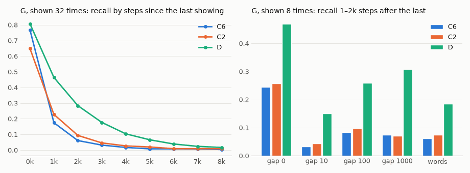

# 00021: What Keeps a Fact: Spacing, Learning Rate, Wordings

**Date:** 2026-11-04
**Status:** Complete
**Source:** `exp/00021` (code: `llm-fundamentals/dev/facts/`)
**Outputs:** `~/data/research/llm-fundamentals/exp_00021/`
**Task plan:** [`../tasks/00008-fact-spacing-lr-wording.md`](../tasks/00008-fact-spacing-lr-wording.md)

## Goal

00020 found that every size forgets a fact within a few thousand steps of its last showing, at a constant learning rate of 6e-4, and that facts are recalled only in their training wording. The owner asked what makes a fact stay. This tests the three answers the literature gives:
- showings spread out against bunched together;
- a decaying learning rate against a constant one;
- several wordings against one.

The design and the readings set before the results are in the task plan.

## Method

- **The stream:** 00020's, unchanged (base, stream, test and reverse facts), plus one new fact a step (`--plus 1`), each shown 8 times:

  | Condition | Showings | Wording |
  |---|---|---|
  | gap 0 | all 8 in the same step | one |
  | gap 10 | 10 steps apart | one |
  | gap 100 | 100 steps apart | one |
  | gap 1000 | 1,000 steps apart | one |
  | words | 100 steps apart | four in turn: "{name} was born in", "The birthplace of {name} is", "{name} is a native of", "{name}'s home town is" |

  The held-out probe for the words condition is 00020's paraphrase, "Where was {name} born? In", never trained.
- **Arms:** C6 (6e-4 constant, 00020's), C2 (2e-4 constant), D (6e-4 falling to 6e-5 along a cosine after the 500-step warmup).
- **Sizes:** L (10.6M non-embedding parameters) and G (85M), two seeds, 20,000 steps; seed 1 on the 4090, seed 2 on the 3090.
- **Checks before the start:**
  - With `--plus 0` the facts and their showings are 00020's, fact for fact (`meta.json` equal to 00020's S run). With `--plus 1` the old facts are unchanged and the new ones come after them.
  - A 2,400-step stub run logged every showing: all 2,400 new facts were shown exactly as scheduled, the words facts in the four wordings in turn. The cosine schedule logged 6.0e-4 at step 500, 3.1e-4 at 1,500 and 6.4e-5 at 2,300.
  - 2,000-step runs with the new facts: G peaks at 5.6 GB and 9.5 steps/s alone, L at 2.3 GB and 12 steps/s.
- **Run notes:** first started at 14:45 on 2026-11-04 and stopped 23 minutes in, at the owner's request, so that vm-00084 runs first; the partial outputs are in `stopped_1445/`. The 12 runs were then deferred by the owner, to run later.
- **A hint from 00020's data:** recall 1–2k steps after the last of 32 showings was .280 for facts shown 200 steps apart and .135 at 20 steps apart in G (L .129 against .083, M .036 against .061). The facts spread wider arrived earlier in the run, so this is not a clean test.
- **Run notes:** the 12 runs started 2026-11-11 22:15 with the owner's go-ahead, six on each card (seed 1 on the 4090, seed 2 on the 3090, in three lanes per card). The MPS daemon was started at 23:11 for vm-00086/87, so the later runs of each lane ran under it. Seed 1 ended at 01:08, seed 2 at 03:18. All 12 reached 20,000 steps; no errors.

## Results

Both seeds pooled. Intervals are 95%, by bootstrap over facts. Chance for one probe is .004 (the paraphrase), and .031 for the reverse.

### R1. Final validation loss and facts held at the end

| Size | C6 | C2 | D |
|---|---|---|---|
| L, val loss | 1.581 | 1.577 | 1.451 |
| G, val loss | 1.388 | 1.373 | 1.242 |
| L, stream facts recalled at the end | 1,035 | 658 | 927 |
| G, stream facts recalled at the end | 1,874 | 1,942 | 3,006 |

### R2. Forgetting, stream facts shown 32 times: recall by thousands of steps since the last showing

| Size, arm | 0–1k | 1–2k | 2–3k | 3–4k | 4–5k | Kept at 1–2k, share of 0–1k |
|---|---|---|---|---|---|---|
| L, C6 | .534 | .087 | .032 | .016 | .009 | .16 |
| L, C2 | .225 | .088 | .037 | .018 | .015 | .39 |
| L, D | .539 | .296 | .157 | .086 | .056 | .55 |
| G, C6 | .768 | .175 | .061 | .032 | .017 | .23 |
| G, C2 | .649 | .228 | .094 | .046 | .027 | .35 |
| G, D | .807 | .464 | .284 | .177 | .104 | .57 |

### R3. Spacing and wordings: the new facts, 8 showings each, exact probe, recall by thousands of steps since the last showing

| Size, arm | Condition | 0–1k | 1–2k | 2–4k | 4–8k | Ever recalled |
|---|---|---|---|---|---|---|
| G, C6 | gap 0 | .660 | .244 | .048 | .009 | .811 |
| G, C6 | gap 10 | .298 | .033 | .012 | .006 | .613 |
| G, C6 | gap 100 | .444 | .084 | .023 | .009 | .856 |
| G, C6 | gap 1000 | .344 | .074 | .024 | .010 | .793 |
| G, C6 | words | .338 | .062 | .017 | .007 | .761 |
| G, C2 | gap 0 | .569 | .257 | .070 | .014 | .702 |
| G, C2 | gap 10 | .284 | .044 | .017 | .009 | .559 |
| G, C2 | gap 100 | .378 | .098 | .032 | .010 | .717 |
| G, C2 | gap 1000 | .251 | .071 | .024 | .013 | .636 |
| G, C2 | words | .303 | .075 | .022 | .007 | .627 |
| G, D | gap 0 | .713 | .469 | .264 | .075 | .812 |
| G, D | gap 10 | .446 | .150 | .060 | .019 | .720 |
| G, D | gap 100 | .577 | .259 | .116 | .033 | .860 |
| G, D | gap 1000 | .569 | .308 | .151 | .040 | .858 |
| G, D | words | .438 | .185 | .085 | .026 | .743 |
| L, C6 | gap 0 | .312 | .029 | .011 | .005 | .547 |
| L, C6 | gap 10 | .210 | .019 | .010 | .005 | .467 |
| L, C6 | gap 100 | .253 | .031 | .010 | .006 | .660 |
| L, C6 | gap 1000 | .051 | .015 | .009 | .008 | .332 |
| L, C6 | words | .154 | .023 | .010 | .005 | .482 |

Gap 100 minus gap 0, exact, 1–4k (per-fact means):

| Size | C6 | C2 | D |
|---|---|---|---|
| L | −.003 [−.007, .001] | −.000 [−.003, .002] | +.001 [−.006, .007] |
| G | −.048 [−.056, −.040] | −.073 [−.082, −.065] | −.162 [−.177, −.146] |

Each seed's mean over 1–4k in G under C6: gap 0 .115 and .119, gap 10 .019 and .020, gap 100 .045 and .044, gap 1000 .038 and .046, words .033 and .033.

The paraphrase ("Where was {name} born? In", never trained), G under C6: recall at 0–1k is .023 (gap 0), .012 (gap 10), .017 (gap 100), .010 (gap 1000) and .015 (words). The ever-recalled shares are .090 to .135 in every condition; across the many probes of a run, chance hits add up. Words minus gap 100, ever recalled on the paraphrase: −.004 [−.017, .011] (G, C6) and −.010 [−.024, .003] (L, C6).

### R4. As in 00020

- **Savings:** a forgotten fact is relearned in 0.44 to 0.57 of a fresh fact's showings, in every size and arm.
- **The reverse:** near chance everywhere: .000 to .016 in G, .047 to .078 in L, against .031.
- **Base facts:** recall peaks at step 4,000, when their showings end, in every arm (G: C6 .665, C2 .110, D .679), and is near chance by step 6,000.

## Readings

1. **Plumbing: met.** Checked before the start: the stub run's schedule (every new fact shown 8 times at its gap; the words facts in the four wordings in turn), the logged learning rate, and `--plus 0` equal to 00020's stream. All 12 runs reached 20,000 steps.
2. **Spacing helps: not met. The opposite holds in G.** Under C6, recall 1–4k steps after the last showing is .048 lower at gap 100 than at gap 0 [−.056, −.040], in both seeds. The same is true under C2 and D. In L there is no difference.
3. **A lower rate forgets slower: met.** The share kept at 1–2k is .39 against .16 in L and .35 against .23 in G. But L under C2 learns much less (.225 at 0–1k against .534), and keeps the same absolute recall at 1–2k (.088 against .087).
4. **Decay consolidates: met in G only, so not met.** D holds 3,006 stream facts at the end against C6's 1,874 in G, but 927 against 1,035 in L.
5. **Wordings let a fact be asked another way: not met.** Words minus gap 100, ever recalled on the held-out paraphrase: −.004 [−.017, .011] in G under C6. Words' share (.113) is above 5 times chance, but so is every condition's (.090 to .135), and its recall at 0–1k on the paraphrase (.015) is the same as the one-wording facts'.

<!-- figures -->
## Figures

*G, both seeds pooled. Left: stream facts shown 32 times, recall by thousands of steps since their last showing. Right: the new facts, shown 8 times, recall on the exact probe 1–2k steps after their last showing.*
<!-- /figures -->

## Analysis

- **Massed beats spaced in G, at every learning rate.**
  - Eight copies of a fact in one step are kept longer than eight copies spread over 70, 700 or 7,000 steps. This is the reverse of the human spacing effect.
  - **The worst is gap 10.** At 1–2k it recalls a seventh as much as gap 0 under C6 (.033 against .244), and less than gap 100 and gap 1000.
  - **A likely reason, not tested here: Adam.** Its second moment, with β₂ .999 and a memory of about 1,000 steps, scales each parameter's step by its recent gradients.
    - Eight copies in one step give one large step, against a second moment that has not yet seen them.
    - Copies 10 steps apart arrive while the earlier ones still inflate it, so each later step is smaller.
    - Copies 100 or 1,000 apart lie partly outside that memory.
  - Spacing does help how many facts are ever recalled (G, C6: .856 at gap 100 against .811 at gap 0). It does not help how long they last after the last showing.
- **Decay slows forgetting, but mostly through the late, low rate.**
  - Under D, the n = 32 facts keep .57 of their recall at 1–2k, against .23 under C6, and in G D holds 60% more facts at the end.
  - Its rate falls along the run. Facts whose last showing came late were followed by small steps, so the effect mixes consolidation with a slower stream of later updates.
  - **This also confounds spacing under D:** gap-1000 facts end later in the run than gap-0 facts, which is why gap 1000 beats gap 100 there.
  - In L, D holds fewer facts at the end than C6. Its late rate learns the newest facts too slowly to make up for keeping the older ones.
  - D also lowers the validation loss most (G 1.24 against 1.39), as a cosine schedule is expected to.
- **A lower constant rate trades learning for keeping.** C2 forgets more slowly as a share, but in L it learns too little for that to pay. In G it about breaks even: more facts at the end (1,942 against 1,874), and .228 against .175 at 1–2k for the n = 32 facts.
- **Four wordings do not make a fact answerable in a fifth.**
  - The held-out paraphrase stays barely above chance (.010 to .023 at 0–1k, against .004), the same for every condition, as in 00020.
  - It costs the trained wording, which got 2 of the 8 showings: .338 at 0–1k against .444 for gap 100.
- **Savings are the same in every arm,** about half a fresh fact's showings. Neither the rate nor the schedule changes the trace a forgotten fact leaves.

## Conclusions

1. **In a transformer trained with Adam, spacing does not help a fact last.** In G, massed showings in one step are kept longest after the last showing, and showings 10 steps apart are kept worst, at every learning rate.
2. **A lower or decaying learning rate slows forgetting, as a share of what was learned.** Only the decaying rate in the larger model also holds more facts at the end: 3,006 against 1,874.
3. **Several training wordings do not give recall in a new one.** Facts stay tied to the wordings they were trained in.

## Next steps

- **Test the Adam explanation for the gap effect:** the same spacing with SGD with momentum, or with Adam at β₂ .99 or .9999. If Adam is the cause, the dip at gap 10 should move with β₂.
- **Separate consolidation from the late rate under D:** probe at fixed points of the schedule, with facts whose last showing falls at the same step in C6 and D.
- **Wordings:** ask whether a fact is stored once or per wording. Train the four wordings and test each held-out pair, and the paraphrase's probability rather than its top-1 hit.
