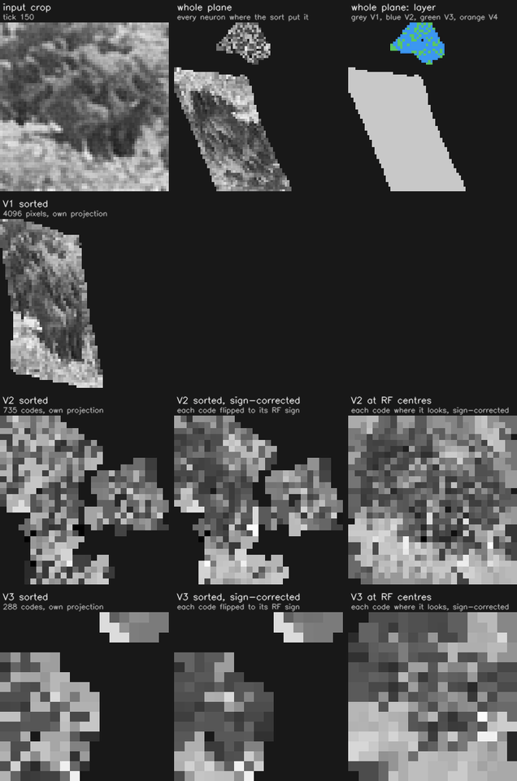
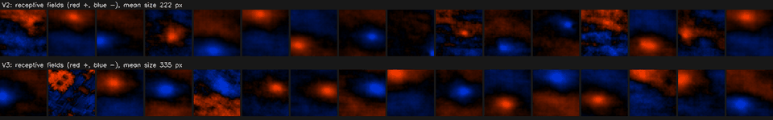
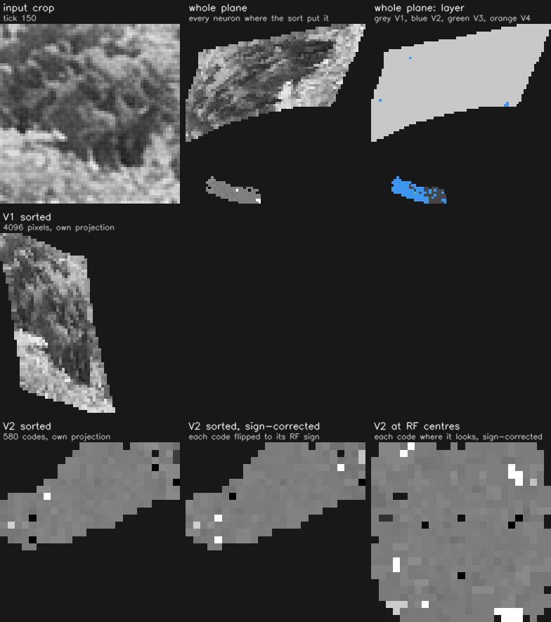
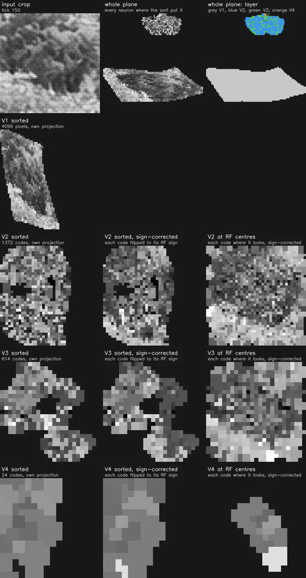
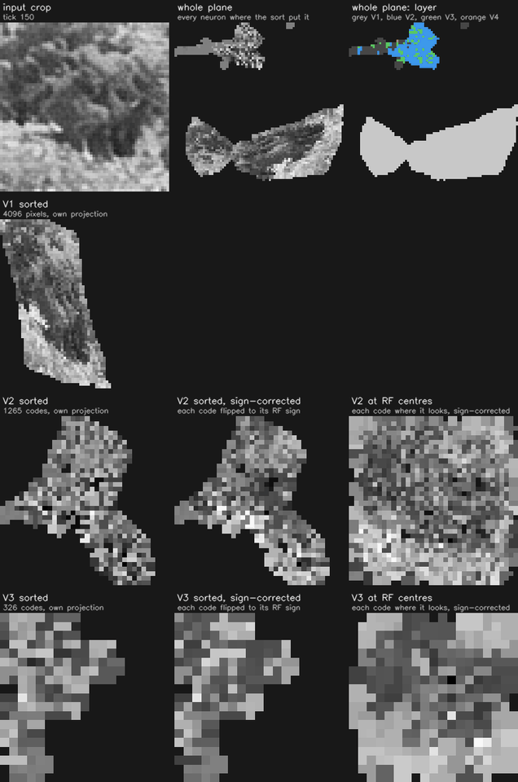
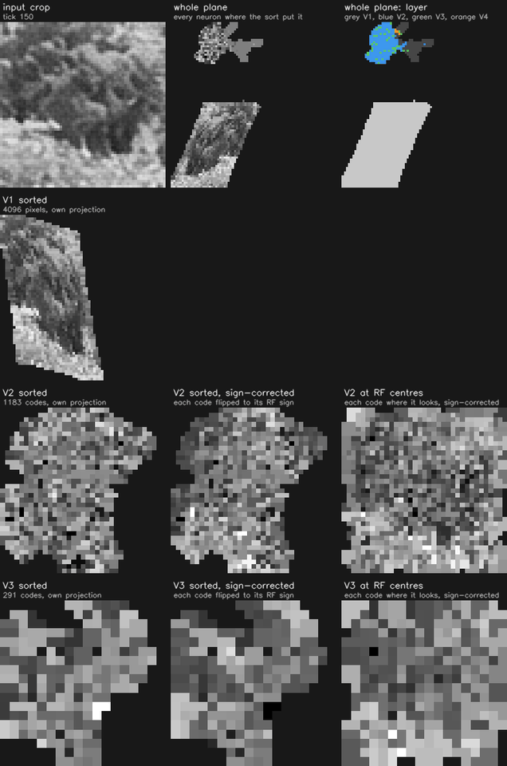
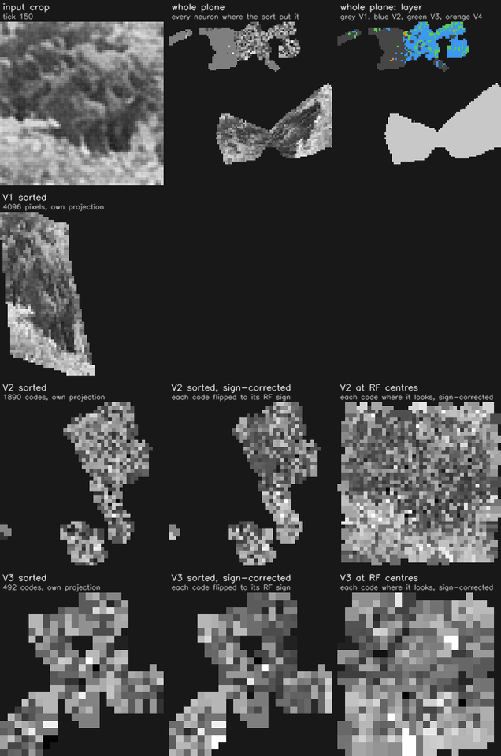
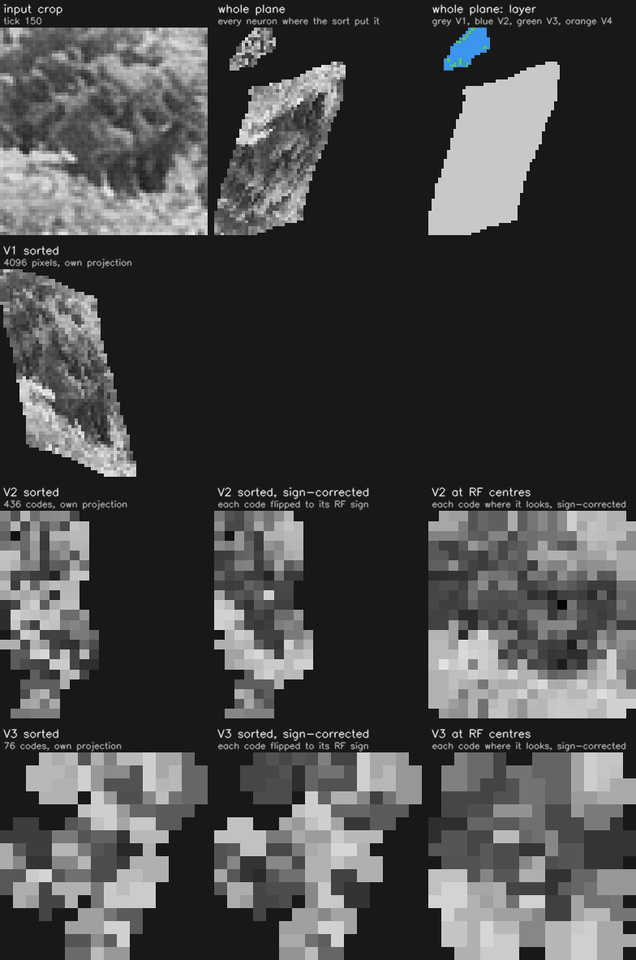
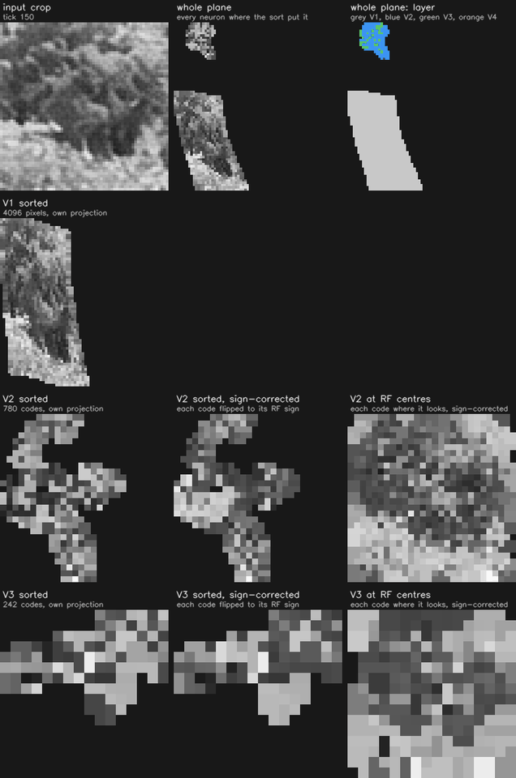

# ts-00028: Bottleneck Codes on the Plane

**Date:** 2026-11-14
**Status:** Complete
**Source:** `exp/ts-00028` (`c201d58`)
**Outputs:** `~/data/research/thalamus-sorter/exp_00028/`
**Task plan:** [`../tasks/00002-fsq-codes-on-the-plane.md`](../tasks/00002-fsq-codes-on-the-plane.md)
**Depends on:** ts-00021 (feedback neurons), ts-00023 (layers by BFS on the feedback graph)

## Goal

Every window of the sorted map gets a small model with a finite scalar quantization (FSQ) bottleneck, trained to predict its inputs two ticks ahead. Its 4 code numbers are fed back one tick late as neurons of their own and sorted together with the pixels. Rendered on a plane, what do the layers show? V1 is the image. Are V2, V3, … smaller copies of it, several interleaved copies (one per code number), or something else?

## Answer

**Something else.**
- **The codes form an area of their own,** apart from the pixels.
- **On that area, V2 and V3 are folded sheets of spot detectors.** Each code responds to a bright or dark blob of about 15 px, usually with an opposite-sign flank.
- **The sheets are roughly topographic:** codes placed near each other look at nearby parts of the crop. They are not laid out as a picture, though, and how topographic they are varies a lot from run to run (below).
- **The picture is in the codes, not in their layout.** Drawn where each code looks, V2 is a blurred copy of the scene (0.51), and V3 is blurrier (0.45).
- **No interleaved copies:** codes carrying the same one of the 4 numbers do not group together.
- **Learning is what makes the layers.** With encoders frozen at their random start, 42% of the codes are silent and only one weak layer forms above V1.
- **The bottleneck's width trades the number of codes against their sharpness.**
  - With 2 numbers per window (F2), every code is used, and V2 drawn at its field centres is the clearest copy of the scene (0.68). But there are only 436 V2 codes and 76 V3.
  - With 4 (F), nearly every code is used (copy 0.49–0.51).
  - A wider bottleneck does not help, even with the window's model scaled to match. With 8 numbers (F8), 22% of the codes go silent (28% after twice the training); with 16 (F16), 42%. The live codes get blurrier with each doubling.
- **What the codes carry repeats from run to run; the layout does not.** A second run of F matches the first in live codes, level use and the copy at field centres (0.49 against 0.51), but not in topography (V2 0.22 against 0.33, V3 0.24 against 0.44). Differences in topography of 0.1–0.2 between single runs are noise.

## Method

- **Input:** a 64 × 64 grayscale crop drifting smoothly over `garden.png` (2 px per tick, velocity kept with probability 0.95, new `--saccade-momentum`), so 4,096 pixel neurons.
- **Sorter:** plain Pearson correlation of the signals, threshold 0.5, absolute value (`--no-use-deriv-corr`). The derivative rule of the existing presets does not sort under smooth drift (0.6% of neighbours within 3 px, against 98.8% for the plain rule at 30k ticks; the motion checks are in the task plan).
- **Columns (`--column-type fsq`, new `FSQColumn` in `column_manager.py`):**
  - Each window (ring wiring, `--cluster-max-k 2`, max 48 inputs) reads its wired neurons over the last 4 ticks.
  - A gelu MLP encodes them to 4 numbers at levels (8, 5, 5, 5), with a straight-through gradient. A decoder from those numbers alone predicts the inputs 2 ticks after the newest one.
  - Each window has its own weights (Adam, lr 0.001) and gets no gradient through the fed-back codes.
  - The 4 codes are written back one tick late (`--column-feedback`) as neurons sorted like the pixels.
- **Runs (100k ticks each, all on the 4090, 2 at a time; 15–18 min per pair):**

| Run | What changes | Why |
|---|---|---|
| F | the design above, 256 windows (`--cluster-neurons-per 20`) | the main run |
| F0 | encoders frozen at their random start (`--column-lr 0`) | does the picture come from learning or from the wiring? |
| FP | positive correlations only (new `--corr-sign pos`) | the predicted split by the arbitrary sign of a code |
| F512 | 512 windows (`--cluster-neurons-per 12`) | does depth grow with the number of windows? |
| F8 | 8 code numbers per window (levels 8,5,5,5 twice; `--cluster-neurons-per 24` keeps 256 windows) | does a wider bottleneck help? (added after the first write-up, at the owner's request; no readings were set for it) |
| F16 | 16 code numbers per window, the window's model scaled to keep F's proportions (32 neurons per window, input cap 80, hidden width 256, 320 sort candidates) | does a wider bottleneck help when the model grows with it? (the owner's request; no readings set) |
| F2 | 2 code numbers per window (levels 8,5; `--cluster-neurons-per 18` keeps 256 windows), otherwise F | is every code of a narrower bottleneck used? (2026-11-15, with the owner's OK; no readings set) |
| F, second run | F's command again | how much single-run measures vary: numpy's draws are not seeded, so the eye's path and the sort differ, while the windows' models start from the same weights |

- **Rendering (`dev/render_layers.py`, new):**
  - Each run's final state is replayed for 4,000 ticks with learning off. The eye restarts at a random place every 100 ticks, so receptive fields are local.
  - **Layers** are assigned by BFS on the wiring: a column is depth 1 if any input is a pixel, and depth d + 1 if any input is a live code of a depth-d column. Pixels are V1; a depth-d column's codes are V(d + 1).
  - **A live code** changes during the replay and correlates with some pixel at 0.05 or more. Silent codes are left out of the layers and the field sizes; the counts over all wiring are kept in `measures.json`.
  - **Receptive field:** each code's correlation with each pixel. Size is the area above half the peak.
  - **Views per layer:**
    - *sorted:* the layer's own 2-D projection, rotated or flipped onto its fields' centres. This is what the plane shows.
    - *at RF centres:* each code drawn where in the crop it looks. This is what the codes carry.
    - Both views are sign-corrected and correlated with the crop shrunk to the layer's grid.
  - **Topography:** Spearman correlation between pairwise distances on the plane and between field centres. Shuffled codes give about 0.
- **Reproduce:** `make runs` (F and F0 on GPU 1, FP and F512 on `GPU_B`, default GPU 0), then `make render`; `make f8` and `make f16` run and render F8 and F16 on GPU 1, and `make checks` runs and renders F2 and F's second run there together. `make test` runs `dev/test_fsq_column.py` (7 tests).

## Results

### What the plane shows

- **Top row (F):**
  - the input crop;
  - every neuron where the sort put it;
  - the same coloured by layer (grey V1, blue V2, green V3).
- **The pixels form one sheet that shows the scene (V1).** The codes form a separate island above it.
  - V2 and V3 are mixed together within that island rather than forming two areas.
  - None of a code's 10 nearest neighbours are pixels.
- **V2 sorted is a branching, folded sheet.** Patches of it are coherent, but it is not a picture of the crop.
- **V2 at RF centres is the scene, blurred.** V3 is blurrier still.

Most fields are a single spot with an opposite-sign region beside it, like centre-surround or edge cells. A few V2 codes respond to a texture across the whole crop.

The four code numbers are mixed throughout. No sub-map per number forms.

### Per run

| Run | V1 within 3 px | Live codes | V2 / V3 / V4 codes | Column depths (live) | V2 topography | V3 topography |
|---|---|---|---|---|---|---|
| F | 98.8% | 99.9% | 735 / 288 / 0 | 184, 72 | 0.33 | 0.44 |
| F, second run | 98.3% | 99.8% | 780 / 242 / 0 | 195, 61 | 0.22 | 0.24 |
| F0 | 99.5% | 57.6% | 580 / 10 / 0 | 151, 10 | 0.23 | 0.13 |
| FP | 99.7% | 99.6% | 712 / 308 / 0 | 178, 78 | 0.20 | 0.21 |
| F512 | 99.0% | 98.1% | 1372 / 614 / 24 | 343, 158, 7 | 0.43 | 0.46 |

| Run | V2 sorted vs crop | V2 at RF centres vs crop | V3 at RF centres vs crop | RF size V2 / V3 (px) | Same-number neighbours (chance 0.25) | Same-sign neighbours (chance 0.50) |
|---|---|---|---|---|---|---|
| F | 0.12 | 0.51 | 0.45 | 222 / 335 | 0.24 | 0.50 |
| F, second run | 0.10 | 0.49 | 0.41 | 213 / 434 | 0.26 | 0.49 |
| F0 | 0.02 | 0.16 | not measured | 318 / 894 | 0.27 | 0.59 |
| FP | 0.01 | 0.49 | 0.39 | 223 / 471 | 0.26 | 0.75 |
| F512 | 0.16 | 0.46 | 0.39 | 246 / 449 | 0.27 | 0.49 |

- **Same-number and same-sign neighbours** are counted among each code's 8 nearest codes.
- **V3's windows read only codes:** they have no pixel inputs. V2's windows read almost only pixels (99%).
  - So the stack is a real hierarchy: V3 is built from V2.
- **The sorted-view measure is harsh.** V1 itself, which plainly shows the image, scores only 0.25–0.29 on it, because the sheet is sheared and the alignment only rotates and flips. V2's 0.12 (F) and 0.16 (F512) are therefore about half of V1's score, not nothing.
- **F's second run** (`010_F_rerun`, 2026-11-15) shows how much a single run says.
  - What the codes carry repeats closely: live codes, level use, the copy at field centres (0.49 against 0.51), the sorted view (0.10 against 0.12), field size and peak.
  - The layout does not: V2 topography 0.22 against 0.33, V3 0.24 against 0.44.
  - So single-run differences in topography of 0.1–0.2, such as F0's 0.23 or FP's 0.20, are within F's own spread.

### Prediction (training log at tick 100k)

| Run | Loss | No-information baseline (slot long-run mean) | Copy-last | Columns with every number at 3+ levels |
|---|---|---|---|---|
| F | 0.158 | 0.253 | 0.208 | 87.9% |
| F, second run | 0.127 | 0.181 | 0.149 | 90.2% |
| F0 | 0.0148 | 0.0145 | 0.0136 | 0% |
| FP | 0.161 | 0.233 | 0.177 | 91.0% |
| F512 | 0.142 | 0.199 | 0.184 | 85.5% |

- **The learned columns predict well.** They beat the no-information baseline throughout. They also beat copy-last at every report after 43k ticks in F, and at 46 of those 57 reports in F's second run (copy-last sees all 48 inputs, the decoder only 4 numbers).
- **F0's codes barely move:** about 1.2 levels in three of its four numbers. It predicts no better than the baseline.
- **The losses rise over the run in every learned run,** together with the baseline. The fed-back codes become inputs to other windows and are harder to predict than pixels, so the inputs get harder as the codes come alive.
- **Levels in training versus replay:** the training count is over 1,000 ticks of smooth drift. Over the replay's 4,000 ticks with restarts, 95–99% of columns in the learned runs use 3+ levels in every number.

### F0 and F512

**F0:** V2 is a flat grey sheet with a few specks; V3 has 10 codes. With the old count, where silent codes still passed depth on, F0 seemed to have V4 and V5. That count was an artefact: silent codes correlate with nothing and are wired almost at random.

**F512:**
- **Its V2 is the most map-like:** a 2-D ring-shaped sheet with topography 0.43, and its sorted view starts to carry the scene (0.16). This is one run; F's two runs give 0.22 and 0.33.
- **It is the only one of the four runs with a third column depth,** but only 7 live columns there and 24 weak V4 codes (field peak 0.12).

### F8: a wider bottleneck (8 numbers per window)

Run after the four above (2026-11-14, 4090, single seed), then again for 200k ticks from the start (`007_F8_200k`, `make f8 F8_TICKS=200000 F8_NAME=007_F8_200k`). Everything matches F except the bottleneck: 8 numbers instead of 4, so 1,000,000 states per window instead of 1,000. The windows stay at 256, and the code neurons double to 2,048.

| Measure | F (4 numbers) | F8 (8 numbers) | F8, 200k ticks |
|---|---|---|---|
| V1 within 3 px | 98.8% | 96.0% | 99.4% |
| Live codes | 99.9% | 78.2% (447 of 2,048 silent) | 72.4% (566 silent) |
| Columns using 3+ levels in every number (replay / training at 100k) | 99% / 88% | 59% / 52% | 50% / 45% (at 200k) |
| V2 codes: topography / sorted vs crop / at RF centres | 735: 0.33 / 0.12 / 0.51 | 1,265: 0.36 / 0.14 / 0.39 | 1,183: 0.39 / 0.12 / 0.36 |
| V3 codes: topography / at RF centres | 288: 0.44 / 0.45 | 326: 0.30 / 0.37 | 291: 0.39 / 0.37 |
| V4 | none | 10 weak codes (field peak 0.10) | 8 weak codes (field peak 0.16) |
| Column depths (live) | 184, 72 | 161, 58, 2 | 155, 56, 1 |
| Field size V2 / V3 | 222 / 335 px | 239 / 525 px | 213 / 405 px |
| Same-number neighbours (chance) | 0.24 (0.25) | 0.14 (0.125) | 0.13 (0.125) |
| Loss / no-information baseline / copy-last at the end | 0.158 / 0.253 / 0.208 | 0.087 / 0.122 / 0.092 | 0.106 / 0.141 / 0.142 |

- **The wider bottleneck does not help.** Much of the extra capacity goes unused.
  - The numbers visit fewer of their levels than in F (about 4 of 5 and 6.3 of 8 in the replay).
  - 22% of the codes never become live. They are the dark grey strip beside the code area in the whole-plane view.
- **The live codes are blurrier.** More V2 fields are scattered texture rather than clean spots, and V2 at its field centres matches the scene less well (0.39 against 0.51).
- **The layout is the same kind:** a folded, topographic sheet, not a picture, with no sub-map per number. A third column depth appears, but with 2 columns.
- **The losses are not comparable across the two runs,** because with twice the code neurons the windows read a different mix of inputs.
  - Against its own baselines F8 does less well: 0.71 of the no-information baseline (F 0.62) and 0.94 of copy-last (F 0.76).
- **Twice the training does not revive the codes** (200k ticks):
  - More codes go silent (28%). They now form an island of their own beside the code area.
  - Level use is flat from 100k to 200k: about 5 of 8 and 3.5 of 5 levels in training, and about 45% of columns with 3+ levels in every number.
  - The loss stays at 0.63–0.75 of the no-information baseline at 50k, 100k, 150k and 200k.
  - V2 at field centres stays below F's (0.36). The layout is the same folded sheet, with topography 0.39.
- **The two F8 runs differ at 100k even with the same seed** (45% against 52% of columns with 3+ levels in training; V1 96.0% at 100k in one, 99.4% at 200k in the other). The GPU runs are not bit-for-bit repeatable, so small differences between single runs here mean little.
- **Likely reading** (F8 twice, F once): with 48 inputs over 4 ticks, a window has only about 4 numbers' worth of predictable structure. The extra numbers go silent or duplicate each other.

### F16: 16 numbers per window, the model scaled with them

Run at the owner's request on 2026-11-14 (23:00–23:20, 4090, one run, `008_F16`, `make f16`). The owner asked for the model to grow with the bottleneck. So, unlike F8, every part of the window keeps F's proportions:

| Part | F | F8 | F16 | Rule |
|---|---|---|---|---|
| Numbers per window | 4 | 8 | 16 | levels 8,5,5,5 repeated |
| Neurons per window | 20 | 24 | 32 | keeps 256 windows |
| Input cap per window | 48 | 48 | 80 | 1.6 times the inputs available, like the window |
| Hidden width of encoder and decoder | 64 | 64 | 256 | 16 per number |
| Candidates per neuron in the sort (`--k-sample`) | 200 | 200 | 320 | 3.9% of the neurons (8,192 instead of 5,120) |

With 16 numbers per window, there are as many code neurons as pixels (4,096).

| Measure | F | F8 | F16 |
|---|---|---|---|
| V1 within 3 px | 98.8% | 96.0% | 99.0% |
| Live codes | 99.9% | 78.2% | 58.4% (1,705 of 4,096 silent) |
| Windows without a live code | 0 | 35 | 65 |
| Columns using 3+ levels in every number (replay / training at 100k) | 99% / 88% | 59% / 52% | 32% / 20% |
| V2 codes: topography / sorted vs crop / at RF centres | 735: 0.33 / 0.12 / 0.51 | 1,265: 0.36 / 0.14 / 0.39 | 1,890: 0.51 / 0.10 / 0.31 |
| V3 codes: topography / at RF centres | 288: 0.44 / 0.45 | 326: 0.30 / 0.37 | 492: 0.46 / 0.27 |
| V4 | none | 10 weak codes | 9 weak codes (field peak 0.25) |
| Column depths (live) | 184, 72 | 161, 58, 2 | 124, 65, 2 |
| V2 field size / peak | 222 px / 0.55 | 239 px / 0.45 | 278 px / 0.38 |
| Same-number neighbours (chance) | 0.24 (0.25) | 0.14 (0.125) | 0.07 (0.06) |
| Loss against copy-last / no-information baseline (mean of the last 10 reports) | 0.80 / 0.62 | 1.03 / 0.66 | 1.04 / 0.72 |

- **Scaling the model with the bottleneck does not rescue it.** F8's pattern continues:
  - 42% of the codes never become live, and 65 of the 256 windows have no live code at all. They are the dark grey part of the code area on the layer map.
  - Only a third of the columns use 3+ levels in every number.
  - The live codes are weaker (V2 field peak 0.38 against F's 0.55), and V2 drawn at its field centres is fainter (0.31 against 0.51).
  - Prediction is no better than copying the last input, as in F8. F's is 20% better.
- **V2's layout is the most topographic of any run** (0.51; F512 0.43, F's two runs 0.22 and 0.33), but this is one run, and it is still not a picture (sorted view 0.10). More V2 codes may give the sorter more overlapping evidence, as in F512; not tested.
- **V1 sorts as well (99.0% within 3 px) but twists into a bow-tie.** Its topography is 0.42 against F's 0.62: right locally, folded as a whole.
- **No new depth:** still two levels of columns, plus 2 columns at depth 3 and 9 weak V4 codes.
- **Caveat:** F16 differs from F8 in four settings (by design), so the step from F8 to F16 is not the bottleneck alone; F16 against F keeps every proportion. One run of each.
- **F, F8 and F16 together:** each doubling of the bottleneck silences a larger share of codes (0.1%, 22%, 42%) and fades the copy at field centres (0.51, 0.39, 0.31). The number of live codes still grows (1,023, 1,601, 2,391), but each carries less. This fits the reading above, presumed and not tested: a window has about 4 numbers' worth of predictable structure, and a larger model around the bottleneck does not create more.

### F2: a narrower bottleneck (2 numbers per window)

Run on 2026-11-15 (23:28–23:46, beside F's second run on the 4090, `009_F2`, `make checks`). Only the numbers change, as in F8: 2 numbers at levels (8, 5), the first two of F's. `--cluster-neurons-per 18` keeps 256 windows, and the input cap, hidden width and sort candidates are F's.

| Measure | F2 (2 numbers) | F (4), two runs | F8 (8) | F16 (16, scaled) |
|---|---|---|---|---|
| Live codes | 100% of 512 | 99.9%, 99.8% of 1,024 | 78% of 2,048 | 58% of 4,096 |
| Columns using 3+ levels in every number (replay) | 100% | 99%, 99% | 59% | 32% |
| V2 / V3 codes | 436 / 76 | 735 / 288, 780 / 242 | 1,265 / 326 | 1,890 / 492 |
| Column depths (live) | 218, 38 | 184, 72; 195, 61 | 161, 58, 2 | 124, 65, 2 |
| V2 at RF centres vs crop | 0.68 | 0.51, 0.49 | 0.39 | 0.31 |
| V3 at RF centres vs crop | 0.51 | 0.45, 0.41 | 0.37 | 0.27 |
| V2 field peak / size | 0.71 / 187 px | 0.55 / 222 px, 0.54 / 213 px | 0.45 / 239 px | 0.38 / 278 px |
| V2 topography / sorted vs crop | 0.39 / 0.11 | 0.33 / 0.12, 0.22 / 0.10 | 0.36 / 0.14 | 0.51 / 0.10 |
| Loss against the no-information baseline (mean of the last 10 reports) | 0.65 | 0.62, 0.64 | 0.66 | 0.72 |
| Same-number neighbours (chance) | 0.49 (0.5) | 0.24, 0.26 (0.25) | 0.14 (0.125) | 0.07 (0.06) |

- **Both numbers are fully used.** Every code is live, and every column uses all 8 and all 5 levels in the replay (and 3+ levels in both numbers in training). Prediction against the no-information baseline is as good as F's (0.65 against 0.62 and 0.64).
- **The codes are the sharpest of any run.** V2 fields peak at 0.71 and cover 187 px. V2 drawn at its field centres is the clearest copy of the scene: 0.68 against F's 0.49–0.51, well outside F's run-to-run spread.
- **The cost is fewer codes:** 436 in V2 and 76 in V3, with 38 depth-2 windows against F's 61–72. No V4.
- **No sub-maps:** same-number neighbours 0.49, at chance 0.5.
- **The series from 2 to 16 numbers:** fewer numbers per window make fewer, sharper codes. Up to 4 numbers every code is used; beyond 4 the extra numbers go silent. So the reading above becomes: a window fully uses 2 or 4 numbers, and its codes are sharper the fewer there are.

*F's second run, for comparison with F's plane at the top: the same kind of picture, with a differently folded V2.*

## The readings (set in the task plan before the runs)

| Reading | Result |
|---|---|
| 1 Plumbing: 100k ticks; 90% of columns use 3+ levels in every number; loss below the slot-mean baseline | **Narrow miss for F:** 87.9% at tick 100k (98% at 50k, 99% in the replay); the loss bar is met. FP passes at 91.0%; F512 is at 85.5%. F's second run passes at 90.2%, so the miss is within run-to-run noise. |
| 2 V1 is the image: K10 within 3 px at least 90% | **Met** in every run (96.0–99.7%). |
| 3 Layers: 3 or more depths with 10 or more columns each | **Fails.** F and FP have 2 depths. F512 reaches depth 3 with 7 live columns. |
| 4 What V2 shows: copy if sorted view above 0.5; sub-maps if same-number neighbours above 0.5 | **"Something else":** sorted 0.12, same-number 0.24. Described above as folded sheets of spot detectors. |
| 5 Fields grow: V2 at least 1.5 times V1 | **Met:** from 1 px to 222 px, and V3 is 1.5 times V2 (335 px). |
| 6 Learning matters: F more topographic than F0, or better at predicting | **Met on prediction:** F's loss beats the baseline and F0's does not; F0 also has 42% silent codes and almost no V3. The topography half does not hold: F's 0.33 against F0's 0.23 looked like a gain, but F's second run scores 0.22. |
| 7 Sign: FP splits codes by sign; F does not | **Met as grouping:** FP's same-sign neighbours 0.75 against F's 0.50 (chance 0.50). Not tested: whether the two groups form two separate mirror maps. FP's topography of 0.20 is within F's own spread (0.22 and 0.33). |

**Changes after the plan was set (stated openly):**
- **Topography** is a Spearman correlation of distances, not the Procrustes disparity in the plan.
- **Reading 4's views** were refined after the 20k pilot: the first alignment collapsed V2 to a point.
- **Silent codes are excluded** from layers and field sizes. That was added after F0 showed dead codes manufacturing depth; it changes nothing in F (one silent code).

## Analysis

- **The codes keep to themselves.** The design discussion worried that codes arriving one tick late under smooth drift would join the pixel map next to their source patch. They don't: no code's 10 nearest neighbours include a pixel. Presumably a code mixes about 20 pixels non-linearly and correlates more with other codes than with any one pixel, even though the rule accepts negative pairs. This was not measured directly.
- **Why there is no picture in the sort:**
  - A V2 code correlates with its own window's other codes, and with codes of overlapping windows, more than with codes far away. That is what gives a topography of 0.2–0.4 (0.22 and 0.33 in two runs of F).
  - Likely, though not measured: the sorter's correlations among codes are also driven by what the codes encode (on or off, spot or flank, brightness level). Four numbers per window, with arbitrary signs and meanings, do not pull into a single smooth sheet as pixels do.
  - The result is a map with folds: locally ordered, globally not a picture.
  - With more windows (F512) the sheet is smoother and more image-like. That suggests the folding is partly a sampling effect: more codes per area give the sorter more overlapping evidence. This rests on one run of F512, whose topography (0.43) is above both runs of F.
- **The sign matters for grouping.** Allowing negative correlations (F) keeps on and off codes mixed. Keeping positive correlations only (FP) groups codes by sign (0.75 same-sign neighbours against 0.50), as the design discussion predicted. FP's lower topography (0.20) is within F's run-to-run spread, so a cost in position is not shown.
- **Fewer numbers, sharper codes.** Each window's numbers seem to share out what its inputs hold. With 2 numbers each one carries a large, clean part of it, so the fields are strong and the copy at field centres is clear. With 8 or 16, the predictable part runs out and the rest go silent or blur. This was not measured directly.
- **Depth stops at two levels of codes.** Depth-2 windows read only V2 codes. For a depth-3 window, a window must be wired mostly to V3 codes, and there are too few (288 in F) for the clustering to give them their own windows. Twice the windows give 7 such columns. Deeper stacks probably need many more windows, or wiring that reserves windows for codes.

## Next

These are not run:
- **More windows** (1,024 or more): does the code sheet become a picture, and does V4 form?
- **A fair random control** whose encoders span the levels (F0's random start barely varies), to separate learned codes from any graded code.
- **Whether FP's two sign groups form two mirror maps** (a topography measured within each group).
- **Several runs per arm** before reading any difference in layout. Topography varies by 0.1–0.2 between two runs of F.
- **F2 with more windows** (512 or 1,024): sharp codes in larger numbers. Does a deeper stack form?
