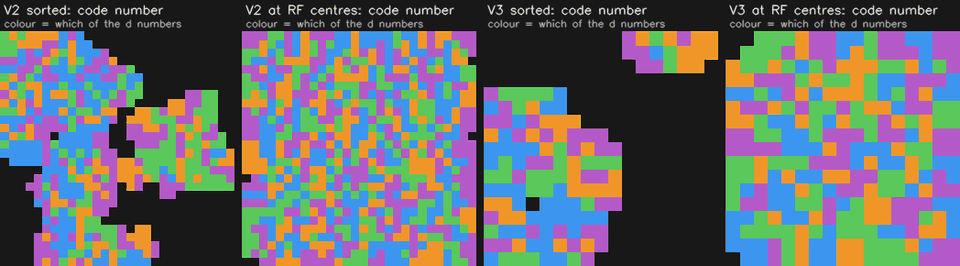

# ts-00028: Bottleneck Codes on the Plane

**Date:** 2026-11-14
**Status:** Complete
**Source:** `exp/ts-00028` (`c201d58`)
**Outputs:** `~/data/research/thalamus-sorter/exp_00028/`
**Task plan:** [`../tasks/00002-fsq-codes-on-the-plane.md`](../tasks/00002-fsq-codes-on-the-plane.md)
**Depends on:** ts-00021 (feedback neurons), ts-00023 (layers by BFS on the feedback graph)

## Goal

Every window of the sorted map gets a small model with a finite scalar quantization (FSQ) bottleneck, trained to predict its inputs two ticks ahead. Its 4 code numbers are fed back one tick late as neurons of their own and sorted together with the pixels. Rendered on a plane, what do the layers show? V1 is the image. Are V2, V3, … smaller copies of it, several interleaved copies (one per code number), or something else?

## Answer

**Something else.**
- **The codes form an area of their own,** apart from the pixels.
- **On that area, V2 and V3 are folded sheets of spot detectors.** Each code responds to a bright or dark blob of about 15 px, usually with an opposite-sign flank.
- **The sheets are roughly topographic:** codes placed near each other look at nearby parts of the crop. They are not laid out as a picture, though.
- **The picture is in the codes, not in their layout.** Drawn where each code looks, V2 is a blurred copy of the scene (0.51), and V3 is blurrier (0.45).
- **No interleaved copies:** codes carrying the same one of the 4 numbers do not group together.
- **Learning is what makes the layers.** With encoders frozen at their random start, 42% of the codes are silent and only one weak layer forms above V1.

## Method

- **Input:** a 64 × 64 grayscale crop drifting smoothly over `garden.png` (2 px per tick, velocity kept with probability 0.95, new `--saccade-momentum`), so 4,096 pixel neurons.
- **Sorter:** plain Pearson correlation of the signals, threshold 0.5, absolute value (`--no-use-deriv-corr`). The derivative rule of the existing presets does not sort under smooth drift (0.6% of neighbours within 3 px, against 98.8% for the plain rule at 30k ticks; the motion checks are in the task plan).
- **Columns (`--column-type fsq`, new `FSQColumn` in `column_manager.py`):**
  - Each window (ring wiring, `--cluster-max-k 2`, max 48 inputs) reads its wired neurons over the last 4 ticks.
  - A gelu MLP encodes them to 4 numbers at levels (8, 5, 5, 5), with a straight-through gradient. A decoder from those numbers alone predicts the inputs 2 ticks after the newest one.
  - Each window has its own weights (Adam, lr 0.001) and gets no gradient through the fed-back codes.
  - The 4 codes are written back one tick late (`--column-feedback`) as neurons sorted like the pixels.
- **Runs (100k ticks each, all on the 4090, 2 at a time; 15–18 min per pair):**

| Run | What changes | Why |
|---|---|---|
| F | the design above, 256 windows (`--cluster-neurons-per 20`) | the main run |
| F0 | encoders frozen at their random start (`--column-lr 0`) | does the picture come from learning or from the wiring? |
| FP | positive correlations only (new `--corr-sign pos`) | the predicted split by the arbitrary sign of a code |
| F512 | 512 windows (`--cluster-neurons-per 12`) | does depth grow with the number of windows? |

- **Rendering (`dev/render_layers.py`, new):**
  - Each run's final state is replayed for 4,000 ticks with learning off. The eye restarts at a random place every 100 ticks, so receptive fields are local.
  - **Layers** are assigned by BFS on the wiring: a column is depth 1 if any input is a pixel, and depth d + 1 if any input is a live code of a depth-d column. Pixels are V1; a depth-d column's codes are V(d + 1).
  - **A live code** changes during the replay and correlates with some pixel at 0.05 or more. Silent codes are left out of the layers and the field sizes; the counts over all wiring are kept in `measures.json`.
  - **Receptive field:** each code's correlation with each pixel. Size is the area above half the peak.
  - **Views per layer:**
    - *sorted:* the layer's own 2-D projection, rotated or flipped onto its fields' centres. This is what the plane shows.
    - *at RF centres:* each code drawn where in the crop it looks. This is what the codes carry.
    - Both views are sign-corrected and correlated with the crop shrunk to the layer's grid.
  - **Topography:** Spearman correlation between pairwise distances on the plane and between field centres. Shuffled codes give about 0.
- **Reproduce:** `make runs` (F and F0 on GPU 1, FP and F512 on `GPU_B`, default GPU 0), then `make render`. `make test` runs `dev/test_fsq_column.py` (7 tests).

## Results

### What the plane shows

- **Top row (F):**
  - the input crop;
  - every neuron where the sort put it;
  - the same coloured by layer (grey V1, blue V2, green V3).
- **The pixels form one sheet that shows the scene (V1).** The codes form a separate island above it.
  - V2 and V3 are mixed together within that island rather than forming two areas.
  - None of a code's 10 nearest neighbours are pixels.
- **V2 sorted is a branching, folded sheet.** Patches of it are coherent, but it is not a picture of the crop.
- **V2 at RF centres is the scene, blurred.** V3 is blurrier still.

Most fields are a single spot with an opposite-sign region beside it, like centre-surround or edge cells. A few V2 codes respond to a texture across the whole crop.

The four code numbers are mixed throughout. No sub-map per number forms.

### Per run

| Run | V1 within 3 px | Live codes | V2 / V3 / V4 codes | Column depths (live) | V2 topography | V3 topography |
|---|---|---|---|---|---|---|
| F | 98.8% | 99.9% | 735 / 288 / 0 | 184, 72 | 0.33 | 0.44 |
| F0 | 99.5% | 57.6% | 580 / 10 / 0 | 151, 10 | 0.23 | 0.13 |
| FP | 99.7% | 99.6% | 712 / 308 / 0 | 178, 78 | 0.20 | 0.21 |
| F512 | 99.0% | 98.1% | 1372 / 614 / 24 | 343, 158, 7 | 0.43 | 0.46 |

| Run | V2 sorted vs crop | V2 at RF centres vs crop | V3 at RF centres vs crop | RF size V2 / V3 (px) | Same-number neighbours (chance 0.25) | Same-sign neighbours (chance 0.50) |
|---|---|---|---|---|---|---|
| F | 0.12 | 0.51 | 0.45 | 222 / 335 | 0.24 | 0.50 |
| F0 | 0.02 | 0.16 | not measured | 318 / 894 | 0.27 | 0.59 |
| FP | 0.01 | 0.49 | 0.39 | 223 / 471 | 0.26 | 0.75 |
| F512 | 0.16 | 0.46 | 0.39 | 246 / 449 | 0.27 | 0.49 |

- **Same-number and same-sign neighbours** are counted among each code's 8 nearest codes.
- **V3's windows read only codes:** they have no pixel inputs. V2's windows read almost only pixels (99%).
  - So the stack is a real hierarchy: V3 is built from V2.
- **The sorted-view measure is harsh.** V1 itself, which plainly shows the image, scores only 0.25–0.29 on it, because the sheet is sheared and the alignment only rotates and flips. V2's 0.12 (F) and 0.16 (F512) are therefore about half of V1's score, not nothing.

### Prediction (training log at tick 100k)

| Run | Loss | No-information baseline (slot long-run mean) | Copy-last | Columns with every number at 3+ levels |
|---|---|---|---|---|
| F | 0.158 | 0.253 | 0.208 | 87.9% |
| F0 | 0.0148 | 0.0145 | 0.0136 | 0% |
| FP | 0.161 | 0.233 | 0.177 | 91.0% |
| F512 | 0.142 | 0.199 | 0.184 | 85.5% |

- **The learned columns predict well.** They beat the no-information baseline throughout, and beat copy-last at every report after 43k ticks (F; copy-last sees all 48 inputs, the decoder only 4 numbers).
- **F0's codes barely move:** about 1.2 levels in three of its four numbers. It predicts no better than the baseline.
- **The losses rise over the run in every learned run,** together with the baseline. The fed-back codes become inputs to other windows and are harder to predict than pixels, so the inputs get harder as the codes come alive.
- **Levels in training versus replay:** the training count is over 1,000 ticks of smooth drift. Over the replay's 4,000 ticks with restarts, 95–99% of columns in the learned runs use 3+ levels in every number.

### F0 and F512

**F0:** V2 is a flat grey sheet with a few specks; V3 has 10 codes. With the old count, where silent codes still passed depth on, F0 seemed to have V4 and V5. That count was an artefact: silent codes correlate with nothing and are wired almost at random.

**F512:**
- **Its V2 is the most map-like:** a 2-D ring-shaped sheet with topography 0.43, and its sorted view starts to carry the scene (0.16).
- **It is the only run with a third column depth,** but only 7 live columns there and 24 weak V4 codes (field peak 0.12).

## The readings (set in the task plan before the runs)

| Reading | Result |
|---|---|
| 1 Plumbing: 100k ticks; 90% of columns use 3+ levels in every number; loss below the slot-mean baseline | **Narrow miss for F:** 87.9% at tick 100k (98% at 50k, 99% in the replay); the loss bar is met. FP passes at 91.0%; F512 is at 85.5%. |
| 2 V1 is the image: K10 within 3 px at least 90% | **Met** in all four runs (98.8–99.7%). |
| 3 Layers: 3 or more depths with 10 or more columns each | **Fails.** F and FP have 2 depths. F512 reaches depth 3 with 7 live columns. |
| 4 What V2 shows: copy if sorted view above 0.5; sub-maps if same-number neighbours above 0.5 | **"Something else":** sorted 0.12, same-number 0.24. Described above as folded sheets of spot detectors. |
| 5 Fields grow: V2 at least 1.5 times V1 | **Met:** from 1 px to 222 px, and V3 is 1.5 times V2 (335 px). |
| 6 Learning matters: F more topographic than F0, or better at predicting | **Met on both:** V2 topography 0.33 against 0.23, and the loss beats the baseline (F0 does not). F0 also has 42% silent codes and almost no V3. |
| 7 Sign: FP splits codes by sign; F does not | **Met as grouping:** FP's same-sign neighbours 0.75 against F's 0.50 (chance 0.50). Not tested: whether the two groups form two separate mirror maps. FP's topography falls to 0.20. |

**Changes after the plan was set (stated openly):**
- **Topography** is a Spearman correlation of distances, not the Procrustes disparity in the plan.
- **Reading 4's views** were refined after the 20k pilot: the first alignment collapsed V2 to a point.
- **Silent codes are excluded** from layers and field sizes. That was added after F0 showed dead codes manufacturing depth; it changes nothing in F (one silent code).

## Analysis

- **The codes keep to themselves.** The design discussion worried that codes arriving one tick late under smooth drift would join the pixel map next to their source patch. They don't: no code's 10 nearest neighbours include a pixel. Presumably a code mixes about 20 pixels non-linearly and correlates more with other codes than with any one pixel, even though the rule accepts negative pairs. This was not measured directly.
- **Why there is no picture in the sort:**
  - A V2 code correlates with its own window's other codes, and with codes of overlapping windows, more than with codes far away. That is what gives a topography of 0.3–0.4.
  - Likely, though not measured: the sorter's correlations among codes are also driven by what the codes encode (on or off, spot or flank, brightness level). Four numbers per window, with arbitrary signs and meanings, do not pull into a single smooth sheet as pixels do.
  - The result is a map with folds: locally ordered, globally not a picture.
  - With more windows (F512) the sheet is smoother and more image-like. That suggests the folding is partly a sampling effect: more codes per area give the sorter more overlapping evidence.
- **The sign matters for the layout.** Allowing negative correlations (F) keeps on and off codes mixed and gives better topography. Keeping positive correlations only (FP) groups codes by sign at the cost of position, as the design discussion predicted.
- **Depth stops at two levels of codes.** Depth-2 windows read only V2 codes. For a depth-3 window, a window must be wired mostly to V3 codes, and there are too few (288 in F) for the clustering to give them their own windows. Twice the windows give 7 such columns. Deeper stacks probably need many more windows, or wiring that reserves windows for codes.

## Next

These are not run:
- **More windows** (1,024 or more): does the code sheet become a picture, and does V4 form?
- **A fair random control** whose encoders span the levels (F0's random start barely varies), to separate learned codes from any graded code.
- **Whether FP's two sign groups form two mirror maps** (a topography measured within each group).
