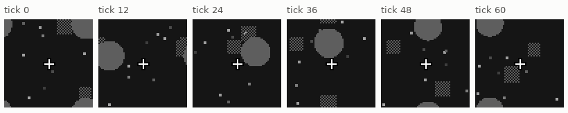
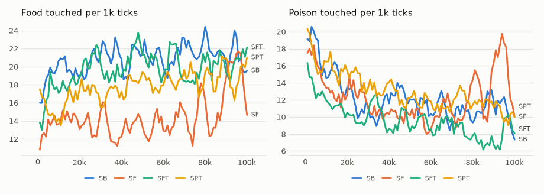

# vm-00043: Square Poison, the Summary Experiment Repeated

**Date:** 2026-10-28
**Status:** Complete
**Source:** `exp/vm-00043` (the code as run, before task 00052's fix; `visual-motor-agent/dev/`)
**Outputs:** `~/data/research/visual-motor-agent/exp_00043/`
**Task plan:** [`../tasks/00050-square-poison.md`](../tasks/00050-square-poison.md)

## Goal

Poison differed from food only by a pixel texture, which a box average removes. Make it a checkered square, so it differs in
shape too, and repeat vm-00042: does the summaries' cost in food shrink when poison is distinguishable at a coarse scale?

## Method

`env.hazard_shape = "square"` (same area as the circle it replaces; `configs/U_touch_ego_sq.json`). Seeds 1–3, 100k ticks:
SB (no summaries), SF (`uni_pyr = 3`), SFT (with thumbnails), SPT (window, thumbnails). The frozen tests were partly run: stopped
when task 00052 found the position bug, and not resumed, since these arms carry it. SF has two seeds, SPT none.

## Results

### R1. Life, the last 20k ticks of 100k, food / poison per 1k

| arm | mean | food by seed | food share | circle world (vm-00042) |
|---|---|---|---|---|
| SB (no summaries) | 21.1 / 10.9 | 20.4, 11.4, 31.6 | 0.66 | EB 36.8 / 8.0 |
| SF | 17.0 / 14.3 | 23.1, 16.3, 11.6 | 0.54 | EF 21.8 / 8.9 |
| SFT | 20.2 / 7.7 | 13.2, 34.0, 13.4 | 0.73 | EFT 20.1 / 7.2 |
| SPT | 19.2 / 11.2 | 9.7, 19.8, 28.2 | 0.63 | EPT 23.3 / 10.4 |

### R2. Frozen at 100k, food / poison per 1k

| arm | policy alone | 1-step instinct | 4-step pair lookahead |
|---|---|---|---|
| SB | 18.7 / 19.5 | 22.9 / 10.5 | 31.1 / 5.9 |
| SF (2 seeds) | 12.9 / 13.2 | 15.7 / 7.7 | not run |
| SFT | 19.7 / 13.2 | 22.0 / 8.6 | 26.0 / 6.4 (2 seeds) |

<!-- figures -->
## Figures

*The world of this experiment as its model sees it, every 12 ticks. Moves are random: this shows the world, not the trained agent.*

*From each run's `metrics.jsonl`, the mean of its seeds by arm, smoothed.*
<!-- /figures -->

## Analysis

- **The control fell the most:** SB is 43% under EB, though only the poison's outline changed. The summary arms barely moved.
  The gap between summaries and none closes (21.1 against 17–20), but because the control dropped.
- That drop made the comparison with EB doubtful, and led to XB in vm-00045: EB rerun on current code.
- **Seeds vary widely:** SFT's run 13.2 to 34.0, more than any gap here.
- Thumbnails help a little where they can show a difference: SFT has more food and half the poison of SF in life.
  With this spread it is a hint. The position bug also applies to SF, SFT and SPT.

## Conclusions

1. Square poison did not explain the summaries' cost.
2. The controls need rerunning on the same code as the arms, and many seeds.

## Next Steps

Done: vm-00044 (a checker that survives the average), vm-00045 (positions fixed, the control rerun).
