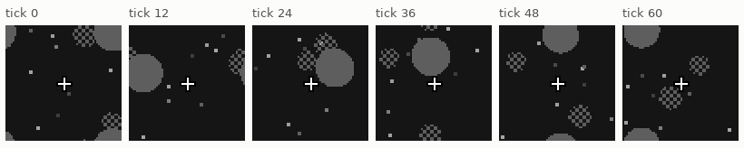
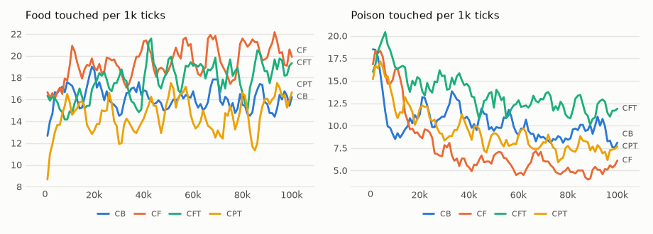

# vm-00044: Poison With a 2 × 2 Checker, the Summary Experiment Repeated

**Date:** 2026-10-28
**Status:** Complete
**Source:** `exp/vm-00044` (the code as run, before task 00052's fix; `visual-motor-agent/dev/`)
**Outputs:** `~/data/research/visual-motor-agent/exp_00044/`
**Task plan:** [`../tasks/00051-checker-cells.md`](../tasks/00051-checker-cells.md)

## Goal

A 1-pixel checker vanishes in a 2 × 2 box average. With 2 × 2 cells, a level-1 thumbnail keeps the checker, so thumbnails could
show poison from food. Does that make them useful?

## Method

`env.hazard_checker_cell = 2` (`configs/U_touch_ego_c2.json`, the world of all later vision runs). Seeds 1–3, 100k ticks: CB (no
summaries), CF (`uni_pyr = 3`), CFT (with thumbnails), CPT (window, thumbnails). Frozen tests were stopped by task 00052's
finding: CFT has none, CPT one seed.

## Results

### R1. Life, the last 20k ticks of 100k, food / poison per 1k

| arm | mean | food by seed | food share | circle world (vm-00042) |
|---|---|---|---|---|
| CB (no summaries) | 15.7 / 9.3 | 20.6, 16.9, 9.5 | 0.63 | EB 36.8 / 8.0 |
| CF | 20.6 / 5.0 | 24.6, 23.2, 13.9 | 0.80 | EF 21.8 / 8.9 |
| CFT | 18.7 / 11.9 | 21.5, 18.7, 16.0 | 0.61 | EFT 20.1 / 7.2 |
| CPT | 15.2 / 7.4 | 11.6, 16.5, 17.5 | 0.67 | EPT 23.3 / 10.4 |

### R2. Frozen at 100k, food / poison per 1k

| arm | policy alone | 1-step instinct | 4-step pair lookahead |
|---|---|---|---|
| CB | 16.5 / 16.8 | 17.4 / 8.2 | 25.5 / 5.2 |
| CF | 21.2 / 15.3 | 22.0 / 5.8 | 32.5 / 4.1 |
| CPT (1 seed) | 11.4 / 10.3 | 12.1 / 5.5 | not run |

<!-- figures -->
## Figures

*The world of this experiment as its model sees it, every 12 ticks. Moves are random: this shows the world, not the trained agent.*

*From each run's `metrics.jsonl`, the mean of its seeds by arm, smoothed.*
<!-- /figures -->

## Analysis

- **Thumbnails did not help:** CFT has more than twice CF's poison in life, the reverse of what the world was built to show.
- **Here the summaries lead the control:** CF beats CB on food and poison, in life and frozen. The control is again far under
  EB (15.7 against 36.8), in a world that differs only in the checker's cell size. A world this close should not halve a
  model, so the seeds and the code version, not the world, are the suspects. vm-00045's XB tests the code.
- These arms carry the position bug (CB does not).

## Conclusions

1. A texture that survives the average does not make thumbnails useful in a single model.
2. Three seeds cannot separate these arms: comparing across worlds and code versions misled us here.

## Next Steps

Done: vm-00045. This world became the standard for vm-00051–00054.
