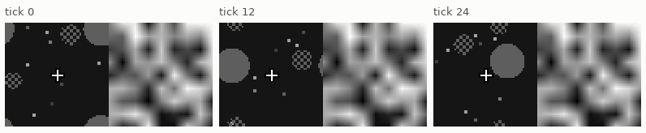
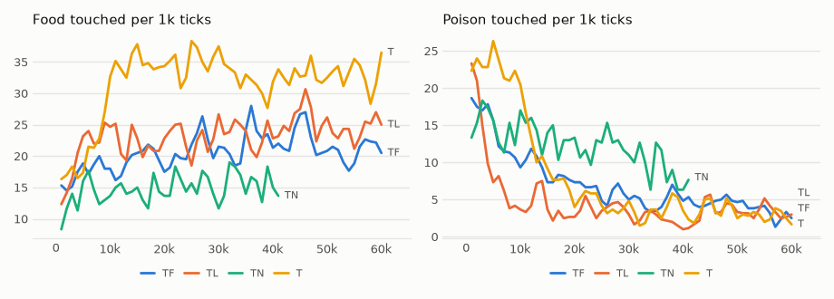
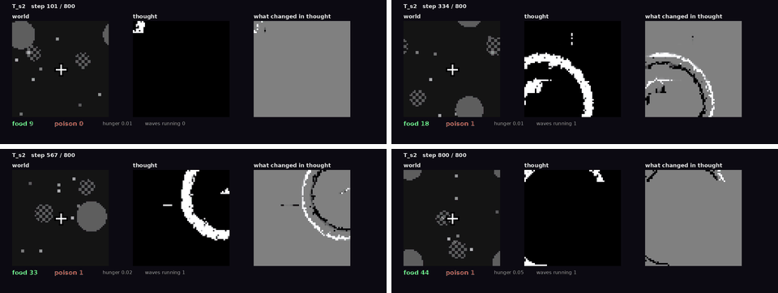

# vm-00056: A Thought World Beside the Real One

**Date:** 2026-10-31
**Status:** Complete
**Source:** `exp/vm-00056` (code: `visual-motor-agent/dev/`)
**Outputs:** `~/data/research/visual-motor-agent/exp_00056/`
**Task plan:** [`../tasks/00064-thought-world.md`](../tasks/00064-thought-world.md)

## Goal

Nothing the model holds outlives its 8-tick window. The owner's idea: a grey thought field beside the world, whose next frame is the
model's own prediction of it, kept alive by waves when it goes quiet. Should it associate states of thought with states of the world, it
would be a state that outlives the window. Does thought stay alive, does it hold the world, does it help?

## Method

- **`model.img_w`:** frames wider than high; 128 × 64, a 16 × 8 grid. With `uni_pyr = 3`, every block lies in one half, so no summary mixes
  them. C++ and GPU against the reference: `tests/test_wide_frame.py`.
- **`ThoughtWorld`** (`world/thought_world.py`, `configs/U_thought.json`): [world | thought]. Two transformers, left the world, right thought,
  each with its own half's patches and every summary; both propose a move, gain makes it (`age_key`, ring).
- **Thought's next frame:** the right transformer's dream of its own patches (two Jacobi iterations, pair decoding) plus waves. A wave
  starts when the dream moves a pixel by under 0.002 on average, with probability 0.2 a tick: a ring going out, up then down. Small
  areas can change too. Thought starts as smooth random grey. The model knows none of this: thought is image.
- **Arms,** seeds 1–3, 60k ticks: **T** (dream, waves); **TF** (thought frozen); **TL** (only the left transformer, thought frozen); **TN** (thought
  new smooth noise every tick; stopped at 41k for a reboot).
- **Frozen tests** (`eval_thought.py`): the food's place from thought alone, a ridge regression on 16 × 16 block averages, trained on the
  first half of the ticks, scored on the second, at lags 0–64; each body given another's thought (shuffle). A video, from T seed 2.

## Results

### R1. The last 20k ticks, per 1k

| arm | food | seeds | poison | patch CE |
|---|---|---|---|---|
| **T** | **33.1** | 29.4, 42.0, 27.9 | 3.1 | 0.51 |
| TL | 25.1 | 26.4, 33.6, 15.2 | 3.5 | 0.67 |
| TF | 21.7 | 28.6, 23.1, 13.3 | 4.0 | 0.62 |
| TN (20k–40k) | 15.7 | 15.4, 13.9, 17.6 | 10.7 | 1.24 |

### R2. By 10k ticks, food / poison

| arm | 0–10k | 10–20k | 20–30k | 30–40k | 40–50k | 50–60k |
|---|---|---|---|---|---|---|
| T | 22.1 / 22.4 | 34.6 / 8.7 | 35.4 / 4.6 | 31.8 / 3.4 | 32.8 / 3.6 | 33.4 / 2.7 |
| TL | 21.1 / 9.3 | 21.8 / 3.8 | 23.3 / 3.9 | 23.0 / 2.2 | 26.2 / 3.6 | 24.1 / 3.3 |
| TF | 17.4 / 13.6 | 19.3 / 8.8 | 21.5 / 6.0 | 22.3 / 4.9 | 22.7 / 4.7 | 20.6 / 3.2 |
| TN | 13.3 / 14.9 | 14.4 / 13.5 | 15.2 / 12.1 | 16.1 / 9.2 | | |

### R3. What thought became

Within ~250 ticks of a frozen run, 99% of its pixels sit at black or white: a few white blobs on black, from 1% to 16% of the field, that
drift, stall, and start again. Over the last 20k ticks of life a pixel changes 3–4% a tick, and 3–7% of ticks are quiet.

### R4. Frozen tests

| test | seed 1 | seed 2 | seed 3 |
|---|---|---|---|
| food's place from the world half, lag 0 (R²) | 0.847 | 0.850 | 0.868 |
| from thought, lags 0–64 (R²) | −0.16 to −0.11 | −0.17 to −0.14 | −0.17 to −0.13 |
| food / poison, frozen | 28.2 / 1.6 | 38.0 / 4.7 | 24.4 / 1.3 |
| shuffled thought | 32.2 / 3.5 | 21.0 / 5.6 | 23.8 / 1.6 |

<!-- figures -->
## Figures

*The world of this experiment as its model sees it, every 12 ticks. Moves are random: this shows the world, not the trained agent.*

*From each run's `metrics.jsonl`, the mean of its seeds by arm, smoothed.*

*Stills from this experiment's video, in time order.*
<!-- /figures -->

## Analysis

- **Thought stays alive,** on its own: waves are rarely needed. But it did not stay grey: each dream sharpens the last, and the field collapsed
  into black and white shapes, attractors of the dream.
- **Thought holds no linearly readable place of the food,** at any lag. The test can see it in the world half. A nonlinear code is not ruled out.
- **The shuffle is mixed:** the mean falls from 30.2 to 25.3, one seed from 38 to 21, and another rises. There is no clear sign that foraging
  reads thought's content. 1,000 ticks is short.
- **T forages best,** a third ahead of TL and half ahead of TF, seed for seed, from 10k ticks on. vm-00055 warns against reading three
  seeds: its arms span 14 to 59.
- **Noise is costly.** TN is the worst: attention and half the loss go to the unpredictable.
- **So far thought looks like an aid to training, not a memory.** A half that can be predicted and keeps changing may make the right
  transformer a better competitor under gain; that is unproven. As feared in the task, nothing teaches the model what to write: dreams are data.

## Conclusions

1. A dream fed back as its next frame stays alive, and forms attractors by itself. The owner's waves are hardly needed.
2. It does not yet associate with the world in any way a linear read can see.
3. Live thought did not cost food, and may help: 33.1 against 25.1 with no second piece.

## Next Steps

- Keep the grey: decode dreams by the mean, or add noise, so the field does not collapse.
- More seeds of T and TL.
- The delayed-cue world, where a memory is needed: a mark flashes and is gone for 20–30 ticks.
- A step of backpropagation through a dream, if writing needs teaching.
