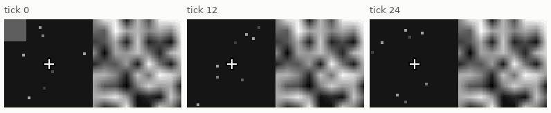
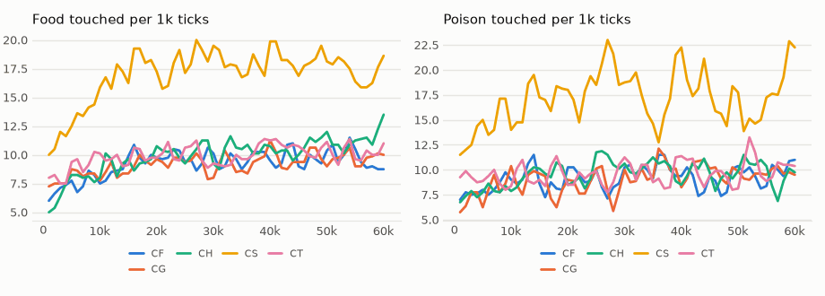
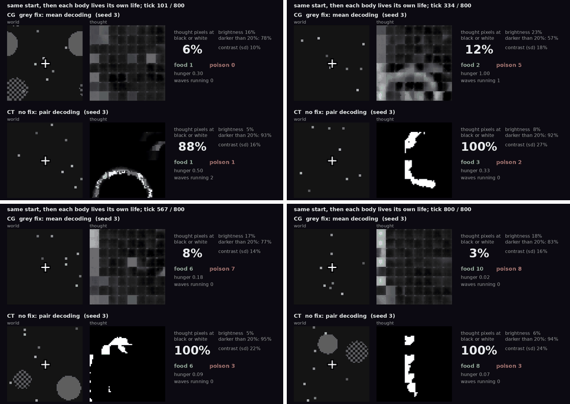

# vm-00057: The Delayed-Cue World

**Date:** 2026-10-31
**Status:** Complete
**Source:** `exp/vm-00057` (code: `visual-motor-agent/dev/`)
**Outputs:** `~/data/research/visual-motor-agent/exp_00057/`
**Task plan:** [`../tasks/00065-delayed-cue.md`](../tasks/00065-delayed-cue.md)

## Goal

vm-00056 could not tell whether thought is a memory, because foraging never needs one. This world has one answer that an 8-tick window
cannot give, so a choice above chance with the sample gone must come from something that outlives the window.

## Method

- **`CueWorld`** (`world/cue_world.py`, `configs/U_cue.json`): a sample flashes for 2 ticks, a 16 × 16 block at the top left of the view,
  solid or 2 × 2 checker. Then 20–30 ticks with no circles. Then one food and one poison of the same grey at 20 px on opposite sides of the
  cursor. **The food looks like the sample.** A touch or 40 ticks ends the trial, and the next flash starts at once. Relief 0.3, poison 0.2, so
  hunger stays off the cap at chance.
- **Model:** [world | thought] as vm-00056's T: two transformers, gain, age key, ring.
- **`online.thought_decode`:** `pair` as vm-00056, or `mean`, the grey fix: a dream of means should not sharpen itself to black and white.
- **Arms,** seeds 1–4, 60k ticks (seeds 1 and 2 on the 3090, 3 and 4 on the 4090):

| arm | sample | delay | thought | it asks |
|---|---|---|---|---|
| **CH** | stays on | 20–30 | frozen | can the rule be learned at all? |
| **CS** | flash | 1–2 | frozen | does the window carry it? |
| **CF** | flash | 20–30 | frozen | the floor |
| **CT** | flash | 20–30 | dream, pair | memory in thought |
| **CG** | flash | 20–30 | dream, mean | the same, kept grey |

- **Measure:** food share = food / (food + poison) among trials ended by a touch; chance is 0.5. The ± is binomial on the touches pooled over seeds.
- **Frozen thought:** the final weights, 800 ticks, one world seed, two bodies, body 0 recorded (`eval_thought.py`, as of this tag with the
  run's own `thought_decode`: it used to dream with pair decoding always). Beyond vm-00056's measures: brightness, contrast, and the share of
  pixels darker than 0.2, because `thought_extreme` counts only pixels under 0.05 or over 0.95.

## Results

### R1. Food share over the last 10k ticks

| arm | food share | touches | s1 | s2 | s3 | s4 |
|---|---|---|---|---|---|---|
| CH | 0.542 ± 0.017 | 849 | 0.498 | 0.534 | 0.473 | **0.648** |
| CS | 0.493 ± 0.013 | 1,408 | 0.523 | 0.467 | 0.492 | 0.497 |
| CF | 0.494 ± 0.018 | 778 | 0.538 | 0.467 | 0.472 | 0.492 |
| CT | 0.492 ± 0.017 | 830 | 0.488 | 0.507 | 0.497 | 0.474 |
| CG | 0.507 ± 0.018 | 777 | 0.503 | 0.482 | 0.523 | 0.526 |

### R2. Food share by age, pooled over four seeds

| arm | 0–10k | 10–20k | 20–30k | 30–40k | 40–50k | 50–60k |
|---|---|---|---|---|---|---|
| CH | 0.489 | 0.497 | 0.495 | 0.516 | 0.521 | 0.542 |
| CS | 0.481 | 0.500 | 0.491 | 0.507 | 0.511 | 0.493 |
| CF | 0.476 | 0.505 | 0.521 | 0.488 | 0.525 | 0.494 |
| CT | 0.498 | 0.503 | 0.511 | 0.513 | 0.532 | 0.492 |
| CG | 0.497 | 0.522 | 0.516 | 0.499 | 0.483 | 0.507 |

CH by seed, per 10k: s1 0.50, 0.46, 0.49, 0.45, 0.52, 0.50; s2 0.53, 0.47, 0.51, 0.58, 0.52, 0.53; s3 0.47, 0.52, 0.54, 0.46, 0.49, 0.47; s4 0.45,
0.53, 0.45, 0.58, 0.56, 0.65. In s4's last 10k, solid samples 0.65 and checker samples 0.63; in s1 and s3 the two lie on either side of 0.5
(0.56 and 0.43; 0.54 and 0.40), a liking for one pattern and not the rule.

### R3. Rates over the last 20k ticks, mean of the seeds

| arm | trials per 1k | touched | food per 1k | poison per 1k | hunger | capped | patch CE | thought at extremes |
|---|---|---|---|---|---|---|---|---|
| CH | 23.8 | 0.88 | 11.1 | 9.8 | 0.41 | 0.09 | 0.609 | 0.005 |
| CS | 45.0 | 0.78 | 17.7 | 17.6 | 0.30 | 0.04 | 0.614 | 0.005 |
| CF | 22.9 | 0.83 | 9.7 | 9.4 | 0.38 | 0.09 | 0.610 | 0.005 |
| CT | 23.4 | 0.87 | 10.4 | 10.0 | 0.46 | 0.10 | 0.505 | 0.985 |
| CG | 22.8 | 0.86 | 9.7 | 9.9 | 0.46 | 0.10 | 0.709 | 0.062 |

### R4. Frozen thought, ticks 500–800

| measure | CG s3 | CG s4 | CT s3 | CT s4 |
|---|---|---|---|---|
| pixels at black or white | 0.071 | 0.030 | 0.997 | 0.987 |
| pixels darker than 0.2 | 0.772 | 0.620 | 0.900 | 0.924 |
| brightness | 0.183 | 0.216 | 0.099 | 0.073 |
| contrast (sd) | 0.164 | 0.136 | 0.298 | 0.256 |
| change per tick | 0.015 | 0.015 | 0.042 | 0.027 |

Videos: `exp_00057/videos/grey_fix_s3.mp4`, `grey_fix_s4.mp4`, CG over CT from the same start (`eval_thought.py --video` gives one run's).

<!-- figures -->
## Figures

*The world of this experiment as its model sees it, every 12 ticks. Moves are random: this shows the world, not the trained agent.*

*From each run's `metrics.jsonl`, the mean of its seeds by arm, smoothed.*

*Stills from this experiment's video, in time order.*
<!-- /figures -->

## Analysis

- **No memory shown, and the test was not valid.** CT and CG sit on the floor, but the control that needs no memory reached only 0.542 ± 0.017,
  so by the plan's reading this says nothing of thought.
- **One seed of four learned the rule.** CH s4 ends at 0.65 on both samples, about 4 standard errors above chance. Seed 2's 0.58 at 30–40k faded
  to 0.53. A pooled rise from 0.49 to 0.54 is that one seed. So the rule can be learned here, rarely and late.
- **CS is at chance with nearly twice the trials,** in every seed, and that is unexplained. The sample is in the window at the choice, but only
  as a few ticks at its far end, and CH has it in view on the tick of the choice.
- **The likely limit is experience** (a guess, not tested). A trial averages ~43 ticks, ~27 of them with no circles, for ~10 food touches per
  1k against QG's 43 in vm-00051. The rule is also harder: a circle's pattern means nothing without the sample.
- **Agents reach the circles** (83–88% of long-delay trials end in a touch); they do not choose between them.
- **The grey fix half works.** Mean decoding stops the collapse to black and white shapes (0.06 of pixels against 0.985), but thought still
  drifts dark: 62–77% of its pixels under 0.2, a dim blocky field with visible 8 × 8 patch seams. `thought_extreme` hid this, and the interim
  write-up's "keeps thought grey" overstated it. It changes less per tick and costs prediction: patch CE 0.709 against 0.505 with pair and 0.610 frozen.
  Whether the field holds anything is not measured here.

## Conclusions

1. The delayed-cue world is too thin for 60k ticks: its control learns in one seed of four, so thought's memory stays an open question.
2. Mean decoding replaces black and white attractors with a dim grey field, at a cost in prediction. A metric of extremes alone does not see the rest.

## Next

A fixed-rule control (patterns with one meaning) separates too few trials from the matching rule itself. A richer trial rate must come before thought
can be tested here.
