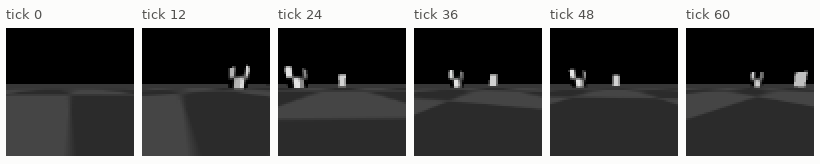
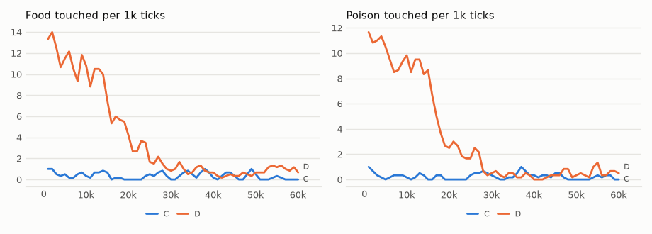
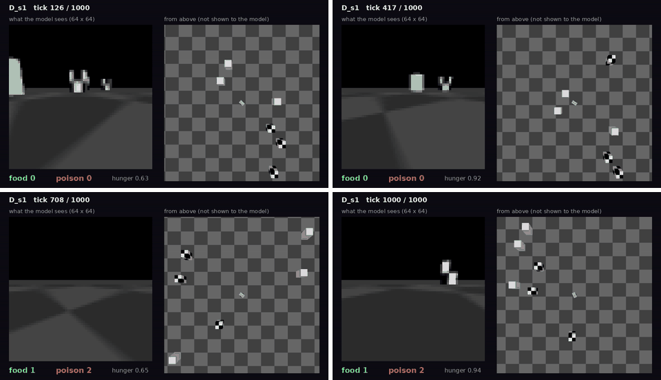

# vm-00060: A Dense Start for the Car

**Date:** 2026-10-31
**Status:** Complete (pending tag)
**Source:** `exp/vm-00060` (code: `visual-motor-agent/dev/`)
**Outputs:** `~/data/research/visual-motor-agent/exp_00060/` (the stopped first start, with the car that flipped: `exp_00060_flipped/`)
**Task plan:** [`../tasks/00068-dense-car.md`](../tasks/00068-dense-car.md)

## Goal

In vm-00059 the car barely touched anything. Does a dense start teach it something that lasts when the boxes thin to that density? The touch distance does not change.

## A Bug Found on the Way

The first start of these runs was stopped. The car of vm-00059 flipped onto its back under moves that change sharply, as a model's do, and stayed there: 58–66% of ticks
upside down in a blind test, its camera below the floor. Stills made for the READMEs showed it. The car now has a low ballast, its wheels under its centre, a skid at each end and
torque limits: at most 0.2° of tilt under the same drivers, 0.9 m/s, 2.6 rad/s. `car_max_tilt` is logged (0.15° at most in these runs) and a test keeps it so.

## Method

- **D:** `configs/U_car_dense.json`: 48 boxes (24 food, 24 poison) for 10k ticks, then three halvings, 6 boxes at 40k and to the end. **C:** `configs/U_car.json`, 6 boxes all the way,
  added so that the dense start is not mixed with three times vm-00059's ticks. Seeds 1–3, 60k ticks, 20 ticks/s of world time; D on the 4090, C on the 3090.
- **Blind drivers** (`car_chance.py`) at each density, 10k ticks, 3 seeds.

## Results

### R1. Food / poison per 1k ticks, by 10k ticks

| run | 0–10k | 10–20k | 20–30k | 30–40k | 40–50k | 50–60k |
|---|---|---|---|---|---|---|
| boxes in D | 48 | 48 to 24 | 24 to 12 | 12 to 6 | 6 | 6 |
| D s1 | 11.9 / 14.3 | 8.1 / 7.4 | 2.1 / 1.8 | 0.0 / 0.1 | 0.2 / 0.1 | 1.0 / 0.6 |
| D s2 | 13.1 / 10.1 | 9.3 / 8.3 | 2.1 / 1.6 | 0.4 / 0.2 | 0.6 / 0.2 | 0.8 / 0.2 |
| D s3 | 9.2 / 5.7 | 4.0 / 2.7 | 1.8 / 1.4 | 2.5 / 0.6 | 0.5 / 0.8 | 1.1 / 0.9 |
| C s1 | 0.1 / 0.1 | 0.0 / 0.0 | 0.0 / 0.0 | 0.0 / 0.0 | 0.0 / 0.0 | 0.0 / 0.0 |
| C s2 | 0.2 / 0.2 | 0.1 / 0.1 | 0.0 / 0.0 | 0.0 / 0.0 | 0.0 / 0.0 | 0.0 / 0.0 |
| C s3 | 1.1 / 0.6 | 0.9 / 0.4 | 0.9 / 0.9 | 1.5 / 1.0 | 1.2 / 0.6 | 0.2 / 0.4 |

### R2. Blind drivers, food / poison per 1k

| boxes | a random move held 20 ticks | a new random move each tick | straight ahead |
|---|---|---|---|
| 48 | 10.1 / 10.8 | 1.3 / 1.5 | 0.6 / 0.5 |
| 24 | 4.9 / 5.6 | 0.8 / 0.7 | 0.1 / 0.2 |
| 12 | 2.2 / 2.4 | 0.4 / 0.3 | 0.1 / 0.0 |
| 6 | 1.2 / 1.2 | 0.3 / 0.2 | 0.1 / 0.0 |

### R3. The last 20k ticks, all at 6 boxes

| run | food | poison | hunger | ticks at the cap | patch CE | body CE | move CE |
|---|---|---|---|---|---|---|---|
| D s1 | 0.60 | 0.35 | 0.86 | 0.60 | 0.528 | 0.133 | 0.416 |
| D s2 | 0.70 | 0.20 | 0.85 | 0.52 | 0.545 | 0.151 | 0.549 |
| D s3 | 0.80 | 0.85 | 0.71 | 0.45 | 0.582 | 0.205 | 0.745 |
| C s1 | 0.00 | 0.00 | 1.00 | 1.00 | 0.403 | 0.009 | 0.136 |
| C s2 | 0.00 | 0.00 | 1.00 | 1.00 | 0.385 | 0.016 | 0.095 |
| C s3 | 0.70 | 0.50 | 0.79 | 0.68 | 0.438 | 0.120 | 0.340 |

Frozen final weights of D s1, 1,000 ticks: 18 food, 9 poison among 48 boxes; 1 food, 2 poison among 6. One run, so a hint at most.

<!-- figures -->
## Figures

*What the car's camera sees, under random moves.*

*From each run's `metrics.jsonl`, the mean of its seeds by arm, smoothed.*

*Stills from this experiment's video, in time order.*
<!-- /figures -->

## Analysis

- **The dense start did not teach foraging that lasts.** At 6 boxes D makes 0.7 food and 0.47 poison per 1k, under the blind held driver's 1.2 and 1.2. It tracks the blind driver's fall with
  density, and sinks below it.
- **D is still better than C, in a weak sense:** two of C's three seeds touch nothing for 50k ticks, with hunger capped all the way. D's seeds all stay alive, at low rates. The food : poison share
  in D's last 20k, 0.60, rests on about 42 touches a seed.
- **Without a touch there is nothing to learn from.** C's body CE of 0.01 is a model that has learned hunger stays at 1. At the cap neither food's absence nor poison leaves any trace.
- **The likely cause is the clock** (a guess, tested in vm-00061). The instinct looks one tick ahead, and at 20 ticks/s a tick covers ~4.5 cm, so a move pays only in the last tick before a touch,
  though a box can be seen from metres away.
- **vm-00059's conclusion is revised.** "Too little experience" does not explain it alone: D had hundreds of touches early, about 250 per seed in the first 10k ticks, and no skill lasted.

## Conclusions

1. A flipping car hid in vm-00059; a tilt metric and a harsh-driving test now guard it.
2. A dense start gives the car experience, not skill: it falls to below blind as the boxes thin.
