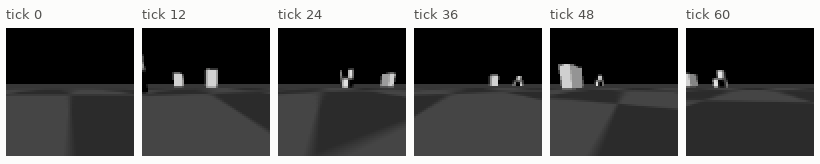
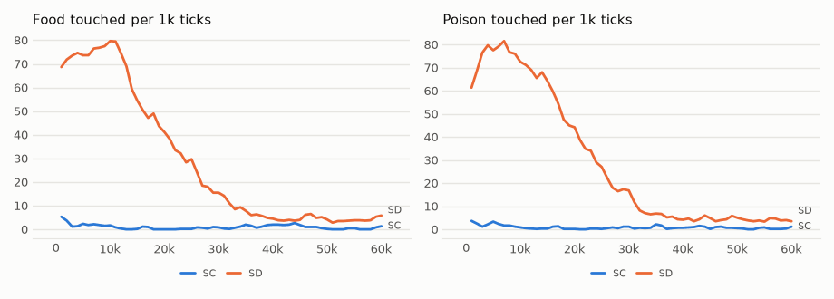
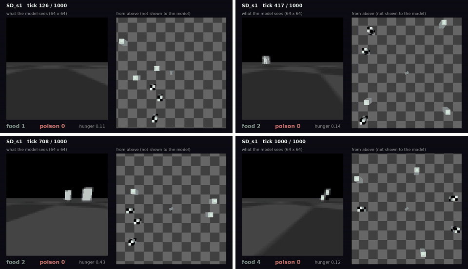

# vm-00061: A Slower Tick for the Car

**Date:** 2026-11-01
**Status:** Complete
**Source:** `exp/vm-00061` (code: `visual-motor-agent/dev/`)
**Outputs:** `~/data/research/visual-motor-agent/exp_00061/`
**Task plan:** [`../tasks/00070-slow-tick-car.md`](../tasks/00070-slow-tick-car.md)

## Goal

At 20 ticks/s the car goes ~4.5 cm a tick, so a one-tick instinct sees a touch only at the last moment. Does 5 ticks/s, ~18 cm a tick, let the instinct work?

## Method

`env.frame_skip = 40` instead of 10; nothing else changes. **SD:** the dense start of vm-00060 (48 boxes, 6 by 40k). **SC:** 6 boxes all the way. Seeds 1–3, 60k ticks. The car could still reverse. Blind drivers at each density, at this tick (`car_chance.py --frame-skip 40 --reverse`).

## Results

### R1. Food / poison per 1k ticks, by 10k ticks

| run | 0–10k | 10–20k | 20–30k | 30–40k | 40–50k | 50–60k |
|---|---|---|---|---|---|---|
| boxes in SD | 48 | 48 to 24 | 24 to 12 | 12 to 6 | 6 | 6 |
| SD s1 | 89.5 / 84.7 | 63.4 / 71.4 | 30.1 / 27.7 | 5.7 / 5.8 | 3.8 / 3.2 | 3.3 / 2.3 |
| SD s2 | 50.3 / 48.1 | 36.5 / 36.1 | 14.7 / 15.3 | 7.9 / 6.4 | 4.9 / 5.2 | 5.0 / 5.5 |
| SD s3 | 86.2 / 93.2 | 64.8 / 65.5 | 26.9 / 28.7 | 8.3 / 6.4 | 4.8 / 5.0 | 4.1 / 4.1 |
| SC s1 | 0.1 / 0.3 | 0.0 / 0.0 | 0.1 / 0.0 | 0.0 / 0.1 | 0.0 / 0.0 | 0.3 / 0.6 |
| SC s2 | 4.5 / 4.2 | 0.9 / 1.3 | 1.2 / 1.5 | 3.3 / 2.1 | 1.8 / 2.0 | 0.8 / 0.7 |
| SC s3 | 1.6 / 1.2 | 0.0 / 0.0 | 0.0 / 0.0 | 0.3 / 0.3 | 2.2 / 0.6 | 0.0 / 0.0 |

### R2. Blind drivers at 5 ticks/s, food / poison per 1k

| boxes | held 20 ticks | new each tick | straight |
|---|---|---|---|
| 48 | 30.4 / 30.9 | 12.1 / 12.0 | 1.9 / 1.6 |
| 24 | 15.3 / 15.8 | 5.5 / 5.4 | 0.7 / 0.5 |
| 12 | 7.5 / 8.4 | 2.9 / 2.9 | 0.2 / 0.2 |
| 6 | 3.9 / 3.5 | 1.5 / 1.5 | 0.2 / 0.1 |

### R3. The last 20k ticks, at 6 boxes

| run | food | poison | hunger | ticks at the cap | body CE |
|---|---|---|---|---|---|
| SD s1 | 3.6 | 2.8 | 0.35 | 0.08 | 0.233 |
| SD s2 | 5.0 | 5.4 | 0.34 | 0.15 | 0.237 |
| SD s3 | 4.5 | 4.6 | 0.42 | 0.14 | 0.235 |
| SC s1 | 0.2 | 0.3 | 0.99 | 0.96 | 0.010 |
| SC s2 | 1.3 | 1.4 | 0.76 | 0.62 | 0.119 |
| SC s3 | 1.1 | 0.3 | 0.79 | 0.70 | 0.053 |

Frozen, 1,000 ticks: SD s1 4 food, 0 poison; SD s3 3 food, 14 poison, at 6 boxes; SD s1 87 food, 96 poison, at 48.

<!-- figures -->
## Figures

*What the car's camera sees, under random moves.*

*From each run's `metrics.jsonl`, the mean of its seeds by arm, smoothed.*

*Stills from this experiment's video, in time order.*
<!-- /figures -->

## Analysis

- **The slower tick gives the car drive, not choice.** At 48 boxes two seeds touch 170–180 boxes per 1k, nearly three times a blind held driver's 61: it does go for boxes. But food and poison stay equal in every seed and at every density.
- **The dense start now holds up.** At 6 boxes SD stays alive at blind level (4.3 food, 4.2 poison against 3.9, 3.5), hunger 0.37, while SC mostly sits at the cap.
- **A likely reason for no choice,** from the owner's reading of the videos: the car often reverses, and collects what its forward camera never saw. The prediction of a touch then has nothing to read. Tested in vm-00062.

## Conclusions

1. At 5 ticks/s the car seeks boxes but does not prefer food. The clock was part of the problem, not all of it.
2. The dense start matters at this tick: without it the car mostly stays starved.
