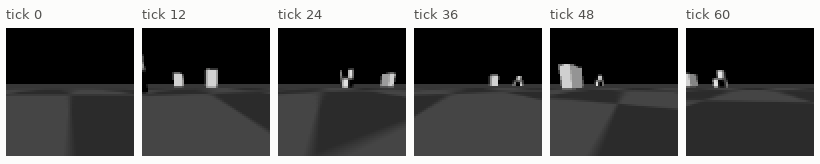
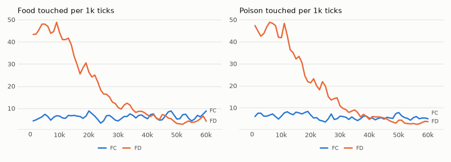
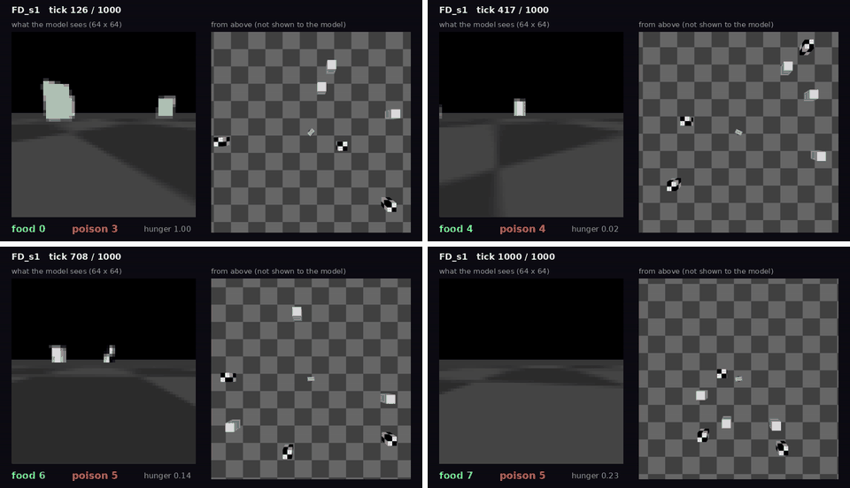

# vm-00062: A Car That Only Goes Forward

**Date:** 2026-11-01
**Status:** Complete
**Source:** `exp/vm-00062` (code: `visual-motor-agent/dev/`)
**Outputs:** `~/data/research/visual-motor-agent/exp_00062/`
**Task plan:** [`../tasks/00071-forward-car.md`](../tasks/00071-forward-car.md)

## Goal

The owner saw that the car often moved backward and so collected things it did not see. Should it only stop or go forward, can the model choose what it sees?

## Method

`env.reverse = false`, the new default: the drive value −1..1 is a speed from stop to full, and no value goes backward. The rest as vm-00061, 5 ticks/s. **FD:** dense start (48 boxes, 6 by 40k). **FC:** 6 boxes all the way. Seeds 1–3, 60k ticks. Blind drivers in the same car (`car_chance.py --frame-skip 40`).

## Results

### R1. Food / poison per 1k ticks, by 10k ticks

| run | 0–10k | 10–20k | 20–30k | 30–40k | 40–50k | 50–60k |
|---|---|---|---|---|---|---|
| boxes in FD | 48 | 48 to 24 | 24 to 12 | 12 to 6 | 6 | 6 |
| FD s1 | 36.8 / 38.0 | 25.5 / 24.2 | 15.6 / 14.9 | 11.3 / 7.5 | 8.8 / 7.3 | 8.8 / 6.4 |
| FD s2 | 62.0 / 63.9 | 47.4 / 45.9 | 20.8 / 24.8 | 10.3 / 9.0 | 4.5 / 3.3 | 0.2 / 0.2 |
| FD s3 | 37.6 / 34.0 | 25.5 / 24.1 | 13.3 / 9.4 | 6.5 / 5.8 | 3.1 / 3.9 | 3.3 / 2.5 |
| FC s1 | 6.4 / 6.8 | 7.5 / 7.2 | 4.7 / 4.3 | 7.4 / 5.1 | 6.8 / 5.2 | 8.5 / 5.7 |
| FC s2 | 7.5 / 8.3 | 8.1 / 10.9 | 7.6 / 7.9 | 8.9 / 8.2 | 8.6 / 8.5 | 8.2 / 6.4 |
| FC s3 | 4.0 / 4.4 | 4.2 / 4.2 | 3.7 / 3.0 | 2.8 / 2.9 | 4.2 / 3.5 | 3.0 / 3.6 |

### R2. Blind drivers, forward only, 5 ticks/s, food / poison per 1k

| boxes | new each tick | held 20 ticks | straight |
|---|---|---|---|
| 48 | 48.5 / 50.0 | 30.4 / 30.9 | 1.9 / 1.6 |
| 24 | 25.1 / 24.6 | 15.3 / 15.8 | 0.7 / 0.5 |
| 12 | 12.5 / 12.5 | 7.5 / 8.4 | 0.2 / 0.2 |
| 6 | 6.2 / 6.2 | 3.9 / 3.5 | 0.2 / 0.1 |

### R3. The last 20k ticks, at 6 boxes

| run | food | poison | food share | hunger | ticks at the cap | patch CE | body CE | move CE |
|---|---|---|---|---|---|---|---|---|
| FD s1 | 8.8 | 6.9 | 0.56 | 0.44 | 0.14 | 0.626 | 0.227 | 0.575 |
| FD s2 | 2.4 | 1.8 | 0.57 | 0.85 | 0.80 | 0.613 | 0.160 | 0.322 |
| FD s3 | 3.2 | 3.2 | 0.50 | 0.65 | 0.46 | 0.607 | 0.191 | 0.590 |
| FC s1 | 7.7 | 5.5 | 0.58 | 0.47 | 0.22 | 0.472 | 0.199 | 0.532 |
| FC s2 | 8.4 | 7.5 | 0.53 | 0.31 | 0.23 | 0.488 | 0.197 | 0.548 |
| FC s3 | 3.6 | 3.6 | 0.50 | 0.47 | 0.35 | 0.467 | 0.176 | 0.481 |

Pooled over the six runs, 1,245 touches: food share 0.530 ± 0.014. vm-00061 with reverse: 0.515 on 602 touches, ± 0.020. Frozen, 1,000 ticks at 6 boxes: FD s1 7 food, 5 poison; s2 6, 9; s3 0, 4; FC s1 7, 7. At 48 boxes FD s1: 38, 38.

<!-- figures -->
## Figures

*What the car's camera sees, under random moves.*

*From each run's `metrics.jsonl`, the mean of its seeds by arm, smoothed.*

*Stills from this experiment's video, in time order.*
<!-- /figures -->

## Analysis

- **The car no longer starves.** FC, with no dense start, touches 6.6 food and 5.5 poison per 1k against SC's 0.9 and 0.7. Forward only is the bigger change: going anywhere now means seeing where.
- **The dense start no longer helps.** FC's last 20k are as good as FD's or better (4.8 food, 3.9 poison), and FD s2 dies away at the end. The dense start was a workaround for a car that could not explore.
- **A first faint preference for food, not yet proven.** Share 0.530 ± 0.014 is about 2 standard errors above chance, and two runs reach 0.56–0.58. It does not beat blind in numbers: a blind forward driver makes 6.2 and 6.2. Frozen runs show no preference, on few touches. It needs more seeds or a longer life.
- **The model is not yet better than random driving.** Blind-new-each-tick touches as much.

## Conclusions

1. Forward only fixes the starving car, without a dense start. The owner's reading of the video was right.
2. Food : poison choice is at most faint, 0.53. Seeing what it touches is necessary, and not yet enough.
