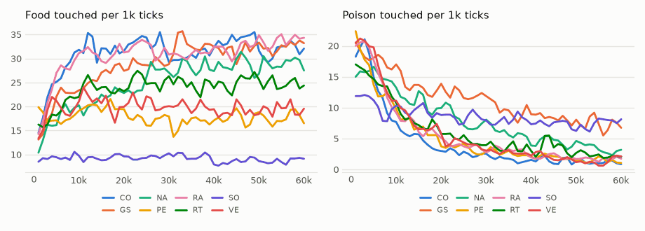

# vm-00063: Ways to Choose the Move

**Date:** 2026-11-01
**Status:** Complete (pending tag)
**Source:** `exp/vm-00063` (code: `visual-motor-agent/dev/`)
**Outputs:** `~/data/research/visual-motor-agent/exp_00063/`
**Task plan:** [`../tasks/00072-selection-rules.md`](../tasks/00072-selection-rules.md)

## Goal

Four pieces propose, one move is made. Gain, the default, chooses by noise on ~74% of ticks (ties) and favours the piece that missed a danger (the winner's curse). Which rule does better over whole lifetimes in the circle world?

## Method

`configs/U_default.json` with `online.piece_rule` changed and nothing else; 60k ticks, seeds 1–8 of each arm, 64 lifetimes under MPS (seeds 1–3 on the 3090, 4–8 on the 4090). `turn_cost` stays 0.

| arm | rule | how it chooses |
|---|---|---|
| NA | `gain` | the lowest own predicted hunger (the default) |
| CO | `council` | every piece scores every move: the lowest mean |
| RA | `rank_first` | every piece ranks every move, the lowest sum of ranks; a tie between sums goes to the lowest piece |
| RT | `rank` | the same, a tie between sums goes at random |
| GS | `gain_sharp` | gain; among hungers within 0.005 of the lowest, the sharpest move prediction |
| VE | `veto` | the lowest worst score |
| PE | `pessimism` | the lowest mean + 1 × the scorers' spread |
| SO | `soft` | the proposals' mean, weighted by softmin(predicted hunger / 0.01) |

Food and poison per 1k over the last 20k ticks; intervals t, 95%, over eight seeds. Differences are taken seed by seed.

**Why there are two runs.** The first 40 lifetimes had five arms, with RA meant to be `rank` and QNA and QCA of vm-00055 as an older-build control. Wins came out p0 > p1 > p2 > p3 in all eight seeds of every scoring rule, which led to the bug in R4: `rank`'s ties between sums did not go at random as designed. The fix and 24 more lifetimes (RT, NA, CO) followed, so RA is reported as what it was, and now has a name.

## Results

### R1. The last 20k ticks, per 1k

| arm | rule | food | poison | food share | proposal size | smoothness |
|---|---|---|---|---|---|---|
| NA | gain | 28.7 ± 5.7 | 3.90 ± 0.47 | 0.88 | 0.78 | 0.27 |
| **CO** | **council** | **32.8 ± 10.4** | **1.30 ± 0.45** | **0.96** | 0.80 | 0.51 |
| **RA** | **rank_first** | **33.0 ± 5.7** | **1.88 ± 0.61** | **0.95** | 0.75 | 0.60 |
| RT | rank | 24.9 ± 6.8 | 2.90 ± 1.41 | 0.90 | 0.60 | 0.63 |
| GS | gain_sharp | 32.1 ± 7.1 | 7.77 ± 1.93 | 0.81 | 0.92 | 0.62 |
| VE | veto | 19.3 ± 5.5 | 1.66 ± 0.66 | 0.92 | 0.66 | 0.66 |
| PE | pessimism | 17.6 ± 6.9 | 1.70 ± 0.69 | 0.91 | 0.55 | 0.66 |
| SO | soft | 8.7 ± 5.1 | 7.49 ± 1.46 | 0.54 | 0.31 | 0.72 |
| QNA | gain, vm-00055 | 34.7 ± 10.2 | 3.51 ± 0.61 | 0.91 | 0.82 | 0.29 |
| QCA | council, vm-00055 | 28.8 ± 9.1 | 1.46 ± 0.41 | 0.95 | 0.71 | 0.60 |

### R2. Differences, seed by seed

| comparison | food | poison |
|---|---|---|
| CO − NA | +4.0 ± 10.9 | **−2.60 ± 0.75** |
| RA − NA | +4.3 ± 7.1 | **−2.02 ± 0.59** |
| RA − CO | +0.3 ± 12.5 | +0.57 ± 0.83 |
| **RT − RA** | **−8.2 ± 4.3** | +1.02 ± 1.51 |
| RT − NA | −3.9 ± 8.8 | −1.00 ± 1.64 |
| GS − NA | +3.4 ± 10.0 | **+3.87 ± 2.09** |
| VE − CO | −13.5 ± 13.2 | +0.36 ± 0.99 |
| PE − CO | −15.2 ± 14.7 | +0.40 ± 0.74 |
| SO − NA | **−20.1 ± 7.6** | **+3.59 ± 1.37** |
| NA − QNA (build) | −6.0 ± 6.8 | +0.39 ± 0.45 |
| CO − QCA (build) | +4.0 ± 10.5 | −0.16 ± 0.63 |

Bold where the interval excludes zero by a clear margin. Each line is one of about fifteen tests, so one false line is to be expected. RT − RA, CO − NA, RA − NA, GS − NA and SO − NA would survive a correction for that, RT − RA only just; VE − CO and PE − CO would not, and are not bold.

### R3. By seed (1–8), last 20k

| arm | food | poison |
|---|---|---|
| NA | 18.4, 37.6, 34.9, 21.8, 23.5, 33.2, 30.1, 30.5 | 4.0, 4.6, 4.2, 4.1, 2.8, 4.3, 3.7, 3.5 |
| CO | 21.6, 39.6, 27.4, 49.9, 14.8, 25.5, 47.2, 36.1 | 0.8, 1.2, 2.1, 1.1, 2.1, 1.1, 0.7, 1.3 |
| RA | 34.1, 34.1, 42.1, 34.1, 28.4, 40.2, 30.8, 20.2 | 2.6, 2.9, 2.1, 0.7, 1.1, 1.7, 1.9, 2.1 |
| RT | 26.1, 19.3, 30.1, 30.9, 17.2, 39.5, 18.8, 17.0 | 2.9, 2.5, 3.0, 1.9, 3.5, 0.9, 6.5, 2.0 |

### R4. Ties, measured on frozen weights (12,800 decisions each)

| run | moves all alike | score ties, all | score ties among different moves | sum-of-ranks ties, all | sum-of-ranks ties among different moves |
|---|---|---|---|---|---|
| RA s1 | 0.20 | 0.56 | 0.000 | 0.21 | 0.09 |
| RA s5 | 0.12 | 0.36 | 0.000 | 0.22 | 0.14 |
| QCA s4 | 0.50 | 0.81 | 0.000 | 0.20 | 0.04 |

Score ties are those of `council`; `pessimism` matches them, and `veto` reaches 0.007 among different moves once. Moves are binned, so pieces often propose the very same one, and two of the same move score the same.

<!-- figures -->
## Figures

*The world of this experiment as its model sees it, every 12 ticks. Moves are random: this shows the world, not the trained agent.*

*From each run's `metrics.jsonl`, the mean of its seeds by arm, smoothed.*
<!-- /figures -->

## Analysis

- **On one build, council beats gain.** A third of the poison (1.30 against 3.90), with no food lost that eight seeds can show. vm-00055 put council's food at about 30% below the best arm, but that arm was QN, without the age key and the ring (41.4 ± 8.0), and it was not rerun here.
- **A fixed tie-break beat a random one, and this was found by accident.** One line separates RA and RT, and it costs 8.2 ± 4.3 food to make the ties fair. It touches only 4–14% of decisions directly. Proposals shrink with it, 0.75 to 0.60, so the effect runs through learning rather than through those decisions. The likely cause, not tested: every piece learns to predict the move made, so a fixed convention gives one consistent target while a random pick gives a mixture, and the "mean shrinks proposals" feedback of vm-00051 returns in a weaker form. This fits the open question in `../ARCHITECTURE.md`: when many moves look equally good, which one is picked matters less than picking the same way each time.
- **Strictness buys nothing.** Veto and pessimism have council's poison (1.66 and 1.70 against 1.30) and less food, with smaller proposals. Council already takes what foresight of the poison there is.
- **`gain_sharp` doubles the poison.** Its frozen numbers looked best of all (43.5 food, 5.8 poison on QG's weights). Over a lifetime it makes 32.1 and 7.77: on a tie the most confident piece moves, whatever the danger, and move CE of 0.076 with proposals of 0.92 show a habit spreading among the pieces, the risk the list named. Another frozen number that a lifetime does not keep.
- **`soft` at 0.01 is the mean.** Hungers lie within 0.005 on ~74% of ticks, so its weights are nearly equal then, and proposals shrink to 0.31. Its 8.7 food sits on the mean's 8.8, with no preference left (food share 0.54). Only this temperature ran, so this does not close soft selection: a much lower one would come nearer to gain.
- **Win shares under a scoring rule are not what they look like.** Council's 0.53, 0.21, 0.14, 0.11 is almost all bookkeeping: on a tie among identical moves the lowest piece is credited and the move is the same. Only gain's flat 0.25 and rank's random shares can be read as who decides.
- **A seed does not replay.** The same rule and seed give different lives across builds and cards: gain's seed 3 made 59.2 in vm-00054 and 34.9 here. The build shows no measurable shift (NA − QNA, CO − QCA), but gain's 6-food drop and council's 4-food rise are themselves within the noise, which is how large eight-seed noise still is.
- **Cost.** Every scoring rule costs the same: `t_act` went from 66 s to 82 s per 1k ticks on the 3090 under this load, about 13% of a tick at four pieces. It grows as S², so it will not stay this cheap at many pieces.

## Conclusions

1. `council` has the best poison of any rule and food equal to gain's: a third of the poison for about 13% of the time. RA matches it within the noise.
2. Fair ties made `rank` worse: a fixed convention for ties beat a random one by 8 food. Arbitrary choices should be consistent.
3. `veto` and `pessimism` lose food for no safety; `gain_sharp` doubles the poison; `soft` at 0.01 collapses to the mean.
4. A bug was found by the win shares and a test too weak to catch it was fixed; RA is kept as `rank_first` because the bug did better than the design.
