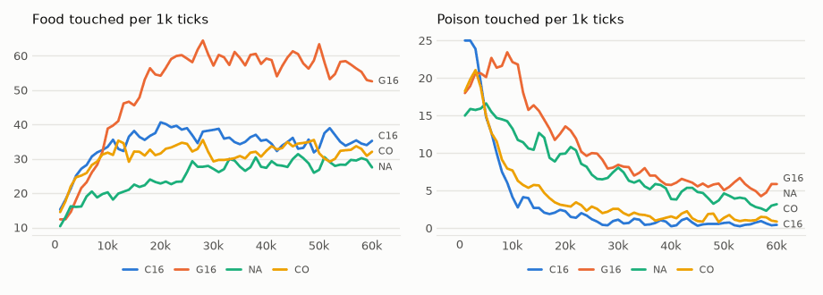

# vm-00064: Sixteen Pieces in One Body

**Date:** 2026-11-01
**Status:** Complete
**Source:** `exp/vm-00064` (code: `visual-motor-agent/dev/`)
**Outputs:** `~/data/research/visual-motor-agent/exp_00064/`; controls NA and CO in `exp_00063/`
**Task plan:** [`../tasks/00073-sixteen-pieces.md`](../tasks/00073-sixteen-pieces.md)

## Goal

How far can the one model be split before it stops foraging? The owner asked what it would take for each patch to be independent. The move made must stay an input, since the view is egocentric, so what can be split is who proposes. Here the default model of 4 transformers becomes 16 of 4 patches each, on the way to 64.

## Method

- `configs/U_default.json` with `model.band_n=16`: a 4 by 4 grid of blocks, 27 slots per step against 39, 14.8M parameters in all against 3.7M. No code change.
- **G16:** `gain`. **C16:** `council`, here because gain favours the piece that misses a danger, and more pieces should make that worse. Seeds 1–8, 60k ticks, seeds 1–3 on the 3090 and 4–8 on the 4090, under MPS.
- **Control:** vm-00063's NA (`gain`) and CO (`council`), the same settings and seeds at 4 pieces, not rerun.
- **Frozen check:** `eval_pieces.py --ring` on the final weights, 16 worlds, 1,500 ticks, every seed: the moves actually made, which the lifetime logs do not record. `--rule random` draws the winning piece at random, so what the rule itself adds shows.
- **Set before the results:** go to 64 if, for at least one rule, the interval of the food difference against the same rule at 4 pieces includes zero or is above it, and its food share stays at 0.85 or more.

## Results

### R1. Food / poison per 1k ticks, by 10k ticks, mean of eight seeds

| arm | 0–10k | 10–20k | 20–30k | 30–40k | 40–50k | 50–60k |
|---|---|---|---|---|---|---|
| G16 | 24.1 / 21.2 | 49.2 / 14.8 | 59.8 / 9.6 | 59.5 / 6.9 | 58.7 / 5.9 | 55.4 / 5.5 |
| C16 | 27.3 / 13.8 | 36.6 / 2.6 | 38.2 / 1.1 | 35.6 / 0.7 | 33.8 / 0.7 | 35.6 / 0.5 |
| NA | 17.4 / 15.0 | 21.9 / 10.6 | 26.0 / 8.0 | 28.2 / 5.5 | 28.5 / 4.6 | 29.0 / 3.2 |
| CO | 25.8 / 13.6 | 32.1 / 4.5 | 33.0 / 2.6 | 30.9 / 1.6 | 33.7 / 1.5 | 31.8 / 1.1 |

### R2. The last 20k ticks, per 1k

| arm | pieces | food | poison | share | hunger | proposal size | smooth | patch CE | body CE | move CE |
|---|---|---|---|---|---|---|---|---|---|---|
| **G16** | 16 | **57.0 ± 6.4** | 5.70 ± 0.61 | 0.91 | 0.073 | 1.05 | 0.23 | 0.799 | 0.221 | 0.533 |
| **C16** | 16 | 34.7 ± 7.0 | **0.62 ± 0.19** | 0.98 | **0.045** | 0.75 | 0.68 | 0.783 | 0.241 | 0.228 |
| NA | 4 | 28.7 ± 5.7 | 3.90 ± 0.47 | 0.88 | 0.089 | 0.78 | 0.27 | 0.761 | 0.235 | 0.332 |
| CO | 4 | 32.8 ± 10.4 | 1.30 ± 0.45 | 0.96 | 0.052 | 0.80 | 0.51 | 0.756 | 0.243 | 0.200 |

Differences seed by seed:

| difference | food | poison | share |
|---|---|---|---|
| G16 − NA | **+28.3 ± 9.4** | **+1.80 ± 0.74** | +0.030 ± 0.029 |
| C16 − CO | +1.9 ± 12.3 | **−0.68 ± 0.42** | +0.029 ± 0.031 |
| C16 − G16 | **−22.3 ± 7.8** | **−5.08 ± 0.69** | **+0.075 ± 0.019** |

Food by seed: G16 54.0, 63.0, 57.6, 62.4, 68.4, 43.5, 52.6, 54.9; NA 18.4, 37.6, 34.9, 21.8, 23.5, 33.2, 30.1, 30.5. The worst seed of G16 is above the best of NA. No run failed.

### R3. Frozen weights: the moves actually made

Eight seeds, 16 worlds, 1,500 ticks. "Aim" is the cosine between the move and the nearest food within 16 px.

| arm | rule | food | poison | share | move size | smooth | aim |
|---|---|---|---|---|---|---|---|
| G16 | `gain` | 57.1 ± 6.0 | 5.3 ± 1.3 | 0.91 | 0.73 | 0.23 | 0.83 |
| G16 | a piece at random | 53.1 ± 7.4 | 5.3 ± 0.8 | 0.91 | 0.72 | 0.22 | 0.73 |
| NA | `gain` | 30.4 ± 6.6 | 3.3 ± 0.5 | 0.90 | 0.54 | 0.27 | 0.57 |
| NA | a piece at random | 27.1 ± 6.2 | 5.1 ± 0.9 | 0.84 | 0.54 | 0.26 | 0.49 |
| C16 | `council` | 34.1 ± 6.6 | 0.7 ± 0.4 | 0.98 | 0.51 | 0.69 | 0.67 |
| CO | `council` | 32.4 ± 8.8 | 0.9 ± 0.4 | 0.97 | 0.55 | 0.51 | 0.55 |

What `gain` adds over a random piece, seed by seed: at 4 pieces poison −1.8 ± 0.9, food +3.2 ± 2.2; at 16 pieces poison 0.0 ± 1.4, food +4.0 ± 4.2.

### R4. Pieces, the last 20k ticks

- **Win share under gain:** even, 0.056–0.066 for each of the 16 pieces. No piece and no corner of the view dominates.
- **Agreement with the move made** (the mean cosine of a piece's proposal with it): 0.32 at 16 pieces against 0.57 at 4 under gain; 0.60 against 0.62 under council.
- **Patch CE by block:** the same everywhere to 0.01, the four central blocks lowest (0.792–0.796 against 0.799–0.801 in G16). The win shares under council run from 0.41 for p0 to 0.016 for p15: the ties of vm-00063, bookkeeping only.
- **Speed:** 25.0 ticks/s alone against 78.7; 7.6 ticks/s each with 16 lifetimes sharing the GPUs.

<!-- figures -->
## Figures

*The world of this experiment as its model sees it, every 12 ticks. Moves are random: this shows the world, not the trained agent.*

*From each run's `metrics.jsonl`, the mean of its seeds by arm, smoothed.*
<!-- /figures -->

## Analysis

- **The split did not hurt foraging. It helped, and much more than the rule did.** Gain's food doubled. All eight G16 seeds are above NA's mean, and the worst is above NA's best, while the seeds of one arm spanned 14–59 food in vm-00063. Frozen weights give the same numbers as the lifetimes (57.1 against 57.0, 30.4 against 28.7), so the result is not a trick of the last 20k ticks.
- **It is better pieces, not better choosing.** A piece drawn at random from G16 makes 53 food, close to gain's 57 and nearly twice NA's. Those moves are about a third longer (0.73 against 0.54) and aim better at near food (0.73 against 0.49 for a random piece). The random draw is of pieces raised in a gain lifetime, so this says the rule adds little at the moment of choosing, not that it taught nothing. Why smaller pieces aim better is **not known**: this experiment can only show that they do. A piece's move token attends to 27 slots against 39, of which the 21 thumbnails of the whole view are now the larger part; that is a guess worth a test.
- **As feared, gain stops guarding against poison.** At 4 pieces gain cuts poison by a third against a random piece; at 16 it cuts nothing, and in the lifetime poison rises by 1.80. The more the pieces, the more likely one of them misses the danger and wins, the winner's curse of task 00072. Share still rises slightly because food rises faster.
- **Council holds, with more eyes.** C16 keeps CO's food and halves its poison. It has the lowest hunger of the four arms, 0.045, though G16 eats 1.6 times as much, so by the measure the instinct works on C16 is the best agent here. Its path is smoother too (0.68 against 0.51).
- **The two rules are now different animals.** G16 is a fast, jerky eater with some poison; C16 is slower, smooth, and almost clean. At 4 pieces they differed in poison, hardly in food. Neither dominates, and which is better depends on what is asked.
- **Prediction paid, slightly.** Patch CE rises by 0.03–0.04, or 4–5%. The move CE of G16 rises to 0.533, as its moves come from more different proposers.
- **Caveat:** the same seeds were not bitwise replayed and NA and CO are from the same build but not the same run batch; 3 and 5 seeds per GPU were kept as in the control. About 15 tests are read here; the bold differences that matter would survive correction, except C16 − CO in poison, which is near the line.

## Conclusions

1. **The rule set before the results is met for both rules:** 64 pieces follow (vm-00065).
2. Splitting the default model into 16 transformers doubles food under gain and halves poison under council, at a cost of 0.04 patch CE and 3 times the compute per tick.
3. The rise comes from the pieces, not the rule: a random piece of the sixteen forages nearly as well as gain. Why is open.
4. Gain's guard against poison does not survive the split. Council's does.
