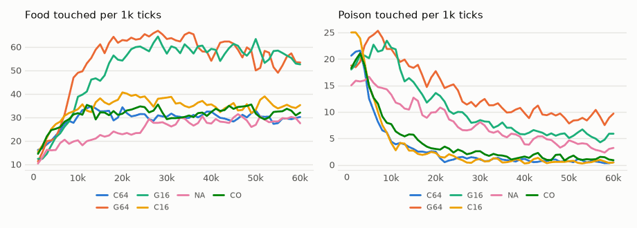

# vm-00065: Sixty-Four Pieces in One Body

**Date:** 2026-11-01
**Status:** Complete
**Source:** `exp/vm-00065` (code: `visual-motor-agent/dev/`)
**Outputs:** `~/data/research/visual-motor-agent/exp_00065/`; controls G16 and C16 in `exp_00064/`, NA and CO in `exp_00063/`
**Task plan:** [`../tasks/00074-sixty-four-pieces.md`](../tasks/00074-sixty-four-pieces.md)

## Goal

Can each patch have its own transformer? vm-00064 split the default model into 16 pieces of 4 patches each, and food doubled under gain. Here the split goes to the end: 64 transformers of 1 patch each. All a piece knows of the rest of the view comes through the 21 summary thumbnails. The move's training target stays shared.

## Method

- `configs/U_default.json` with `model.band_n=64`: 8 by 8 blocks of 1 patch, 24 slots per step, 59.4M parameters in all against 14.8M at 16 pieces. No code change.
- **G64:** `gain`. **C64:** `council`, 4,096 scores per tick. Seeds 1–8, 60k ticks, under MPS, seeds 1–4 on the 3090 and 5–8 on the 4090.
- **Control:** vm-00064's G16 and C16 and vm-00063's NA and CO, the same settings and seeds, not rerun.
- **Frozen check:** `eval_pieces.py --ring` on the final weights, 16 worlds, 1,500 ticks, every seed, all on the 3090 without MPS. `--rule random` beside gain.
- **Set before the results:** 64 pieces survive if, for at least one rule, the interval of the food difference against the same rule at 16 pieces includes zero or is above it, and its food share stays at 0.85 or more.

## Results

### R1. Food / poison per 1k ticks, by 10k ticks, mean of eight seeds

| arm | 0–10k | 10–20k | 20–30k | 30–40k | 40–50k | 50–60k |
|---|---|---|---|---|---|---|
| G64 | 29.9 / 22.3 | 59.3 / 17.9 | 64.4 / 13.1 | 61.1 / 10.6 | 58.5 / 9.4 | 54.5 / 8.9 |
| G16 | 24.1 / 21.2 | 49.2 / 14.8 | 59.8 / 9.6 | 59.5 / 6.9 | 58.7 / 5.9 | 55.4 / 5.5 |
| C64 | 24.1 / 12.1 | 32.7 / 3.0 | 30.5 / 1.1 | 30.9 / 0.9 | 30.2 / 0.7 | 29.3 / 0.6 |
| C16 | 27.3 / 13.8 | 36.6 / 2.6 | 38.2 / 1.1 | 35.6 / 0.7 | 33.8 / 0.7 | 35.6 / 0.5 |

### R2. The last 20k ticks, per 1k

| arm | pieces | food | poison | share | hunger | proposal size | smooth | patch CE | body CE | move CE |
|---|---|---|---|---|---|---|---|---|---|---|
| **G64** | 64 | **56.5 ± 3.9** | 9.16 ± 1.05 | 0.86 | 0.076 | 1.05 | 0.21 | 0.812 | 0.219 | 0.631 |
| **C64** | 64 | 29.8 ± 8.6 | **0.65 ± 0.69** | 0.98 | 0.052 | 0.72 | 0.72 | 0.790 | 0.244 | 0.201 |
| G16 | 16 | 57.0 ± 6.4 | 5.70 ± 0.61 | 0.91 | 0.073 | 1.05 | 0.23 | 0.799 | 0.221 | 0.533 |
| C16 | 16 | 34.7 ± 7.0 | 0.62 ± 0.19 | 0.98 | 0.045 | 0.75 | 0.68 | 0.783 | 0.241 | 0.228 |
| NA | 4 | 28.7 ± 5.7 | 3.90 ± 0.47 | 0.88 | 0.089 | 0.78 | 0.27 | 0.761 | 0.235 | 0.332 |
| CO | 4 | 32.8 ± 10.4 | 1.30 ± 0.45 | 0.96 | 0.052 | 0.80 | 0.51 | 0.756 | 0.243 | 0.200 |

Differences seed by seed:

| difference | food | poison | share |
|---|---|---|---|
| G64 − G16 | −0.5 ± 6.8 | **+3.46 ± 0.86** | **−0.048 ± 0.021** |
| C64 − C16 | −4.9 ± 8.0 | +0.03 ± 0.76 | −0.004 ± 0.017 |
| G64 − NA | **+27.8 ± 8.6** | **+5.26 ± 1.13** | |
| C64 − CO | −3.0 ± 14.2 | −0.65 ± 0.98 | |
| C64 − G64 | **−26.8 ± 10.9** | **−8.51 ± 1.22** | |

G64's share by seed runs from 0.826 to 0.906, mean 0.860 ± 0.020, so its mean clears 0.85 and the interval does not. Patch CE against 16 pieces: G64 +0.013 ± 0.002, C64 +0.007 ± 0.005. Move CE: G64 +0.098 ± 0.081.

Food by seed: G64 55.8, 53.2, 49.4, 62.2, 60.7, 55.4, 62.2, 53.5; C64 35.9, 45.5, 39.4, 32.0, 28.8, 20.0, 17.2, 19.4. No run failed.

### R3. Frozen weights: the moves actually made

Eight seeds, 16 worlds, 1,500 ticks. "Aim" is the cosine between the move and the nearest food within 16 px.

| arm | rule | food | poison | share | move size | smooth | aim |
|---|---|---|---|---|---|---|---|
| G64 | `gain` | 55.2 ± 5.7 | 8.8 ± 1.6 | 0.86 | 0.74 | 0.21 | 0.86 |
| G64 | a piece at random | 53.5 ± 1.9 | 6.1 ± 1.4 | 0.90 | 0.74 | 0.21 | 0.77 |
| G16 | `gain` | 57.1 ± 6.0 | 5.3 ± 1.3 | 0.91 | 0.73 | 0.23 | 0.83 |
| G16 | a piece at random | 53.1 ± 7.4 | 5.3 ± 0.8 | 0.91 | 0.72 | 0.22 | 0.73 |
| C64 | `council` | 31.2 ± 8.7 | 0.54 ± 0.37 | 0.98 | 0.50 | 0.73 | 0.62 |
| C16 | `council` | 34.1 ± 6.6 | 0.65 ± 0.37 | 0.98 | 0.51 | 0.69 | 0.67 |

What `gain` adds over a random piece, seed by seed:

| pieces | food | poison | aim |
|---|---|---|---|
| 4 | +3.2 ± 2.2 | **−1.8 ± 0.9** | |
| 16 | +4.0 ± 4.2 | 0.0 ± 1.4 | **+0.100 ± 0.021** |
| 64 | +1.7 ± 6.4 | **+2.7 ± 1.3** | **+0.086 ± 0.026** |

### R4. C64's seeds

C64's seeds fall in two groups, and the groups are the two GPUs. This was not looked for in advance.

| | s1 | s2 | s3 | s4 | s5 | s6 | s7 | s8 |
|---|---|---|---|---|---|---|---|---|
| GPU in the lifetime | 3090 | 3090 | 3090 | 3090 | 4090 | 4090 | 4090 | 4090 |
| food, lifetime | 35.9 | 45.5 | 39.4 | 32.0 | 28.8 | 20.0 | 17.2 | 19.4 |
| food, frozen (all on the 3090) | 35.1 | 46.2 | 42.0 | 37.1 | 27.8 | 23.9 | 17.8 | 19.9 |
| move size, frozen | 0.68 | 0.70 | 0.61 | 0.55 | 0.40 | 0.36 | 0.36 | 0.31 |
| proposal size, lifetime | 0.95 | 0.98 | 0.83 | 0.79 | 0.64 | 0.59 | 0.56 | 0.43 |

- The frozen scores repeat the lifetimes on one GPU, so the difference is in the weights, not in how they were scored.
- No other arm splits this way. Food on the 3090 and on the 4090: G64 55.1 and 57.9, C16 38.7 and 32.3, G16 58.2 and 56.4, CO 29.5 and 34.7, NA 30.3 and 27.8 (at 16 and at 4 pieces seeds 1–3 ran on the 3090).
- C64 − C16 in food is +0.5 ± 16.0 on seeds 1–4 and −10.4 ± 9.0 on seeds 5–8.

### R5. Pieces and speed, the last 20k ticks

- **Win share under gain:** even, 0.0129–0.0181 for each of the 64 pieces. No piece dominates.
- **Agreement with the move made:** 0.23 against 0.32 at 16 pieces under gain; 0.65 against 0.60 under council.
- **Over the life:** from 20–30k to 50–60k G64 loses 9.9 ± 6.0 food and 4.2 ± 0.9 poison. G16 loses 4.4 ± 6.6 and 4.1 ± 1.8.
- **Speed:** 6.8 ticks/s for gain and 6.1 for council alone on the 4090, against 25.0 at 16 pieces and 78.7 at 4. With 16 lifetimes sharing: 1.5 and 2.2 ticks/s on the 3090, 2.8 and 3.8 on the 4090.

<!-- figures -->
## Figures

*The world of this experiment as its model sees it, every 12 ticks. Moves are random: this shows the world, not the trained agent.*

*From each run's `metrics.jsonl`, the mean of its seeds by arm, smoothed.*
<!-- /figures -->

## Analysis

- **A transformer can own a single patch.** Four patches or one, the piece forages the same: 56.5 food against 57.0, on 14.8M or 59.4M parameters. What a piece needs of the rest of the view reaches it through the 21 thumbnails.
- **The gain from splitting has stopped.** Going from 4 to 16 doubled food; going from 16 to 64 adds nothing, for about 4 times the compute per tick. Aim at near food still rises a little (0.73, then 0.77, for a random piece at 16 and 64), and food does not follow it, so aim looks to be no longer what limits food here. What does is not known.
- **The rule's guard against poison has turned into a cost.** What gain adds on poison over a random piece goes from −1.8 at 4 pieces to 0.0 at 16 to +2.7 at 64. At 64 a piece drawn at random is cleaner than the rule (share 0.90 against 0.86) and gets as much food. This is the winner's curse that vm-00064 saw starting: the more the pieces, the likelier one of them misses the danger and wins. Gain still aims better at near food than a random piece, so it is choosing something, but that does not reach the food count.
- **Council holds, on the numbers as they stand.** C64 keeps C16's poison, its smooth path, and its share. Its food is the uncertain part (R4).
- **The C64 spread is not explained.** Seeds and GPUs were assigned together, so this experiment cannot tell a GPU from four unlucky seeds. Against a GPU: G64 ran on the same two GPUs with no split, and proposal size slides from seed to seed more than it steps at the boundary. Against plain luck: complete separation in one arm has odds of 1 in 35, though six arms were looked at, so that is weak. The configs match, and the two GPUs ran at different speeds, but `lifetime.py` reads the clock only for its timing metrics, so speed should not reach the learning. No mechanism is known. Only rerunning a seed on the other GPU would settle it.
- **Prediction pays little.** Patch CE rises 0.013 from 16 pieces, 0.051 from 4. Move CE rises under gain, as moves come from ever more proposers, and does not under council.
- **Caveats:** the controls come from the same build but not the same batch. About 20 tests are read here; by the rule of thumb in vm-00070 (mean at least 1.9 times its 95% half-interval), the bold differences survive, gain's +2.7 poison only just, and the fall in G64's food over the life and the seeds 5–8 difference do not. The seeds 5–8 difference was made after seeing the split, so it is a question, not a finding. G64 passes the share test by its mean, 0.860 against 0.85, and not by its interval. The reading's food test accepts a zero that a wide interval cannot exclude: for C64 that interval reaches −12.9.

## Conclusions

1. **The rule set before the results is met for both rules.** G64 food −0.5 ± 6.8 at share 0.86, C64 −4.9 ± 8.0 at share 0.98. 64 pieces survive.
2. Each patch can have its own transformer, with the move's target shared, at no cost in food under gain. It also brings no gain, and costs about 4 times the compute of 16.
3. **16 stays the split to use:** it matches 64 on food with 3.46 less poison under gain and matches it under council with less doubt.
4. Gain gets worse on poison as pieces multiply, and at 64 it is worse than a piece drawn at random. Council does not.
5. C64's food depends on which seeds are read. That is open, and it does not change conclusion 1, since G64 meets the reading alone.

## Next steps

- Rerun a C64 seed or two on the other GPU, to separate GPU from seed.
- Unshare the move's training target (a piece learns the move only when it made it), the part of "independent" this experiment left out.
