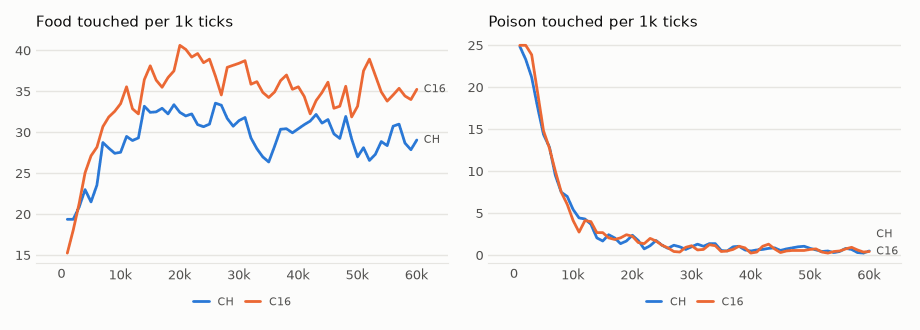

# vm-00066: A Channel per Value

**Date:** 2026-11-01
**Status:** Complete
**Source:** `exp/vm-00066` (code: `visual-motor-agent/dev/`)
**Outputs:** `~/data/research/visual-motor-agent/exp_00066/`; control C16 in `exp_00064/`
**Task plan:** [`../tasks/00075-value-channels.md`](../tasks/00075-value-channels.md)

## Goal

Hunger, the second drive and the move used the same rows of `W_in`, `W_out` and the bias as the first pixels of a patch. The owner: a value's meaning should not depend on that. Does giving each value its own rows change anything?

## Method

- **CH:** `configs/U_default.json`, `model.band_n=16`, `council`, `model.uni_chan=1`: five more value positions in the tables, about 41k parameters per piece (4%). Seeds 1–8, 60k ticks, on the 4090 with MPS.
- **Control:** C16 (vm-00064), not rerun.
- **Frozen check:** `eval_pieces.py --ring`, 16 worlds, 1,500 ticks, every seed.
- **Set before the results:** the channels are a cleanup and need no gain. They stay if the interval of the food difference against C16 includes zero or is above it, and that of poison includes zero or is below it.

## Results

### R1. Food / poison per 1k ticks, by 10k ticks, mean of eight seeds

| arm | 0–10k | 10–20k | 20–30k | 30–40k | 40–50k | 50–60k |
|---|---|---|---|---|---|---|
| CH | 24.3 / 13.3 | 31.9 / 2.5 | 31.9 / 1.1 | 29.1 / 0.9 | 30.2 / 0.8 | 28.8 / 0.5 |
| C16 | 27.3 / 13.8 | 36.6 / 2.6 | 38.2 / 1.1 | 35.6 / 0.7 | 33.8 / 0.7 | 35.6 / 0.5 |

### R2. The last 20k ticks, per 1k

| measure | CH | C16 | CH − C16, seed by seed |
|---|---|---|---|
| food | 29.5 ± 6.2 | 34.7 ± 7.0 | −5.2 ± 11.0 |
| poison | 0.65 ± 0.17 | 0.62 ± 0.19 | +0.03 ± 0.26 |
| food share | 0.978 | 0.982 | −0.005 ± 0.010 |
| patch CE | 0.780 | 0.783 | −0.003 ± 0.004 |
| body CE | 0.242 | 0.241 | +0.001 ± 0.004 |
| move CE | 0.232 | 0.228 | +0.004 ± 0.020 |
| mean hunger | 0.046 | 0.045 | |

Food by seed: CH 35.8, 25.3, 20.6, 41.0, 36.3, 22.6, 25.0, 29.8.

### R3. Frozen weights

| arm | food | poison | share | move size | aim within 16 px |
|---|---|---|---|---|---|
| CH | 28.1 ± 6.0 | 0.56 ± 0.24 | 0.98 | 0.46 | 0.65 |
| C16 | 34.1 ± 6.6 | 0.65 ± 0.37 | 0.98 | 0.51 | 0.67 |

<!-- figures -->
## Figures

*The world of this experiment as its model sees it, every 12 ticks. Moves are random: this shows the world, not the trained agent.*

*From each run's `metrics.jsonl`, the mean of its seeds by arm, smoothed.*
<!-- /figures -->

## Analysis

- **The reading is met, so the channels stay in the design.** Both intervals include zero.
- **The mixing was costing nothing we can measure.** Body and move CE do not fall, by 0.004 and 0.020 at most. So the case for channels is that the design is cleaner, not that it works better.
- **A loss of food is not ruled out.** The difference could be as large as −16, and CH is below C16 in the lifetime and frozen, with moves about 10% shorter. No mechanism is known, and with the seeds of one arm spanning 21–41 this may be noise.
- **Caveats:** tested at 16 pieces under council only; seeds are not bitwise replayed, and C16 ran on both cards while CH ran on the 4090.

## Conclusions

1. The channels pass the rule set in advance and stay in the design.
2. Sharing rows between hunger, the move and pixels did no measurable harm.
3. `configs/U_default.json` has `model.uni_chan=1` since this experiment (the owner, 2026-11-01): 970,402 parameters per piece against 929,282, 76 ticks/s alone on the 4090 against 79. They were tested at 16 pieces under council, not at the default's 4 under gain, and controls from before this date (NA, CO, G16, C16) ran without them.
