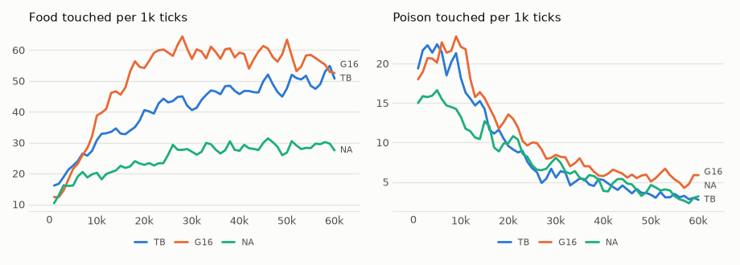

# vm-00067: One Table for All Pieces

**Date:** 2026-11-01
**Status:** Complete (pending tag)
**Source:** `exp/vm-00067` (code: `visual-motor-agent/dev/`)
**Outputs:** `~/data/research/visual-motor-agent/exp_00067/`; controls G16 in `exp_00064/`, NA in `exp_00063/`
**Task plan:** [`../tasks/00076-shared-tables.md`](../tasks/00076-shared-tables.md)

## Goal

At 16 pieces gain's food doubled (vm-00064). The owner's explanation: each transformer has its own table of 2,048 rows, so more pieces are more tokens. The direct test takes the extra tables away and keeps all else that 16 pieces change.

## Method

- **TB:** `configs/U_default.json`, `model.band_n=16`, `gain`, `online.tie_tables=inout`. All pieces start from piece 0's `W_in`, `W_out` and biases, and after every update these become the mean over the pieces. Each piece keeps its own Adam state, so this is close to one shared table, not the same. A patch has 32 rows on average against 128 at 4 pieces and 512 at 16. Distinct parameters: about 7M against 14.8M. Seeds 1–8, 60k ticks, on the 4090 with MPS.
- **Controls:** G16 (vm-00064), NA (vm-00063), not rerun.
- **Frozen check:** `eval_pieces.py --ring`, 16 worlds, 1,500 ticks, every seed, under `gain` and with a random piece.
- **Set before the results,** on food over the last 20k ticks. More tokens explain the rise: TB − G16 below zero beyond its interval, and TB − NA includes zero. They do not: TB − G16 includes zero or is above it. In part: TB below G16 and above NA, both beyond their intervals. An `in` arm runs only if TB loses food.

## Results

### R1. Food / poison per 1k ticks, by 10k ticks, mean of eight seeds

| arm | 0–10k | 10–20k | 20–30k | 30–40k | 40–50k | 50–60k |
|---|---|---|---|---|---|---|
| TB | 23.7 / 20.6 | 35.2 / 12.7 | 42.5 / 6.7 | 46.1 / 5.3 | 47.8 / 3.9 | 50.8 / 3.1 |
| G16 | 24.1 / 21.2 | 49.2 / 14.8 | 59.8 / 9.6 | 59.5 / 6.9 | 58.7 / 5.9 | 55.4 / 5.5 |

### R2. The last 20k ticks, per 1k

| measure | TB | G16 | TB − G16, seed by seed |
|---|---|---|---|
| food | 49.3 ± 10.8 | 57.0 ± 6.4 | −7.7 ± 13.4 |
| poison | 3.49 ± 0.60 | 5.70 ± 0.61 | **−2.21 ± 0.83** |
| food share | 0.934 | 0.909 | +0.023 ± 0.029 |
| patch CE | 0.788 | 0.799 | **−0.010 ± 0.003** |
| body CE | 0.231 | 0.221 | **+0.010 ± 0.007** |
| move CE | 0.301 | 0.533 | **−0.232 ± 0.066** |
| mean hunger | 0.048 | 0.073 | |

TB − NA: food **+20.6 ± 12.7**, poison −0.41 ± 0.85. Food by seed: TB 46.0, 48.4, 43.8, 70.4, 28.2, 43.0, 63.6, 51.0. Win shares under gain are even, 0.059–0.070.

### R3. Frozen weights

| arm | rule | food | poison | share | aim within 16 px |
|---|---|---|---|---|---|
| TB | `gain` | 48.2 ± 9.5 | 3.7 ± 1.4 | 0.92 | 0.77 |
| TB | a piece at random | 42.9 ± 10.6 | 4.8 ± 1.0 | 0.89 | 0.66 |
| G16 | `gain` | 57.1 ± 6.0 | 5.3 ± 1.3 | 0.91 | 0.83 |
| G16 | a piece at random | 53.1 ± 7.4 | 5.3 ± 0.8 | 0.91 | 0.73 |

What `gain` adds over a random piece, seed by seed: TB food +5.3 ± 2.9, poison **−1.1 ± 0.9**; G16 food +4.0 ± 4.2, poison 0.0 ± 1.4.

<!-- figures -->
## Figures

*The world of this experiment as its model sees it, every 12 ticks. Moves are random: this shows the world, not the trained agent.*

*From each run's `metrics.jsonl`, the mean of its seeds by arm, smoothed.*
<!-- /figures -->

## Analysis

- **By the rule set in advance, more tokens do not explain the rise.** TB − G16 includes zero. With fewer rows per patch than at 4 pieces, TB still makes 20.6 more food than NA.
- **That does not clear the tables completely.** The two intervals allow TB to have lost as much as 21 of G16's food, and to have kept as little as 8 of the 28.3 gained. So at least about a quarter of the rise is not the tables, and most of it may not be. The rest stays with what 16 pieces still change: fewer slots per piece, a larger share of thumbnails, more parameters in the transformers.
- **TB may still be catching up.** Its food rises in every block to 50.8, while G16's falls from 59.8 to 55.4. The last 20k ticks may understate it. Only a longer life would tell.
- **Sharing helps elsewhere.** Poison falls by 39%, patch CE and hunger improve, and move CE nearly halves, all with about half the distinct parameters. Pieces that read values in the same way may simply agree more about what comes next; that is a guess.
- **Gain's guard against poison returns.** At 16 pieces with separate tables gain cut no poison against a random piece; with one table it does. Why is not known.
- **Caveats:** the mean of 16 Adam steps is not one optimizer; G16 ran on both cards and TB on the 4090; seeds are not replayed. Only the poison, CE and TB − NA differences are clear. No `in` arm: TB did not lose food beyond its interval.

## Conclusions

1. The rise at 16 pieces survives one shared table. The tables are not its main cause, though part of it is not excluded.
2. One table gives a cleaner forager for half the parameters: less poison, better patch prediction, about 14% less food, not significantly.
3. Sharing tables is a candidate for the default at many pieces. It is also a step towards the scale the owner wants, as parameters stop growing with the pieces. The saving is not yet real in memory or compute: each piece still stores and updates its own copy.
