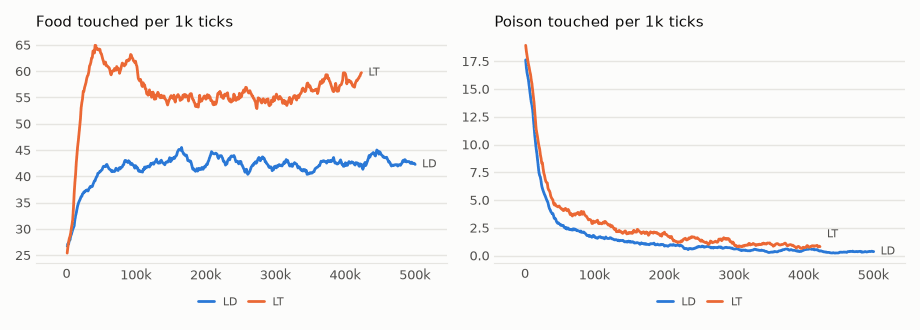

# vm-00069: Long Lives for Many Pieces

**Date:** 2026-11-01
**Status:** In progress: LD finished at 500k; LT at 422k when this was written, so everything about LT below is interim.
**Source:** `exp/vm-00069` once tagged (code: `visual-motor-agent/dev/`)
**Outputs:** `~/data/research/visual-motor-agent/exp_00069/`
**Task plan:** [`../tasks/00080-long-life-pieces.md`](../tasks/00080-long-life-pieces.md)

## Goal

60k ticks may be about 100 minutes of lived time. What does a life ten times longer change: does it get trapped, does it pay, and do the pieces keep their lead?

## Method

- **LT:** 16 pieces, `online.tie_tables=inout`, seeds 1–4 on the 4090, under MPS. **LD:** the default, 4 pieces, seeds 1–4 on the 3090.
- Both: `gain`, `configs/U_default.json` (channels on), `online.steps=500000`, `online.replay=500000`, so the memory holds the whole life and nothing is forgotten.
- **Frozen check:** `eval_pieces.py --ring` at 500k, 16 worlds, 1,500 ticks, every seed, `--rule random` beside gain. Done for LD; LT's waits for its end.
- **Set before the results (task 00080):**
  1. A life is trapped if its mean hunger over the last 20k ticks is above 0.9 or its food is under 1 per 1k.
  2. Long lives pay for an arm if its food over the last 20k minus its own 40–60k is above zero beyond its interval, or its poison is below zero beyond its interval with food not below.
  3. Pieces hold their lead if LT − LD in food over the last 20k is above zero beyond its interval.

With 4 seeds, df 3: t = 3.182.

## Results so far

### R1. Food / poison per 1k ticks, by 50k ticks, mean of four seeds

| arm | 0–50k | 50–100k | 100–150k | 150–200k | 200–250k | 250–300k | 300–350k | 350–400k | 400–450k | 450–500k |
|---|---|---|---|---|---|---|---|---|---|---|
| LD | 35.5 / 7.85 | 41.8 / 2.20 | 42.1 / 1.46 | 42.9 / 1.06 | 43.6 / 0.78 | 41.9 / 0.76 | 41.8 / 0.47 | 42.4 / 0.43 | 43.1 / 0.41 | 42.7 / 0.35 |
| LT | 51.4 / 9.42 | 61.3 / 3.68 | 55.6 / 2.54 | 55.1 / 2.02 | 54.7 / 1.56 | 54.9 / 1.29 | 55.4 / 0.97 | 57.4 / 0.92 | running | |

### R2. The same window for both arms, 400–420k, per 1k (interim)

| arm | food | poison | share | hunger | patch CE | body CE | move CE |
|---|---|---|---|---|---|---|---|
| LD | 42.7 ± 8.5 | 0.56 ± 0.30 | 0.99 | 0.032 | 0.741 | 0.240 | 0.874 |
| LT | 58.3 ± 13.7 | 0.76 ± 0.33 | 0.99 | 0.032 | 0.765 | 0.231 | 0.973 |

LT − LD, seed by seed: food +15.7 ± 12.0, poison +0.20 ± 0.25. Food by seed: LD 46.2, 48.2, 38.4, 37.8; LT 71.2, 54.7, 53.5, 53.8.

### R3. LD at the end, the last 20k ticks

Food 42.8 ± 10.5 (45.2, 50.7, 39.9, 35.5), poison 0.34 ± 0.04, share 0.99, hunger 0.041, patch CE 0.739, body CE 0.239, move CE 0.908.

Against its own 40–60k, seed by seed: food +1.6 ± 5.2, **poison −2.40 ± 0.60**.

### R4. LD, frozen at 500k

| rule | food | poison | share | move size | smooth | aim |
|---|---|---|---|---|---|---|
| `gain` | 42.3 ± 10.8 | 0.58 ± 0.51 | 0.98 | 0.65 | 0.24 | 0.72 |
| a piece at random | 42.8 ± 11.1 | 0.43 ± 0.35 | 0.99 | 0.64 | 0.24 | 0.70 |

`gain` − random, seed by seed: food −0.6 ± 1.9, poison +0.15 ± 0.54.

### R5. Move CE climbs and the moves do not change

Mean of seeds over the 20k ticks from each mark:

| arm | measure | 0k | 100k | 200k | 300k | 400k |
|---|---|---|---|---|---|---|
| LD | move CE | 0.160 | 0.469 | 0.692 | 0.809 | 0.874 |
| LD | proposal size | 0.88 | 0.89 | 0.90 | 0.89 | 0.90 |
| LD | smooth | 0.30 | 0.26 | 0.25 | 0.24 | 0.23 |
| LD | agreement of p0 with the move | 0.60 | 0.56 | 0.55 | 0.53 | 0.54 |
| LT | move CE | 0.112 | 0.524 | 0.797 | 0.916 | 0.973 |
| LT | proposal size | 0.87 | 1.07 | 1.06 | 1.05 | 1.08 |

Patch CE falls over the same life, 0.792 to 0.740 in LD, and body CE stays flat. Mean memory age rises in step with the life, as a memory of the whole life must: half the life at every point.

<!-- figures -->
## Figures

*The world of this experiment as its model sees it, every 12 ticks. Moves are random: this shows the world, not the trained agent.*

*From each run's `metrics.jsonl`, the mean of its seeds by arm, smoothed.*
<!-- /figures -->

## Reading so far

1. **Trapped: not for LD.** No LD life is near the limits: the worst mean hunger of the last 20k is 0.076, the least food 35.5. Hunger did touch 1.0 in at least one log row after 20k ticks in every life of both arms, and came back. The ring memory of vm-00031 trapped two lives of three; these are 4 seeds of a different model, so the whole-life memory is not proved the cause.
2. **Long lives pay for LD, in poison only.** Food stays level from 50k to 500k: whatever food this model reaches, it reaches in the first 50k ticks. Poison keeps falling for the whole life, to about an eighth of its level at 40–60k. For LT the interim difference is food −4.3 ± 6.7 and poison −3.51 ± 1.74 at 422k.
3. **Pieces hold their lead: not judged yet.** The window above is interim and not the reading's. With 4 seeds it leans on LT's seed 1.

## What is open

- **Move CE.** A model that gets better at the frames and worse at its own moves, with the moves about the same, has not been explained. It is scored on the training batch, 7 of whose 8 windows come from the memory, so a guess is that a memory of the whole life keeps showing it moves from every age; another is that the model's move distribution widens over time, since it is trained on samples of itself. Neither was tested. The instinct draws its candidates from that distribution, so if the second is right, a longer life may slowly change what it can choose from.
- **Gain does nothing by the end.** In LD at 500k a piece drawn at random does as well as `gain`, on food and on poison, though `gain` was what the life was lived by. The random draw is of pieces raised under gain, so this says nothing about what the rule taught them.
