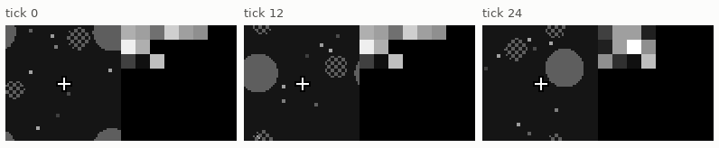
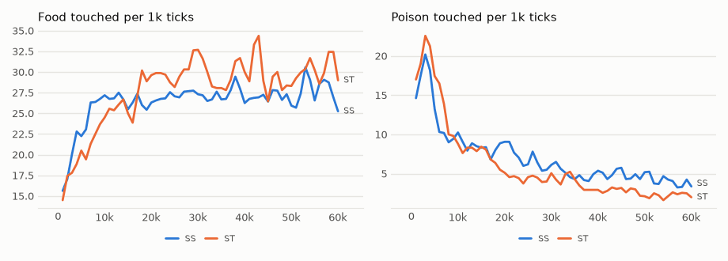

# vm-00070: Two Senses, One Body

**Date:** 2026-11-02
**Status:** Complete
**Source:** `exp/vm-00070` (code: `visual-motor-agent/dev/`)
**Outputs:** `~/data/research/visual-motor-agent/exp_00070/`
**Task plan:** [`../tasks/00081-two-senses.md`](../tasks/00081-two-senses.md)

## Goal

Can one sense stand in for another? Each piece of the model so far restored only what it sees itself. The owner proposed exercises across senses, and that bias from one part should reach what another perceives. Here a model lives with a view and a text sense, each of which goes off by itself for longer than its memory, and nothing rewards reading.

## Method

- **The world (`world/sense_world.py`):** one wide frame, 128 by 64, [view | text]. A scripted teacher writes three words about the thing nearest the cursor: `food` or `poison`; `left`, `right`, `up` or `down`; `near` or `far`. That is 16 sentences and 16 letters, one letter to a patch, so every letter is one patch of one grey level. It is pixels to the model, with no text path.
- **Drops:** every 60–140 ticks the eyes close or the teacher falls silent, at even odds, for 10–16 ticks, longer than the context of 8. Never both.
- **The model:** `configs/U_sense.json`: the default model with channels, two column pieces (view, text) joined by all the summaries, `gain`, 979,234 parameters per piece.
- **ST:** the true teacher. **SS:** shuffled words, a random sentence each time the true one changes, so the same rhythm with no meaning. Seeds 1–8, 60k ticks, both on the 4090 at 11 ticks/s per life.
- **Frozen test (`eval_sense.py`):** final weights, 16 worlds, 1,500 ticks, as lived and with `sense.cut`, where the other sense goes off too. Each sense is scored at its first tick back.
- **Set before the results,** seed by seed, ST as lived minus ST cut, and SS must not show the same: (1) sentence letters above zero, (2) error over the thing the teacher names below zero, (3) food with the eyes closed above zero.

Three additions and one fix came after the first results, and are not part of the plan:

- **Fix.** `eval_sense.py` read the text piece from the view piece's slots. A piece's summaries fall differently, so odd rows came from the wrong tokens, which showed as sentences right exactly 0.000 of the time. Fixed before SS was scored, with a test. Only the letter scores change, and food, poison and the view's scores were identical in a full rerun.
- **`direction`, `range`:** the first letter of those words alone. The rest of a word follows from its first letter, so reading 1's letters are mostly easy.
- **`first_mae`:** the error on the thing's first patch in reading order, because the rest of the thing is given away by the patches before it in the frame.
- **`eval_steer.py`:** who makes the move with the eyes closed, and where it goes, split by whether the last views are still in the window.

## Results

### R1. The readings: as lived minus cut, eight seeds

| reading | ST | SS | verdict |
|---|---|---|---|
| 1. Sentence letters | **+0.059 ± 0.020** | +0.010 ± 0.014 | **met** |
| 2. Error over the named thing | −0.0008 ± 0.0016 | −0.0008 ± 0.0010 | **not met** |
| 3. Food, eyes closed, per 1k | **+7.7 ± 4.9** | +1.1 ± 3.4 | **met** |

### R2. All scores

| score | ST lived | ST cut | SS lived | SS cut | ST lived − SS lived |
|---|---|---|---|---|---|
| sentences whole | **0.667** | 0.254 | 0.073 | 0.079 | **+0.594 ± 0.075** |
| first letter of the direction | **0.744** | 0.387 | 0.178 | 0.198 | **+0.566 ± 0.058** |
| first letter of the range | **0.876** | 0.632 | 0.445 | 0.458 | **+0.431 ± 0.047** |
| error, whole view | 0.0122 | 0.0125 | 0.0121 | 0.0123 | +0.0001 ± 0.0005 |
| error, named thing | 0.0357 | 0.0365 | 0.0354 | 0.0362 | +0.0003 ± 0.0026 |
| error, thing's first patch | 0.0764 | 0.0819 | 0.0871 | 0.0864 | −0.0107 ± 0.0116 |
| food, eyes closed | **22.5** | 14.8 | 13.8 | 12.7 | **+8.7 ± 4.2** |
| poison, eyes closed | **3.5** | 18.5 | 14.1 | 13.7 | **−10.7 ± 2.5** |
| food, eyes open | 31.4 | 31.4 | 28.6 | 28.5 | +2.9 ± 8.6 |
| poison, eyes open | 2.1 | 3.2 | 2.8 | 4.1 | −0.7 ± 1.2 |

The first-patch difference, lived minus cut: ST −0.0055 ± 0.0059, SS +0.0007 ± 0.0100. About 107 returns of each sense per run.

### R3. The lifetimes, per 1k ticks, mean of eight seeds

Food / poison overall, then with the eyes closed:

| ticks | ST | ST eyes closed | SS | SS eyes closed |
|---|---|---|---|---|
| 0–10k | 20.6 / 15.1 | 14.1 / 16.2 | 23.3 / 13.1 | 15.6 / 14.9 |
| 10–20k | 27.2 / 7.2 | 18.4 / 11.6 | 26.4 / 8.4 | 14.1 / 17.9 |
| 20–30k | 30.2 / 4.4 | 16.3 / 7.9 | 27.2 / 6.6 | 17.7 / 13.2 |
| 30–40k | 29.4 / 3.6 | 19.6 / 6.4 | 27.3 / 4.9 | 16.9 / 13.7 |
| 40–50k | 29.6 / 2.7 | 20.2 / 6.1 | 26.9 / 4.9 | 12.8 / 16.0 |
| 50–60k | 30.3 / 2.3 | 21.2 / 4.3 | 27.8 / 3.8 | 13.0 / 14.9 |

Last 20k ticks, ST − SS: poison with the eyes closed **−10.3 ± 3.5**, poison overall **−1.9 ± 0.8**, food with the eyes closed +7.8 ± 8.3, food overall +2.6 ± 7.4, hunger 0.083 against 0.084.

### R4. Who steers, with the eyes closed (`eval_steer.py`, frozen)

"Past the context" is 9 or more ticks after the eyes closed, about 510 ticks per run: no view left in the window. Cosines are between a move and the direction of the nearest thing, by what it really is.

| past the context | ST | SS | ST − SS |
|---|---|---|---|
| food per 1k | 21.3 ± 4.8 | 11.6 ± 4.9 | **+9.8 ± 6.2** |
| poison per 1k | 3.4 ± 2.6 | 16.8 ± 3.4 | **−13.4 ± 4.0** |
| move made, nearest is food | +0.217 ± 0.068 | +0.125 ± 0.044 | **+0.092 ± 0.051** |
| move made, nearest is poison | −0.127 ± 0.061 | +0.024 ± 0.042 | **−0.151 ± 0.066** |
| view piece's proposal, food | +0.207 ± 0.075 | +0.117 ± 0.040 | **+0.090 ± 0.062** |
| view piece's proposal, poison | −0.138 ± 0.047 | +0.005 ± 0.021 | **−0.143 ± 0.058** |
| text piece's proposal, food | +0.202 ± 0.073 | +0.114 ± 0.030 | **+0.088 ± 0.060** |
| text piece's proposal, poison | −0.080 ± 0.074 | +0.018 ± 0.046 | **−0.099 ± 0.083** |
| text piece makes the move | 0.587 ± 0.076 | 0.476 ± 0.106 | +0.111 ± 0.131 |

Within the context (1–8 ticks closed): ST 23.2 food, 3.5 poison; SS 15.2, 12.4. With the eyes open: ST 31.4, 2.1; SS 28.6, 2.8.

<!-- figures -->
## Figures

*The world of this experiment as its model sees it, every 12 ticks: the view on the left, the text sense on the right, one grey block to a letter and a word to a row. Moves are random: this shows the world, not the trained agent.*

*From each run's `metrics.jsonl`, the mean of its seeds by arm, smoothed. With the eyes open most of the time, the arms look alike: the difference is in R3 and R4.*
<!-- /figures -->

## Analysis

- **The words guide it.** With the eyes closed past its memory, ST still eats six food for every poison and SS eats fewer food than poison. Nobody told it what a word means, and no reward ever touched the text: it learned them by predicting. With the eyes open the arms eat the same within the interval and hunger is equal, so this is not a stronger agent overall, though in the lifetimes ST also touches a little less poison with its eyes open (−1.4 ± 0.9). Poison is the sharp result, and it comes from the moves: ST turns away from a poison it cannot see, and SS does not.
- **Words come from the picture.** The text piece writes the right sentence two times in three at the teacher's return. It holds nothing of the text for 10 ticks, and in the cut world, which keeps its body and moves and takes away the view's memory, it falls to one in four. So the difference comes through what the view put in the summaries.
- **The view piece read the words, and that is the surprise.** The planned fallback said a failed reading 2 would mean words reach the view piece too weakly. They do not. With its own patches black, the view piece proposes moves as good as the text piece's, and the text piece does not take over: it makes 0.59 of the moves, against 0.53 with the eyes open. So the summaries carry the words well enough to steer by.
- **But no picture came of it.** Reading 2 fails, and the sharper first-patch score does not clear zero either. Words reach the view piece's move and not its picture, as far as these scores can see. Any picture is at most a small effect: −0.0055 at best, on an error of 0.08. A guess at why, not tested: the eyes open at one tick in about 230, so the pixels get little training from words, while the move is predicted at every tick.
- **It is knowing without seeing.** The model acts on where the poison is and draws nothing of it. The owner's note on aphantasia asked what expectation between pieces would look like. Here is one shape of it: the expectation arrived and did its work with no image. An analogy, not a finding about minds.

## Caveats

- The teacher is a second sensor as much as a language: 16 fixed sentences about now, on at nearly every tick that the eyes are shut. Nothing here shows commands, or words about what is absent. The hint of rank C in the plan is not earned by this.
- Part of the moves' lead is not words: SS's moves still lean towards food (+0.125) with no view in the window and no meaning in the text. Why is **not known**. The differences above are the fair measure.
- The cut world was never lived. SS shows that this costs nothing: lived and cut match there. The exception, poison "with the eyes open" in both arms, is counting: in the cut world a teacher's drop turns the view off too, and those ticks still count as open.
- ST cut stays above chance on direction (0.39 against 0.25). Slot order lets the text piece see the top of the view within the frame, and words are not equally common. These two were not separated, and neither affects the difference against SS.
- Reading 1's letters are 0.91 even when cut, as most letters follow from a word's first. That is why the sentences and first letters are the scores to read.
- The eyes-closed scores rest on few events: about 2% of ticks past the context, which is about 11 food per seed. The intervals carry that.
- About 25 tests are read here. Correcting for them asks a mean of at least 1.9 times its interval. Sentences, first letters, reading 1, poison with the eyes closed, and the aim of the move and the view piece away from poison pass that, and so does ST − SS food with the eyes closed in the frozen test (+8.7 ± 4.2). **Reading 3 as set does not** (+7.7 ± 4.9), nor do the aims at food or the text piece's aim from poison. Avoiding poison is the firm result, and finding food the likely one.
- Both arms shared the 4090 with LT of vm-00069, which ran at about 2 ticks/s instead of 14 for over 3 hours. SS moved there from the 3090 to avoid a wait of hours, with its settings unchanged.

## Conclusions

1. **Readings 1 and 3 are met and reading 2 is not.** Words come from the picture, and words guide the body with the eyes closed, most firmly away from poison. The picture does not measurably come from words.
2. With no reward on the text, a model learned what 16 words mean well enough to avoid poison it cannot see: 3.5 against 14.1 per 1k ticks, and to write what it saw: 0.67 of sentences against 0.07.
3. Both pieces steer from the words, including the one whose own patches are black. The summaries are not the limit.
4. What the model knows from words reaches action and not imagery. An exercise that asks for the picture itself is the next test of that.

## Next steps

- Score the picture directly: an exercise where the view piece is trained to fill in the frame from words with its eyes closed, and the owner's exercises across senses in full.
- Words that say what is not present or what to do: `poison` is a description, and `go left` would be an instruction.
