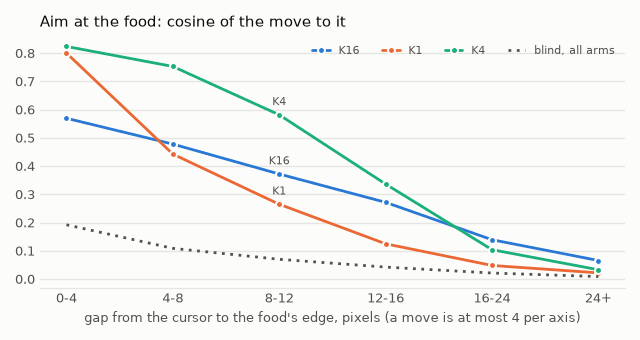
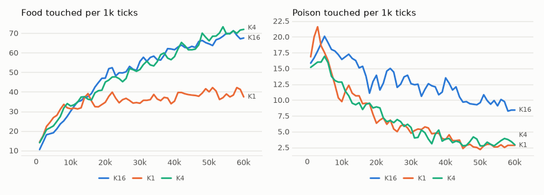

# vm-00071: Hunger Ahead

**Date:** 2026-11-02
**Status:** Complete (pending tag)
**Source:** `dev/` (not yet tagged)
**Outputs:** `~/data/research/visual-motor-agent/exp_00071/`
**Task plan:** [`../tasks/00082-hunger-ahead.md`](../tasks/00082-hunger-ahead.md)

## Goal

vm-00069 found no chain of moves: aim at food fades past 2–3 moves though the whole world is in view, and a blind path with a perfect one-step grab gets about 60% of the food. Does a chain form if the hunger a move is scored on is the mean over the next k ticks, trained on real futures?

## Method

- **One change, in the target.** `online.future_k = k`: the hunger the move token predicts, and the instinct reads, is the mean over the next k ticks, labelled in hindsight (`online.py`, `future_labels`). No new token, table or head, the same loss, the same read. The rest of the design is in the task plan.
- **Arms:** K1 (the default, the control), K4, K16. Six seeds each, 60k ticks, `configs/U_default.json` (4 pieces, gain, channels). Seeds 1–3 on the 4090 at 20 ticks/s, 4–6 on the 3090 at 11, nine lives on each under MPS, so arm and GPU are not confounded.
- **Frozen tests:** `eval_hunger.py chain` and `reach`, final weights, 16 worlds, 1,500 ticks, without MPS.
- **Set before the results (task 00082),** each an arm against K1, seed by seed, 95% interval on six seeds, df 5, t = 2.571:
  1. Plumbing: training gets the right numbers.
  2. Reach grows (the main one): aim at gaps of 12–24 pixels, weighted by ticks, is above K1's by more than its interval.
  3. A chain pays: the model's lead over blind and a perfect grab is above K1's by more than its interval.
  4. Food: over the last 20k ticks food is above K1's by more than its interval, with poison not above K1's by more than its interval.

## Results

### R1. In life, per 1k ticks, mean of six seeds

| arm | food 0–20k | 20–40k | 40–60k | poison 0–20k | 20–40k | 40–60k |
|---|---|---|---|---|---|---|
| K1 | 30.6 | 36.1 | 39.0 | 12.5 | 5.4 | 2.9 |
| K4 | 32.2 | 52.7 | **67.8** | 12.0 | 5.3 | 3.3 |
| K16 | 31.2 | 55.3 | 66.1 | 16.3 | 12.7 | 9.7 |

Food by seed, 40–60k:

| arm | s1 | s2 | s3 | s4 | s5 | s6 |
|---|---|---|---|---|---|---|
| K1 | 52.1 | 30.5 | 52.3 | 35.8 | 30.6 | 32.8 |
| K4 | 62.4 | 86.5 | 76.6 | 82.4 | 52.7 | 46.2 |
| K16 | 61.4 | 77.8 | 69.0 | 59.0 | 73.9 | 55.4 |

### R2. The readings' numbers, against K1

| measure | K4 − K1 | seeds above | K16 − K1 | seeds above |
|---|---|---|---|---|
| Aim at 12–24 px, frozen | +.092 ± .061 | 6 of 6 | +.112 ± .035 | 6 of 6 |
| The same aim at another world's food (blind) | +.003 ± .011 | 4 of 6 | +.008 ± .012 | 5 of 6 |
| Lead over blind and a perfect grab, frozen | +29.6 ± 15.4 | 6 of 6 | +20.6 ± 12.7 | 6 of 6 |
| Food, last 20k | +28.8 ± 19.3 | 6 of 6 | +27.1 ± 15.8 | 6 of 6 |
| Poison, last 20k | +.37 ± .64 | 4 of 6 | **+6.83 ± 1.39** | 6 of 6 |

### R3. Aim at the food by the gap to its edge, frozen, mean of six seeds

| gap, px | K1 | K4 | K16 | blind, K4 |
|---|---|---|---|---|
| 0–4 | .80 | .82 | .57 | .20 |
| 4–8 | .44 | .75 | .48 | .10 |
| 8–12 | .27 | .58 | .37 | .07 |
| 12–16 | .13 | .34 | .27 | .04 |
| 16–24 | .05 | .10 | .14 | .02 |
| 24+ | .02 | .03 | .07 | .01 |

### R4. Chaos and a grab, frozen, food / poison per 1k

| arm | seen | blind | blind + perfect grab | grab's share of the food | smoothness |
|---|---|---|---|---|---|
| K1 | 38.7 / 3.32 | 13.0 / 18.3 | 25.0 / 17.4 | 65% | .25 |
| K4 | 71.5 / 2.70 | 14.6 / 19.1 | 28.2 / 18.9 | 39% | .32 |
| K16 | 67.7 / 9.33 | 17.1 / 22.9 | 33.4 / 21.9 | 49% | .38 |

### R5. With food or poison one move away, frozen

Predicted drop, whether it clears the tolerance of .005, and food eaten when in reach, by real hunger.

| real hunger | K1 drop | clears | eaten | K4 drop | clears | eaten | K16 drop | clears | eaten |
|---|---|---|---|---|---|---|---|---|---|
| 0–.005 | .0024 | .08 | .85 | .0021 | .04 | .82 | .0016 | .16 | .50 |
| .005–.01 | .0064 | .57 | .94 | .0043 | .17 | .87 | .0028 | .19 | .56 |
| .01–.02 | .0123 | .76 | .94 | .0065 | .36 | .89 | .0043 | .23 | .62 |
| .02–.04 | .0232 | .84 | .94 | .0108 | .52 | .89 | .0048 | .27 | .66 |
| .04–.1 | .0410 | .84 | .93 | .0189 | .68 | .87 | .0095 | .35 | .67 |
| .1+ | .2949 | .85 | .90 | .1612 | .83 | .87 | .0387 | .63 | .70 |

| poison in reach | K1 | K4 | K16 |
|---|---|---|---|
| Predicted rise | .248 | .166 | **.017** |
| Clears the tolerance | .83 | .77 | .42 |
| The lowest prediction is a poison move | .07 | .11 | **.30** |

<!-- figures -->
## Figures

*The world of this experiment as its model sees it, every 12 ticks. Moves are random: this shows the world, not the trained agent.*

*From each run's `metrics.jsonl`, the mean of its seeds by arm, smoothed.*
<!-- /figures -->

## Videos

Not in the repository: `~/data/research/visual-motor-agent/exp_00071/videos/`, `make videos`. K1, K4 and K16 side by side from the same start, for seed 3 (K4's lead there is about the median) and seed 2 (K4's largest).

## Readings

1. **Plumbing: met,** before the runs, inside real lives: k = 1 labels equal the next hunger in all 2,493 batches, and k = 4 and 16 are within 6e-8 of the true means.
2. **Reach grows: met by both.** K4 +.092 ± .061, K16 +.112 ± .035. The blind aim does not move, so the rise is about food the agent sees.
3. **A chain pays: met by both.** K4 +29.6 ± 15.4, K16 +20.6 ± 12.7.
4. **Food: met by K4, not by K16.** K4 +28.8 ± 19.3 in food with poison +.37 ± .64. K16 has the food, +27.1 ± 15.8, but poison is above K1's by +6.83 ± 1.39.

## Analysis

- **K4 is the arm that works.** Food goes from 39.0 to 67.8 with poison where it was. LD settled at 42.8 food and LT, with 16 pieces, at 58.5 (vm-00069), though those are other lives with other seeds, so this is not a controlled comparison.
- **The whole gain comes after 20k ticks.** All arms are level until then. K1 then goes nearly flat while K4 and K16 are still climbing at 60k. This is what a target that reflects the agent's own habits should do, since better moves make better targets, but nothing here shows that this is the cause.
- **K16 has the widest reach and loses the near field.** It aims best past 16 px, but its aim at 0–4 px falls to .57 from .80, and it eats only 50–70% of the food in reach, against 85–94% for K1.
- **K16 hardly sees poison.** Its predicted rise is .017, a fifteenth of K1's, under the tolerance on 58% of its pairs, and it picks a poison move 30% of the time. One guess: a meal resets hunger, and food comes about every 15 ticks, so most of a 16-tick mean is untouched by what a poison does. Another: the mean is a noisier target to learn. Neither was tested.
- **The tolerance costs K4 more.** The mean over 4 ticks about halves the predicted drop for food, so fewer drops clear .005: 52% against 84% at hunger .02–.04. K4 eats less of the food in reach than K1 at every level, by 3–7 points. It more than earns this back by arriving at food more often, but the tolerance was tuned on next-tick hunger.
- **Still not a plan.** Aim fades past about 16 px in K4, a reach of perhaps one or two moves more than K1, and the world is still seen whole. But the walk and a last grab no longer explain the food: 39% of K4's against 65% of K1's. What the labels give is a value of a move under the agent's habits, and that is what a wider reach means here.
- **Moves are about as jumpy.** Smoothness .25, .32 and .38; the differences from K1, +.08 ± .20 and +.14 ± .17, are within their intervals.
- **Caveats:** these are plain 95% intervals, with no correction for reading six comparisons. By the stricter bar of earlier work, a mean at least 1.9 times its interval, K4's lead is on the line (1.9), and its aim and food fall short (1.5); K16's aim clears it and its lead (1.6) does not. All are 6 of 6 seeds, so the direction is firmer than the sizes. Seeds vary a great deal: K4's food lead runs from +10 to +56. The readings stop at 60k, with K4 and K16 still rising. Frozen food agrees with the last 20k of the lives in every arm: 38.7, 71.5 and 67.7 against 39.0, 67.8 and 66.1.
- **The cost of k above 1.** The body token no longer predicts the next hunger, so body CE is not comparable, a dream's body is wrong, and `lifetime.py` refuses self-forcing with it.

## Conclusions

1. **Scoring a move on the mean hunger of the next 4 ticks works:** food +28.8 ± 19.3, no more poison, in all six seeds.
2. **Reach widens but does not become a plan.** Aim at 8–12 px doubles, .27 to .58, and fades past about 16 px.
3. **Further is not better.** K16 reaches a little further, loses aim up close and all but stops seeing poison: +6.83 ± 1.39.
4. **It took one change in the target,** with no new token, table or head, though it gives up next-tick hunger, and with that the body in dreams and self-forcing.
5. `h_rate` at 5 times, the fallback in the task plan, was not needed.

## Next steps

- K4 with its own tolerance: the drop is about half, so .005 probably hides food that K1 would see.
- K2 and K8, to find where poison starts to go.
- K4 for a long life: it is still climbing at 60k.
- Why K16 hardly sees poison, by comparing the predicted rise with the real rise in the mean.
- The general form: every token predicts itself k ticks ahead, so that dreams stay right (challenge 3 of §13 in `../ARCHITECTURE.md`).
