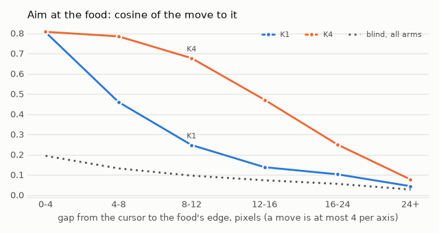
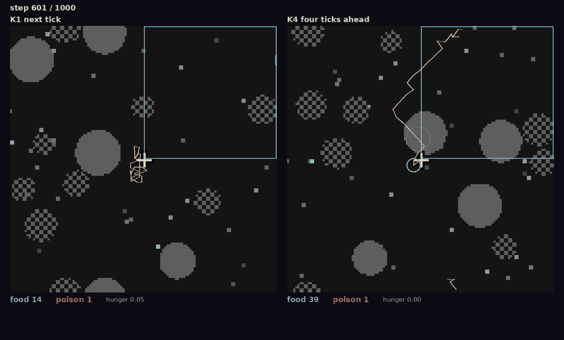
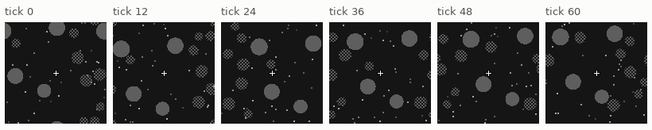
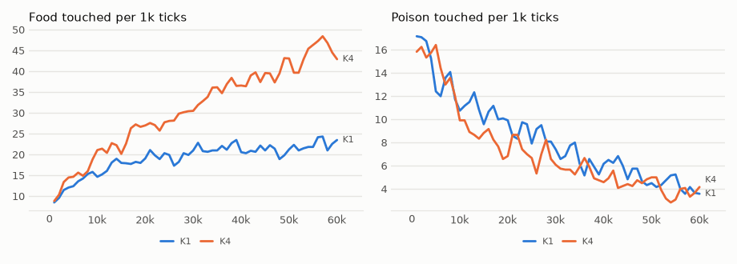

# vm-00072: The Big World

**Date:** 2026-11-02
**Status:** Complete
**Source:** `exp/vm-00072` (code: `visual-motor-agent/dev/`)
**Outputs:** `~/data/research/visual-motor-agent/exp_00072/`
**Task plan:** [`../tasks/00083-big-world.md`](../tasks/00083-big-world.md)

## Goal

vm-00071 at twice the side: a 128 x 128 world with food and poison of the same size in pixels and four times as many of each. Does the wider reach of K4 hold when there is four times as much to look at, and what does a larger view cost?

## Method

- **The world:** `configs/U_big.json`: 4 foods, 8 poisons, 32 dots, the same sizes, moves and hunger as the default, so the same density. `env.foods` adds still food circles, and the nearest is always the one in `target`.
- **The model:** the same four quarters, 16 x 16 patches, four levels of summaries, log summaries: a quarter reads 39 of the 85, 105 tokens per step against 32 at 64 x 64.
- **Arms:** K1 and K4, `online.future_k`, six seeds, 60k ticks. Seeds 1–3 on the 4090 at 8.3 ticks/s, 4–6 on the 3090 at 4.4, six lives on each under MPS. The first start, with every summary and K16, was stopped early with nothing read from it; the owner chose log summaries and dropped K16 after vm-00073.
- **Frozen tests:** `eval_hunger.py chain`, `reach`, `poison`, final weights, 16 worlds, 1,500 ticks.
- **The world alone:** `eval_food_gap.py`, scripted walkers with no model, 32 bodies, 5,500 ticks.
- **Set before the results (task 00083),** K4 against K1, seed by seed, 95% interval on six seeds, df 5, t = 2.571. Beside them, mean hunger. vm-00073 is the small world beside it.

## Results

### R1. K4 against K1

| measure | Big, K1 | Big, K4 | Big, K4 − K1 | Small, K1 | Small, K4 | Small, K4 − K1 |
|---|---|---|---|---|---|---|
| Food, last 20k | 21.7 | 42.1 | +20.4 ± 6.5 | 35.8 | 70.0 | +34.2 ± 8.1 |
| Poison, last 20k | 4.84 | 4.18 | −.66 ± 1.18 | 3.90 | 3.68 | −.22 ± 1.48 |
| Food, frozen | 22.7 | 44.6 | +21.8 ± 5.2 | 37.0 | 72.2 | |
| Poison, frozen | 4.24 | 2.52 | −1.7 ± 2.5 | 2.99 | 3.34 | |
| Aim at 12–24 px, frozen | .113 | .307 | +.195 ± .030 | .085 | .166 | +.081 ± .055 |
| Lead over blind and a perfect grab, frozen | 5.4 | 22.7 | +17.3 ± 1.9 | 8.6 | 42.9 | |
| Mean hunger, frozen | .113 | .048 | −.065 ± .033 | .072 | .041 | −.031 ± .029 |

K4 is above K1 in all six seeds on food, aim and lead.

### R2. Aim at the food by the gap to its edge, frozen

| gap, px | Share of ticks, K1 | Share of ticks, K4 | Aim, K1 | Aim, K4 |
|---|---|---|---|---|
| 0–4 | .025 | .051 | .805 | .807 |
| 4–8 | .043 | .049 | .460 | .785 |
| 8–12 | .071 | .054 | .247 | .677 |
| 12–16 | .104 | .070 | .138 | .471 |
| 16–24 | .252 | .199 | .102 | .250 |
| 24+ | .505 | .576 | .044 | .077 |

*K4 reaches further than K1 at every gap past 4 pixels. Past 24 pixels neither does much, and that is where both spend more than half their ticks.*

### R3. What the world asks for, with no model

The same density, yet both arms eat about 60% of what they eat in the small world. The owner's explanation: in the big world food can respawn far from the model, so it is harder to reach. Scripted walkers go straight, and turn to the nearest food once it is within a reach, ignoring poison.

| Walker or arm | Food, 64 x 64 | Food, 128 x 128 | Big against small |
|---|---|---|---|
| Blind | 22.7 | 19.5 | .86 |
| Reach 16 pixels | 139.8 | 67.7 | .48 |
| Reach 24 pixels | 243.4 | 105.4 | .43 |
| Always chases | 272.0 | 170.6 | .63 |
| K1, last 20k | 35.8 | 21.7 | .61 |
| K4, last 20k | 70.0 | 42.1 | .60 |

| Right after a bite, chasing | 64 x 64 | 128 x 128 |
|---|---|---|
| Gap to the nearest food | 15.3 px | 24.6 px |
| Share of bites with the next food beyond 24 px | .15 | .50 |

### R4. The videos

`videos/seed3/compare.mp4` and `videos/seed2/compare.mp4`, K1 beside K4, 1,000 ticks. Seed 3 has the widest lead of the first three seeds, seed 2 the narrowest. Over 16 worlds, frozen: seed 3, food 14.3 and 46.4, poison 4.3 and .9; seed 2, food 24.9 and 38.9, poison 3.9 and 3.6.

*Seed 3 at tick 600: K1 in a small tangle, K4's trail in a long line. One frame.*

<!-- figures -->
## Figures

*The world of this experiment as its model sees it, every 12 ticks. Moves are random: this shows the world, not the trained agent.*

*From each run's `metrics.jsonl`, the mean of its seeds by arm, smoothed.*
<!-- /figures -->

## Readings

1. **Plumbing: met.** With `foods = 1` the world is the old one, draw for draw, over 5,000 ticks; with 4, every food is drawn and feeds, and no circles overlap.
2. **Reach holds: met.** Aim at 12–24 px +.195 ± .030, all six seeds.
3. **A chain pays: met.** Lead +17.3 ± 1.9, all six seeds.
4. **Food: met.** +20.4 ± 6.5, all six seeds, with poison −.66 ± 1.18.

Beside them, mean hunger falls by more than its interval, −.065 ± .033.

## Analysis

- **K4's advantage is a property of the task, not of the small world.** It doubles food in both worlds, at nearly the same ratio. A quarter reads fewer than half of the summaries, and the reach still holds.
- **The owner's explanation of the lower food holds.** The next food is 24.6 px away against 15.3, and even a perfect chaser loses 37% of its food. The model's 40% is no worse than the world alone asks, so nothing about the model is needed to explain it. My first guess, that it had more to learn in the same ticks, is not needed. The interim figure of .56 for K4 used three seeds; with six it is .60.
- **Why the same density gives longer gaps:** a torus of 64 pixels cannot put anything more than about 45 pixels away. In the big world the next food is the nearest of a few scattered circles, and the one just eaten was the near one.
- **Not tested:** the second half of the explanation, that food concentrates in places. Foods are placed independently, so any clumps are chance; this measures gaps, not clumps.
- **Aim is not a chain yet.** Both arms spend more than half of their ticks past 24 pixels, where aim is .04 to .08. K4 gets twice what a blind walk gets, K1 about the same as one (21.7 against 19.5). The food the world still offers past that reach is the largest gap left: reach 24 walkers get 2.5 times what K4 gets.
- **Reading the aim row with care:** aim at 12–24 px is weighted by ticks, and the two worlds differ in where those ticks fall, so .307 against .166 is not simply a better reach in the big world.

## Conclusions

1. K4 against K1 holds in a world four times the size: food 42.1 against 21.7, no more poison, reach and chain both up, all six seeds.
2. Both arms eat about 60% of the small world's food because the world asks for it: the next food is farther, and even a perfect chaser loses 37%.
3. Log summaries are enough for this: a quarter reads 39 of 85.

## Next steps

- Reach past 24 pixels: most ticks are spent there.
- The 16-transformer arm in this world, with log summaries, is parked.
- Whether K4 should be the default stays the owner's decision.
