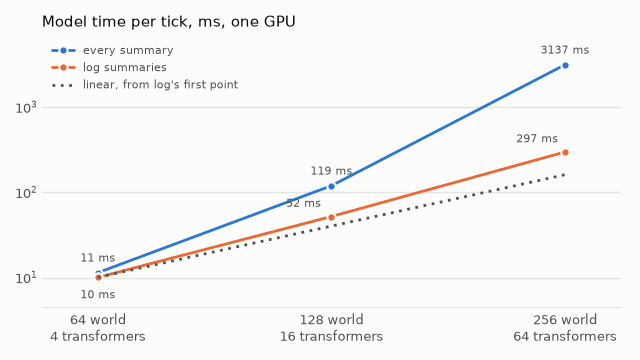
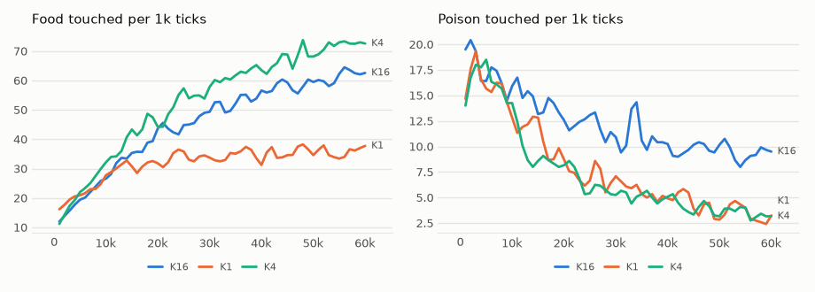

# vm-00073: Log Summaries

**Date:** 2026-11-02
**Status:** Complete
**Source:** `exp/vm-00073` (code: `visual-motor-agent/dev/`)
**Outputs:** `~/data/research/visual-motor-agent/exp_00073/`
**Task plan:** [`../tasks/00084-log-summaries.md`](../tasks/00084-log-summaries.md)

## Goal

Every run since vm-00050 has read every summary, which grows with the world. The owner: "We need to switch to log summaries by default". Two questions: what do log summaries (`model.band_win = 1`, sharp near and coarse far) do to food, poison and reach in the visual world, and does the cost grow in line with the world when the transformers grow with it?

## Method

- **Quality:** vm-00071's experiment with one change, `model.band_win = 1`: the 64 x 64 world, K1, K4, K16, six seeds, 60k ticks, seeds 1–3 on the 4090 and 4–6 on the 3090, nine lives on each under MPS. Each quarter reads 14 summaries against 21, so a step is 32 tokens against 39. The control is vm-00071 itself, same arm and seed number.
- **Frozen tests:** `eval_hunger.py chain`, `reach` and `poison`, final weights, 16 worlds, 1,500 ticks, without MPS.
- **Cost:** `bench_scale.py`, the owner's comparison of T transformers in a world against 4T in a world of 4 times the area. Each doubling of the side takes the area, the things in it and the transformers up 4 times, so a transformer keeps its 16 patches. Alone on the 4090, without MPS, 1,500 ticks, timed after tick 1,100.
- **Set before the results (task 00084),** each an arm against the same k in vm-00071, seed by seed, 95% interval on six seeds, df 5, t = 2.571:
  1. Plumbing: 32 tokens per step, the ring and the tools work.
  2. Food and poison hold: food not below, poison not above, by more than the interval.
  3. Reach holds (K4): aim at 12–24 pixels and the lead over blind and a perfect grab not below by more than their intervals.
  4. Hunger holds: frozen mean hunger not above by more than its interval.
  5. The cost: linear is 4 times at each doubling of the side.

## Results

### R1. Log minus all, six seeds, same arm and seed

| measure | K1 | K4 | K16 |
|---|---|---|---|
| Food, last 20k | −3.2 ± 16.2 | +2.2 ± 20.1 | −6.2 ± 13.4 |
| Poison, last 20k | +1.0 ± 1.4 | +.42 ± .76 | −.21 ± 3.3 |
| Aim at 12–24 px, frozen | +.016 ± .061 | +.005 ± .062 | −.013 ± .034 |
| Lead over blind and a perfect grab, frozen | −5.1 ± 7.3 | −.4 ± 19.5 | −3.5 ± 15.5 |
| Mean hunger, frozen | −.002 ± .057 | +.005 ± .018 | −.003 ± .015 |

### R2. The levels

| arm | food, all | food, log | poison, all | poison, log | mean hunger, all | mean hunger, log |
|---|---|---|---|---|---|---|
| K1 | 39.0 | 35.8 | 2.9 | 3.9 | .074 | .072 |
| K4 | 67.8 | **70.0** | 3.3 | 3.7 | .035 | .041 |
| K16 | 66.1 | 59.9 | 9.7 | 9.5 | .060 | .057 |

K4 against K1 inside this experiment holds as in vm-00071: 70.0 against 35.8 food. K16's poison is unchanged, and so is the way it misses it: predicted rise .021, the lowest prediction a poison move 29% of the time (.017 and 30% in vm-00071).

### R3. Aim at the food by the gap to its edge, frozen, K4

| gap, px | all | log |
|---|---|---|
| 0–4 | .82 | .80 |
| 4–8 | .75 | .72 |
| 8–12 | .58 | .57 |
| 12–16 | .34 | .34 |
| 16–24 | .10 | .11 |
| 24+ | .03 | .03 |

### R4. Speed in the runs

| | all (vm-00071) | log |
|---|---|---|
| Ticks/s per life, 4090, nine lives | 20.0 | 25.8 |
| Ticks/s per life, 3090, nine lives | 11.1 | 14.5 |
| Ticks/s alone, 4090 | 76 | 84 |

### R5. Does the cost grow in line with the world?

The model's time per tick on one GPU, acting plus updating. Tokens are per step and per transformer.

| world | transformers | tokens, all | tokens, log | all, ms | growth | log, ms | growth |
|---|---|---|---|---|---|---|---|
| 64 | 4 | 39 | 32 | 11.4 | | 10.0 | |
| 128 | 16 | 103 | 36–48 | 119.5 | **10.5** | 52.0 | **5.2** |
| 256 | 64 | 359 | 40–57 | 3,137 | **26** | 297 | **5.7** |

| | world 64 | world 128 | world 256 |
|---|---|---|---|
| Per transformer, all, ms | 2.9 | 7.5 | 49 |
| Per transformer, log, ms | 2.5 | 3.3 | 4.6 |
| Acting, all / log, ms | 4.9 / 4.5 | 26 / 17 | 234 / 70 |
| Updating, all / log, ms | 6.5 / 5.6 | 93 / 35 | 2,903 / 227 |
| Peak GPU memory, all / log, GB | 0.8 / 0.7 | 2.1 / 1.5 | 15.2 / 5.7 |
| The world's code, ms | 0.8 | 1.8 | 15 |

<!-- figures -->
## Figures

*The world of this experiment as its model sees it, every 12 ticks. Moves are random: this shows the world, not the trained agent.*

*From each run's `metrics.jsonl`, the mean of its seeds by arm, smoothed.*
<!-- /figures -->

## Readings

1. **Plumbing: met,** before the runs: `uni_layout` gives 32 tokens, the ring and summary tests pass, and a short life and the frozen tools ran.
2. **Food and poison hold: met,** in all three arms.
3. **Reach holds: met.** Aim +.005 ± .062, lead −.4 ± 19.5.
4. **Hunger holds: met,** in all three arms.
5. **The cost:** log summaries grow by 5.2 and 5.7 times, near linear and not quite; every summary grows by 10.5 and 26.

## Analysis

- **No loss could be seen, and that is not proof of none.** The intervals are wide: K4's food could differ by about 20 either way, nearly a third of it. Differences by seed swing from −30 to +26, about as much as the gaps between arms, so most of what shows here is the noise of a life.
- **This was the mild test.** A quarter lost 7 of 21 summaries, all at the finest level, and a world of 4 x 4 cells has little that is far. It says nothing yet about a quarter of the big world, which would go from 85 to 39, or about 16 or 64 transformers.
- **One thing to watch:** poison and K1's lead lean the wrong way, K1 +1.0 and K4 +.42 in poison, 5 of 6 and 4 of 6 seeds above, K1's lead 5 of 6 below. Each is inside its interval, so it is not read as a loss, but a real small cost would look like this.
- **The speed gain is less than the square of the tokens.** 18% fewer tokens would give 1.48 times if attention were all of a tick. The runs gain about 1.3 times, and a life alone about 1.1 times (the model's time goes from 11.4 to 10.0 ms). Why the gain is larger with nine lives on a GPU was not measured.
- **All summaries go past linear because each transformer's tokens grow with the world,** and attention grows with their square. Log summaries add a few tokens per level, so the cost per transformer creeps up: 2.5, 3.3, 4.6 ms. Acting is about linear, 3.8 and 4.2 times, and updating is not, 6.3 and 6.5 times. As a power of the area the last doubling is about N^1.25 for log and N^2.35 for all.
- **At 256, log summaries are 10.6 times faster** and take 5.7 GB against 15.2. At 128 they are 2.3 times faster.
- **Caveats on the cost:** one short run of each, 300–400 ticks. The 256 run with every summary hit its 20-minute limit at tick 300, before the warm-up ended, and is timed on its last rows; on the two smaller worlds early and warm timings agree within about 2%. Transformers run one after another, so this is total compute, as on one GPU. It measures speed only: nothing here says what 16 or 64 transformers do to quality with log summaries at 128 or 256.

## Conclusions

1. **Log summaries cost nothing that could be seen at 64 x 64,** on food, poison, reach or hunger, and run about 30% faster. That is a mild test with wide intervals.
2. **With log summaries the cost of a tick grows nearly in line with the world:** 5.2 and 5.7 times per quadrupling, against 10.5 and 26 with every summary.
3. `configs/U_default.json` now has `band_win = 1`, the owner's decision, made before the results and not changed by them.

## Next steps

- vm-00072, the big world, with log summaries: 4 quarters as the direct comparison with vm-00071 and this one (27.5 ticks/s alone), and 16 transformers (17.3 ticks/s alone) to see if near-linear cost keeps its quality.
- Why updating grows by more than 4 times with the tokens nearly fixed.
