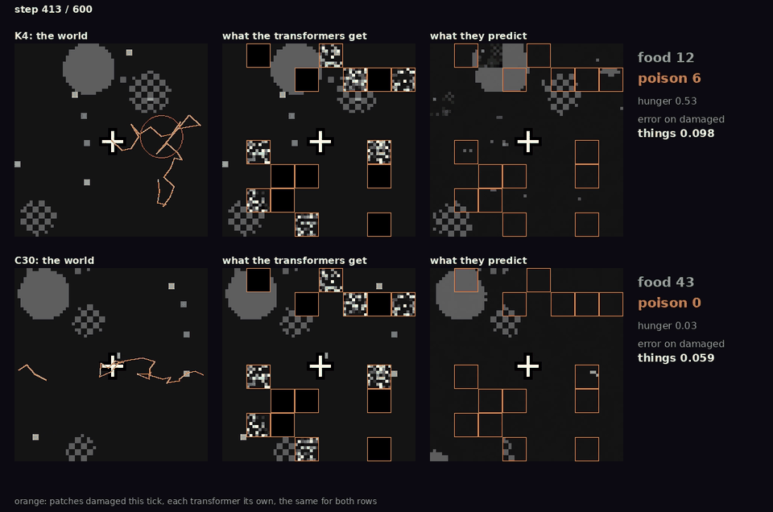
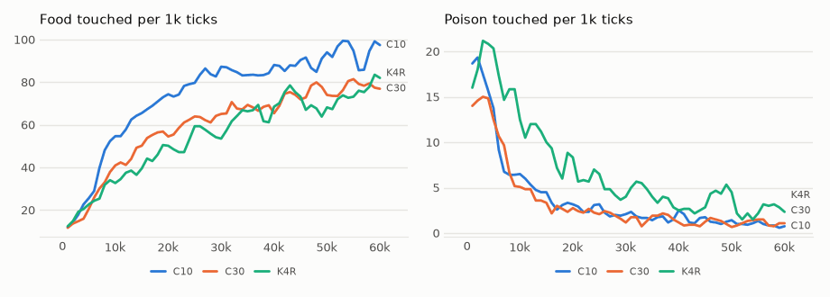

# vm-00074: Clogged Channels

**Date:** 2026-11-02
**Status:** Complete
**Source:** `exp/vm-00074` (code: `visual-motor-agent/dev/`)
**Outputs:** `~/data/research/visual-motor-agent/exp_00074/`
**Task plan:** [`../tasks/00085-clogged-channels.md`](../tasks/00085-clogged-channels.md)

## Goal

The owner: add noise to random pixels in random transformers, and train against the full image, "thus we would train model to restore image even if some channels are clogged". Each transformer gets its own temporarily damaged input, while it is trained against the clean frame. Does the system learn to restore what does not arrive, and what does it cost on clean input?

## Method

- **The damage:** `online.clog = p`. In each batch, for each transformer, about p of the patches of each step are damaged, drawn for the whole frame and different for each transformer. Half of it lasts the whole 8-step window and half one step (`online.clog_long`). Half of the damaged patches are black, half speckled: half of their pixels replaced at random. Damage outside a transformer's quarter reaches it through its summaries, which are built from its damaged frame.
- **What stays clean:** targets, memory and acting. The body and the move are not damaged.
- **The whole mechanism,** step by step: [`ARCHITECTURE.md`, section 14](../ARCHITECTURE.md).
- **Arms:** K4 with log summaries in the 64 x 64 world, C10 and C30, six seeds, 60k ticks, all on the 4090 at 36 ticks/s, seeds 1–3 first and 4–6 after them. The control is vm-00073's K4.
- **Control rerun (not planned):** the poison result was too large to rest on a control from older code, so K4 with no damage was run again on the arms' code, seeds 1–3, as K4R.
- **Frozen tests:** `eval_clog.py`, predictions against the clean frame with 30% damage; `eval_hunger.py chain --clog .3`, each transformer acting on its own damaged view; `chain` on clean input. Final weights, 16 worlds, 1,500 ticks.
- **Set before the results (task 00085),** each arm against the control, seed by seed, 95% interval on six seeds, df 5, t = 2.571.

## Results

### R1. Restoration: error against the clean frame on damaged patches that hold something

| | Control | C10 | C30 | C10 − control | C30 − control |
|---|---|---|---|---|---|
| Clean input, the floor | .037 | .037 | .038 | .000 ± .002 | +.001 ± .003 |
| Brief: damaged the step before | .081 | .050 | .046 | −.031 ± .006 | −.035 ± .008 |
| Long: damaged in all 8 steps | .114 | .064 | .053 | −.049 ± .006 | −.061 ± .009 |
| Copy of the frame before, the baseline | .223 | .221 | .230 | | |

All six seeds in brief and long.

### R2. Foraging with 30% damage while acting, frozen

| | Control | C10 | C30 | C10 − control | C30 − control |
|---|---|---|---|---|---|
| Food | 45.2 | 92.7 | 77.7 | +47.4 ± 21.2 | +32.5 ± 23.0 |
| Poison | 13.2 | 4.06 | 1.81 | −9.16 ± 3.82 | −11.40 ± 2.69 |
| Aim at 12–24 px | .083 | .237 | .225 | +.154 ± .063 | +.142 ± .048 |
| Lead over a perfect grab | 18.1 | 54.6 | 46.3 | +36.5 ± 22.7 | +28.2 ± 18.7 |

### R3. On clean input

| | Control | C10 | C30 | C10 − control | C30 − control |
|---|---|---|---|---|---|
| Food, last 20k | 70.0 | 91.7 | 76.5 | +21.7 ± 25.0 | +6.5 ± 26.6 |
| Poison, last 20k | 3.68 | 1.12 | 1.12 | −2.57 ± .86 | −2.57 ± .42 |
| Food, frozen | 72.2 | 94.2 | 77.3 | +22.0 ± 23.0 | +5.1 ± 28.5 |
| Poison, frozen | 3.34 | 1.39 | .92 | −1.95 ± .93 | −2.42 ± .68 |
| Aim at 12–24 px, frozen | .166 | .256 | .226 | +.090 ± .073 | +.060 ± .063 |
| Smoothness of the move, frozen | .37 | .57 | .59 | | |

### R4. The control rerun, seeds 1–3, last 20k

| | Poison | Food |
|---|---|---|
| Control, vm-00073 | 3.62 | 73.5 |
| K4R, on the arms' code | 3.00 | 73.4 |
| C10 | .92 | 93.2 |
| C30 | .97 | 58.1 |

### R5. The videos

`videos/seed1.mp4` and `videos/seed4.mp4`: the control above C30, 600 ticks at half speed, the same damage for both rows. In the middle column each quarter shows what its own transformer gets; the damage each one gets elsewhere reaches it only through summaries, and is not drawn. Seed 1 is one where C30's training food was below the control's, seed 4 one where it was above. Over 8 worlds with 30% damage: seed 1, food 54.0 and 61.7, poison 8.8 and 1.7; seed 4, food 40.6 and 91.9, poison 12.5 and 2.9.

*Seed 4 at tick 413. The control's picture breaks up, with holes in the top circle and crumbs of noise. C30 draws a whole circle through a black patch at the top left, and still loses some dots and edges. Orange marks the patches damaged this tick. The picture is the one `eval_clog.py` scores: each patch from the steps before it, the patches before it and the summaries. It is not a dream.*

<!-- figures -->
## Figures

*The world of this experiment as its model sees it, every 12 ticks. Moves are random: this shows the world, not the trained agent.*

*From each run's `metrics.jsonl`, the mean of its seeds by arm, smoothed. K4R is the control rerun, seeds 1–3; C10 and C30 are six seeds.*
<!-- /figures -->

## Readings

1. **Plumbing: met.** Clean frames given as inputs change the loss in no digit, damage raises it, targets stay clean.
2. **Restoration: met,** both arms, all six seeds, below the control by more than the interval and far below `copy`.
3. **Clean cost: met.** Food is not below the control and poison is not above it. Prediction on clean input is unchanged.
4. **Robustness: met,** both arms, food above the control by more than the interval.

## Analysis

- **Restoration works, and costs nothing that could be seen.** Error under long damage falls by 44% and 54%, and error on clean input does not move. The damage is also a real one to the control: its error triples, and its food falls by more than a third, while the arms lose almost none.
- **The surprise: poison falls on clean input.** About a third of the control's, in training and frozen, at both 10% and 30%, starting within the first 10k ticks. K4R rules out the older code. We did not predict this and do not know why. Aim and smoothness rise with it, so damage changes how the move is chosen, not only how the picture is rebuilt.
- **Food is less clear.** C10 is above on clean input and C30 is not, and both intervals include zero.
- **C30's food splits by batch.** On clean input seeds 1–3 give 55–62 and seeds 4–6 give 85–102. Those were the two batches. Settings and training code are the same, and C10 and the poison numbers do not split that way, so it is probably chance, but three seeds each cannot rule a batch effect out.
- **Not yet tested:** damage to the body and the move, closed eyes, and a permanent blind spot. Those are the other two cases of the task's design.

## Conclusions

1. A model trained on damaged input, against clean targets, restores what does not arrive: long damage error .053 to .064 against .114, in all six seeds.
2. It costs nothing visible on clean input, and with damage while acting it eats about twice the control's food and takes a third or less of its poison.
3. On clean input poison falls to about a third, for a reason not yet known. That is the main open question.

## Next steps

- Why poison falls on clean input. A first test: does it come from the black patches, the speckle, the long or the brief damage?
- Rerun C30, seeds 1–3, to settle the split.
- Whether `online.clog` should be on by default, and at what p, is the owner's decision.
