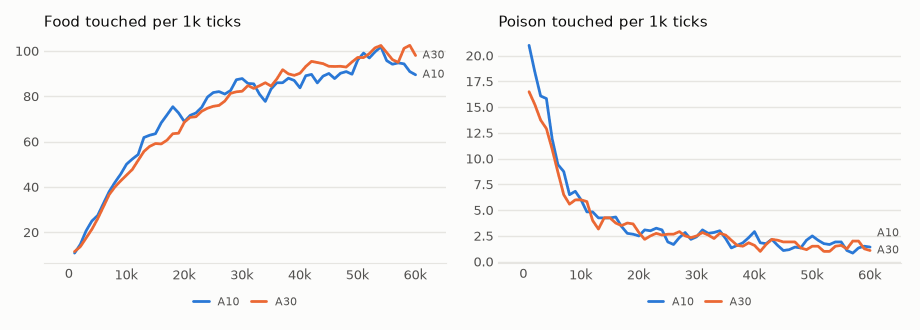

# vm-00075: Clogged Acting

**Date:** 2026-11-02
**Status:** Complete (pending tag)
**Source:** `dev/` (not yet tagged)
**Outputs:** `~/data/research/visual-motor-agent/exp_00075/`
**Task plan:** [`../tasks/00086-clogged-acting.md`](../tasks/00086-clogged-acting.md)

## Goal

vm-00074 with the damage in real life: each transformer also acts on its own damaged view, while memory stays clean and training draws fresh damage. Design, arms and the readings set before the results are in the task plan.

## How the damage works here

The full mechanism is in [`ARCHITECTURE.md`, section 14](../ARCHITECTURE.md). What this experiment changes:

| | vm-00074 (C10, C30) | here (A10, A30) |
|---|---|---|
| Acting during a life | clean | **damaged, each transformer its own** |
| A transformer's context | clean | **damaged** |
| Memory | clean | clean |
| Training input | fresh damage | fresh damage |
| Training targets | clean | clean |

The agent lives through the damage rather than only practising on it. The world, food and hunger are as they were: a transformer that cannot see a food circle can still touch it.

## Method

- **Arms:** A10 and A30, K4 with log summaries, 64 x 64, `online.clog` .1 and .3, `online.clog_act = 1`, six seeds, 60k ticks, seeds 1–3 on the 4090 and 4–6 on the 3090, all 12 at once.
- **Comparison:** C10 and C30 of vm-00074 and the K4 of vm-00073, not rerun.
- **Frozen tests:** as vm-00074, `eval_hunger.py chain --clog .3`, `chain` on clean input, `eval_clog.py score`, final weights, 16 worlds, 1,500 ticks, six seeds, against the arm of vm-00074 with the same p.
- **Readings:** set before the results, in the task plan.
- **Checks passed before the start:** 10 unit tests, the views of the transformers different on every one of 60 ticks on the GPU, a short life as fast as one without it, and a life refuses `clog_act` without `clog`.

## Results

### R1. Frozen, six seeds

| | K4 control | C10 | A10 | C30 | A30 |
|---|---|---|---|---|---|
| Food, 30% damage while acting | 45.2 | 92.7 | 94.9 | 77.7 | 101.0 |
| Poison, 30% damage while acting | 13.2 | 4.06 | 3.27 | 1.81 | 1.74 |
| Aim at 12–24 px, 30% damage | .083 | .237 | .250 | .225 | .270 |
| Food, clean input | 72.2 | 94.2 | 93.3 | 77.3 | 99.0 |
| Poison, clean input | 3.34 | 1.39 | 1.44 | .92 | 1.24 |
| Aim at 12–24 px, clean input | .166 | .256 | .252 | .226 | .265 |
| Smoothness, clean input | .37 | .57 | .59 | .59 | .63 |
| Error on damaged things, long damage | .114 | .064 | .064 | .053 | .052 |
| Error on things, clean input | .037 | .037 | .037 | .038 | .038 |

### R2. Living with damage against practising on it, seed by seed

| A − C | 10% | 30% |
|---|---|---|
| Food, first 10k ticks, lived | −.8 ± 11.8 | +4.5 ± 12.9 |
| Food, last 20k, lived on damage against C's frozen food under damage | +.4 ± 31.8 | +19.2 ± 24.0 |
| Food, frozen, 30% damage | +2.3 ± 29.8 | +23.3 ± 24.5 |
| Poison, frozen, 30% damage | −.79 ± 2.32 | −.07 ± .42 |
| Error under long damage | −.001 ± .003 | −.001 ± .004 |
| Food, frozen, clean | −.9 ± 31.2 | +21.7 ± 26.1 |
| Poison, frozen, clean | +.05 ± 1.05 | +.31 ± .28 |

Food lived over the last 20k: A10 93.0, A30 97.0; poison 1.58 and 1.53, against 1.12 for both C arms when they acted on clean frames. Clean poison against the control: −1.9 ± .6 for A10 and −2.1 ± .4 for A30.

<!-- figures -->
## Figures

*The world of this experiment as its model sees it, every 12 ticks. Moves are random: this shows the world, not the trained agent.*

*From each run's `metrics.jsonl`, the mean of its seeds by arm, smoothed. Food here is lived: each transformer acting on its own damaged view.*
<!-- /figures -->

## Readings

1. **Plumbing: met,** before the runs.
2. **The cost of growing up damaged: not met.** Food over the first 10k ticks is level with the C arms. The prediction was wrong.
3. **It catches up: met.** Lived food over the last 20k is level with C10's frozen food under damage and above C30's.
4. **The final model is no worse: met.** Food, poison and restoration under damage are level with or above the C arms'. A30's food is ahead by +23.3 ± 24.5, just short of its interval.
5. **Clean input: met.** Poison stays below the control's by more than the interval, in both arms.

## Analysis

- **Living with the damage costs nothing that could be measured.** Every move is chosen from views with 10% or 30% of their patches damaged, yet lived food over the last 20k is 93 and 97, the level of the arms that acted on clean frames and well above the control's 70 on clean frames.
- **Why no early cost:** the guess is that a young model barely uses its view, so there is little to lose. It was not measured.
- **Lived poison is higher than when acting on clean frames,** 1.5 against 1.1, but still well below the control's 3.7 on clean frames. A30 takes slightly more poison than C30 on clean input too, +.31 ± .28, just past its interval: a small cost, if real.
- **C30's batch split in vm-00074 was probably chance.** A30 shows no split: its seed 3, from the "low" batch there, is one of its best, +48 over C30's.
- **The poison effect of vm-00074 holds** with damage in life: clean poison about a third to two fifths of the control's.

## Conclusions

1. A model can live with damaged channels from its first tick. It forages as well as one that only practised on damage, and the final model is as good or better.
2. The predicted early cost did not appear.
3. Damage, in practice or in life, keeps poison on clean input well below the undamaged control. Why is still open.

## Next steps

- Why damage lowers poison on clean input, for both vm-00074 and here.
- Whether damaged acting should be the default with `online.clog`, and at what p, is the owner's decision.
- The other two cases of the design: closed eyes and permanent damage.
