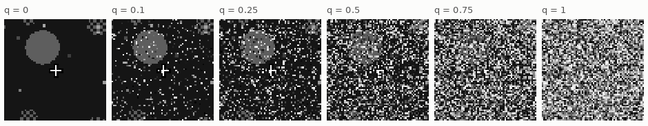
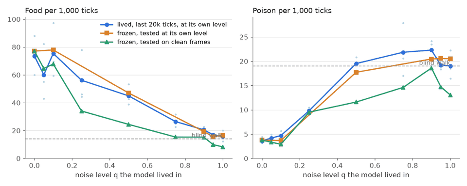
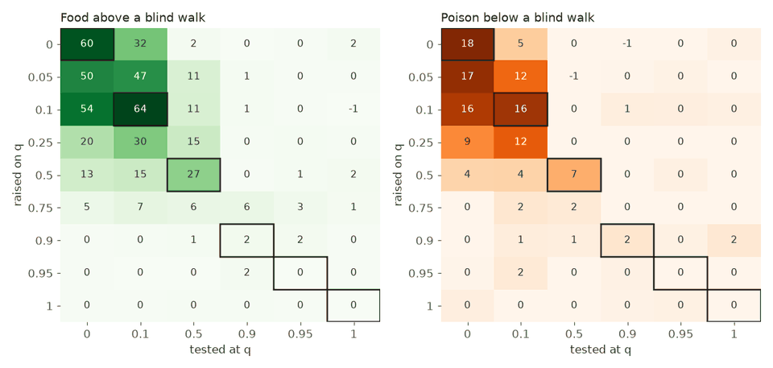

# vm-00076: White Noise

**Date:** 2026-11-02
**Status:** Complete
**Source:** `exp/vm-00076` (code: `visual-motor-agent/dev/`)
**Outputs:** `~/data/research/visual-motor-agent/exp_00076/`
**Task plan:** [`../tasks/00087-white-noise.md`](../tasks/00087-white-noise.md)

## Goal

This experiment adds white noise to the world at eight levels. It asks where the agent breaks and how, and whether it first gets better, as the owner predicted. It might break because it cannot see, because it cannot learn, or because unpredictable patch targets drown the rest of the model. There is no clean truth here: input, targets and memory all carry the noise. The design, the arms and the readings set before the results are in the task plan.

## How the noise works

`env.noise = q`: on every tick, each pixel of the frame is replaced by a random brightness with probability q. The noise is fresh every tick, gray (the same in all three channels) and drawn from its own generator. So `noise = 0` reproduces the old world exactly: the first 5,000 ticks were checked to match. The noise is in the world, unlike the damage of vm-00074:

| | Clogged channels (vm-00074) | White noise (here) |
|---|---|---|
| Where | each transformer's input | the world's frame |
| Same for all four transformers | no, each its own | yes |
| Targets | clean | noisy |
| Memory | clean | noisy |
| Acting | clean | noisy |
| Can it be restored | yes, from the clean target | no: the noise cannot be predicted |

Food, poison, hunger and moves are real whatever the frame shows. `env.clean_frame()` gives the frame without noise; it is used only by the frozen error test.

*The same state of the world at six levels: a food circle, the cursor, poison checkers and dots.*

## Method

- **Arms:** N5 to N100: K4 with log summaries, the default 64 x 64 world, `env.noise` .05, .1, .25, .5, .75, .9, .95 and 1, seeds 1–3, 60k ticks. Seeds 1 and 2 ran on the 4090 and seed 3 on the 3090, all 24 lives at once, at 14 and 16 ticks/s.
- **Control:** vm-00073's K4, seeds 1–3 (q = 0), not rerun.
- **Lived:** food and poison per 1,000 ticks over the last 20k ticks of each life, at the life's own level, and the token cross-entropies.
- **Frozen cross-tests:** every final model at test levels 0, .1, .5, .9, .95 and 1, with 16 worlds and 1,500 ticks each (`eval_noise.py`):
  - `chain` measures food and poison against a blind walk and a perfect grab, and aim at 12–24 pixels.
  - `error` measures each transformer's prediction of its own patches against the clean frame, on pixels that hold something.
- **Readings:** set before the results, in the task plan.
- **Checks passed before the start:** six unit tests (no noise gives the clean frame; the share of replaced pixels is q; q = 1 is uncorrelated with the frame; the noise is fresh each tick and gray; only the frame changes), the old world reproduced exactly with `noise = 0`, and a short life at q = .5.

## Results

### R1. Lived, each life at its own level, last 20k ticks, three seeds

| q | Food | Poison | Mean hunger | Body CE | Patch CE |
|---|---|---|---|---|---|
| 0 (K4) | 73.5 ± 35.0 | 3.62 ± 1.69 | .06 | .26 | .77 |
| .05 | 60.1 ± 49.9 | 4.18 ± 1.76 | .05 | .27 | 1.07 |
| .1 | 75.4 ± 48.7 | 4.70 ± 2.09 | .06 | .27 | 1.27 |
| .25 | 56.2 ± 46.9 | 9.80 ± 1.95 | .10 | .28 | 1.72 |
| .5 | 45.0 ± 18.6 | 19.5 ± 3.4 | .22 | .29 | 2.22 |
| .75 | 26.4 ± 11.5 | 21.9 ± 13.7 | .26 | .29 | 2.61 |
| .9 | 20.5 ± 5.7 | 22.3 ± 6.7 | .31 | .29 | 2.84 |
| .95 | 16.9 ± 2.3 | 19.2 ± 2.3 | .49 | .28 | 2.85 |
| 1 | 15.7 ± 9.7 | 19.1 ± 7.4 | .45 | .29 | 2.85 |

A blind walk gets about 16 food and 20 poison.

### R2. Frozen: food per 1,000 ticks, raised on by tested at, mean of three seeds

| Raised on | Tested at 0 | .1 | .5 | .9 | .95 | 1 |
|---|---|---|---|---|---|---|
| 0 (K4) | **77.1** | 48.5 | 16.1 | 13.4 | 14.6 | 15.7 |
| .05 | 64.6 | 60.5 | 23.7 | 14.4 | 14.9 | 14.5 |
| .1 | 67.8 | **77.9** | 26.4 | 17.7 | 17.0 | 15.4 |
| .25 | 34.1 | 44.9 | 28.6 | 15.1 | 13.6 | 13.6 |
| .5 | 24.4 | 27.4 | **47.0** | 17.0 | 15.1 | 13.2 |
| .75 | 15.3 | 17.9 | 21.9 | 25.0 | 19.5 | 13.3 |
| .9 | 15.3 | 15.6 | 14.6 | **19.3** | 18.2 | 17.4 |
| .95 | 9.8 | 10.1 | 8.1 | 16.0 | **15.6** | 15.2 |
| 1 | 8.4 | 8.8 | 9.5 | 15.3 | 16.0 | **16.6** |

Bold marks each model at its own level.

### R3. Frozen: poison per 1,000 ticks, raised on by tested at

| Raised on | Tested at 0 | .1 | .5 | .9 | .95 | 1 |
|---|---|---|---|---|---|---|
| 0 (K4) | **3.75** | 16.3 | 20.1 | 21.1 | 21.3 | 18.8 |
| .05 | 3.33 | 6.44 | 18.5 | 18.5 | 18.3 | 18.7 |
| .1 | 2.90 | **3.68** | 20.4 | 21.3 | 23.2 | 24.5 |
| .25 | 9.51 | 8.58 | 17.8 | 18.4 | 19.4 | 19.6 |
| .5 | 11.6 | 11.6 | **17.7** | 20.5 | 17.8 | 17.2 |
| .75 | 14.6 | 13.7 | 16.9 | 23.4 | 20.9 | 16.9 |
| .9 to 1 | 13 to 19 | 13 to 19 | 15 to 17 | 18 to 21 | 19 to 21 | 20 to 21 |

### R4. Frozen: error of the prediction against the clean frame, on things

| Raised on | Tested at 0 | .1 | .5 | .9 | 1 |
|---|---|---|---|---|---|
| 0 (K4) | **.037** | .053 | .161 | .245 | .250 |
| .1 | .051 | **.050** | .107 | .164 | .174 |
| .25 | .064 | .057 | .074 | .141 | .149 |
| .5 | .116 | .094 | **.068** | .170 | .192 |
| .75 | .185 | .169 | .110 | .187 | .233 |
| .9 | .263 | .264 | .261 | **.265** | .264 |
| 1 | .292 | .295 | .310 | .331 | **.341** |

### R5. Against the control, seed by seed, 95% interval (t, df 2)

| Arm − K4, frozen | Food | Poison | Aim 12–24 px |
|---|---|---|---|
| .05, tested clean | −12.5 ± 45.2 | −.42 ± 2.34 | −.04 ± .10 |
| .1, tested clean | −9.3 ± 60.9 | −.85 ± 2.06 | −.04 ± .19 |
| .25, tested clean | −43.1 ± 30.4 | +5.76 ± 4.29 | −.12 ± .05 |
| .5, tested clean | −52.7 ± 50.0 | +7.85 ± 2.18 | −.12 ± .14 |
| .05, both tested at .1 | +12.0 ± 64.8 | −9.82 ± 8.76 | +.04 ± .14 |
| .1, both tested at .1 | +29.4 ± 36.3 | −12.6 ± 10.2 | +.05 ± .10 |
| .5, both tested at .5 | +30.9 ± 5.9 | −2.38 ± 4.85 | +.068 ± .004 |

At q = 1 the model raised there gets −.56 ± 1.40 food above a blind walk and −.43 ± 4.63 poison below it. Aim tested clean falls with the level a model was raised on, from .175 for K4 to .13 for .05 and .1, .05 for .5, and .01 to .03 from .9 up.

### R6. Stage 2 (2026-11-03): six seeds at q = .1

N10 seeds 4–6 with the same code, frozen at 0 and .1, against vm-00073's K4 seeds 4–6 (`make stage2`, `make frozen2`). Six seeds, t interval df 5:

| N10 − K4, frozen | Tested clean | Tested at .1 |
|---|---|---|
| Food | −13.3 ± 17.0 | +30.5 ± 11.0 |
| Poison | +1.04 ± 2.51 | −9.4 ± 4.8 |
| Aim 12–24 px | −.048 ± .056 | +.054 ± .033 |

Seeds 4–6 take more clean poison than K4 (+4.62, +1.25, +2.92), so the hint from seeds 1–3 is gone. Lived over the last 20k ticks, six seeds: food 70.4 against 70.0 (+.4 ± 15.0), poison 4.79 against 3.68 (+1.11 ± 1.13).

### Videos

`make videos` (`compare_video.py`, 1,000 ticks from the same start, seed 1 of each arm; outputs in `exp_00076/videos/`, not in the repo):
- `noise_levels.mp4`: six models, each in the noise it was raised on: q = 0, .1, .25, .5, .75 and 1. Over 8 worlds: food 91.1, 70.6, 86.5, 42.8, 22.4 and 15.9 per 1,000 ticks.
- `clean_vs_q10_at_q10.mp4`: K4 and N10, both at q = .1. K4 gets food 56.0 and poison 10.2, N10 food 70.6 and poison 2.4.

The owner, from the video: at .1 the poison checkers are still visible, and at .25 almost not, so the rise in poison is to be expected.

## Figures

*Each arm at the level it lived in (blue: lived, last 20k ticks; orange: frozen, tested at its own level), and the same frozen models tested on clean frames (green). Faint dots are the lived seeds. Dashed: a blind walk.*

*The frozen cross-tests as a lead over a blind walk. Outlined: each model at its own level. Every model does best near the level it was raised on.*

## Readings

1. **Plumbing: met,** before the runs.
2. **The floor: met.** At q = 1 food is −.56 ± 1.40 above a blind walk and poison −.43 ± 4.63 below it: nothing is seen.
3. **Poison first: met.**
   - **Lived:** poison loses half its lead over a blind walk at about q = .3, and food at about .5. At .25 poison nearly triples (9.8 against 3.6) while food is still within its interval.
   - **Frozen, each model at its own level:** the gap is narrower but in the same direction. By .5 poison keeps .37 of its lead and food .45.
4. **Which failure, at q = .5 where food is half broken: the signal is partly gone.**
   - **The noise really does hide the food.** The model raised on clean frames gets nothing at .5: food above a blind walk 1.7, poison below it −.3.
   - **But not all of it.** The model raised at .5 keeps half its lead, +30.9 ± 5.9 food over K4 at that level, in all three seeds. No model does better at .5.
   - **The model raised there sees through it, but only half as well.** Its error at .5 is .068, against .037 for K4 on clean frames.
   - **"Drowning" is ruled out.** Body cross-entropy hardly moves (.26 to .29). Prediction of the clean frame gets worse with the level a model was raised on, where that failure needs it to hold.
   - **The sign of "cannot learn" shows but does not decide.** The model raised at .5 does badly on clean frames (−52.7 ± 50.0 food, +7.85 ± 2.18 poison). But it does better at its own level than on clean frames, and it predicts its own level better than clean frames (.068 against .116). It is adapted to the noise, not stunted. Clean frames are new to it.
5. **The owner's maximum: not met.**
   - **Lived:** .1 gets 75.4 against 73.5, well inside the interval, and .05 gets less.
   - **Frozen, tested clean:** no arm is above the control on food, poison or aim.
   - **The one hint:** clean poison at .1 is 2.90 against 3.75 (−.85 ± 2.06), lower in all three seeds. It is not significant.
   - **Stage 2, six seeds: still not met.** Clean poison +1.04 ± 2.51, food −13.3 ± 17.0. The hint is gone.

## Analysis

- **Each model does best near the level it was raised on.** The diagonal of the cross-tests holds from 0 to .9. A model raised at .5 forages twice as well at .5 as on clean frames, and predicts the clean world better at .5 than on clean frames. It has learned to look through its noise, and to expect it.
- **The model raised on clean frames is fragile.** At q = .1 its poison is 16.3 against 3.75, more than four times as much, and its food falls by a third. Ten per cent of the pixels are enough to break its view of the checkers.
- **A life at .1 buys robustness at no measurable clean cost.** Tested at .1, the model raised there takes −12.6 ± 10.2 less poison than K4 and gets +29 ± 36 more food. On clean frames it is level with K4.
- **Why poison breaks first:** the poison checker is a 2 x 2 texture, read pixel by pixel. Food is a gray circle of about 250 pixels whose mean survives the noise. The owner saw it in the video: at .1 the checkers still show, at .25 almost not. That speckles are mistaken for checkers is a guess, not measured.
- **Why no maximum:** vm-00074's damage gave a clean target to restore, and the gain on clean poison came with it. Here nothing can be restored: noise in the targets only adds what cannot be learned, so it adds nothing to the model. This is a guess; stage 3 (noise on the input only, clean targets) would test it.
- **Where it breaks:** between .75 and .9. The model raised at .75 still gets 9 to 10 food above a blind walk at its own level when lived, and 6 when frozen at .9. The model raised at .9 gets 2.
- **Three seeds are few.** The interval on food is ±30 to ±65. Only effects of 30 or more on food, or of 5 or more on poison, show.

## Conclusions

1. White noise in the world breaks foraging in stages. Poison goes first, at about q = .3. Food is half gone at .5, and nothing is left between .75 and .9.
2. At the half-broken level, the noise really hides part of the world. The model raised in it recovers half of what it hides, and no model does better.
3. The owner's predicted maximum did not appear, lived or tested clean, in three seeds or, at .1, in six.
4. A little noise in life makes a model robust to that noise: at .1, with six seeds, food +30.5 ± 11.0 and poison −9.4 ± 4.8 against K4. On clean frames it costs a little food, −13.3 ± 17.0, inside the interval. A model raised on clean frames is fragile: 10% noise quadruples its poison.

## Next steps

- Stage 2 is done (R6). Stage 3, noise on the input only with clean targets, is [vm-00077](../00077-input-noise/README.md): with clean targets the noise helps.
- The white ceiling, the other end of the owner's idea (ARCHITECTURE section 13): a world where nothing happens, then move both raised models to the structured world.
