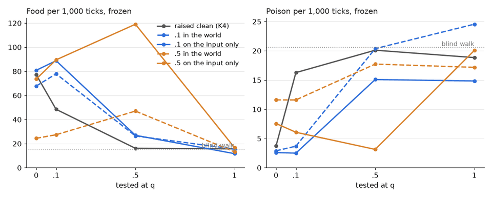

# vm-00077: Input Noise, Clean Targets

**Date:** 2026-11-03
**Status:** Complete (pending tag)
**Source:** `dev/` (not yet tagged)
**Outputs:** `~/data/research/visual-motor-agent/exp_00077/`
**Task plan:** [`../tasks/00088-input-noise.md`](../tasks/00088-input-noise.md)

## Goal

This is stage 3 of [vm-00076](../00076-white-noise/README.md). There, white noise in the world, carried by input, targets and memory, never helped: there was no maximum, and every model did best near the level it was raised on. vm-00074's damage did help, with clean targets. The guess: the noise in the targets is what took the benefit away. Here the same noise is put on the model's input only, and the world, memory and targets stay clean.

## How the noise works here

`online.noise_in = q`: the frame is noised as `env.noise` does, each pixel replaced by a random gray with probability q.

| | vm-00076 (N10, N50) | here (I10, I50) |
|---|---|---|
| The world's frame | noisy | clean |
| Acting | noisy, one draw for all transformers | **the same**: noisy, one draw for all transformers |
| A transformer's context (the ring) | noisy | noisy |
| Memory | noisy, the noise of the tick it was seen | **clean** |
| Training input | the stored noise | **fresh noise each update**, one draw for all transformers |
| Training targets | noisy | **clean** |

While acting, the model sees exactly what it saw in vm-00076 at the same q. What changes is what it learns from: the clean frame behind the noise, with new noise on each replay. So the frozen tests of both experiments use world noise at test time, the same tools and the same worlds.

## Method

- **Arms:** I10 and I50: K4 with log summaries, the default 64 x 64 world, `online.noise_in` .1 and .5, seeds 1–3, 60k ticks. Seeds 1 and 2 ran on the 4090 and seed 3 on the 3090, all six at once, at 39 and 29 to 36 ticks/s.
- **Comparison:** vm-00076's N10 and N50 (the same noise in the world) and vm-00073's K4 (q = 0), seeds 1–3, not rerun.
- **Frozen tests:** `eval_noise.py chain` and `error` at test levels 0, .1, .5 and 1, with 16 worlds and 1,500 ticks, as in vm-00076.
- **Readings:** set before the results, in the task plan.
- **Checks passed before the start:**
  - A unit test: about q of the pixels are replaced, the noise is gray, the frames given are left as they were, and q = 0 changes nothing.
  - A probe of a 120-tick life: one acting view per tick (120) and one training input per update (110), each shared by the four transformers.
  - A life refuses `noise_in` together with `online.clog`.

## Results

### R1. Frozen, mean of three seeds

| Arm | Tested at | Food | Poison | Aim 12–24 px | Error on things |
|---|---|---|---|---|---|
| K4 | 0 | 77.1 | 3.75 | .17 | .037 |
| K4 | .1 | 48.5 | 16.3 | .09 | .053 |
| K4 | .5 | 16.1 | 20.1 | .04 | .161 |
| N10 | 0 | 67.8 | 2.90 | .13 | .051 |
| N10 | .1 | 77.9 | 3.68 | .14 | .050 |
| **I10** | 0 | 80.9 | 2.60 | .22 | .040 |
| **I10** | .1 | 88.8 | 2.50 | .26 | .040 |
| **I10** | .5 | 26.9 | 15.1 | .05 | .070 |
| N50 | 0 | 24.4 | 11.6 | .05 | .116 |
| N50 | .5 | 47.0 | 17.7 | .10 | .068 |
| **I50** | 0 | 73.6 | 7.57 | .17 | .109 |
| **I50** | .1 | 89.5 | 6.07 | .21 | .082 |
| **I50** | .5 | **119.1** | **3.14** | **.32** | .050 |
| any | 1 | 12 to 17 | 15 to 25 | .03 | .17 to .25 |

A blind walk gets about 16 food and 20 poison.

### R2. Seed by seed, 95% interval (t, df 2)

| Comparison, frozen | Food | Poison | Aim | Error on things |
|---|---|---|---|---|
| I50 − N50, both at .5 | +72.0 ± 67.6 | −14.6 ± 4.6 | +.21 ± .18 | −.018 ± .007 |
| I50 − N50, both clean | +49.2 ± 61.9 | −4.03 ± 1.98 | +.12 ± .13 | −.006 ± .042 |
| I50 − K4, both at .5 | +102.9 ± 69.3 | −17.0 ± 9.5 | +.28 ± .19 | −.112 ± .040 |
| I50 − K4, both clean | −3.5 ± 98.8 | +3.82 ± 2.39 | −.01 ± .22 | +.072 ± .015 |
| I10 − N10, both at .1 | +10.9 ± 97.2 | −1.18 ± 3.85 | +.11 ± .22 | −.009 ± .008 |
| I10 − K4, both clean | +3.7 ± 35.0 | −1.15 ± 2.13 | +.04 ± .03 | +.003 ± .004 |
| I10 − K4, both at .1 | +40.3 ± 65.2 | −13.8 ± 14.1 | +.17 ± .12 | −.013 ± .009 |

### R3. Lived, last 20k ticks

| Arm | Food | Seeds | Poison | Body CE | Patch CE |
|---|---|---|---|---|---|
| K4 (q 0) | 73.5 | 88.2, 72.2, 60.1 | 3.62 | .26 | .77 |
| N10 | 75.4 | 69.4, 97.3, 59.5 | 4.70 | .27 | 1.27 |
| **I10** | **91.6** | 114.2, 83.2, 77.4 | 2.28 | .25 | .81 |
| N50 | 45.0 | 39.0, 42.5, 53.4 | 19.5 | .29 | 2.22 |
| **I50** | **116.6** | 99.7, 104.2, 145.8 | 4.00 | .26 | .87 |

Against K4 by seed number: I10 +18.1 ± 18.7, I50 +43.1 ± 95.1. The seeds are not paired across experiments, so these intervals mean little. Every I50 seed is above every K4 seed. Over the first 10k ticks I50 already gets 30.4, 29.4 and 48.0, against K4's 21.7, 29.5 and 20.5.

## Figures

*Frozen, mean of three seeds. Dashed: noise in the world (vm-00076). Solid: the same noise on the input only, with clean targets and memory. Gray: K4, raised on clean frames.*

## Readings

1. **Plumbing: met,** before the runs.
2. **Clean targets restore: met.** At .5, I50's error against the clean frame is .050, against N50's .068: −.018 ± .007.
3. **Clean targets help foraging at .5: met.** At .5, food 119.1 against N50's 47.0 (+72.0 ± 67.6), poison 3.14 against 17.7 (−14.6 ± 4.6), aim +.21 ± .18.
4. **The maximum with clean targets, read as lower clean poison at .1: not met.** I10 against K4 on clean frames: poison −1.15 ± 2.13, aim +.04 ± .03, food +3.7 ± 35.0.

## Analysis

- **The noise in the targets was the problem.** With the same view while acting, only the training data changed, and at .5 the model forages more than twice as well as N50 and takes a sixth of its poison. Prediction of the clean frame is better too, at every test level below 1.
- **At .5, input noise beats no noise at all.**
  - I50 at .5 gets 119.1 food and 3.14 poison. K4 on clean frames gets 77.1 and 3.75, and so does I50 itself on clean frames (73.6).
  - Lived, I50 gets 116.6 food, the most of any arm here, against K4's 73.5.
  - This is the owner's maximum, in its first half: food rises from q = 0 through .1 to .5, but only when the targets are clean. Where it turns down is not measured, as there is no level between .5 and 1.
  - With three seeds, frozen at .5 from 97.1 to 156.6, the size of the gain is uncertain. Only its direction is clear: all three I50 seeds above all three K4 seeds.
- **Each model still does best at its own level.** I50 on clean frames takes twice K4's poison (+3.82 ± 2.39), and its prediction of clean frames is worse (.109 against .037). Clean frames are new to it. I10 sits between: level with K4 on clean frames, and better at .1.
- **Why noise on the input could help (guesses, not tested):**
  - With half the pixels gone, a single pixel cannot be trusted, so the model may learn to read the shape of a whole region. Aim at 12–24 px rises from .17 to .32.
  - Fresh noise on each replay of the same memory makes each window a new example, as dropout does.
- **The difference from vm-00074's damage:** there, damage while training cut poison on clean frames. Here input noise did not (reading 4). The damage was whole 8 x 8 patches, black or speckled, a fraction of the view. The noise here is scattered over every patch.

## Conclusions

1. With clean targets, white noise on the input helps: at q = .5 a model forages better in the noise than the clean-raised model does on clean frames, lived and frozen.
2. In vm-00076, the noise in the targets and memory is what turned the noise from a help into harm.
3. The owner's predicted rise appears when the targets are clean: food climbs from q = 0 through .1 to .5. Its fall is not yet measured.
4. Each model stays best near the level it was raised on. Input noise at .5 makes a model worse on clean frames, especially on poison.

## Next steps

- Input noise at .75 and .9, to find where the climb turns down.
- Six seeds at I50, to size the gain.
- I50 against K4 on clean frames, after a short life on clean frames: does it adapt back quickly?
- Whether input noise belongs beside `online.clog` as a default is the owner's decision.
