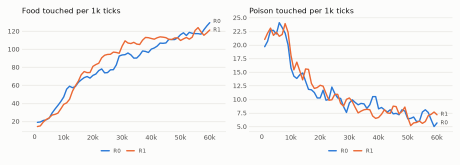

# vm-00078: Outage

**Date:** 2026-11-03
**Status:** Complete
**Source:** `exp/vm-00078` (code: `visual-motor-agent/dev/`)
**Outputs:** `~/data/research/visual-motor-agent/exp_00078/`
**Task plan:** [`../tasks/00089-outage.md`](../tasks/00089-outage.md)

## Goal

Sixteen transformers, each switched off at random a quarter of the time, so that about 4 of the 16 are out at any moment. How gracefully does the body cope, and does a life with outages make it cope better? Later the same switch may save resources, spread the load and encourage specialization. The design, arms and readings set before the results are in the task plan.

## How the outage works

| | An off transformer | Everyone else |
|---|---|---|
| Input (frames, patches, summaries) | arrives as always; it just isn't read | unchanged |
| Forward pass, move proposal | none | the gain rule picks among the live ones |
| Learning | none | unchanged |
| Its ring | nothing written; on return the missed ticks are skipped at once, their slots marked unseen | unchanged |
| Memory | every step stored, with which transformers were on | the same |

**If it was off, it was off.** A returning transformer doesn't catch up. Its context keeps the steps it saw, each at its real age in ticks, with nothing where it was away. With `ctx = 8`, a spell of 8 ticks or more leaves its context empty on return.

**Training mirrors it.** In a replayed window, a transformer's missed steps are no keys for its seen steps and carry no loss, so it learns from exactly the stretch of the world it was present for. A seen step's move token still predicts the real next body, even if the transformer missed that tick.

**The schedule:** each transformer has its own two-state chain. An off spell ends with probability 1/32 per tick; an on transformer goes off with probability 1/96. So each is off 25% of the time, with spells of 32 ticks on average.

## Method

- **Arms:** R0, all on; R1, `online.off = 0.25`. 16 transformers (`model.band_n = 16`, 2 x 2 patches each), K4, log summaries, the default 64 x 64 world, six seeds, 60k ticks.
- **Placement:** seeds 1–3 of both arms on the 4090 and 4–6 on the 3090, all 12 at once, at 16 (R0) and 22 (R1) ticks/s on the 4090 and 9 and 13 on the 3090. An off transformer does no forward pass and no update, so R1 runs faster.
- **Comparison for scale:** vm-00073's K4, the default 4 quadrant transformers, six seeds, not rerun.
- **Frozen tests (`eval_outage.py`):** `chain` at test off shares 0, .25 and .5 (16 worlds, 1,500 ticks); `restore`; `alone`, each transformer foraging by itself with the other 15 off (8 worlds, 600 ticks).
- **Checks passed before the start:**
  - 13 tests in `tests/test_outage.py`, among them:
    - the GPU's loss and gradients with a step mask equal the reference's in three configurations;
    - a missed step's frames change nothing;
    - a ring with gaps equals a streaming reference whose ages are tick distances, the instinct's candidates included;
    - acting with gaps equals training with the same mask;
    - a short life: each transformer on about 75% of the ticks, every one learning.
  - 831 GPU tests and 96 lifetime and memory tests unchanged.

## Results

### R1. Lived, last 20k ticks, six seeds, 95% interval (t, df 5)

| | Food | Seeds | Poison | Mean hunger |
|---|---|---|---|---|
| K4, 4 quarters (vm-00073) | 70.0 ± 10.8 | 88.2, 72.2, 60.1, 68.6, 70.8, 60.3 | 3.68 ± .73 | .058 |
| R0, 16, all on | 114.9 ± 26.3 | 104.3, 104.7, 164.0, 93.0, 112.8, 110.2 | 7.08 ± .74 | .040 |
| R1, 16, off .25 | 114.6 ± 32.6 | 152.6, 60.8, 129.2, 127.7, 111.4, 105.8 | 7.06 ± .81 | .028 |

| Seed by seed | Food | Poison |
|---|---|---|
| R1 − R0 | −.3 ± 38.4 | −.02 ± .77 |
| R0 − K4 | +44.8 ± 32.9 (1.64 times) | +3.40 ± 1.12 |

Each R1 transformer was off .21 to .28 of the ticks, as set.

### R2. Frozen, each final model at three test off shares, mean of six seeds

| Off at test | Food R0 | Food R1 | Poison R0 | Poison R1 | Aim R0 | Aim R1 |
|---|---|---|---|---|---|---|
| 0 | 120.1 | 120.0 | 6.61 | 6.22 | .30 | .30 |
| .25 | 118.3 | 118.5 | 5.92 | 5.77 | .30 | .30 |
| .5 | 117.9 | 118.0 | 5.09 | 5.35 | .29 | .30 |

R1 − R0, seed by seed: food −.07 ± 35.1 at off 0, +.17 ± 36.6 at .25, +.11 ± 35.3 at .5. At test off .5 about 9 of 16 transformers are live, sometimes 5; a check of R0 seed 1 at off .9 had about 2 live and the moves changed, so the switch takes them out.

### R3. Alone

`eval_outage.py alone`: each transformer foraging by itself, the other 15 off, against all 16 together, the same 8 worlds, 600 ticks. Seed 1 of each arm here; the other seeds were still running at the time of writing and are reported with vm-00079.

| Seed 1 | All 16: food (poison) | Each alone: mean food | Range over the 16 | Share of all | Poison alone, mean (range) |
|---|---|---|---|---|---|
| R0 | 106.9 (6.25) | 78.8 | 69.0 to 87.3 | .65 to .82 | 6.58 (4.0 to 11.0) |
| R1 | 163.1 (5.21) | 129.0 | 111.0 to 147.1 | .68 to .90 | 6.41 (5.0 to 11.2) |

Every transformer alone, corners included, forages at two thirds or more of the team.

### R4. Restoration: error against the real thumbnail of a transformer's region, on things, mean of six seeds

| | R0 | R1 |
|---|---|---|
| The owner's own patches, box-averaged | .042 | .044 |
| The owner's prediction of its block's summary | .011 | .014 |
| **The neighbours' predictions of that summary** (5.2 on average) | **.050** | **.051** |
| The frame before, shifted by the move | .087 | .087 |

The owner's summary prediction comes right after it has read its own patches, so it is nearly a copy of its inputs. The neighbours have only the coarser summaries and their own detail.

## Figures

*From each run's `metrics.jsonl`, the mean of its seeds by arm, smoothed. Lived food and poison; R1 lived with a quarter of its transformers off.*

*The default world as the model sees it, under random moves.*

## Readings

1. **Plumbing: met,** before the runs.
2. **Graceful (R1's lived food at least 75% of R0's): met.** It is 100%: 114.6 against 114.9.
3. **Practice pays (R1 above R0 at test off .25 by more than its interval): not met.** +.17 ± 36.6. Outages barely hurt either arm, so there was nothing to get better at.
4. **No cost when whole (level at test off 0): met.** −.07 ± 35.1.

## Analysis

- **Sixteen transformers are deeply redundant.** A quarter of them out for a whole life cost nothing in food or poison, and with half out at test food fell by 2%. Each transformer alone gets .65 to .90 of the team's food in seed 1 of each arm (R3).
- **Why:** every transformer holds the coarse summaries of the whole view (log summaries: its own block sharp, the rest at two coarser levels), and the food circle is large enough to see in them. The gain rule only needs one transformer that predicts a lower hunger for some move.
- **Poison falls a little with transformers off** (6.6 to 5.1 for R0 at test off .5), against what one would expect. A guess: fewer proposals make fewer chances that one of them leads onto a checker, and the gain rule follows the lowest predicted hunger, so an optimistic piece wins more often among many. Not tested.
- **The live neighbours could already restore an off region,** at the summaries' resolution, nearly as well as its owner's own patches do (.050 against .042), and much better than copying the frame before (.087). R1 is no better at it than R0, as expected: an outage does not change what a neighbour sees.
- **The unplanned result: 16 transformers forage 1.64 times as well as 4 quarters,** with about twice the poison, and lower mean hunger (.040 against .058). vm-00064 ran 16 pieces on older defaults, so this comparison differs from vm-00064 in K4 and log summaries too. Why more, smaller transformers do better, and why they take more poison, is open.

## Conclusions

1. Switching transformers off at random, without catching up, works as designed: gaps in the context, ages in ticks, training masked to what each saw.
2. With 16 transformers, a quarter or even half off costs almost nothing. That makes outages a cheap way to save compute: R1 ran faster and lost nothing.
3. A life with outages did not make the body better at outages, because outages did not hurt.
4. Sixteen transformers out-forage four by 1.64 times, at twice the poison.

## Next steps

- Four transformers with outages, where each holds a quarter of the detail: vm-00079 (task 00090), Q25 and Q50.
- Why 16 beat 4, and where the extra poison comes from.
- Outages chosen by the model instead of at random: rest when predicting well, fatigue when winning too often (ARCHITECTURE section 13).
