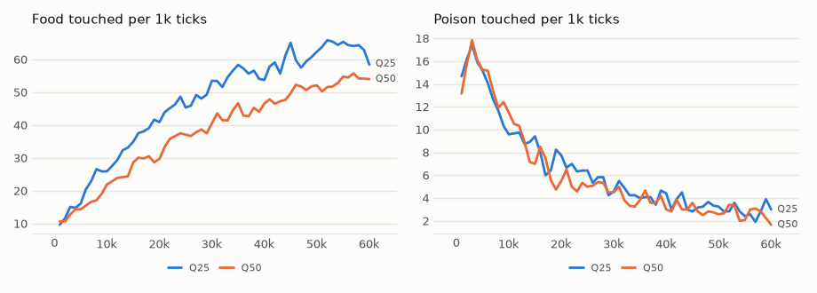

# vm-00079: Outage With Four Transformers

**Date:** 2026-11-03
**Status:** Complete (pending tag)
**Source:** `dev/` (not yet tagged)
**Outputs:** `~/data/research/visual-motor-agent/exp_00079/`
**Task plan:** [`../tasks/00090-outage-four.md`](../tasks/00090-outage-four.md)

## Goal

vm-00078's outage with the default 4 quadrant transformers, each off a quarter (Q25) or half (Q50) of the time. Each holds a quarter of the view in detail, against a sixteenth with 16, so this is where the body should be least redundant. The outage mechanism is described in [vm-00078](../00078-outage/README.md); the design and readings are in the task plan.

## Method

- **Arms:** Q25 and Q50, the default model (4 quadrant transformers, K4, log summaries, the default 64 x 64 world), `online.off` .25 and .5, `online.off_span = 32`, six seeds, 60k ticks; seeds 1–3 on the 4090, 4–6 on the 3090, all 12 at once.
- **Control:** vm-00073's K4, the same model all on, six seeds, not rerun.
- **Frozen (`eval_outage.py`):** `chain` at test off shares 0, .25 and .5 for Q25, Q50 and K4 (16 worlds, 1,500 ticks); `restore`; `alone` (8 worlds, 600 ticks).
- **Readings:** set before the results, in the task plan.
- **Code:** unchanged from vm-00078 (`exp/vm-00078`); the switch works for any number of transformers.

## Results

### R1. Lived, last 20k ticks, six seeds, 95% interval (t, df 5)

| | Food | Seeds | of K4 | Poison | Mean hunger |
|---|---|---|---|---|---|
| K4, all on | 70.0 ± 10.8 | 88.2, 72.2, 60.1, 68.6, 70.8, 60.3 | – | 3.68 ± .73 | .058 |
| Q25, off .25 | 61.9 ± 15.5 | 65.0, 47.4, 67.8, 44.8, 85.0, 61.5 | .88 | 3.11 ± .82 | .040 |
| Q50, off .5 | 51.6 ± 11.3 | 64.8, 39.0, 58.2, 57.5, 38.6, 51.8 | .74 | 2.80 ± .26 | .028 |

Against K4, seed by seed: Q25 food −8.1 ± 18.7, poison −.58 ± 1.11; Q50 food −18.4 ± 13.8, poison −.88 ± .79.

The transformers were on .74 to .76 of the ticks in Q25. In Q50 they were on .49 to .51, except the top-left one at .63: the rule that the lowest stays on when all would be off made up the rest.

### R2. Frozen, each final model at three test off shares, mean of six seeds

| Test off | Food K4 | Food Q25 | Food Q50 | Poison K4 | Poison Q25 | Poison Q50 | Aim K4 | Aim Q25 | Aim Q50 |
|---|---|---|---|---|---|---|---|---|---|
| 0 | 72.2 | 67.5 | 64.6 | 3.34 | 2.34 | 2.20 | .17 | .15 | .15 |
| .25 | 68.4 | 64.3 | 59.6 | 3.35 | 2.47 | 2.32 | .15 | .14 | .13 |
| .5 | 64.9 | 60.3 | 56.1 | 3.74 | 2.54 | 2.36 | .14 | .14 | .13 |

| Seed by seed | Food | Poison |
|---|---|---|
| K4 at test off .5 − K4 at off 0 | −7.35 ± 4.48 (.90) | +.40 ± .51 |
| Q50 at test off .5 − Q50 at off 0 | −8.56 ± 2.14 (.87) | +.16 ± .63 |
| Q25 − K4, both at off 0 | −4.67 ± 22.08 | **−1.00 ± .67** |
| Q50 − K4, both at off 0 | −7.58 ± 11.85 | −1.14 ± 1.13 |
| Q50 − K4, both at off .5 | −8.79 ± 9.57 | −1.38 ± 1.28 |

### R3. Alone: each transformer foraging by itself, the other three off

| | All together: food (poison) | Each alone: mean food (poison) | Range of the four | Share of all, mean (range over seeds and transformers) |
|---|---|---|---|---|
| K4 | 66.9 (3.82) | 56.9 (4.77) | 55.2 to 59.3 | .86 (.68 to 1.06) |
| Q25 | 64.2 (2.36) | 53.2 (3.47) | 48.1 to 56.2 | .83 (.66 to 1.10) |
| Q50 | 63.8 (2.60) | 45.9 (3.19) | 43.8 to 46.9 | .72 (.55 to .85) |

### R4. Restoration: error against the real thumbnail of a transformer's quarter, on things

| | K4 | Q25 | Q50 |
|---|---|---|---|
| The owner's patches, box-averaged | .021 | .022 | .023 |
| The owner's summary prediction | .010 | .013 | .017 |
| The neighbours' (3) predictions of that summary | .026 | .028 | .031 |
| The frame before, shifted by the move | .031 | .031 | .031 |

## Figures

*From each run's `metrics.jsonl`, the mean of its seeds by arm, smoothed. K4, the control, is in vm-00073.*

## Readings

1. **Graceful: met.** Q25's lived food is .88 of K4's, above .75; Q50's is .74, above .5.
2. **It costs here: met.** K4 frozen with half off loses 7.35 ± 4.48 food, a tenth. With 16 transformers half off cost 2%.
3. **Practice pays: not met.** Frozen with half off, Q50 is still below K4, −8.79 ± 9.57. A life with outages did not make the body better at them.
4. **Alone, under 75% of the team: not met.** A quadrant transformer alone gets .86 of the team's food in K4, more than a sixteenth did in vm-00078 (.75). Four are also highly redundant.

## Analysis

- **With 4 transformers an outage costs, mildly.** Half off at test costs about a tenth of the food, in every arm. Over a whole life, half off costs a quarter of the food (Q50, −18.4 ± 13.8), a quarter off an eighth (Q25, within its interval).
- **The life costs more than the test.** At test with half off, the K4 model keeps .90 of its food, while the Q50 life ends at .74 of K4's. The difference is learning: each transformer in Q50 trains on about half the steps, so it is a weaker model when on (Q50 at test off 0: 64.6 against 72.2).
- **Outages lower poison.** Frozen at test off 0, Q25's poison is 1.00 ± .67 below K4's and Q50's 1.14 ± 1.13 below; lived, Q50 takes 2.80 against 3.68, and the mean hunger of both arms is lower than K4's (.040 and .028 against .058). This echoes vm-00074, where damage in training also lowered poison on clean input. A guess: a transformer that often lacks its neighbours' votes, or trains on broken context, learns to be more careful. Not tested.
- **Alone, a quadrant is nearly the team,** .86 of its food. The poison of one alone is higher (4.77 against 3.82 for K4): the team's main contribution looks like avoiding poison, not finding food.
- **Restoration is cheaper here:** with only three neighbours, each holding the level-2 summary of the off quarter, the neighbours' error (.026) is close to the owner's (.021) and below copying the frame before (.031). But a quarter's thumbnail is coarser (each value the mean of 4 x 4 pixels), so it changes less between frames, and copying the frame before is also much better than in vm-00078.

## Addendum to vm-00078: alone, all six seeds

vm-00078's README reports the alone test for seed 1. All six seeds, same test:

| | All 16: food (poison) | Each alone: mean food (poison) | Range of the 16 | Share of all, mean (range) |
|---|---|---|---|---|
| R0 | 117.4 (6.01) | 87.8 (6.31) | 80.9 to 92.8 | .75 (.54 to .97) |
| R1 | 118.0 (5.73) | 95.7 (5.86) | 88.3 to 101.3 | .82 (.68 to .95) |

A sixteenth-size transformer alone keeps three quarters of the team's food, a quadrant .86 (R3 above).

## Conclusions

1. Four transformers are less redundant than sixteen: half off at test costs a tenth of the food against 2%. But even one quadrant alone keeps .86 of it.
2. Living with outages costs more than meeting them at test, because each transformer learns from fewer steps.
3. Living with outages does not teach the body to handle them, at 4 transformers as at 16.
4. Outages lower poison, as damage did in vm-00074.

## Next steps

- Why outages and damage both lower poison.
- Outages as a resource saving: at 16 transformers they are nearly free.
- Outages chosen by the model: rest when predicting well, fatigue when winning too often.
