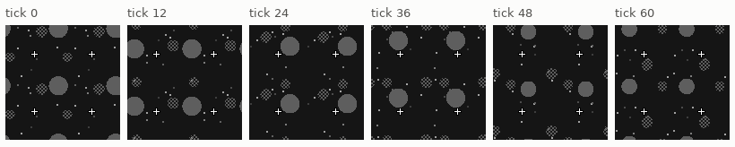
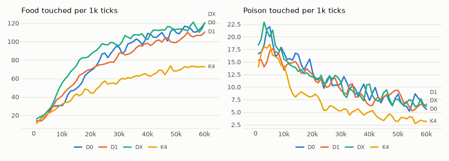

# vm-00080: Delayed Copies

**Date:** 2026-11-03
**Status:** Complete (pending tag)
**Source:** `dev/` (not yet tagged)
**Outputs:** `~/data/research/visual-motor-agent/exp_00080/`
**Task plan:** [`../tasks/00091-delayed-copies.md`](../tasks/00091-delayed-copies.md)

## Goal

The owner's idea: build the view so that it helps the model predict. The frame is four copies of the view: now, and 1 to 16 ticks ago. Each copy has its own four transformers, and every one of them is trained to output the present. Do the delayed transformers learn to dead-reckon, and does the body forage better for seeing the past? The design, arms and readings set before the results are in the task plan.

## How it works

| Quadrant of the 128 x 128 frame | Shows | Transformers | Target |
|---|---|---|---|
| Top-left | now | 4 | now |
| Top-right | d1 ticks ago | 4 | now |
| Bottom-left | d2 ticks ago | 4 | now |
| Bottom-right | d3 ticks ago | 4 | now |

- Each transformer is a default quadrant transformer in size: 4 x 4 patches of 8 pixels, the same network. It holds 36 to 48 tokens per step, against 32 in the default model, because the pyramid has one more level.
- Every transformer's body token is the present body, and all 16 vote by the gain rule.
- In training, the stored composite is the input and the present, tiled four times, is the target: the same split as damage and input noise (`update_rollout(inputs=...)`).
- Before tick d, the first frame stands in for the missing past.

## Method

- **Arms:** D0 (delays 0, 0, 0, 0), D1 (0, 1, 2, 3), DX (0, 1, 4, 16); K4, log summaries, the default world, six seeds, 60k ticks; seeds 1–4 of each arm on the 4090 and 5–6 on the 3090, all 18 at once. Nine per card at first gave 4.8 and 2.6 ticks/s, so the split was changed after 6 minutes, the first start discarded, for the cards to finish together.
- **Reference:** vm-00073's K4, one present frame and 4 transformers, not rerun.
- **Frozen tests (`eval_delay.py`):** `error`, the prediction of the present by copy against its stale input; `chain`, foraging as seen and with the delayed copies blanked.
- **Checks passed before the start:** `tests/test_delay.py`:
  - the composite's quarters are the frames 0, 1, 4 and 16 ticks back over 40 ticks, against a plain world in lockstep;
  - drives, touches and cursor are the plain world's;
  - the targets are the present tiled;
  - bad delays are refused;
  - a short life with 16 transformers learns in every one.
  The world tests are unchanged.

- **Placement during the run:** from about 21:30 the fact experiment's stage 1 (llm-fundamentals 00020) shared the 3090 and slowed its six lives to about 1 tick/s for an hour. All 18 lives finished at 00:17 (3.4 ticks/s at the end); the frozen tests at 00:49.

## Results

### R1. Lived, ticks 40–60k, six seeds, 95% interval (t, df 5), paired by seed

| Arm | Food per 1k | Poison per 1k | Mean hunger | Food against D0 | Poison against D0 |
|---|---|---|---|---|---|
| D0 | 110.9 | 7.30 | .032 | | |
| D1 | 103.8 | 7.31 | .046 | −7.1 ± 30.8 | +0.0 ± 1.3 |
| DX | 114.3 | 7.24 | .015 | +3.4 ± 29.1 | −0.1 ± 1.0 |

Seed by seed, D0's food ranges from 87.0 to 151.2, DX's from 101.3 to 123.5. For scale, vm-00073's K4 (4 transformers, one present frame) had 70.0 food and 3.68 poison over the same ticks: D0's 16 transformers on 4 present copies take 1.6 times K4's food and twice its poison, the same ratios as vm-00078's 16 sixteenth-size transformers on one frame.

Food by 10k ticks of life, mean of six seeds, and DX against D0 (paired):

| Arm | 0–10k | 10–20k | 20–30k | 30–40k | 40–50k | 50–60k |
|---|---|---|---|---|---|---|
| D0 | 24.5 | 54.6 | 85.6 | 99.4 | 107.5 | 114.4 |
| D1 | 26.9 | 60.5 | 78.1 | 92.0 | 100.4 | 107.2 |
| DX | 33.1 | 76.3 | 95.8 | 105.6 | 113.3 | 115.4 |
| DX − D0 | +8.7 ± 13.9 | +21.8 ± 20.4 | +10.2 ± 22.7 | +6.3 ± 29.0 | +5.8 ± 26.4 | +1.0 ± 32.1 |

### R2. Prediction of the present by copy (`eval_delay.py error`), on things, mean of six seeds

The model's error in predicting the present from each quarter, against the error of the quarter's own (stale) input taken as the prediction:

| Arm | Copy now | Second copy | Third copy | Fourth copy |
|---|---|---|---|---|
| D0 (0, 0, 0, 0) | .042 / .000 | .042 / .000 | .036 / .000 | .036 / .000 |
| D1 (0, 1, 2, 3) | .042 / .000 | .062 / .110 | .038 / .158 | .038 / .188 |
| DX (0, 1, 4, 16) | .042 / .000 | .063 / .116 | .038 / .211 | .039 / .236 |

The model minus its stale input, seed by seed: D1 −.048 ± .006, −.120 ± .013, −.150 ± .013; DX −.053 ± .003, −.173 ± .006, −.197 ± .002. The two bottom quarters are lower in every arm, D0 included (.036 against .042), so the comparison between delays is made against the same quarter of D0.

### R3. Frozen foraging, as seen and with the three delayed copies blanked (`eval_delay.py chain`), mean of six seeds

| Arm | Seen: food | Seen: poison | Blanked: food | Blanked: poison | Blanked minus seen, food | Blanked minus seen, poison |
|---|---|---|---|---|---|---|
| D0 | 115.9 | 5.88 | 39.8 | 17.79 | −76.1 ± 24.8 | +11.9 ± 1.8 |
| D1 | 105.1 | 5.34 | 54.7 | 12.36 | −50.3 ± 9.6 | +7.0 ± 2.3 |
| DX | 115.4 | 5.69 | 54.5 | 13.40 | −60.9 ± 14.7 | +7.7 ± 1.8 |

Seen, against D0: D1 food −10.9 ± 30.8, DX −0.5 ± 30.5. The drop from blanking, against D0's drop: D1 +25.8 ± 26.1, DX +15.2 ± 38.2.

## Readings

1. **Plumbing: met** (`tests/test_delay.py`, before the start).
2. **Dead reckoning: met.** Every delayed copy predicts the present far better than its stale input, at every delay, by many times its interval. At 16 ticks back the error is .039 against .236 for the input, as low as the bottom quarters of D0, which see the present.
3. **The past helps: not met.** DX's lived food is +3.4 ± 29.1 above D0's, frozen −0.5 ± 30.5. The seeds vary too much to see a difference of this size, and none of the means points to one.
4. **The past is used: met as worded, but the test does not measure it.** Blanking DX's delayed copies costs 60.9 ± 14.7 food. But blanking the same three quarters in D0, where they hold the present, costs more, 76.1. The test blinds 12 of the 16 voters, and that, not the loss of the past, is what it measures. Against D0's drop, DX's is +15.2 ± 38.2: no sign that DX's body relies on the past.

<!-- figures -->
## Figures

*D0's world as its model sees it, every 12 ticks: the four quarters are all the present (in D1 and DX three of them lag). Moves are random: this shows the world, not the trained agent.*

*From each run's `metrics.jsonl`, the mean of its seeds by arm, smoothed.*
<!-- /figures -->

## Analysis

- **The delayed transformers learn to see the present they cannot see.** A transformer whose own quarter is 16 ticks old predicts the present as well as one that sees it. It can: the pyramid's coarse summaries reach across the whole frame, the present quarter's included, and the body token is the present body. So "dead reckoning" here may be reading the present from the shared summaries rather than carrying the past forward. The data do not separate the two.
- **The 1-tick copy is the worst of the delayed ones,** .062 against .038 at 4 and 16 ticks, and against .042 for D0's same quarter. A guess: its input is so close to the present that it learns to copy it, and pays for the one tick of motion, while the far copies, whose input is useless for the present, learn to read it from elsewhere. Not tested.
- **DX may learn faster early.** At 10–20k ticks DX is ahead of D0 by +21.8 ± 20.4, just outside its interval, and the lead shrinks after. This was not a reading set before the results, and it is one window of six, so it is a hint only. A possible cause: more distinct views of the same moment give more varied training on the present.
- **The body forages no better for the past.** In this world everything the body needs is in the present frame, and vm-00078 showed 16 transformers already redundant. The delays give no measurable gain, and no measurable loss.
- **Blanking is the wrong control for "is the past used".** Any quarter blacked out is a view the model never met in its life; the drop is the same in kind whatever the quarter held. The right test is a world where the past matters (hidden food): that was vm-00081's conditional arm, not run (below).

## Conclusions

1. Transformers trained to predict the present from a delayed view do predict it, up to 16 ticks back, nearly as well as from the present itself.
2. Seeing the past did not change foraging, lived or frozen, in a world where the present tells all.
3. Blanking quarters measures blinded voters, not memory; D0's drop is the control that shows it.

## Next steps

- vm-00081's conditional arms (D0 and DX with hidden food) were not started: reading 4 is met only as worded, and vm-00081 showed that hidden food from birth stops foraging altogether, so those arms would test learning, not memory. With vm-00083's gradual hiding they could be worth running.
- Whether the delayed transformers read the present from the shared summaries: cut a transformer's summaries of the present quarter and see if its error rises.
