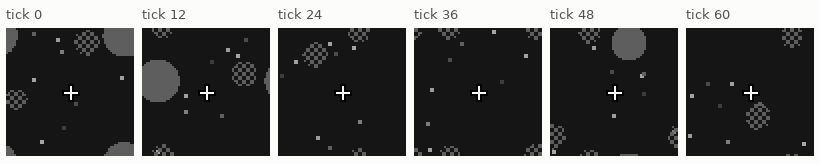
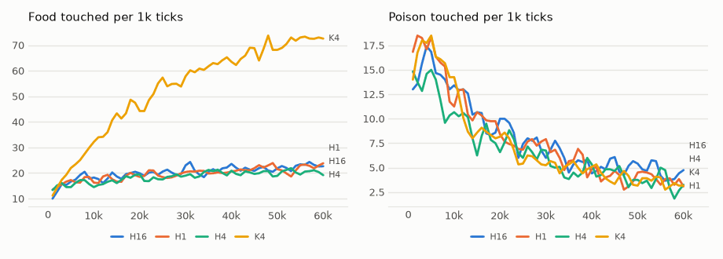

# vm-00081: Hidden Food

**Date:** 2026-11-03
**Status:** Complete
**Source:** `exp/vm-00081` (code: `visual-motor-agent/dev/`)
**Outputs:** `~/data/research/visual-motor-agent/exp_00081/`
**Task plan:** [`../tasks/00092-hidden-food.md`](../tasks/00092-hidden-food.md)

## Goal

How long can the agent remember? The food is drawn only in its first few frames after it appears; then it is invisible until eaten, though touching it still feeds. In the egocentric view the food never leaves the view, so remembering it means keeping track of it through one's own moves. The design, arms and readings set before the results are in the task plan.

## How it works

- `env.food_show = v`: the food is drawn in its first v frames after it appears, then not at all until it is eaten. Poison and dots stay visible. `v = 0` is the old world: identical to the committed world over 5,000 ticks, frames and drives.
- A full step moves 4 pixels on each axis. The next food after a bite is about 15 pixels away, 3 to 4 ticks of travel.

## Walkers, no model (`eval_hidden.py walk`)

32 worlds, 6,000 ticks, food per 1,000 ticks:

| `food_show` | Blind | Forgets at once | Remembers perfectly |
|---|---|---|---|
| 16 | 22.8 | 272.0 | 272.0 |
| 4 | 22.6 | 56.0 | 272.0 |
| 1 | 22.6 | 24.7 | 272.0 |

At 16 forgetting costs nothing: every trip ends before the food vanishes. At 4, memory is worth a factor of 5, and at 1 nearly everything. vm-00073's K4, raised with the food always seen and tested at `food_show = 4` (one seed, 400 ticks), aims at the food 1 tick after it vanished (.25) and not after, and forages below a blind walk (18).

Reading 4 compares shares: the forgetful walker keeps .21 of the perfect one's food at `food_show = 4`, and H4 must keep more than .21 of K4's always-seen food.

## Method

- **Arms:** H16, H4, H1: the default model (4 quadrant transformers, K4, log summaries), `env.food_show` 16, 4, 1, six seeds, 60k ticks; seeds 1–3 on the 4090, 4–6 on the 3090.
- **Control:** vm-00073's K4, always seen, not rerun; also tested frozen with the food hidden.
- **Conditional:** vm-00080's D0 and DX with `food_show = 4` (C0, CX), four seeds, if vm-00080 shows DX using its past.
- **Frozen (`eval_hidden.py aim`):** aim by time since the food vanished, and food per 1,000 ticks.
- **Checks passed before the start:** `tests/test_hidden_food.py` (the food drawn in exactly its first v frames over 600 ticks of chasing, everything but its pixels the always-seen world's, `food_show = 0` unchanged, bad values refused); the world tests and the JavaScript equivalence unchanged.
- **Run notes:**
  - The 18 lives ran 00:49–01:59 on 2026-11-04.
  - The first frozen tests failed:
    - the aim test of the H arms ran out of GPU memory, because vm-00082's 30 lives started at the same moment (my queueing: vm-00082 waited for these lives, not for the frozen tests);
    - K4's aim tested only seed 1: the run list, joined by line breaks, was passed into `sh -c`, which ran each further line as a command.
  - The Makefile now joins the list with spaces. The frozen tests were rerun on 2026-11-04, 07:38–08:11, alone on the 4090; the failed outputs are kept as `*.failed.*`.
- **The conditional arms were not run:** vm-00080's reading 4 is met only as worded (blanking D0's present copies costs more than blanking DX's past), and, by the lived results below, hidden food from birth would test learning, not memory.

## Results

### R1. Lived, ticks 40–60k, six seeds, 95% interval (t, df 5), paired by seed

| Arm | Food per 1k | Poison per 1k | Mean hunger | Food against K4 |
|---|---|---|---|---|
| K4 (vm-00073, always seen) | 70.0 | 3.68 | .058 | |
| H16 | 22.1 | 4.88 | .140 | −47.9 ± 12.7 |
| H4 | 20.1 | 3.83 | .126 | −49.9 ± 9.6 |
| H1 | 22.0 | 3.81 | .146 | −48.0 ± 11.9 |

Food by 10k ticks of life, mean of six seeds:

| Arm | 0–10k | 10–20k | 20–30k | 30–40k | 40–50k | 50–60k |
|---|---|---|---|---|---|---|
| K4 | 23.3 | 41.8 | 54.0 | 62.1 | 67.9 | 72.1 |
| H16 | 16.9 | 18.8 | 20.6 | 21.2 | 21.4 | 22.8 |
| H4 | 15.5 | 17.6 | 18.3 | 20.1 | 19.8 | 20.5 |
| H1 | 16.5 | 18.3 | 19.5 | 20.4 | 22.0 | 22.0 |

### R2. Meals eaten while the food is still drawn, moving at random (no model, 16 worlds, 5,000 ticks)

| `food_show` | Food per 1k | Eaten while still drawn |
|---|---|---|
| 16 | 4.6 | 14.8% |
| 4 | 4.6 | 6.2% |
| 1 | 4.6 | 2.4% |

### R3. Frozen aim by ticks since the food vanished (`eval_hidden.py aim`), mean of six seeds, 95% interval

Each model is tested in its own world; vm-00073's K4 (raised with the food always seen) is tested at three shows. Aim is the cosine between the move and the direction to the food. Food and poison are per 1k ticks of the test.

| Model, show | Food | Poison | Seen | 1 | 2 | 3–4 | 5–8 | 9–16 | 17–32 | Over 32 |
|---|---|---|---|---|---|---|---|---|---|---|
| H16, 16 | 22.3 | 3.49 | .074 ± .043 | .143 ± .065 | .131 ± .081 | .135 ± .075 | .106 ± .048 | .085 ± .039 | .093 ± .024 | .090 ± .005 |
| H4, 4 | 20.4 | 3.11 | −.024 ± .030 | .032 ± .033 | .064 ± .031 | .055 ± .018 | .083 ± .009 | .105 ± .027 | .071 ± .020 | .089 ± .015 |
| H1, 1 | 22.5 | 3.16 | −.043 ± .040 | .002 ± .021 | .015 ± .014 | .032 ± .024 | .058 ± .030 | .090 ± .040 | .089 ± .029 | .083 ± .015 |
| K4, 16 | 35.5 | 15.56 | .272 ± .059 | .173 ± .076 | .119 ± .092 | .139 ± .059 | .075 ± .038 | .026 ± .043 | .047 ± .023 | .045 ± .018 |
| K4, 4 | 19.0 | 18.33 | .246 ± .097 | .058 ± .027 | .024 ± .039 | .059 ± .045 | .055 ± .056 | .039 ± .043 | .026 ± .035 | .043 ± .020 |
| K4, 1 | 15.4 | 19.44 | .209 ± .075 | .014 ± .034 | −.001 ± .042 | .019 ± .038 | .035 ± .051 | .027 ± .055 | .043 ± .035 | .038 ± .023 |

"Over 32" is the model's aim at a food it has not seen for a long time: its general drift toward food, not memory. It is above zero for every model, because a path that wanders toward the middle of the world nears more foods than it leaves.

## Readings

1. **Plumbing: met** (`tests/test_hidden_food.py`, before the start).
2. **Memory, a little: not met.** H4's aim 1 and 2 ticks after the food vanished (.032, .064) is below its aim after 32 ticks (.089), and so is H1's (.002, .015 against .083). The models aim at a food less just after it vanishes than long after.
3. **Beyond the context it is gone: met, trivially.** H1's aim at 17–32 ticks (.089) is within the interval of its aim after 32 ticks (.083 ± .015), but nothing was there to lose.
4. **More than forgetting: met as worded, but not memory.** H4's lived food is .29 ± .04 of K4's (the interval covers both arms' seeds), above the forgetful walker's .21. But H4, at 20.1, forages below a blind walker (22.6). The reading's share hides that: K4 is so far below the perfect chaser that a blind walk is already .32 of it.

<!-- figures -->
## Figures

*The world of this experiment as its model sees it, every 12 ticks. Moves are random: this shows the world, not the trained agent.*

*From each run's `metrics.jsonl`, the mean of its seeds by arm, smoothed.*
<!-- /figures -->

## Analysis

- **With the food hidden from birth the agent does not learn to forage, whatever the show.** All three arms end near the blind walker (22.6) and gain about 5 food per 1k over the whole life, against K4's 49. H16 is no better than H1, though at 16 frames a walker that forgets at once loses nothing against perfect memory. So the failure is not a limit of memory.
- **It is a failure to start.** An agent moving at random eats a food it can still see in only 15% of its meals at 16 frames, 6% at 4. It almost never sees "food on screen, then hunger falls", so nothing ties the food's image to eating, and the image never becomes worth approaching.
- **The frozen aim agrees.** The hidden-from-birth models barely aim at a food they can see (H16 .074; H4 and H1 below zero), and at a food that just vanished less than at one long gone. Only H16 aims a little more at a food 1–4 ticks after it vanished (.13 to .14) than long after (.090), within the intervals.
- **Poison is still learned.** Poison stays drawn, and every arm keeps it low (3.8 to 4.9 lived, against 27 to 28 for the blind walker).
- **A model raised with the food in sight breaks when the food hides.** Frozen at 16, K4 still forages at half its lived rate (35.5) and aims at a food 1 tick after it vanished (.173) about as much as at a seen one. At 4 and 1 its food falls to 19.0 and 15.4, below a blind walk, and its poison rises five times, to 18–19 per 1k. A guess: with no food in view, it moves toward what is still drawn, and that is the poison. Not tested.

## Conclusions

1. Hidden food from birth stops foraging altogether, at every show: the agent never learns that food is worth approaching. This is a start-up problem, not a memory limit.
2. None of the hidden-from-birth models shows memory of a vanished food.
3. A model that learned with the food in sight forages below a blind walk once the food hides after 4 frames or fewer, and eats five times the poison.
4. Memory can only be tested in an agent that already forages: vm-00083 (food seen for 20k ticks, then hiding gradually).
