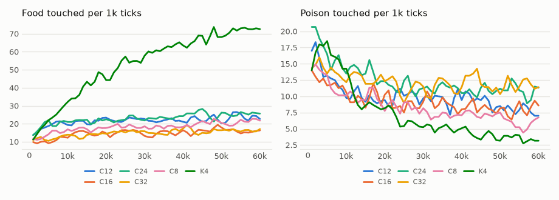

# vm-00082: Context Length

**Date:** 2026-11-03
**Status:** Complete (pending tag)
**Source:** `dev/` (not yet tagged)
**Outputs:** `~/data/research/visual-motor-agent/exp_00082/`
**Task plan:** [`../tasks/00093-context-length.md`](../tasks/00093-context-length.md)

## Goal

The owner's question: does a longer context help? One transformer over the whole small world, with a context of 8, 12, 16, 24 or 32 ticks, everything else the default. Each final model is also tested with hidden food (vm-00081's world), to see whether the longer context lets it remember longer. The design and readings set before the results are in the task plan.

## Method

- **Arms:** C8, C12, C16, C24, C32: one transformer (`model.band_n = 0`, `online.pieces = 0`, 87 tokens per step), `model.ctx` 8 to 32, K4, the default 64 x 64 world, six seeds, 60k ticks; seeds 1–3 on the 4090, 4–6 on the 3090.
- **Reference:** vm-00073's K4, 4 transformers at ctx 8, not rerun.
- **A longer context also means more tokens per update:** the replayed windows are ctx steps long, so C32 trains on 4 times C8's tokens.
- **Frozen:**
  - `eval_hunger.py chain`: the model's food against the same moves replayed blind in another world, and against those blind moves with a perfect grab whenever a food is one move away;
  - `eval_hidden.py aim` with the food hidden after 4 frames and after 1.
- **Checks passed before the start:** 300-tick lives at ctx 8 and 32 (36.7 and 12.5 ticks/s with the GPU shared), and both frozen tools on a one-transformer model.
- **Run notes:**
  - The 30 lives started at 01:59 on 2026-11-04, at the same moment as vm-00081's frozen tests.
  - Six of them ran out of GPU memory at the start: C24 s2, and C32 s2, s3, s4, s5, s6.
  - Five were rerun on the 4090 once its first batch was done. C32 s5 ran out of memory a second time and was rerun alone on the 3090 (07:06–08:43). The failed logs are kept as `*.oom.log` and `*.oom2.log`.
  - On the 4090's first batch, a C8 life took 130 minutes and a C32 life 149.
  - The frozen tests ran 09:40–09:53.

## Results

### R1. Lived, ticks 40–60k, six seeds, 95% interval (t, df 5), paired by seed

| Arm | Food per 1k | Poison per 1k | Mean hunger | Food against C8 | Poison against C8 |
|---|---|---|---|---|---|
| C8 | 20.8 | 6.51 | .195 | | |
| C12 | 23.2 | 8.54 | .231 | +2.5 ± 14.4 | +2.03 ± 1.97 |
| C16 | 16.1 | 8.07 | .305 | −4.6 ± 14.5 | +1.57 ± 2.80 |
| C24 | 25.4 | 10.88 | .209 | +4.7 ± 9.7 | +4.38 ± 4.48 |
| C32 | 16.1 | 11.96 | .391 | −4.6 ± 15.8 | +5.45 ± 1.70 |
| K4 (vm-00073, 4 transformers) | 70.0 | 3.68 | .058 | +49.3 ± 12.3 | −2.82 ± 2.83 |

Seed by seed, C8's food ranges from 6.0 to 33.5, C32's from 5.8 to 26.8.

Food by 10k ticks of life, mean of six seeds:

| Arm | 0–10k | 10–20k | 20–30k | 30–40k | 40–50k | 50–60k |
|---|---|---|---|---|---|---|
| C8 | 14.4 | 17.1 | 18.5 | 18.2 | 20.5 | 21.0 |
| C12 | 18.7 | 21.6 | 22.3 | 21.6 | 22.5 | 23.9 |
| C16 | 10.8 | 14.8 | 15.2 | 14.8 | 16.3 | 15.9 |
| C24 | 19.5 | 21.8 | 22.4 | 23.5 | 25.4 | 25.4 |
| C32 | 12.2 | 13.6 | 15.7 | 15.5 | 15.9 | 16.3 |
| K4 | 23.3 | 41.8 | 54.0 | 62.1 | 67.9 | 72.1 |

### R2. Frozen chain (`eval_hunger.py chain`), mean of six seeds

| Arm | Seen: food | Seen: poison | Blind: food | Blind with a grab: food | Seen minus grab |
|---|---|---|---|---|---|
| C8 | 20.7 | 6.73 | 11.6 | 22.9 | −2.1 ± 4.4 |
| C12 | 25.0 | 8.53 | 11.9 | 23.2 | +1.7 ± 7.4 |
| C16 | 16.3 | 8.06 | 8.7 | 18.0 | −1.7 ± 6.6 |
| C24 | 26.5 | 10.51 | 14.6 | 28.1 | −1.6 ± 6.2 |
| C32 | 16.6 | 11.52 | 11.0 | 21.4 | −4.8 ± 6.6 |

Aim at the food 12–16 pixels from its edge, seen (blind baseline in brackets): C8 .086 (.044), C12 .085 (.037), C16 .039 (.025), C24 .093 (.045), C32 .044 (.036).

### R3. Frozen aim with hidden food (`eval_hidden.py aim`), by ticks since the food vanished, mean of six seeds

| Arm, show | Food | Poison | Seen | 1 | 2 | 3–4 | 5–8 | 9–16 | Over 32 |
|---|---|---|---|---|---|---|---|---|---|
| C8, 4 | 13.0 | 7.10 | .066 | −.018 | −.006 | .016 | .018 | .057 | .058 |
| C32, 4 | 12.3 | 12.46 | .011 | −.005 | .000 | −.008 | .028 | .033 | .045 |
| C8, 1 | 13.5 | 7.02 | .096 | −.046 | .008 | .032 | .022 | .058 ± .023 | .067 |
| C12, 1 | 12.9 | 10.75 | .026 | −.015 | −.017 | .001 | .026 | .067 | .047 |
| C16, 1 | 10.9 | 10.31 | .054 | −.022 | −.002 | .000 | .022 | .027 | .037 |
| C24, 1 | 13.7 | 13.53 | .069 | −.018 | −.003 | −.009 | .011 | .052 | .048 |
| C32, 1 | 11.9 | 13.31 | .027 | −.006 | −.006 | −.018 | .015 | .060 ± .024 | .050 |

The 95% intervals of the other cells are .015 to .08 wide on each side.

## Readings

1. **Plumbing: met** (300-tick lives at ctx 8 and 32, before the start).
2. **Longer helps: not met.** C32's lived food is 4.6 ± 15.8 below C8's. No arm differs from C8 in food, and the order of the arms (C24, C12, C8, C16, C32) follows no trend in the context.
3. **Memory reaches further: not met.** At show 1, C32's aim 9–16 ticks after the food vanished (.060 ± .024) equals C8's (.058 ± .023). Neither aims at a just-vanished food more than at one long gone.

<!-- figures -->
## Figures

*The world of this experiment as its model sees it, every 12 ticks. Moves are random: this shows the world, not the trained agent.*

*From each run's `metrics.jsonl`, the mean of its seeds by arm, smoothed.*
<!-- /figures -->

## Analysis

- **One transformer over the whole world forages poorly at any context.** All five arms end at 16 to 25 food per 1k, under a third of K4's 70 with 4 quarter transformers at ctx 8, and they hardly improve after 10k ticks. The context is not what holds them back. Splitting the view among transformers matters far more (vm-00078: 16 transformers forage 1.64 times as well as 4).
- **A longer context costs poison.** Poison rises with the context, from 6.5 at 8 to 12.0 at 32 (+5.45 ± 1.70 against C8, the one difference outside its interval). C32's mean hunger is twice C8's (.39 against .20). A guess: each update spreads over 4 times the ticks, so the few ticks where a touch matters weigh less. Not tested.
- **No arm moves in a chain toward the food.** Every arm's food is within its interval of what its own moves, replayed blind with a perfect grab at the end, would get (seen minus grab −4.8 to +1.7). What these models do is a walk with a grab when the food is one move away.
- **No arm remembers a vanished food,** at either show, so a longer context has nothing to keep. Memory needs an agent that first forages well with the food in view.
- **Memory cost:** five C32 lives took 20.6 GB of the 4090, and more did not fit.

## Conclusions

1. For one transformer over the whole small world, a context of 8 to 32 ticks makes no difference to food; the longest eats more poison.
2. None of the one-transformer models chains moves toward food or remembers a hidden one, so the context has nothing to carry.
3. The split of the view among transformers is worth far more than a longer context.

## Next steps

- Context length in an agent that does forage and must remember: vm-00083's G4 schedule with the default model at ctx 8 against 16 or 32.
