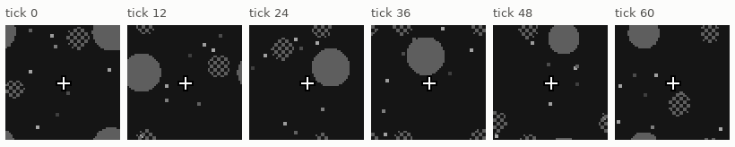
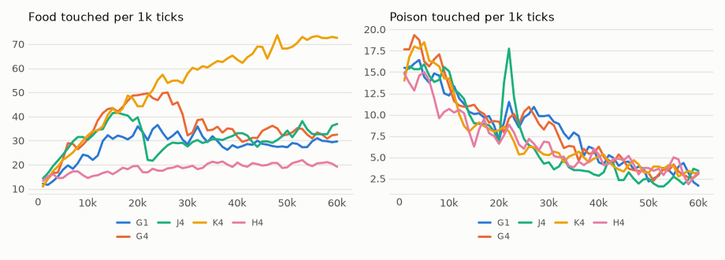

# vm-00083: The Food Hides Gradually

**Date:** 2026-11-04
**Status:** Complete (pending tag)
**Source:** `dev/` (not yet tagged)
**Outputs:** `~/data/research/visual-motor-agent/exp_00083/`
**Task plan:** [`../tasks/00094-food-hides-gradually.md`](../tasks/00094-food-hides-gradually.md)

## Goal

In vm-00081, with the food hidden from birth, the agent never learned to forage, even at 16 frames, where a walker that forgets at once loses nothing. A random-moving agent eats a food it can still see in only 15% of its meals at 16 frames and 6% at 4, so the link between the food's image and eating has little to grow from. Here the food is always seen for the first 20k ticks and then hides after fewer and fewer frames (the owner's suggestion). Does the agent keep foraging as the food hides, and does it learn to remember where it was? The design, arms and readings set before the results are in the task plan.

## How it works

- `online.env_sched = {"food_show": [[tick, value], ...]}`: at the start of each listed tick the life calls `env.reconfigure(food_show=value)`.
  - A world lists the settings it can change mid-life (`CircleWorld.RUNTIME`: only `food_show`, read afresh every frame).
  - Other keys and bad ticks or values are refused at the start. The metrics carry `env_food_show`.
- `tests/test_env_sched.py`: a world switched at step 200 is the always-seen world, frame for frame, before the switch and the world born hidden after it.
- A 300-tick life switched to 8 at tick 101 and to 2 at 201 logs 0, 0, 8, 8, 2, 2 at its six 50-tick reports.

## Method

| Arm | `food_show` over the life |
|---|---|
| G4 | always seen to 20k; 64, 32, 16, 8 for 4k ticks each; 4 from 36k to 60k |
| G1 | as G4 to 36k; 2 at 40k; 1 from 44k to 60k |
| J4 | always seen to 20k; 4 from 20k |

- The default model (4 quadrant transformers, K4, log summaries), the default world, six seeds, 60k ticks; seeds 1–3 on the 4090, 4–6 on the 3090.
- **References, not rerun:** vm-00073's K4 (always seen) and vm-00081's H4 and H1 (hidden from birth).
- **Frozen (`eval_hidden.py aim`):** each model at show 4 and at show 1. K4's reference is from vm-00081's frozen tests.
- **Run notes:** the 18 lives ran 08:11–09:40 on 2026-11-04 (39 minutes on the 4090, 90 on the 3090 beside vm-00082's last life), and the frozen tests 09:40–09:53.
- **The three arms are the same until 20k,** with the same seeds, so up to there they are three repeats of one condition. They still differ, because the GPU's arithmetic is not repeatable and lives part quickly: at 16–20k, G4, G1 and J4 ate 47.7, 33.2 and 40.0, and seed 1 alone 81.2, 36.2 and 61.8. Differences between arms of this size are chance.

## Results

### R1. Lived, ticks 50–60k (every arm at its last value), six seeds, 95% interval (t, df 5), paired by seed

| Arm | Food per 1k | Poison per 1k | Mean hunger | Food against H4 | Food against J4 |
|---|---|---|---|---|---|
| G4 | 32.9 | 3.10 | .097 | +12.4 ± 2.7 | −1.3 ± 2.8 |
| G1 | 29.3 | 3.02 | .061 | +8.8 ± 3.6 | −4.9 ± 4.9 |
| J4 | 34.2 | 2.37 | .069 | +13.7 ± 2.8 | |
| H4 (vm-00081) | 20.5 | 3.47 | .137 | | −13.7 ± 2.8 |
| H1 (vm-00081) | 22.0 | 3.70 | .141 | +1.5 ± 5.0 | −12.2 ± 5.4 |
| K4 (vm-00073, always seen) | 72.1 | 3.47 | .085 | +51.7 ± 10.6 | +37.9 ± 10.2 |

G1 against H1, both at show 1: +7.3 ± 3.1.

Food by 4k ticks of life, mean of six seeds, with G4's show and G4 against J4 (paired):

| Ticks | G4's show | G4 | G1 | J4 | H4 | K4 | G4 − J4 |
|---|---|---|---|---|---|---|---|
| 12–16k | always | 42.5 | 32.2 | 40.1 | 17.2 | 41.0 | +2.4 ± 12.9 |
| 16–20k | always | 47.7 | 33.2 | 40.0 | 18.8 | 46.5 | +7.6 ± 15.0 |
| 20–24k | 64 | 48.2 | 33.3 | 23.0 | 17.2 | 51.8 | +25.2 ± 20.1 |
| 24–28k | 32 | 47.9 | 32.2 | 28.5 | 19.0 | 54.4 | +19.4 ± 13.2 |
| 28–32k | 16 | 35.3 | 32.2 | 28.9 | 18.6 | 58.6 | +6.4 ± 10.0 |
| 32–36k | 8 | 35.0 | 29.6 | 30.1 | 20.6 | 61.7 | +4.9 ± 7.5 |
| 36–40k | 4 | 33.4 | 26.6 | 32.1 | 20.5 | 63.8 | +1.2 ± 3.7 |
| 40–44k | 4 | 30.6 | 29.3 | 29.8 | 19.7 | 66.8 | +0.9 ± 4.2 |
| 44–48k | 4 | 35.1 | 27.9 | 30.0 | 20.3 | 68.9 | +5.1 ± 6.4 |
| 48–52k | 4 | 33.8 | 28.0 | 34.2 | 20.1 | 69.3 | −0.3 ± 6.5 |
| 52–56k | 4 | 33.0 | 29.2 | 33.7 | 20.4 | 72.5 | −0.7 ± 5.0 |
| 56–60k | 4 | 31.7 | 29.7 | 34.8 | 20.1 | 72.5 | −3.1 ± 4.7 |

J4's poison rose from 6.7 per 1k at 18–20k to 17.8 at 20–22k, the 2k ticks after the jump, and was back to 8.8 by 22–24k.

### R2. Frozen aim by ticks since the food vanished (`eval_hidden.py aim`), mean of six seeds, 95% interval

| Model, show | Food | Poison | Seen | 1 | 2 | 3–4 | 5–8 | 9–16 | Over 32 |
|---|---|---|---|---|---|---|---|---|---|
| G4, 4 | 34.9 | 3.81 | .167 ± .084 | .068 ± .037 | .069 ± .033 | .106 ± .034 | .131 ± .039 | .103 ± .030 | .089 ± .014 |
| G1, 4 | 30.2 | 2.60 | .139 ± .077 | .033 ± .050 | .024 ± .040 | .050 ± .033 | .109 ± .028 | .132 ± .018 | .088 ± .013 |
| J4, 4 | 33.5 | 1.64 | .161 ± .045 | .074 ± .014 | .087 ± .021 | .089 ± .040 | .134 ± .071 | .103 ± .032 | .097 ± .007 |
| K4, 4 | 19.0 | 18.33 | .246 ± .097 | .058 ± .027 | .024 ± .039 | .059 ± .045 | .055 ± .056 | .039 ± .043 | .043 ± .020 |
| G4, 1 | 30.7 | 3.50 | .149 ± .081 | .049 ± .037 | .050 ± .013 | .056 ± .019 | .106 ± .021 | .107 ± .018 | .088 ± .015 |
| G1, 1 | 29.4 | 2.80 | .117 ± .086 | .030 ± .029 | .017 ± .051 | .046 ± .021 | .089 ± .025 | .120 ± .018 | .092 ± .014 |
| J4, 1 | 30.4 | 1.53 | .150 ± .055 | .042 ± .019 | .048 ± .016 | .041 ± .031 | .092 ± .051 | .114 ± .037 | .102 ± .015 |
| K4, 1 | 15.4 | 19.44 | .209 ± .075 | .014 ± .034 | −.001 ± .042 | .019 ± .038 | .035 ± .051 | .027 ± .055 | .038 ± .023 |

At show 4, G4 against K4 (unpaired, t with about 10 degrees of freedom):

| Ticks since the food vanished | 2 | 3–4 | 5–8 |
|---|---|---|---|
| Aim, G4 minus K4 | +.045 ± .044 | +.047 ± .049 | +.076 ± .059 |
| The same, each model's aim over 32 ticks taken off | −.002 ± .047 | +.001 ± .052 | +.029 ± .055 |

## Readings

1. **Plumbing: met.** Every life's `env_food_show` followed its schedule at every 1k report, and `tests/test_env_sched.py` shows the switched world equal to the always-seen world before the switch.
2. **Learned first, kept after: met.** G4's food at 50–60k is 12.4 ± 2.7 above H4's.
3. **Gradual beats a jump: not met.** G4 is 1.3 ± 2.8 below J4.
4. **Memory grew: not met.** At show 4, G4's aim 2 ticks after the food vanished is above K4's by +.045 ± .044, just outside its interval, but at 3–4 ticks by +.047 ± .049, inside it. Both are G4's higher aim at any food, not memory: with each model's aim at a food long gone taken off, the difference is zero (−.002 ± .047).

<!-- figures -->
## Figures

*The world at the start of every life, as its model sees it, every 12 ticks: the food is always drawn until 20k. Moves are random: this shows the world, not the trained agent.*

*From each run's `metrics.jsonl`, the mean of its seeds by arm, smoothed. G4, G1 and J4 are one condition until 20k.*
<!-- /figures -->

## Analysis

- **Learning with the food in sight carries over.** Every staged arm forages above the hidden-from-birth arms once the food hides: G4 by 12.4 ± 2.7 over H4, G1 by 7.3 ± 3.1 over H1. vm-00081's start-up problem is solved by seeing the food first.
- **But hiding stops the learning.** Under hiding the staged arms stay flat at 30 to 35, while K4, with the food in sight, climbs from 47 to 72 over the same ticks. They keep part of what they learned and add nothing.
- **Hiding after 64 or 32 frames costs nothing; after 16 it does.** G4 forages at 48 through 20–28k and falls to 35 at show 16. A guess: several foods are on screen at once, and a food the agent does not go for soon outlives 16 frames, so the agent loses targets rather than memory. Not tested.
- **The jump costs a few thousand ticks, not the outcome.** J4's food fell from 40 to 23 right after the jump and its poison nearly tripled for 2k ticks, but it had caught up with G4 by 36–40k and ends level. The gradual schedule spreads the same loss over 16k ticks.
- **No memory of a vanished food.** The staged models aim at any food more than K4 does (about .09 against .04 long after it vanished), a general drift toward food. They aim at a food 1 or 2 ticks gone less than at one long gone; the aim rises with the time since the food vanished, where memory would make it fall. The model does not carry the food's place forward through its own moves.
- **Training with hiding makes the model robust to hiding.** Frozen at show 4, G4 eats 34.9 food with 3.8 poison and J4 33.5 with 1.6, where K4, raised in sight, eats 19.0 with 18.3 poison. The staged models learned what to do when no food is in view; K4, meeting that for the first time, goes for poison.

## Conclusions

1. Seeing the food for 20k ticks before it hides lifts foraging under hiding from the blind walker's level (20) to 30–35. Hidden food from birth is a start-up problem, and staging solves it.
2. A gradual schedule does no better than a jump.
3. Once the food hides, foraging stops improving, and no arm learns to remember where a vanished food was.
4. A model raised with hiding forages under hiding at nearly twice K4's food and a fifth to a tenth of its poison.

## Next steps

- Why the model does not learn to track a vanished food: it is trained to predict the next frames, where a hidden food is not drawn, so nothing in the loss asks it to keep the food's place. A test with the input/target split already used for damage and input noise: the input frames hide the food, the target frames show it. If memory appears then, the missing piece is the target, not the capacity.
- vm-00080's delayed copies with G4's schedule: a view of the past may carry the food where the context does not.
