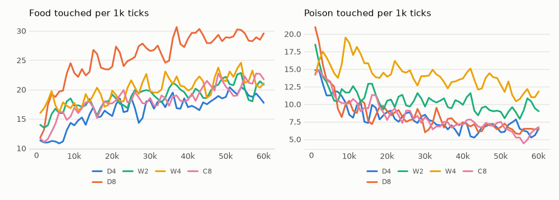

# vm-00084: One Transformer, Bigger Instead of Longer

**Date:** 2026-11-04
**Status:** Complete
**Source:** `exp/vm-00084` (code: `visual-motor-agent/dev/`)
**Outputs:** `~/data/research/visual-motor-agent/exp_00084/`
**Task plan:** [`../tasks/00095-model-size-one-transformer.md`](../tasks/00095-model-size-one-transformer.md)

## Goal

The owner's question, after vm-00082: instead of a longer context, what do more parameters give? vm-00082's single transformer over the whole small world forages at 16 to 25 food per 1k, a third of the 4-quadrant K4, and does not move in a chain toward food at any context length. Here the same transformer, at ctx 8, is made deeper (4 and 8 layers) or wider (d_model 256 and 512). The design and the readings set before the results are in the task plan.

## Method

| Arm | d_model | Layers | Heads | d_ff | Parameters |
|---|---|---|---|---|---|
| C8 (vm-00082, not rerun) | 128 | 2 | 4 | 512 | 976,546 |
| D4 | 128 | 4 | 4 | 512 | 1,373,090 |
| D8 | 128 | 8 | 4 | 512 | 2,166,178 |
| W2 | 256 | 2 | 8 | 1024 | 2,737,314 |
| W4 | 512 | 2 | 16 | 2048 | 8,618,146 |

- Everything else as vm-00082: one transformer (`model.band_n = 0`, `online.pieces = 0`), ctx 8, K4, the default 64 x 64 world, six seeds, 60k ticks; seeds 1–3 on the 4090, 4–6 on the 3090.
- **Frozen:** `eval_hunger.py chain`; `eval_hidden.py aim` with the food hidden after 4 frames and after 1.
- **Checks passed before the start:** a 400-tick life at every size, with the GPU shared with the fact runs: C8 10.4 ticks/s, D4 6.6, D8 3.4, W2 9.9, W4 8.6. Depth costs speed (the layers run one after another), width hardly any.
- **Run notes:** the 12 lives of seeds 1–3 ran on the 4090 together, in 1.4 h (W2) to 2.0 h (D8); seeds 4–6 on the 3090, in 2.9 h to 4.0 h. At 17:49 the owner stopped everything for a reboot, with seeds 4–6 on the 3090 at D4 34k, D8 18k, W2 57k, W4 53k ticks. Checkpoints keep neither the optimizer, the replay memory nor the world, so a life started from one (`--init`) is not the same life, and its break would fall inside the 40–60k window the arms are compared on. Seeds 4–6 were therefore rerun from tick 0 on the 3090, the only card after the reboot (`make runs SEEDS="4 5 6"`); the frozen tests ran on it too (`make frozen GC=0`). The stopped lives' partial outputs are in `stopped_1749/` and are not used. C8's lives are vm-00082's (seeds 1–3 on the 4090, 4–6 on the 3090, as here). GPU lives are not bitwise reproducible, so the arms are read over seeds.

## Results

### R1. Lived, ticks 40–60k, six seeds, 95% interval (t, df 5)

| Arm | Parameters | Food per 1k | Poison per 1k | Mean hunger | Patch CE | Move CE | Body CE |
|---|---|---|---|---|---|---|---|
| C8 (vm-00082) | 1.0M | 20.8 ± 10.9 | 6.51 ± 2.64 | .195 | .7117 | .0991 | .2606 |
| D4 | 1.4M | 18.7 ± 9.0 | 6.42 ± 1.40 | .232 | .7089 | .1050 | .2584 |
| D8 | 2.2M | 29.1 ± 12.0 | 6.56 ± 1.90 | .152 | .7036 | .0640 | .2552 |
| W2 | 2.7M | 20.5 ± 8.3 | 9.38 ± 4.17 | .219 | .6998 | .0397 | .2378 |
| W4 | 8.6M | 21.7 ± 12.8 | 12.55 ± 7.21 | .332 | .6924 | .0162 | .2144 |

Against C8, paired by seed:

| Arm | Food | Seeds | Poison | Patch CE | Below C8 | Move CE |
|---|---|---|---|---|---|---|
| D4 | −2.1 ± 16.2 | −16.8, −3.6, +17.8, +9.1, +3.4, −22.5 | −0.09 ± 3.15 | −.0028 ± .0022 | 6 of 6 | +.006 ± .015 |
| D8 | +8.4 ± 6.1 | +2.5, +15.1, +8.2, +2.1, +15.4, +6.9 | +0.05 ± 2.74 | −.0081 ± .0032 | 6 of 6 | −.035 ± .036 |
| W2 | −0.3 ± 10.4 | −5.2, +3.1, +11.7, +8.4, −4.3, −15.2 | +2.88 ± 4.15 | −.0119 ± .0028 | 6 of 6 | −.059 ± .023 |
| W4 | +1.0 ± 20.2 | −9.4, +4.1, −8.4, +35.9, +3.4, −19.8 | +6.04 ± 8.35 | −.0193 ± .0037 | 6 of 6 | −.083 ± .027 |

D8 against W2, paired: +8.6 ± 12.2 food (seeds +7.6, +12.0, −3.4, −6.2, +19.6, +22.1).

Food per 1k by 10k ticks of life, mean of six seeds:

| Arm | 0–10k | 10–20k | 20–30k | 30–40k | 40–50k | 50–60k |
|---|---|---|---|---|---|---|
| C8 | 14.4 | 17.1 | 18.5 | 18.2 | 20.5 | 21.0 |
| D4 | 12.0 | 15.6 | 17.0 | 17.6 | 18.1 | 19.2 |
| D8 | 19.5 | 24.0 | 26.2 | 27.4 | 29.0 | 29.2 |
| W2 | 16.1 | 17.7 | 18.8 | 19.3 | 20.3 | 20.6 |
| W4 | 17.5 | 18.4 | 19.9 | 20.8 | 21.4 | 22.0 |

### R2. Frozen chain (`eval_hunger.py chain`): food and poison per 1k, and aim by the gap to the food

| Arm | Seen | Blind | Blind + perfect grab | Seen − grab | Poison seen | Poison blind | Smoothness |
|---|---|---|---|---|---|---|---|
| C8 | 20.7 ± 10.0 | 11.6 ± 5.2 | 22.9 ± 9.1 | −2.1 ± 4.4 | 6.73 | 14.60 | .291 |
| D4 | 19.3 ± 8.4 | 10.3 ± 4.4 | 19.5 ± 8.6 | −0.2 ± 5.4 | 5.44 | 14.17 | .187 |
| D8 | 28.2 ± 11.8 | 13.7 ± 5.1 | 25.5 ± 9.5 | +2.7 ± 6.2 | 6.88 | 19.39 | .437 |
| W2 | 20.1 ± 8.3 | 12.6 ± 7.9 | 24.3 ± 14.7 | −4.3 ± 10.4 | 8.90 | 17.17 | .322 |
| W4 | 21.9 ± 12.7 | 11.9 ± 6.4 | 22.6 ± 11.4 | −0.7 ± 11.3 | 13.38 | 18.44 | .384 |

Aim (cosine of the move to the food) by the gap from the cursor to the food's edge, seen; the blind aim, the baseline, is .02–.04 at 12 px and beyond in every arm:

| Arm | 0–4 px | 4–8 | 8–12 | 12–16 | 16–24 | 24+ |
|---|---|---|---|---|---|---|
| C8 | .432 | .266 | .165 | .086 | .035 | .023 |
| D4 | .444 | .231 | .117 | .050 | .024 | .009 |
| D8 | .488 | .288 | .188 | .105 | .044 | .023 |
| W2 | .391 | .219 | .130 | .055 | .017 | .007 |
| W4 | .383 | .244 | .130 | .057 | .030 | .000 |

Against C8, paired: the lead over blind with a grab, D4 +1.9 ± 6.9, D8 +4.8 ± 9.2, W2 −2.2 ± 11.0, W4 +1.4 ± 11.5; aim at 12–24 px, D8 +.011 ± .053, the others −.012 to −.022, all within their intervals.

### R3. Frozen aim at a hidden food (`eval_hidden.py aim`), by ticks since it vanished, mean of six seeds

| Arm, show | Food | Poison | Seen | 1 | 2 | 3–4 | 5–8 | >32 |
|---|---|---|---|---|---|---|---|---|
| C8, 4 | 13.0 | 7.10 | .066 | −.018 | −.006 | .016 | .018 | .058 |
| D4, 4 | 13.0 | 7.69 | .028 | −.005 | .031 | .016 | .042 | .060 |
| D8, 4 | 16.7 | 6.99 | .048 | .017 | .022 | .045 | .087 | .068 |
| W2, 4 | 13.2 | 9.23 | .022 | −.021 | −.002 | .051 | .081 | .062 |
| W4, 4 | 13.1 | 14.19 | .026 | .033 | .058 | .083 | .076 | .059 |
| C8, 1 | 13.5 | 7.02 | .096 | −.046 | .008 | .032 | .022 | .067 |
| D8, 1 | 16.4 | 6.76 | .051 | −.004 | .032 | .032 | .072 | .066 |
| W4, 1 | 12.4 | 13.60 | .047 | −.011 | .014 | .004 | .036 | .061 |

Every interval is ±.02 to ±.09. No arm aims at a food that has just vanished more than at one long gone (the >32 column, each model's baseline).

## Readings

1. **Plumbing: met.** Every life ran 60k ticks at its size, with the parameter counts above.
2. **Bigger helps: not met.** W4's food is 1.0 ± 20.2 above C8's.
3. **Depth beats width at equal size: not met.** D8 is 8.6 ± 12.2 above W2, ahead in 4 of 6 seeds.
4. **Prediction follows size: met.** W4's patch cross-entropy is below C8's in every seed (−.019 ± .004).
5. **A chain of moves appears: not met.** Seen food minus blind food with a perfect grab: D8 +2.7 ± 6.2, W4 −0.7 ± 11.3.

<!-- figures -->
## Figures

*The world of this experiment as its model sees it, every 12 ticks. Moves are random: this shows the world, not the trained agent.*

*From each run's `metrics.jsonl`, the mean of its seeds by arm, smoothed.*
<!-- /figures -->

## Analysis

- **Width buys prediction, not foraging.**
  - Patch cross-entropy falls with every step of width (.712, .700, .692).
  - Move cross-entropy falls six-fold from C8 to W4: the wide models predict the instinct's choice almost exactly.
  - Food stays where C8's is.
  - W4 eats about twice C8's poison (12.6 against 6.5; +6.0 ± 8.4, mostly from two seeds) at a higher mean hunger (.33 against .20). A model that predicts its own habit very well may follow it into poison more often, but nothing here shows that.
- **Eight layers forage better, from the start.**
  - D8 is above C8 in all six seeds, by 8.4 ± 6.1, with the same poison.
  - It leads from the first 10k ticks (19.5 against 14.4) and keeps the lead.
  - This was not a reading set beforehand (reading 3 compared D8 with W2), so it is a finding to confirm, not a result.
  - Depth does not help step by step: D4 gains nothing.
  - D8 also has the smoothest path (.44 against .29) and the highest frozen aim at every gap, but no gap's aim is above C8's by more than its interval.
- **No size makes a chain.**
  - Every arm's food is what a blind walk with a perfect last grab would get, within its interval.
  - Aim fades past 12–16 px as in C8.
  - No arm aims at a food that has just vanished: at 1–2 ticks every arm's aim is at or below its aim at a food long gone.
  - Bigger models predict better and act no further ahead.
- **Why: the target, not the capacity.**
  - Every arm scores a move by the mean hunger over the next 4 ticks (K4).
  - A model of any size learns that label and no more, so nothing rewards a state three moves from food over any other.
  - vm-00082 found the same for context length. vm-00085 changes the label itself, with a bootstrapped value (`RESEARCH.md` section 11).
- **The cost:**
  - Depth is slow: the layers run one after another, so D8 runs at about a third of C8's speed when the card is shared.
  - Width is nearly free on these GPUs: W4, at 8.8 times the parameters, ran faster than D8.

## Conclusions

1. Making one transformer wider improves every prediction (frames, moves, hunger) but not foraging, and the widest eats more poison.
2. Eight layers forage about 40% better than two (29 against 21 food per 1k, all six seeds), with the same poison; four layers do not. Not a pre-set reading.
3. At no size does a chain of moves or a memory of a vanished food appear. Like context length (vm-00082), size does not change what the 4-tick label rewards.

## Next steps

- **A label that reaches further** (vm-00085, running): K4 with a bootstrapped value, γ 0.9 and 0.97.
- **Depth, confirmed:** D8 against C8 as a reading set in advance, perhaps with 16 layers, and depth in the four-quadrant default (K4's transformers are 2 layers).
- **W4's poison:** whether better prediction of its own moves leads a model into poison, with the instinct's override rate and poison per seed.
