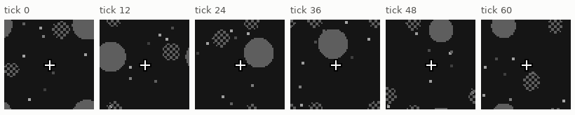
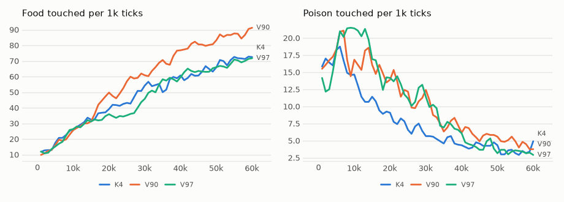

# vm-00085: A Value That Reaches Past Four Ticks

**Date:** 2026-11-04
**Status:** Complete
**Source:** `exp/vm-00085` (code: `visual-motor-agent/dev/`)
**Outputs:** `~/data/research/visual-motor-agent/exp_00085/`
**Task plan:** [`../tasks/00096-value-bootstrap.md`](../tasks/00096-value-bootstrap.md)

## Goal

K4 scores a move by the mean of the real hunger over the next 4 ticks, labelled in hindsight. Nothing past those 4 ticks reaches the label, which fits what vm-00071, vm-00081–00083 and vm-00082 found: aim fades past about 16 px, hidden food is not pursued, and no chain of moves forms. Game-playing RL agents get their reach from a bootstrapped value: the value of a moment is trained toward what happens next plus the model's own estimate of the value after it, so credit spreads back one step per round of learning, with no fixed window. Here K4's label gets such a tail. The design and the readings set before the results are in the task plan.

## Method

- **The label** (`online.value_gamma = γ`, `online.value_n = n`, default `future_k`):

  V_j = (1 − γ) Σ_{i<n} γ^i h_{j+i} + γ^n V̂_{j+n}

  - h is the hunger after a step.
  - V̂_{j+n} is the model's own predicted label of the move it took at tick j + n, stored while acting: the prediction of the transformer whose move the body made.
  - The label is the exponentially weighted mean of all future hunger, so it stays in 0–1.
  - It sits in K4's slot: the move token predicts it and the instinct reads it. No new token, no CUDA change.

| Arm | γ | n | Reach, about 1 / (1 − γ) ticks |
|---|---|---|---|
| K4 (control, rerun) | off | — | 4 |
| V90 | 0.9 | 4 | 10 |
| V97 | 0.97 | 4 | 33 |

- **Everything else** is the default: four quadrant transformers, gain, log summaries, the ring, the egocentric touch world, `online.future_k = 4`, six seeds, 60k ticks. All 18 lives run at once on the RTX 3090, since the 4090 is out.
- **Frozen tests:**
  - `eval_hunger.py chain`: seen, blind, and blind with a perfect grab; aim by the gap to the food.
  - `eval_hunger.py value` (new): over 2,000 ticks on 16 bodies, the predicted label of each move taken against the realized one (bias, mean absolute error, correlation) and the spread of the instinct's candidates.
- **Checks passed before the start:**
  - `tests/test_value_labels.py`:
    - the labels equal the exact discounted mean to 1e-6;
    - an episode end cuts the tail;
    - the `future` mode is unchanged;
    - a gated memory hands training (the newest window and every stored chunk) the same labels as a direct sum on the stream.
  - The existing memory and gate tests pass.
  - 600-tick lives of K4, V90 and V97, beside vm-00084's 12 lives: the label and the prediction stay within 0–1 (both about .4 at the start), at the same speed as K4 (11.5 ticks/s).
  - `eval_hunger.py value` on vm-00073's K4 s1 (400 ticks, 4 bodies): bias −.010 against a realized mean of .025, correlation .84, median candidate spread .0016.
- **Run notes:** the 18 lives ran together on the 3090 under MPS, 22:25–00:34 (2.2 h each, 7.7 ticks/s), and the frozen tests until 00:44. No errors.

## Results

### R1. Lived, ticks 40–60k, six seeds, 95% interval (t, df 5)

| Arm | Food per 1k | Poison per 1k | Mean hunger | Instinct overrides | Move CE |
|---|---|---|---|---|---|
| K4 | 66.9 ± 21.8 | 3.91 ± 0.84 | .047 | .075 | .274 |
| V90 | 84.2 ± 14.3 | 5.22 ± 0.72 | .030 | .089 | .257 |
| V97 | 66.7 ± 19.7 | 3.74 ± 0.95 | .043 | .037 | .114 |

Against K4, paired by seed:

| Arm | Food | Seeds | Poison | Instinct overrides | Move CE |
|---|---|---|---|---|---|
| V90 | +17.2 ± 22.9 | −13.5, +10.3, +46.9, +32.3, +25.1, +2.3 | +1.31 ± 1.49 | +.014 ± .027 | −.017 ± .082 |
| V97 | −0.3 ± 17.8 | −3.9, +28.9, −8.5, +8.0, −5.3, −20.7 | −0.17 ± 1.30 | −.038 ± .009 | −.160 ± .070 |

Food per 1k by 10k ticks of life, mean of six seeds:

| Arm | 0–10k | 10–20k | 20–30k | 30–40k | 40–50k | 50–60k |
|---|---|---|---|---|---|---|
| K4 | 19.1 | 34.3 | 46.4 | 56.2 | 62.7 | 71.2 |
| V90 | 17.8 | 37.7 | 55.7 | 70.1 | 80.9 | 87.5 |
| V97 | 18.0 | 32.0 | 38.0 | 56.2 | 64.0 | 69.3 |

The training metrics `value_pred` (the predicted label of the moves taken) and `value_label` (the mean label of each update's batch) fall together through the life: V90 from .275 and .385 at 0–10k to .013 and .098 at 50–60k. The batch holds windows replayed from long-term memory, much of it from hungrier times, so the two are not a measure of bias. The frozen test below is.

### R2. Frozen value (`eval_hunger.py value`): the predicted label of the move taken against the realized one

2,000 ticks on 16 bodies. Realized: K4's own 4-tick mean; for the V arms the discounted mean of the hunger that followed, cut where γ^i < 1e-3 (66 ticks at γ 0.9, 227 at 0.97). Spread: the median over ticks of the largest minus the smallest predicted label among the instinct's candidates.

| Run | Predicted | Realized | Bias | Bias, share of realized | Correlation | Spread |
|---|---|---|---|---|---|---|
| K4, 6 seeds | .036 | .043 | −.007 (abs, mean) | −14% to −25% | .85 to .94 | .0010 to .0016 |
| V90_s1 | .012 | .027 | −.015 | −55% | .66 | .0024 |
| V90_s2 | .022 | .036 | −.014 | −40% | .75 | .0012 |
| V90_s3 | .013 | .023 | −.010 | −43% | .79 | .0007 |
| V90_s4 | .023 | .033 | −.010 | −30% | .81 | .0015 |
| V90_s5 | .018 | .030 | −.012 | −41% | .79 | .0022 |
| V90_s6 | .014 | .029 | −.015 | −53% | .71 | .0014 |
| V97_s1 | .009 | .016 | −.008 | −46% | .70 | .0006 |
| V97_s2 | .012 | .026 | −.014 | −54% | .60 | .0006 |
| V97_s3 | .012 | .036 | −.024 | −66% | .64 | .0009 |
| V97_s4 | .010 | .027 | −.017 | −63% | .33 | .0004 |
| V97_s5 | .024 | .060 | −.036 | −59% | .53 | .0000 |
| V97_s6 | .015 | .037 | −.022 | −59% | .76 | .0000 |

Reading 2's bar: an absolute bias of at most twice K4's mean (2 × .0071 = .0141) and a correlation above .5.

### R3. Frozen chain (`eval_hunger.py chain`): food and poison per 1k, and aim by the gap to the food

| Arm | Seen | Blind | Blind + perfect grab | Seen − grab | Poison seen | Poison blind | Smoothness |
|---|---|---|---|---|---|---|---|
| K4 | 73.4 ± 22.7 | 15.0 ± 3.2 | 29.5 ± 6.8 | +43.9 ± 20.0 | 3.69 | 19.98 | .321 |
| V90 | 86.2 ± 13.3 | 21.2 ± 4.5 | 40.8 ± 7.8 | +45.4 ± 9.6 | 4.44 | 26.70 | .588 |
| V97 | 68.6 ± 19.1 | 23.6 ± 6.2 | 47.2 ± 11.5 | +21.5 ± 16.3 | 4.42 | 29.06 | .726 |

Aim (cosine of the move to the food) by the gap from the cursor to the food's edge, seen:

| Arm | 0–4 px | 4–8 | 8–12 | 12–16 | 16–24 | 24+ |
|---|---|---|---|---|---|---|
| K4 | .799 | .705 | .538 | .318 | .093 | .040 |
| V90 | .692 | .586 | .463 | .331 | .172 | .093 |
| V97 | .610 | .488 | .364 | .253 | .127 | .060 |

Against K4, paired by seed:

| Arm | Aim 12–24 px | Seeds | Aim 12–24 px, blind | Lead over grab | Frozen food |
|---|---|---|---|---|---|
| V90 | +.074 ± .042 | +.022, +.094, +.098, +.084, +.118, +.029 | +.015 ± .007 | +1.5 ± 14.4 | +12.8 ± 20.4 |
| V97 | +.018 ± .048 | −.038, +.083, +.040, +.034, +.016, −.030 | +.020 ± .012 | −22.4 ± 17.5 | −4.8 ± 20.9 |

## Readings

1. **Plumbing: met.** The unit tests, the plumbing lives and all 18 lives (60k ticks, no errors; the label and prediction within 0–1).
2. **The value holds: not met.** V90 misses the bias bar in 3 of 6 seeds (.0147, .0142, .0152), with every correlation above .5 (.66–.81). V97 misses it in 5 of 6 (up to .036), and seed 4's correlation is .33. By the rule set beforehand, readings 3–6 are provisional until phase 2.
3. **Reach grows: met for V90** (provisional). Aim at 12–24 px is +.074 ± .042, above K4 in all six seeds. V97: +.018 ± .048.
4. **A chain pays: not met.** V90's lead over a blind walk with a perfect grab is +1.5 ± 14.4; V97's is −22.4 ± 17.5.
5. **More food: not met.** V90 +17.2 ± 22.9 (5 of 6 seeds); V97 −0.3 ± 17.8.
6. **Poison is still seen: met**, narrowly for V90 (+1.31 ± 1.49, above K4 in 5 of 6 seeds).

<!-- figures -->
## Figures

*The world of this experiment as its model sees it, every 12 ticks. Moves are random: this shows the world, not the trained agent.*

*From each run's `metrics.jsonl`, the mean of its seeds by arm, smoothed.*
<!-- /figures -->

## Analysis

- **The value is optimistic, as expected, and more so with a longer reach.**
  - Every arm predicts less hunger than follows. K4 by 14–25%, V90 by 30–55%, V97 by 46–66%.
  - The bootstrap V̂ is the prediction of the move that won. The instinct picks the lowest of 16 candidates and the gain rule the best of four transformers, so V̂ is a minimum of noisy estimates and biased low, as Q-learning's max is biased high. The label then carries that bias in its tail (γ⁴ of its weight: .66 at γ 0.9, .89 at 0.97), and the model learns it back.
  - The correlation stays high in V90 (.66–.81), so the value still ranks states; it is the level that drifts.
- **The value squashes the difference between moves.**
  - The 4 real ticks carry 1 − γ⁴ of the label: all of it in K4, 34% in V90, 11.5% in V97. A move changes the near hunger; the tail barely depends on it.
  - The bins, the two-hot loss and the instinct's tolerance (.005) were left as they were. In V97 the median spread between candidates is .0004–.0009, and 0 in two seeds: most ticks, the model scores every move the same. The instinct overrides half as often (.037 against .075), and move cross-entropy falls to .114: the label is easy to predict because it hardly depends on the move.
  - Aim up close falls in both value arms (0–4 px: .80, .69, .61), as the near-term part of the label shrinks.
- **V90 moves differently, more than it plans.**
  - Its path is much smoother (.59 against .32), and with the same gait a blind walk eats more (21 against 15) and a blind walk with a perfect grab more still (41 against 30).
  - Its food over the grab is K4's (+45 against +44). Its frozen gain over K4 (+12.8) is about the gain of its gait (+11.3 with the grab), not of a chain of moves.
  - It aims further (16–24 px .17 against .09; 24+ px .09 against .04), which is the reach the value was meant to give. Blind aim at 12–24 px also rises (+.015), small, and more likely the steadier gait than a memory.
  - In the lived numbers it leads K4 in every 10k block from 10k ticks on, by 16 per 1k at 50–60k.
- **γ 0.97 is past the useful range** with this label: too little of it depends on the move.

## Conclusions

1. A bootstrapped value with γ 0.9 makes the default agent aim further (all six seeds) and walk more steadily, with more food that is not yet significant (+17 per 1k, 5 of 6 seeds), and no chain of moves.
2. The value is biased toward low hunger, 30–55% at γ 0.9 and 46–66% at 0.97: the bootstrap takes the winner's estimate, a minimum, and feeds it back. Reading 2 fails, so the rest is provisional.
3. At γ 0.97 the label depends so little on the move that the candidates' scores collapse; the agent eats no more than K4 and loses its lead over the grab.

## Next steps

- **Depth** (vm-00086, the owner's choice): K4 and V90 with 8 layers in each quadrant transformer, a 2 × 2 with this experiment's 2-layer arms.
- **Phase 2** (vm-00087): V̂ from the mean of the four transformers instead of the winner's, refreshed from each update's own predictions of the windows it replays.
- **The squashing:** score moves by the difference between candidates (an advantage), or scale the tolerance and the bins with 1 − γ; only after phase 2.
