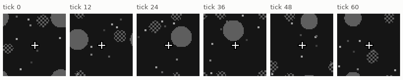
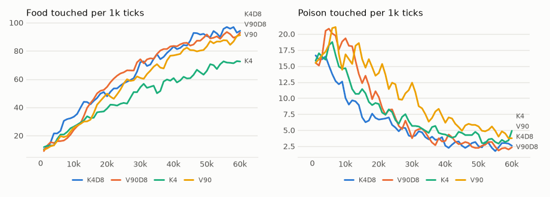

# vm-00086: Eight Layers in Each Quadrant, With and Without the Value

**Date:** 2026-11-11
**Status:** Complete (pending tag)
**Source:** `dev/` (not yet tagged)
**Outputs:** `~/data/research/visual-motor-agent/exp_00086/`
**Task plan:** [`../tasks/00097-value-depth.md`](../tasks/00097-value-depth.md)

## Goal

Two earlier results point the same way:
- In vm-00084, eight layers made a single transformer forage better than two, in all six seeds.
- In vm-00085, a bootstrapped value (γ 0.9) made the four-quadrant default aim further, but its estimate was badly optimistic.

The owner asked for both together. Here each of the default's four transformers is made 8 layers deep, with K4's label and with vm-00085's value. With vm-00085's 2-layer arms this gives a 2 × 2 of label and depth. The design and the readings set before the results are in the task plan.

## Method

| Arm | Label | Layers per transformer | Parameters per transformer |
|---|---|---|---|
| K4 (vm-00085, not rerun) | mean hunger over the next 4 ticks | 2 | 969,506 |
| V90 (vm-00085, not rerun) | value, γ 0.9, n 4 | 2 | 969,506 |
| K4D8 | mean hunger over the next 4 ticks | 8 | 2,159,138 |
| V90D8 | value, γ 0.9, n 4 | 8 | 2,159,138 |

- **Depth is the only change:** `model.n_layer = 8`, as vm-00084's D8 (d_model 128, 4 heads, d_ff 512).
- **Everything else is the default:** four quadrant transformers, gain, log summaries, the ring, the egocentric touch world, `online.future_k = 4`, six seeds, 60k ticks.
- **The value is vm-00085's (phase 1):** the winner's prediction, stored while acting.
- **Where it runs:** the 12 new lives run on the RTX 4090 under MPS. vm-00085's lives ran on the 3090, and GPU lives are not bitwise reproducible, so arms are compared over seeds.
- **Frozen tests:** `eval_hunger.py chain` and `eval_hunger.py value`, as in vm-00085.
- **Checks passed before the start:** 600-tick lives of both arms on the 4090: 2,159,138 parameters per transformer, the value within 0–1 (V90D8 .33–.39 at the start).
- **Run notes:** the 12 lives ran together on the 4090 under MPS, 2026-11-12 01:08–03:23 (8.1 ticks/s each), after 00021's seed-1 runs; the frozen tests until 03:32. No errors.

## Results

### R1. Lived, ticks 40–60k, six seeds, 95% interval (t, df 5)

| Arm | Food per 1k | Poison per 1k | Mean hunger | Instinct overrides | Move CE | Smoothness |
|---|---|---|---|---|---|---|
| K4 (vm-00085) | 66.9 ± 21.8 | 3.91 ± 0.84 | .047 | .075 | .274 | .31 |
| V90 (vm-00085) | 84.2 ± 14.3 | 5.22 ± 0.72 | .030 | .089 | .257 | .58 |
| K4D8 | 91.3 ± 14.0 | 2.71 ± 0.33 | .017 | .062 | .175 | .42 |
| V90D8 | 88.8 ± 31.5 | 2.69 ± 0.52 | .016 | .036 | .099 | .67 |

Paired by seed:

| Pair | Food | Seeds | Poison | Overrides | Move CE |
|---|---|---|---|---|---|
| K4D8 − K4 (depth) | +24.3 ± 34.0 | −20.2, +35.7, +45.1, +58.6, +39.0, −12.1 | −1.20 ± 0.92 | −.013 ± .019 | −.099 ± .047 |
| V90D8 − V90 (depth, with the value) | +4.6 ± 35.6 | −17.0, +17.9, −20.3, +62.1, +13.7, −28.8 | −2.53 ± 0.80 | −.053 ± .031 | −.158 ± .095 |
| V90D8 − K4D8 (the value, at 8 layers) | −2.5 ± 20.8 | −10.3, −7.5, −18.5, +35.8, −0.3, −14.4 | −0.02 ± 0.77 | −.026 ± .029 | −.076 ± .071 |

Poison and move CE are lower with 8 layers in all 12 pairs. Food per 1k by 10k ticks of life, mean of six seeds:

| Arm | 0–10k | 10–20k | 20–30k | 30–40k | 40–50k | 50–60k |
|---|---|---|---|---|---|---|
| K4 | 19.1 | 34.3 | 46.4 | 56.2 | 62.7 | 71.2 |
| V90 | 17.8 | 37.7 | 55.7 | 70.1 | 80.9 | 87.5 |
| K4D8 | 24.2 | 45.1 | 59.9 | 75.9 | 88.2 | 94.4 |
| V90D8 | 17.2 | 44.1 | 66.2 | 78.7 | 86.8 | 90.7 |

### R2. Frozen value (`eval_hunger.py value`), 2,000 ticks on 16 bodies

| Run | Predicted | Realized | Bias | Bias, share of realized | Correlation | Spread |
|---|---|---|---|---|---|---|
| K4, 6 seeds (vm-00085) | .036 | .043 | −.0071 (abs, mean) | −14% to −25% | .85 to .94 | .0010 to .0016 |
| V90, 6 seeds (vm-00085) | .017 | .030 | −.0127 (abs, mean) | −30% to −55% | .66 to .81 | .0007 to .0024 |
| K4D8, 6 seeds | .019 | .025 | −.0064 (abs, mean) | −21% to −30% | .85 to .92 | .0009 to .0016 |
| V90D8_s1 | .016 | .030 | −.014 | −46% | .77 | .0007 |
| V90D8_s2 | .011 | .021 | −.009 | −45% | .75 | .0011 |
| V90D8_s3 | .015 | .023 | −.009 | −38% | .84 | .0000 |
| V90D8_s4 | .007 | .012 | −.005 | −39% | .81 | .0000 |
| V90D8_s5 | .015 | .027 | −.012 | −46% | .78 | .0005 |
| V90D8_s6 | .015 | .026 | −.011 | −43% | .76 | .0004 |

V90D8's abs bias against V90's, paired: −.0026 ± .0024 (lower in 5 of 6 seeds). The bar of vm-00085: abs bias at most .0141 and correlation above .5.

### R3. Frozen chain (`eval_hunger.py chain`)

| Arm | Seen | Blind | Blind + perfect grab | Seen − grab | Poison seen | Smoothness |
|---|---|---|---|---|---|---|
| K4 | 73.4 ± 22.7 | 15.0 ± 3.2 | 29.5 ± 6.8 | +43.9 ± 20.0 | 3.69 | .321 |
| V90 | 86.2 ± 13.3 | 21.2 ± 4.5 | 40.8 ± 7.8 | +45.4 ± 9.6 | 4.44 | .588 |
| K4D8 | 101.4 ± 13.5 | 18.5 ± 2.0 | 34.9 ± 3.7 | +66.5 ± 13.7 | 2.98 | .431 |
| V90D8 | 91.8 ± 34.9 | 22.4 ± 4.1 | 44.4 ± 7.9 | +47.3 ± 29.0 | 2.83 | .673 |

Aim (cosine of the move to the food) by the gap from the cursor to the food's edge, seen:

| Arm | 0–4 px | 4–8 | 8–12 | 12–16 | 16–24 | 24+ |
|---|---|---|---|---|---|---|
| K4 | .799 | .705 | .538 | .318 | .093 | .040 |
| V90 | .692 | .586 | .463 | .331 | .172 | .093 |
| K4D8 | .835 | .798 | .682 | .450 | .153 | .037 |
| V90D8 | .677 | .560 | .453 | .339 | .183 | .100 |

Paired by seed:

| Pair | Aim 12–24 px | Aim 12–24 px, blind | Lead over grab | Frozen food | Frozen poison |
|---|---|---|---|---|---|
| K4D8 − K4 | +.081 ± .088 | +.005 ± .006 | +22.7 ± 29.4 | +28.0 ± 34.6 | −0.71 ± 1.94 |
| V90D8 − V90 | +.012 ± .083 | +.004 ± .008 | +1.9 ± 35.3 | +5.5 ± 41.4 | −1.61 ± 0.81 |
| V90D8 − K4D8 | +.005 ± .045 | +.014 ± .011 | −19.2 ± 20.1 | −9.7 ± 25.2 | −0.15 ± 1.07 |

## Readings

1. **Plumbing: met.** All 12 lives ran 60k ticks with 8 layers in each transformer, no errors.
2. **Depth helps four quadrants: not met.** K4D8's lived food is +24.3 ± 34.0 over K4's (4 of 6 seeds). Everything else moves the same way: poison −1.20 ± 0.92 (6 of 6), move CE −.099 ± .047 (6 of 6), and K4D8 leads in every 10k block.
3. **Depth helps the value hold: met, by its letter.** V90D8 meets the bar in every seed (abs bias up to .0138, correlation .75–.84), and its abs bias is below V90's by .0026 ± .0024. But as a share of the realized label it is still −38% to −46%, about V90's: the absolute bias fell because the agent is less hungry, not because the value is less optimistic.
4. **The value's reach survives depth: not met.** V90D8's aim at 12–24 px is K4D8's (+.005 ± .045). Depth alone raises K4's aim at 12–24 px by +.081.
5. **A chain pays: not met.** V90D8's lead over the grab is below K4D8's, −19.2 ± 20.1 (5 of 6 seeds).
6. **The combination is best: not met.** V90D8's lived food is +4.6 ± 35.6 over V90's and −2.5 ± 20.8 against K4D8's.
7. **Poison is still seen: met.** Both 8-layer arms touch less poison than their 2-layer counterparts, in every seed.

<!-- figures -->
## Figures

*The world of this experiment as its model sees it, every 12 ticks. Moves are random: this shows the world, not the trained agent.*

*From each run's `metrics.jsonl`, the mean of its seeds by arm, smoothed.*
<!-- /figures -->

## Analysis

- **Depth is the better lever for the four quadrants, as for the single transformer of vm-00084.**
  - K4D8 predicts its moves better (move CE .175 against .274), aims better at every gap up to 24 px, and touches less poison, in every seed.
  - Its lead over a blind walk with a perfect grab (+66.5, against +43.9) is the largest of any arm so far: more of its food comes from seeing, not from its gait.
  - The food gain is large (+24 lived, +28 frozen) but two seeds go the other way, so six seeds do not separate it.
- **Depth makes K4 aim further on its own,** as far as V90 did at 2 layers (16–24 px .153 against V90's .172). The value's reach at 2 layers may have been partly a stand-in for depth.
- **The old value at 8 layers: calibrated in absolute terms only, and its candidates collapse.**
  - The bias falls with the realized hunger; its share stays about −43%.
  - The median spread between candidates is 0 in two seeds and .0004–.0011 in the rest, against K4D8's .0009–.0016: the collapse seen with γ 0.97 in vm-00085. The deeper model fits the squashed label better (move CE .099), so it scores moves more alike, and the instinct overrides half as often (.036 against .062).
  - With the gait of V90 (smoothness .67) and less difference between moves, V90D8 has no edge over K4D8 and a smaller lead over the grab.
- **Seed 4 is an outlier in V90D8** (lived food 146, frozen 156, lead over grab +102): one life where the combination worked; the rest are at or below K4D8.
- **Cards:** these lives ran on the 4090 and vm-00085's on the 3090. The model is the same; only the run-to-run noise of GPU lives differs.

## Conclusions

1. Eight layers per quadrant transformer improve every lived and frozen measure of the K4 default, poison and move CE in every seed. Food is +24 per 1k, not yet beyond its interval with six seeds.
2. vm-00085's value (the winner's stored estimate) does not combine with depth: still about 43% optimistic, its candidates' scores collapse, and it adds no food or reach over K4D8.

## Next steps

- **The fresh value at 8 layers** (vm-00088): vm-00087's value refresh, which fixes the optimism, with 8 layers, against K4D8, over 12 seeds.
