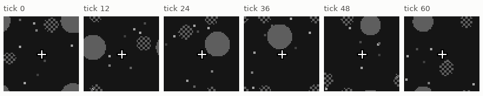
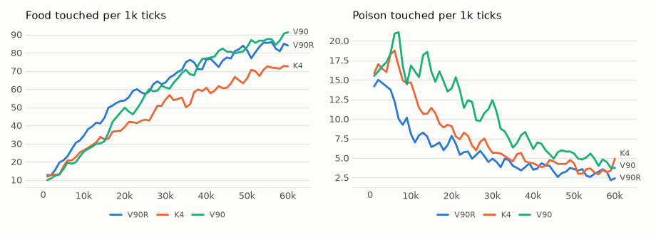

# vm-00087: A Value Whose Tail Is Fresh and Shared

**Date:** 2026-11-11
**Status:** Complete (pending tag)
**Source:** `dev/` (not yet tagged)
**Outputs:** `~/data/research/visual-motor-agent/exp_00087/`
**Task plan:** [`../tasks/00098-value-refresh.md`](../tasks/00098-value-refresh.md)

## Goal

In vm-00085 the bootstrapped value with γ 0.9 aimed further, but it predicted 30–55% less hunger than followed, and the calibration reading failed. Its tail had two faults:
- it was the winning transformer's estimate, a minimum, which biases it low;
- it was fixed when a chunk was written, so it went stale in long-term memory.

Here, as the pre-set response (phase 2), the tail is recomputed at every update as the mean of the four transformers' predictions of the move actually made. The design and the readings set before the results are in the task plan.

## Method

- **The label** stays (1 − γ) Σ_{i<4} γ^i h_{j+i} + γ⁴ V̂_{j+4}, with γ 0.9.
  - V̂_{j+4} now comes from a forward pass, without gradient, of each of the four transformers over the window that starts 4 steps later. It is their mean predicted label for the move made there.
  - The pass runs before every update (`online.value_refresh = 1`).
  - Long-term memory keeps each chunk with the 4 steps after it, and its real parts and tail weights in place of fixed labels.
- **Arms:** V90R, here. Its controls are vm-00085's K4 and V90, which ran on the same card and are not rerun.
- **Everything else is the default:** four quadrant transformers of 2 layers, gain, log summaries, the ring, the egocentric touch world, `online.future_k = 4`, six seeds, 60k ticks.
- **Where it runs:** the RTX 3090 under MPS, after 00021.
- **Frozen tests:** `eval_hunger.py chain` and `eval_hunger.py value`, as in vm-00085.
- **Checks passed before the start:**
  - `tests/test_value_labels.py`:
    - the real part plus the weighted tail equals vm-00085's label, episode ends included;
    - every window, from short-term and long-term memory, carries the bootstrap window 4 steps later, and a fresh tail equal to the stored one gives the same label;
    - without refresh, memory is as before.
  - `tests/test_ring.py`: the extra forward pass between ticks leaves the ring's moves and candidates bitwise unchanged.
  - 600-tick lives on the 3090 (shared with 00021): V90R 1.51 ticks/s against V90's 1.69 (11% slower), the fresh tail .37–.47 at the start.
  - The full suite: 1 failure, `tests/test_record.py::test_json_and_npz_round_trip`, which fails the same on the committed code before this change (the episode recorder, not used here).
- **Run notes:** the 6 lives ran together on the 3090 under MPS, 2026-11-12 03:18–04:24 (15.1 ticks/s each, with the card to themselves; vm-00085's 18 lives shared it at 7.7), then the frozen tests until 04:27. No errors.

## Results

### R1. Lived, ticks 40–60k, six seeds, 95% interval (t, df 5)

| Arm | Food per 1k | Poison per 1k | Mean hunger | Instinct overrides | Move CE | Smoothness |
|---|---|---|---|---|---|---|
| K4 (vm-00085) | 66.9 ± 21.8 | 3.91 ± 0.84 | .047 | .075 | .274 | .31 |
| V90 (vm-00085) | 84.2 ± 14.3 | 5.22 ± 0.72 | .030 | .089 | .257 | .58 |
| V90R | 80.7 ± 19.4 | 3.28 ± 0.51 | .014 | .076 | .268 | .41 |

Paired by seed:

| Pair | Food | Seeds | Poison | Overrides | Move CE |
|---|---|---|---|---|---|
| V90R − K4 | +13.7 ± 30.2 | −1.6, +38.5, +7.1, +51.4, +15.8, −28.9 | −0.63 ± 0.77 | +.002 ± .020 | −.007 ± .057 |
| V90R − V90 | −3.5 ± 29.2 | +11.9, +28.2, −39.8, +19.2, −9.3, −31.2 | −1.93 ± 0.92 | −.013 ± .028 | +.011 ± .078 |

Food per 1k by 10k ticks of life, mean of six seeds:

| Arm | 0–10k | 10–20k | 20–30k | 30–40k | 40–50k | 50–60k |
|---|---|---|---|---|---|---|
| K4 | 19.1 | 34.3 | 46.4 | 56.2 | 62.7 | 71.2 |
| V90 | 17.8 | 37.7 | 55.7 | 70.1 | 80.9 | 87.5 |
| V90R | 24.1 | 47.3 | 60.8 | 72.3 | 78.0 | 83.3 |

The fresh tail (`value_boot`, the four's mean predicted label of the move made 4 ticks later) falls with the hunger, from .320 at 0–10k to .065 at 50–60k. The winner's prediction of the move it takes (`value_pred`) is .016 at 50–60k: the minimum of the candidates and of the four, as before, but no longer fed back.

### R2. Frozen value (`eval_hunger.py value`), 2,000 ticks on 16 bodies

| Run | Predicted | Realized | Bias | Bias, share of realized | Correlation | Spread |
|---|---|---|---|---|---|---|
| K4, 6 seeds (vm-00085) | .036 | .043 | −.0071 (abs, mean) | −14% to −25% | .85 to .94 | .0010 to .0016 |
| V90, 6 seeds (vm-00085) | .017 | .030 | −.0127 (abs, mean) | −30% to −55% | .66 to .81 | .0007 to .0024 |
| V90R_s1 | .013 | .016 | −.004 | −23% | .62 | .0016 |
| V90R_s2 | .015 | .015 | +.000 | +1% | .71 | .0015 |
| V90R_s3 | .020 | .026 | −.005 | −21% | .76 | .0014 |
| V90R_s4 | .012 | .017 | −.005 | −27% | .67 | .0011 |
| V90R_s5 | .017 | .025 | −.008 | −32% | .61 | .0015 |
| V90R_s6 | .016 | .020 | −.004 | −20% | .69 | .0010 |

V90R's abs bias: .0043 ± .0027, against V90's, paired, −.0084 ± .0044 (lower in all six seeds).

### R3. Frozen chain (`eval_hunger.py chain`)

| Arm | Seen | Blind | Blind + perfect grab | Seen − grab | Poison seen | Smoothness |
|---|---|---|---|---|---|---|
| K4 | 73.4 ± 22.7 | 15.0 ± 3.2 | 29.5 ± 6.8 | +43.9 ± 20.0 | 3.69 | .321 |
| V90 | 86.2 ± 13.3 | 21.2 ± 4.5 | 40.8 ± 7.8 | +45.4 ± 9.6 | 4.44 | .588 |
| V90R | 87.0 ± 20.9 | 16.3 ± 2.2 | 32.8 ± 3.8 | +54.2 ± 23.0 | 2.90 | .432 |

Aim (cosine of the move to the food) by the gap from the cursor to the food's edge, seen:

| Arm | 0–4 px | 4–8 | 8–12 | 12–16 | 16–24 | 24+ |
|---|---|---|---|---|---|---|
| K4 | .799 | .705 | .538 | .318 | .093 | .040 |
| V90 | .692 | .586 | .463 | .331 | .172 | .093 |
| V90R | .676 | .594 | .488 | .357 | .191 | .092 |

Paired by seed:

| Pair | Aim 12–24 px | Seeds | Aim 12–24 px, blind | Lead over grab | Frozen food | Frozen poison |
|---|---|---|---|---|---|---|
| V90R − K4 | +.098 ± .093 | +.108, +.196, +.029, +.203, +.069, −.017 | +.005 ± .010 | +10.3 ± 28.6 | +13.6 ± 30.3 | −0.79 ± 0.85 |
| V90R − V90 | +.024 ± .091 | +.086, +.102, −.069, +.119, −.050, −.046 | −.010 ± .008 | +8.8 ± 29.1 | +0.8 ± 30.5 | −1.54 ± 1.03 |

## Readings

1. **Plumbing: met.** The unit tests and the bitwise ring test; the 600-tick lives (value within 0–1, 11% slower than V90); all 6 lives ran 60k ticks without errors.
2. **The value holds: met.** Every seed's abs bias is at most .0080 (bar .0141) with correlation .61–.76 (bar .5), and V90R's abs bias is below V90's by .0084 ± .0044, in all six seeds.
3. **Reach is kept: met**, narrowly: aim at 12–24 px +.098 ± .093 over K4, 5 of 6 seeds.
4. **A chain pays: not met.** V90R's lead over the grab is +10.3 ± 28.6 above K4's.
5. **More food: not met.** +13.7 ± 30.2 over K4 (4 of 6 seeds); −3.5 ± 29.2 against V90.
6. **Poison is still seen: met.** −0.63 ± 0.77 against K4, and −1.93 ± 0.92 against V90 (lower in all six seeds).

<!-- figures -->
## Figures

*The world of this experiment as its model sees it, every 12 ticks. Moves are random: this shows the world, not the trained agent.*

*From each run's `metrics.jsonl`, the mean of its seeds by arm, smoothed.*
<!-- /figures -->

## Analysis

- **The fresh, shared tail removes the optimism.**
  - The bias as a share of the realized label is −20% on average (+1% to −32%), about K4's (−14% to −25%), against V90's −30% to −55%. Both faults named in the plan were at work: the winner's minimum and the stale tail; with the tail taken from all four on the move actually made, recomputed at every update, the label no longer learns its own minimum back.
  - The correlation is a little lower than V90's (.68 against .75 on average): the realized label of a calmer agent (.015–.026) has less to rank.
  - The candidates' spread stays at K4's level (.0010–.0016): no collapse.
- **It undoes V90's side effects.**
  - Poison falls below V90's in all six seeds and below K4's; V90's extra poison came from the optimistic tail.
  - The gait is between K4's and V90's (smoothness .43), so a blind walk eats about as little as K4's (16 against 15), and more of the food comes from seeing: the lead over the grab is +54, the highest of the 2-layer arms, though not beyond K4's interval.
- **It learns faster, then levels off.** V90R leads the 2-layer arms through the first 30k ticks (24 and 47 per 1k in the first two blocks, against V90's 18 and 38), then grows more slowly; at 50–60k it is between K4 and V90.
- **Reach without a chain.** It aims at 12–24 px about as V90 does (+.098 over K4), but blind aim does not rise (+.005), and the lead over the grab is not significant: a better sense of where food is, not a plan.
- **Six seeds are too few for the food question:** every interval is ±20–30 per 1k, larger than any of the effects measured.

## Conclusions

1. The phase-2 value (the mean of the four transformers' predictions of the move made, recomputed at every update) is calibrated as well as K4's short label: abs bias .0043 against V90's .0127, lower in all six seeds, about −20% of the realized label.
2. With it the agent aims further than K4, learns faster early, and touches less poison than V90, but it eats no more than K4 or V90 by more than the noise of six seeds, and builds no chain of moves.

## Next steps

- **The fresh value at 8 layers** (vm-00088): V90RD8 against K4D8 (vm-00086), over 12 seeds.
- **The squashing:** if the value is calibrated but still does not pay, score moves by the difference between candidates (an advantage), or scale the tolerance and the bins with 1 − γ.
