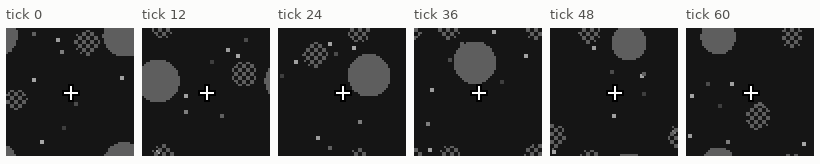
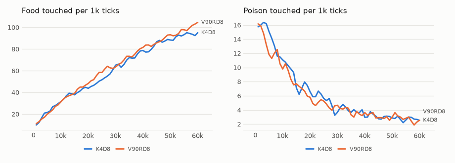

# vm-00088: The Fresh Value at Eight Layers, Twelve Seeds

**Date:** 2026-11-12
**Status:** Complete
**Source:** `exp/vm-00088` (code: `visual-motor-agent/dev/`)
**Outputs:** `~/data/research/visual-motor-agent/exp_00088/`
**Task plan:** [`../tasks/00099-value-refresh-depth.md`](../tasks/00099-value-refresh-depth.md)

## Goal

- **vm-00086:** eight layers in each quadrant helped K4 in every lived measure. The old value at eight layers stayed optimistic, and its candidates collapsed.
- **vm-00087:** a tail recomputed at every update, as the mean of the four transformers, made the value calibrated, but at two layers it added no food beyond its interval.

Here the fresh value runs at eight layers, against K4 at eight layers, over twelve seeds, because six were too few to resolve differences of this size. The design and the readings set before the results are in the task plan.

## Method

| Arm | Label | Tail | Layers | Seeds |
|---|---|---|---|---|
| K4D8 | mean hunger over the next 4 ticks | none | 8 | 1–6 from vm-00086 (RTX 4090), 7–12 new (RTX 3090) |
| V90RD8 | value, γ 0.9, n 4 | the four's mean prediction of the move made, fresh at every update | 8 | 1–6 on the RTX 4090, 7–12 on the RTX 3090 |

- **Every seed pair runs on one card:** seeds 1–6 on the 4090, seeds 7–12 on the 3090, all under MPS.
- **Everything else is the default:** four quadrant transformers, gain, log summaries, the ring, the egocentric touch world, `online.future_k = 4`, 60k ticks.
- **Frozen tests:** `eval_hunger.py chain` and `eval_hunger.py value`, as in vm-00085–00087.
- **No code change:** `online.value_refresh = 1` (vm-00087) with `model.n_layer = 8` (vm-00086). `eval_hunger.py`'s interval table now goes up to 12 seeds.
- **Run notes:**
  - the 18 lives ran under MPS, 2026-11-12, from 06:51;
  - V90RD8 seeds 1–6 on the 4090 until 08:29 (about 10 ticks/s each);
  - on the 3090, K4D8 7–12 until 11:07 and V90RD8 7–12 until 11:34 (12 lives together, 4–7 ticks/s each);
  - the frozen tests, two per card without MPS, until 11:47. No errors.

## Results

### R1. Lived, ticks 40–60k, twelve seeds, 95% interval (t, df 11)

| Arm | Food per 1k | Poison per 1k | Mean hunger | Instinct overrides | Move CE | Smoothness |
|---|---|---|---|---|---|---|
| K4D8 | 89.1 ± 8.2 | 2.92 ± 0.45 | .025 | .065 | .174 | .41 |
| V90RD8 | 93.3 ± 8.8 | 2.86 ± 0.30 | .014 | .071 | .194 | .40 |

Paired by seed, V90RD8 − K4D8:

| Seeds | Food | Positive | Poison | Mean hunger | Overrides | Move CE |
|---|---|---|---|---|---|---|
| 1–12 | +4.2 ± 12.4 | 7 of 12 | −0.06 ± 0.53 | −.010 ± .020 | +.006 ± .017 | +.020 ± .044 |
| 1–6 (4090) | −5.7 ± 18.2 | 2 of 6 | +0.20 ± 0.79 | −.004 ± .020 | +.014 ± .030 | +.010 ± .065 |
| 7–12 (3090) | +14.0 ± 18.4 | 5 of 6 | −0.32 ± 0.95 | −.017 ± .044 | −.002 ± .025 | +.029 ± .085 |

Food by seed (1–12): +0.3, −14.6, −34.9, −0.8, −0.3, +16.3, +16.0, −0.6, +2.7, +4.1, +14.9, +47.1.

Across experiments, seeds 1–6 (all on the 4090), V90RD8 against:

| Pair | Food | Poison | Overrides | Move CE | Smoothness |
|---|---|---|---|---|---|
| V90RD8 − V90R (vm-00087; depth, with the fresh value) | +5.0 ± 21.8 | −0.38 ± 0.53 | −.001 ± .025 | −.082 ± .052 (6 of 6) | −.003 ± .13 |
| V90RD8 − V90D8 (vm-00086; the fresh tail, at 8 layers) | −3.1 ± 24.2 | +0.22 ± 0.82 | +.039 ± .013 (6 of 6) | +.086 ± .034 (6 of 6) | −.27 ± .18 |

V90R ran on the 3090 and V90D8 on the 4090, so only the second pair is within one card.

Food per 1k by 10k ticks of life, mean of twelve seeds:

| Arm | 0–10k | 10–20k | 20–30k | 30–40k | 40–50k | 50–60k |
|---|---|---|---|---|---|---|
| K4D8 | 23.1 | 40.6 | 54.6 | 71.8 | 84.8 | 93.5 |
| V90RD8 | 22.1 | 42.0 | 59.6 | 74.6 | 87.8 | 98.9 |

V90RD8's mean fresh tail (`value_boot`) by the same blocks: .351, .187, .125, .096, .078, .066.

### R2. Frozen value (`eval_hunger.py value`), 2,000 ticks on 16 bodies

| Arm | Predicted | Realized | Abs bias, mean (max) | Bias, share of realized | Correlation | Spread |
|---|---|---|---|---|---|---|
| K4D8, 12 seeds | .018 | .024 | .0061 (.011) | −25% (−20% to −30%) | .86 (.80 to .92) | .0005 to .0020 |
| V90RD8, 12 seeds | .013 | .018 | .0055 (.012) | −26% (−52% to +26%) | .64 (.52 to .79) | .0007 to .0058 (median .0014) |
| V90R, 6 seeds (vm-00087) | .016 | .020 | .0043 | −20% | .68 | .0010 to .0016 |
| V90D8, 6 seeds (vm-00086) | .013 | .023 | .0100 | −43% | .78 | .0000 to .0011 |

V90RD8 against K4D8, abs bias paired: −.0005 ± .0030. Seed 2 is the one seed whose value is pessimistic (bias +.0055, the widest spread, .0058, and the lowest frozen food, 73.5). The bar of vm-00085: abs bias at most .0141 and correlation above .5.

### R3. Frozen chain (`eval_hunger.py chain`)

| Arm | Seeds | Seen | Blind | Blind + perfect grab | Seen − grab | Poison seen | Smoothness |
|---|---|---|---|---|---|---|---|
| K4D8 | 12 | 99.9 ± 8.3 | 18.2 ± 1.1 | 34.8 ± 2.1 | +65.1 ± 8.3 | 2.69 | .433 |
| V90RD8 | 12 | 102.3 ± 10.3 | 18.5 ± 1.6 | 36.1 ± 3.0 | +66.2 ± 12.2 | 2.82 | .437 |
| V90R (vm-00087) | 6 | 87.0 ± 20.9 | 16.3 ± 2.2 | 32.8 ± 3.8 | +54.2 ± 23.0 | 2.90 | .432 |
| V90D8 (vm-00086) | 6 | 91.8 ± 34.9 | 22.4 ± 4.1 | 44.4 ± 7.9 | +47.3 ± 29.0 | 2.83 | .673 |

Aim (cosine of the move to the food) by the gap from the cursor to the food's edge, seen, 12 seeds:

| Arm | 0–4 px | 4–8 | 8–12 | 12–16 | 16–24 | 24+ |
|---|---|---|---|---|---|---|
| K4D8 | .837 | .798 | .673 | .442 | .145 | .032 |
| V90RD8 | .677 | .614 | .517 | .402 | .222 | .112 |

Paired by seed:

| Pair | Seeds | Aim 12–24 px | Aim 12–24 px, blind | Lead over grab | Frozen food | Frozen poison |
|---|---|---|---|---|---|---|
| V90RD8 − K4D8 | 12 | +.061 ± .053 (8 of 12) | −.002 ± .003 | +1.1 ± 15.2 | +2.4 ± 13.5 | +0.13 ± 1.07 |
| V90RD8 − V90R | 6 | +.008 ± .114 | −.002 ± .006 | +3.3 ± 31.9 | +8.0 ± 29.5 | +0.04 ± 0.57 |
| V90RD8 − V90D8 | 6 | +.021 ± .051 | −.016 ± .009 | +10.1 ± 21.7 | +3.2 ± 31.1 | +0.10 ± 1.17 |

## Readings

1. **Plumbing: met.** All 18 lives ran 60k ticks without errors; the fresh tail stayed within 0–1 (.35 falling to .07).
2. **The fresh value holds at depth: met.**
   - Every seed: abs bias at most .0122 (bar .0141), correlation .52–.79 (bar .5), median spread at least .0007 (bar .0005).
   - About −26% of the realized label, as K4D8's −25%; V90D8's was −43%.
3. **Reach: met.** Aim at 12–24 px is +.061 ± .053 above K4D8's (8 of 12 seeds).
4. **A chain pays: not met.** The lead over the grab is +1.1 ± 15.2 above K4D8's.
5. **More food (the main one): not met.** +4.2 ± 12.4 over K4D8 (7 of 12 seeds); frozen +2.4 ± 13.5.
6. **Poison is still seen: met.** −0.06 ± 0.53 against K4D8.

Reading 2 holds and 5 fails: by the rule set in the plan, the value is right but does not pay at this horizon, and the next step is the label's scale, not more seeds.

<!-- figures -->
## Figures

*The world of this experiment as its model sees it, every 12 ticks. Moves are random: this shows the world, not the trained agent.*

*From each run's `metrics.jsonl`, the mean of its seeds by arm, smoothed.*
<!-- /figures -->

## Analysis

- **Twelve seeds narrow the food question.**
  - The interval of the difference is ±12 per 1k, against ±20–35 in vm-00085–00087. A gain of more than about 17 per 1k is unlikely, and the estimate, +4, is small.
  - The two cards disagree (−5.7 on the 4090, +14.0 on the 3090), but their intervals overlap widely: most likely seed noise, not the card.
- **K4D8 is the best-measured arm so far:** 89.1 ± 8.2 food over 12 seeds, against the 2-layer K4's 66.9 ± 21.8 over 6.
- **The fresh tail keeps its calibration at depth; the old tail did not.**
  - With the stored tail (V90D8), depth left the value 43% optimistic and collapsed the candidates' spread. With the fresh tail (V90RD8), the bias is K4D8's share and the spread does not collapse (median .0014, about K4D8's).
  - But it ranks situations less well than K4D8 (correlation .64 against .86). As with V90R at 2 layers (.68), a 66-tick label of a calm agent has little to rank, and 34% of it depends on the next 4 ticks.
- **The value changes where the agent aims, not how much it eats.**
  - V90RD8 aims worse up close (.68 against .84 at 0–4 px) and better from afar (.22 against .15 at 16–24 px; .11 against .03 beyond 24). The two cancel in food.
  - Blind aim does not change, and the lead over a blind walk with a perfect grab is K4D8's: there is still no chain of moves.
- **Depth helps the fresh value as it helps K4.** Against the 2-layer V90R, move CE is lower in all six seeds (−.082), as for K4 in vm-00086 (−.099); food is +5 ± 22.
- **Against the stored tail at 8 layers (V90D8),** the fresh tail undoes V90D8's smooth gait (smoothness −.27) and its low overrides (+.039, 6 of 6): V90D8's quiet instinct and fluent moves came from the collapsed spread, and they did not buy food.
- **Why the value does not pay: the scale.** With γ 0.9, 66% of every candidate's label is the tail beyond the next 4 ticks, which a single move barely changes. The candidates' scores differ by about .001 (median spread .0014), while the instinct's tolerance and the label's bins are set for labels of K4's scale. The value's preference among moves is then weak against the instinct and the model's noise. This is the squashing seen with γ 0.97 in vm-00085, at a smaller scale.

## Conclusions

1. With twelve seeds, the fresh value at eight layers (V90RD8) eats no more than K4 at eight layers (K4D8): +4.2 ± 12.4 food per 1k, poison equal.
2. Its value stays calibrated at depth (bias −26% of the realized label, like K4D8's), without the stored tail's collapse, and it aims further, but it builds no chain of moves.
3. K4D8, 89.1 ± 8.2 food over 12 seeds, is the reference for the next experiments.

## Next steps

- **The label's scale** (the pre-set next step): score candidates by their difference from the mean candidate (an advantage), or scale the instinct's tolerance and the label's bins with 1 − γ, against K4D8.
