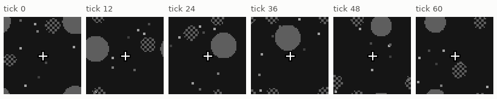
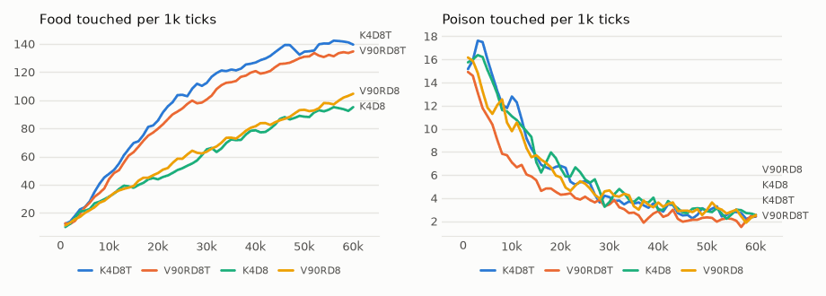

# vm-00089: The Instinct's Tolerance at the Value's Scale

**Date:** 2026-11-12
**Status:** Complete (pending tag)
**Source:** `dev/` (pending tag `exp/vm-00089`)
**Outputs:** `~/data/research/visual-motor-agent/exp_00089/`
**Task plan:** [`../tasks/00100-value-scale.md`](../tasks/00100-value-scale.md)

## Goal

In vm-00088 the fresh value at eight layers (V90RD8) was calibrated and aimed further than K4D8, but it ate no more.

**The instinct and its tolerance:**
- At every tick each transformer samples 16 candidate moves and predicts the label (hunger to come) of each.
- It makes the lowest, unless the first sample, the model's own habit, is within `online.instinct_tol` (0.005) of it. Then it keeps the first sample.
- So 0.005 is how much better, in predicted hunger, a move must look before the instinct overrides the habit.

**Why the value may fall below it:** a move mostly changes when the next food is touched, a tick sooner or later.
- K4's label weighs each of the next 4 ticks 1/4. The value weighs the next tick 1 − γ = 0.1.
- So the same move changes the value's label about 0.4 times as much, and its food moves fall within the tolerance more often.

Here the tolerance is lowered to 0.002 (0.005 × 0.4), for both labels. The design, the pre-check and the readings set before the results are in the task plan.

## Method

| Arm | Label | `online.instinct_tol` | Seeds |
|---|---|---|---|
| K4D8 (vm-00086/88, not rerun) | mean hunger over the next 4 ticks | 0.005 | 1–12 |
| V90RD8 (vm-00088, not rerun) | value, γ 0.9, n 4, fresh tail | 0.005 | 1–12 |
| K4D8T | mean hunger over the next 4 ticks | 0.002 | 1–12 |
| V90RD8T | value, γ 0.9, n 4, fresh tail | 0.002 | 1–12 |

- **The tolerance, 0.002:** 0.005 × (1 − γ) · k = 0.005 × 0.1 × 4, the tolerance at the value's scale for the next tick.
- **The lower tolerance is given to K4 too.** Without K4D8T, a gain could be the tolerance alone, not the value.
- **Every seed's lives on one card:** seeds 1–6 on the RTX 4090, 7–12 on the RTX 3090, as in vm-00088, all under MPS.
- **Everything else is vm-00088's:** four quadrant transformers of 8 layers, gain, log summaries, the ring, the egocentric touch world, `online.future_k = 4`, 60k ticks.
- **Frozen tests:** `eval_hunger.py chain`, `value` and `reach`, as before.
- **The pre-check** (`make precheck`), before any new life, on vm-00086/88's 24 final checkpoints:
  - `reach`: with food one move away, does the predicted drop clear the tolerance, and is the food eaten?
  - `told`: frozen food with the tolerance at 0.
- **Run notes:**
  - pre-check 2026-11-12 15:22–15:57;
  - the 24 lives from 16:41: on the 4090, K4D8T until 19:01 and V90RD8T until 19:17; on the 3090, K4D8T until 20:59 and V90RD8T until 21:27;
  - the frozen tests until 21:47;
  - every run's `info.json` carries `instinct_tol` 0.002. No errors.

## Results

### R0. Pre-check, frozen, at the old tolerance (vm-00086/88's checkpoints, 12 seeds each)

With food one move away, by the body's real hunger:

| | K4D8 | V90RD8 |
|---|---|---|
| Predicted drop, hunger .01–.02 | .0039 | .0015 |
| Predicted drop, hunger .02–.04 | .0070 | .0024 |
| Drop above 0.005, hunger .01–.04 | .22–.40 | .07–.15 |
| The lowest candidate is a food move | .84–.89 | .64–.76 |
| Eaten when in reach | .886 | .687 |
| In reach (share of ticks) | .113 | .150 |

Tolerance 0 against 0.005 (`told`), paired by seed:

| | Food | Poison |
|---|---|---|
| K4D8 | +12.7 ± 4.7 | +1.68 ± 0.63 |
| V90RD8 | +18.3 ± 3.7 | +0.36 ± 0.65 |
| V90RD8's gain − K4D8's | +5.6 ± 4.9 (11 of 12) | −1.31 ± 0.88 |

### R1. Lived, ticks 40–60k, twelve seeds, 95% interval (t, df 11)

| Arm | Food per 1k | Poison per 1k | Mean hunger | Instinct overrides | Move CE | Smoothness |
|---|---|---|---|---|---|---|
| K4D8 | 89.1 ± 8.2 | 2.92 ± 0.45 | .025 | .065 | .174 | .41 |
| V90RD8 | 93.3 ± 8.8 | 2.86 ± 0.30 | .014 | .071 | .194 | .40 |
| K4D8T | 137.3 ± 15.8 | 2.74 ± 0.27 | .015 | .120 | .164 | .48 |
| V90RD8T | 129.3 ± 11.5 | 2.20 ± 0.29 | .009 | .119 | .205 | .47 |

Paired by seed, 12 seeds:

| Pair | Food | Positive | Poison | Overrides | Move CE |
|---|---|---|---|---|---|
| K4D8T − K4D8 (the tolerance, K4) | +48.1 ± 21.3 | 11 of 12 | −0.18 ± 0.46 | +.056 ± .025 | −.011 ± .035 |
| V90RD8T − V90RD8 (the tolerance, the value) | +36.0 ± 16.5 | 11 of 12 | −0.66 ± 0.43 (lower in 11) | +.048 ± .018 (12 of 12) | +.010 ± .033 |
| V90RD8T − K4D8T (the value, at 0.002) | −8.0 ± 17.3 | 4 of 12 | −0.54 ± 0.29 (lower in 10) | −.002 ± .031 | +.041 ± .044 |
| Value's gain − K4's gain | −12.2 ± 24.7 | 5 of 12 | −0.48 ± 0.60 | −.008 ± .032 | +.021 ± .057 |

V90RD8T − K4D8T food by card: seeds 1–6 (4090) −17.9 ± 17.0 (0 of 6), seeds 7–12 (3090) +1.9 ± 35.4 (4 of 6).

Food per 1k by 10k ticks of life, mean of twelve seeds:

| Arm | 0–10k | 10–20k | 20–30k | 30–40k | 40–50k | 50–60k |
|---|---|---|---|---|---|---|
| K4D8 | 23.1 | 40.6 | 54.6 | 71.8 | 84.8 | 93.5 |
| V90RD8 | 22.1 | 42.0 | 59.6 | 74.6 | 87.8 | 98.9 |
| K4D8T | 30.5 | 71.6 | 105.2 | 122.7 | 134.7 | 139.8 |
| V90RD8T | 27.4 | 66.5 | 94.8 | 114.4 | 125.7 | 132.9 |

Instinct overrides by the same blocks:

| Arm | 0–10k | 10–20k | 20–30k | 30–40k | 40–50k | 50–60k |
|---|---|---|---|---|---|---|
| K4D8 | .209 | .079 | .074 | .081 | .071 | .059 |
| V90RD8 | .337 | .165 | .112 | .092 | .075 | .066 |
| K4D8T | .345 | .178 | .154 | .149 | .129 | .112 |
| V90RD8T | .481 | .236 | .191 | .160 | .126 | .111 |

### R2. Frozen value (`eval_hunger.py value`), 2,000 ticks on 16 bodies

| Arm | Predicted | Realized | Abs bias, mean (max) | Bias, share of realized | Correlation | Spread, median (min) |
|---|---|---|---|---|---|---|
| K4D8 | .018 | .024 | .0061 (.011) | −25% | .86 (.80 to .92) | .0012 (.0005) |
| V90RD8 | .013 | .018 | .0055 (.012) | −26% | .64 (.52 to .79) | .0014 (.0007) |
| K4D8T | .011 | .016 | .0050 (.010) | −31% (−44% to −24%) | .84 (.74 to .88) | .0009 (.0005) |
| V90RD8T | .008 | .012 | .0037 (.008) | −31% (−51% to −10%) | .58 (.37 to .68) | .0011 (.0006) |

V90RD8T's correlation by seed: .65, .55, .59, .66, .55, .53, .59, .56, **.37**, .55, .66, .68. Against V90RD8's, paired: −.058 ± .088.

### R3. Frozen chain (`eval_hunger.py chain`) and reach (`eval_hunger.py reach`)

| Arm | Seen | Blind | Blind + perfect grab | Seen − grab | Poison seen | Smoothness | Eaten when in reach | In reach |
|---|---|---|---|---|---|---|---|---|
| K4D8 | 99.9 ± 8.3 | 18.2 ± 1.1 | 34.8 ± 2.1 | +65.1 ± 8.3 | 2.69 | .433 | .886 | .113 |
| V90RD8 | 102.3 ± 10.3 | 18.5 ± 1.6 | 36.1 ± 3.0 | +66.2 ± 12.2 | 2.82 | .437 | .687 | .150 |
| K4D8T | 143.6 ± 16.0 | 20.3 ± 1.5 | 39.9 ± 2.8 | +103.7 ± 13.9 | 2.45 | .480 | .927 | .154 |
| V90RD8T | 137.4 ± 13.1 | 19.5 ± 2.0 | 39.0 ± 3.0 | +98.4 ± 14.5 | 2.19 | .501 | .742 | .186 |

Aim (cosine of the move to the food) by the gap from the cursor to the food's edge, seen, 12 seeds:

| Arm | 0–4 px | 4–8 | 8–12 | 12–16 | 16–24 | 24+ |
|---|---|---|---|---|---|---|
| K4D8 | .837 | .798 | .673 | .442 | .145 | .032 |
| V90RD8 | .677 | .614 | .517 | .402 | .222 | .112 |
| K4D8T | .858 | .856 | .822 | .663 | .256 | .064 |
| V90RD8T | .721 | .685 | .635 | .537 | .334 | .181 |

Paired by seed, 12 seeds:

| Pair | Aim 12–24 px | Aim 12–24 px, blind | Lead over grab | Frozen food | Frozen poison | Eaten when in reach |
|---|---|---|---|---|---|---|
| K4D8T − K4D8 | +.147 ± .068 | +.000 ± .005 | +38.5 ± 20.1 | +43.6 ± 22.3 | −0.24 ± 1.15 | +.041 ± .022 (12 of 12) |
| V90RD8T − V90RD8 | +.125 ± .080 | +.002 ± .005 | +32.1 ± 21.1 | +35.1 ± 18.4 | −0.63 ± 0.50 | +.055 ± .042 (10 of 12) |
| V90RD8T − K4D8T | +.039 ± .073 | −.000 ± .004 | −5.3 ± 18.9 | −6.1 ± 19.7 | −0.26 ± 0.81 | −.184 ± .028 (0 of 12) |

## Readings

1. **Plumbing: met.** All 24 lives ran 60k ticks with `instinct_tol` 0.002. Overrides rose against the 0.005 arms: K4D8T +.056 (11 of 12), V90RD8T +.048 (12 of 12).
2. **The value still holds: not met**, in one seed. V90RD8T's seed 9 has correlation .37, below the bar of .5. Abs bias is at most .0081 (bar .0141) and the median spread at least .0006 (bar .0005) in every seed.
3. **The food moves get through: met.** V90RD8T eats .742 of the food in reach, against V90RD8's .687: +.055 ± .042 (10 of 12).
4. **More food (the main one): not met.** V90RD8T − K4D8T is −8.0 ± 17.3 (4 of 12); frozen −6.1 ± 19.7.
5. **The tolerance helps the value more than K4: not met.** −12.2 ± 24.7.
6. **Poison is still seen: met.** Both arms with 0.002 touch no more poison than at 0.005: K4D8T −0.18 ± 0.46, V90RD8T −0.66 ± 0.43.

**The outcome set in the plan:** both arms gained, about equally. The tolerance was too high for both labels, so 0.002 should become the default. The value still does not pay.

<!-- figures -->
## Figures

*The world of this experiment as its model sees it, every 12 ticks. Moves are random: this shows the world, not the trained agent.*

*From each run's `metrics.jsonl`, the mean of its seeds by arm, smoothed.*
<!-- /figures -->

## Analysis

- **The tolerance was the largest limit on foraging found so far.**
  - At 0.002, K4D8 eats 54% more (137 against 89 per 1k, 11 of 12 seeds) with no more poison. V90RD8 eats 39% more, with less poison in 11 of 12 seeds.
  - The gain is in seeing, not in gait. The lead over a blind walk with a perfect grab rises from +65 to +104 for K4. Aim at 12–24 px rises by .15, while blind aim and the blind walk's food barely move.
- **The gain grows with learning.**
  - Frozen, the tolerance at 0 gave K4D8 only +13 food (R0). Lived, 0.002 gives +48.
  - In the first 10k ticks the difference is +7 per 1k, at 10–20k +31, and from 20k on +46 to +51.
  - The likely reason: an instinct that acts on smaller predicted differences makes more food moves, so memory holds more meals to learn from. The habit, which learns the instinct's moves, then aims better too.
- **Why 0.005 hid so much.**
  - K4D8 spends two thirds of its ticks below hunger .01 (R0). There, the predicted drop of a food move one step away is .001–.002, and only 2–8% of those drops clear 0.005. At hunger .01–.04 the drop is .004–.007, and 22–40% clear it.
  - The tolerance was set with the first universal-model agent (task 00023), with no measurement recorded behind it. It has been varied only once since, with a turn cost (vm-00053). As agents got better and calmer, the drops shrank, and the same tolerance held the instinct back more.
  - At 0 (frozen) K4 touches more poison (+1.7); at 0.002 lived, it does not. The best value is not known.
- **The value does not use the lower tolerance better than K4.**
  - Both labels gain, K4 a little more (−12 ± 25, not significant). At 0.002 the value is −8 ± 17 against K4.
  - Its frozen pattern is unchanged. It reaches food more often (.186 of ticks against .154) and eats less of it (.742 against .927, lower in all 12 seeds). Aim is worse up close (.72 against .86 at 0–4 px) and better from afar.
  - The value's one consistent gain is less poison: −0.54 ± 0.29 against K4D8T, 10 of 12 seeds (frozen −0.26 ± 0.81).
- **The value's correlation drops further** (.58 against .64 at 0.005, one seed at .37). As the agent gets calmer, the realized label (.012 on average) has less variation to rank.
- **The card split appears again.** At 0.002 the value is behind K4 on the 4090 (−17.9, 0 of 6) and level on the 3090 (+1.9 ± 35), as in vm-00088 (−5.7 and +14.0). The intervals overlap, and both arms of a seed share a card. Most likely it is chance in which seeds fall on which card.

## Conclusions

1. Lowering the instinct's tolerance from 0.005 to 0.002 raises lived food by about half: K4D8 89 → 137 per 1k, V90RD8 93 → 129, 11 of 12 seeds each, with no more poison. K4D8T, 137.3 ± 15.8 food over 12 seeds, is the best agent so far.
2. The value does not gain more from the lower tolerance than K4, and at 0.002 it still eats no more (−8.0 ± 17.3). It touches a little less poison.
3. The candidate defaults are `online.instinct_tol = 0.002` with `model.n_layer = 8`. They are not applied yet (the owner, 2026-11-12); see ARCHITECTURE.md, section 9.

## Next steps

- **The best tolerance:** K4D8 at 0.001 and 0, against K4D8T. Frozen at 0, poison rose (R0).
- **A tolerance that follows the scale:** a fixed tolerance becomes too high as the agent gets calmer, since predicted drops shrink with hunger. Two candidates: a tolerance relative to the candidates' spread, or one proportional to the current hunger. Either would be scale-free, for any label.
- **The value line:** put aside with K4 as the label, unless a chain of moves is needed later (γ 0.97 at the lower tolerance).
