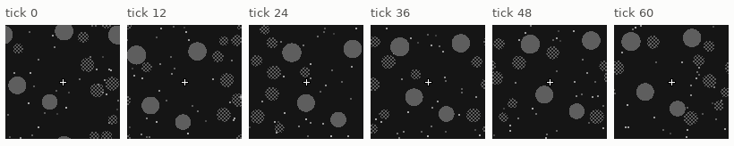
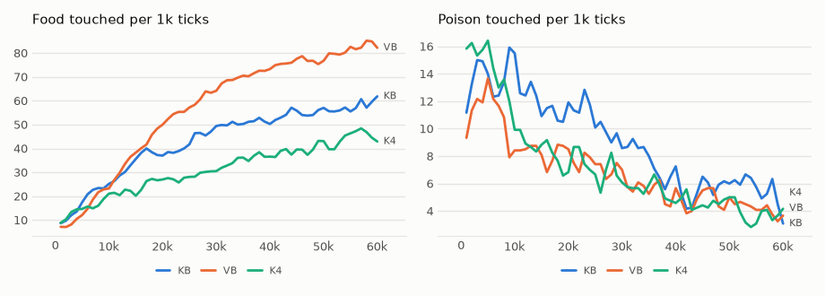

# vm-00090: The Value and K4 at Eight Layers in the Big World

**Date:** 2026-11-13
**Status:** Complete
**Source:** `exp/vm-00090` (code: `visual-motor-agent/dev/`)
**Outputs:** `~/data/research/visual-motor-agent/exp_00090/`
**Task plan:** [`../tasks/00101-big-world-depth.md`](../tasks/00101-big-world-depth.md)

## Goal

The small world has stopped testing much:
- vm-00089's best agent (K4D8T) eats about every 7 ticks, so its hunger stays below .01.
- The next food is rarely more than 24 px away.

Here vm-00089's two agents move, unchanged, into vm-00072's big world, where food is farther and the body hungrier: K4D8T as KB, V90RD8T as VB. Two questions:
- Do depth and the lower tolerance carry over?
- Does the value pay once reach matters?

The design and the readings set before the results are in the task plan.

## Method

| Arm | Label | Model | World | Seeds |
|---|---|---|---|---|
| vm-00072's K4 (not rerun) | K4 | 4 quarters × 2 layers, tolerance 0.005 | `U_big.json` | 1–6 |
| KB | K4 | 4 quarters × 8 layers, tolerance 0.002 | `U_big.json` | 1–6 |
| VB | value, γ 0.9, n 4, fresh tail | 4 quarters × 8 layers, tolerance 0.002 | `U_big.json` | 1–6 |

- **The world** (`configs/U_big.json`): 128 × 128, 4 foods, 8 poisons, 32 dots. Sizes, moves and hunger are the same as in the default world, so the density is the same.
  - After a meal the next food is 24.6 px away, and beyond 24 px half the time.
  - Scripted walkers (vm-00072): always chasing 170.6 food per 1k, reach 24 px 105.4, reach 16 px 67.7, blind 19.5.
- **The model:** each quarter transformer covers 64 × 64 px and reads 105 tokens per step, against 32 in the small world.
- **Only the world changes** from vm-00089's K4D8T and V90RD8T: `--config configs/U_big.json --set online.future_k=4 --set model.n_layer=8 --set online.instinct_tol=0.002`, plus `--set online.value_gamma=0.9 --set online.value_refresh=1` for VB.
- **Each seed's two lives on one card:** seeds 1–4 on the RTX 4090, 5–6 on the RTX 3090, all under MPS. The 4090 is about twice as fast, so it took more seeds.
- **Frozen tests:** `eval_hunger.py chain` and `reach` at 1,500 ticks (as in vm-00072), and `value` at 2,000.
- **Run notes:**
  - the 12 lives ran from 2026-11-12 23:31;
  - KB ended at 08:02 (4090) and 08:10 (3090), VB at 08:57 and 09:14. VB is about 10% slower per tick;
  - the frozen tests ran until 09:39;
  - every run's `info.json` carries `env.size` 128, `n_layer` 8 and `instinct_tol` 0.002. No errors.

## Results

### R1. Lived, ticks 40–60k, six seeds, 95% interval (t, df 5)

| Arm | Food per 1k | Poison per 1k | Mean hunger | Instinct overrides | Move CE | Smoothness |
|---|---|---|---|---|---|---|
| vm-00072's K4 | 42.1 ± 3.6 | 4.18 ± 1.18 | .060 | .159 | .689 | .30 |
| KB | 56.4 ± 7.8 | 5.42 ± 0.82 | .031 | .378 | .441 | .38 |
| VB | 79.2 ± 10.1 | 4.43 ± 0.84 | .025 | .353 | .399 | .52 |

Paired by seed, 6 seeds:

| Pair | Food | Positive | Poison | Mean hunger | Overrides | Move CE | Smoothness |
|---|---|---|---|---|---|---|---|
| VB − KB (the value) | +22.9 ± 10.6 | 6 of 6 | −0.99 ± 1.14 (lower in 5) | −.007 ± .032 | −.025 ± .097 | −.042 ± .101 | +.137 ± .073 (6 of 6) |
| KB − vm-00072's K4 (depth and tolerance) | +14.3 ± 10.4 | 5 of 6 | +1.23 ± 1.03 (higher in 5) | −.028 ± .024 (lower in 6) | +.219 ± .055 | −.247 ± .172 | +.079 ± .086 |
| VB − vm-00072's K4 | +37.2 ± 12.8 | 6 of 6 | +0.24 ± 1.36 | −.035 ± .041 | +.195 ± .080 | −.289 ± .149 | +.217 ± .107 |

VB − KB food by seed: +34.5, +30.1, +7.4, +15.5, +28.4, +21.5.

Food per 1k by 10k ticks of life, mean of six seeds:

| Arm | 0–10k | 10–20k | 20–30k | 30–40k | 40–50k | 50–60k |
|---|---|---|---|---|---|---|
| vm-00072's K4 | 15.5 | 23.9 | 28.7 | 35.7 | 39.7 | 44.4 |
| KB | 18.5 | 35.0 | 43.9 | 50.8 | 55.0 | 57.7 |
| VB | 15.4 | 40.4 | 59.2 | 70.9 | 76.7 | 81.7 |

Instinct overrides by the same blocks:

| Arm | 0–10k | 10–20k | 20–30k | 30–40k | 40–50k | 50–60k |
|---|---|---|---|---|---|---|
| vm-00072's K4 | .352 | .164 | .165 | .167 | .163 | .154 |
| KB | .475 | .324 | .368 | .401 | .385 | .371 |
| VB | .596 | .448 | .405 | .396 | .367 | .339 |

### R2. Frozen value (`eval_hunger.py value`), 2,000 ticks on 16 bodies

| Arm | Predicted | Realized | Abs bias, mean (max) | Bias, share of realized | Correlation | Spread, median (min) |
|---|---|---|---|---|---|---|
| KB | .044 | .057 | .0131 (.0196) | −23% (−29% to −19%) | .92 (.88 to .94) | .0040 (.0028) |
| VB | .013 | .022 | .0086 (.0128) | −39% (−49% to −31%) | .68 (.62 to .78) | .0032 (.0015) |

Frozen, both bodies are hungrier than lived (KB .057 against .031): a frozen checkpoint no longer learns from its meals.

### R3. Frozen chain (`eval_hunger.py chain`) and reach (`eval_hunger.py reach`)

| Arm | Seen | Blind | Blind + perfect grab | Seen − grab | Poison seen | Smoothness | Eaten when in reach | In reach |
|---|---|---|---|---|---|---|---|---|
| vm-00072's K4 | 44.6 ± 3.2 | 14.3 ± 1.6 | 21.9 ± 3.1 | +22.7 ± 1.1 | 2.52 | .329 | | |
| KB | 58.5 ± 7.9 | 16.3 ± 2.1 | 25.8 ± 3.1 | +32.8 ± 5.0 | 5.12 | .402 | .848 | .069 |
| VB | 85.5 ± 7.8 | 19.3 ± 2.5 | 30.5 ± 3.8 | +54.9 ± 4.3 | 3.54 | .556 | .634 | .135 |

Aim (cosine of the move to the food) by the gap from the cursor to the food's edge, seen, 6 seeds:

| Arm | Share of ticks beyond 24 px | 0–4 px | 4–8 | 8–12 | 12–16 | 16–24 | 24+ |
|---|---|---|---|---|---|---|---|
| vm-00072's K4 | .576 | .807 | .785 | .677 | .471 | .250 | .077 |
| KB | .565 | .839 | .830 | .768 | .609 | .320 | .092 |
| VB | .354 | .657 | .647 | .627 | .588 | .509 | .240 |

Paired by seed, 6 seeds:

| Pair | Aim 24+ px | Aim 24+ px, blind | Aim 12–24 px | Lead over grab | Frozen food | Frozen poison | Eaten when in reach |
|---|---|---|---|---|---|---|---|
| VB − KB | +.148 ± .017 (6 of 6) | +.012 ± .010 | +.141 ± .058 | +22.2 ± 5.9 (6 of 6) | +26.9 ± 9.4 | −1.58 ± 2.05 | −.214 ± .064 (0 of 6) |
| KB − vm-00072's K4 | | | +.089 ± .041 | +10.1 ± 5.6 | +14.0 ± 10.2 | +2.60 ± 1.66 | |

With food one move away, by the body's real hunger (`reach`), VB's predicted drop is .0009–.0030 below hunger .04, against KB's .0026–.0132. The drop clears 0.002 in 11–38% of those ticks, against 23–78% for KB.

## Readings

1. **Plumbing: met.** All 12 lives ran 60k ticks with `img` 128, 8 layers and `instinct_tol` 0.002, without errors.
2. **The world asks more: met, narrowly on hunger.** KB's lived mean hunger is .031, against a bar of .030 (twice K4D8T's .015 in the small world). Its food, 56.4, is a third of the always-chasing walker's 170.6.
3. **Depth and the tolerance carry over: met.** KB − vm-00072's K4 is +14.3 ± 10.4 food (5 of 6); frozen +14.0 ± 10.2.
4. **The value pays when food is far (the main one): met.** VB − KB is +22.9 ± 10.6 food (6 of 6); frozen +26.9 ± 9.4.
5. **Reach: met.** VB's aim past 24 px is +.148 ± .017 above KB's (6 of 6), and its lead over the grab +22.2 ± 5.9 (6 of 6).
6. **The value holds: met.** Every VB seed meets the bar: abs bias at most .0128 (bar .0141), correlation .62 to .78 (bar .5), median candidate spread at least .0015 (bar .0005).
7. **Poison is still seen: met.** VB's lived poison is −0.99 ± 1.14 below KB's (lower in 5 of 6).

**The outcome set in the plan:** 4 holds, so the value pays when the world asks for reach. It is kept and taken into C, a world larger than the view. The second wave (seeds 7–12) was not triggered: VB's lead is outside its interval.

<!-- figures -->
## Figures

*The world of this experiment as its model sees it, every 12 ticks. Moves are random: this shows the world, not the trained agent.*

*From each run's `metrics.jsonl`, the mean of its seeds by arm, smoothed.*
<!-- /figures -->

## Analysis

- **For the first time the value eats more than K4.**
  - In the small world it never did: −8.0 ± 17.3 against K4D8T (vm-00089), +4.2 ± 12.4 against K4D8 (vm-00088). Here it leads by 23 food per 1k in every seed, 40% more than KB.
  - The difference is where the food is. In the small world food was rarely beyond 24 px. Here more than half of KB's ticks are spent with the food beyond 24 px (.565), and there KB's aim is near chance (.092).
  - The value weighs about 66 ticks ahead (γ 0.9, horizon of the fresh tail), K4 only 4. A move that closes 2 px on food 30 px away changes K4's label hardly at all, so K4 has nothing to steer by. VB aims at it (.240) and spends a third of its ticks beyond 24 px instead of more than half.
  - The gain is in seeing, not in gait: blind aim past 24 px differs by only .012, while seen aim differs by .148.
- **The value's weakness up close stays.**
  - With food one move away VB eats it .634 of the time, against KB's .848 (lower in all 6 seeds), as in the small world (.742 against .927).
  - Its predicted drop for a food move is small: .001–.003 against KB's .003–.013. A meal now and a meal a few ticks later differ little to a 66-tick value, so the drop often falls inside the tolerance of 0.002, and the habit wins.
  - VB still eats more because it is in reach twice as often (.135 of ticks against .069).
- **VB is still learning.** Its food rises 76.7 → 81.7 from 40–50k to 50–60k, KB's 55.0 → 57.7. The 60k gap is likely an underestimate of what the value is worth in this world.
- **Depth and the lower tolerance carry over, with more poison.**
  - KB eats 34% more than vm-00072's 2-layer K4 at tolerance 0.005 (+14.3, 5 of 6), aims better at 12–24 px, and its hunger is lower in all 6 seeds.
  - Its poison is higher (+1.2 lived, +2.6 frozen, 5 of 6). In the small world 0.002 did not raise K4's poison (vm-00089). VB's poison is not above vm-00072's K4 (+0.24 ± 1.36).
  - Which of the two changes (depth or tolerance) brings the poison is not separated here.
- **The big world asks much more.** KB eats 56 per 1k here against K4D8T's 137 in the small world, at the same density of food, and its hunger is twice as high. Both agents are far below the always-chasing walker (171) and VB is still below the walker that reaches 24 px (105).
- **The frozen value is more pessimistic than K4's.** VB predicts 39% below the hunger it then gets, KB 23%; in the small world both were at 31%. Its correlation (.68) is above V90RD8T's in the small world (.58), likely because the body's hunger varies more here.

## Conclusions

1. In the big world the value label pays: VB eats 79.2 per 1k against KB's 56.4 (+22.9 ± 10.6, 6 of 6 seeds), with less poison, and is still rising at 60k.
2. The gain comes from aiming at far food: past 24 px VB's aim is .240 against KB's .092 (6 of 6). Up close VB still lets more food go (eaten when in reach .634 against .848).
3. Depth and the lower tolerance carry over to the big world: KB eats 14 more than vm-00072's 2-layer K4 at 0.005, with about one more poison per 1k.
4. The value (γ 0.9, fresh tail, 8 layers, tolerance 0.002) goes forward into C, a world larger than the view.

## Next steps

- **C, a world larger than the view:** the agent sees only part of it, so finding food needs exploring and memory. VB's settings, with KB as the control.
- **The value's grab:** a tolerance that follows the label's scale (relative to the candidates' spread or to the hunger) would let VB's small food-move drops through. Its effect on poison has to be watched.
- **KB's poison:** depth and tolerance separated, if the poison rise matters for C.
