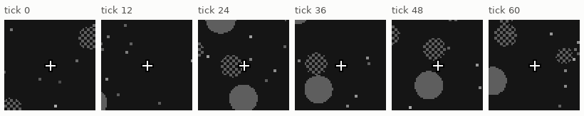
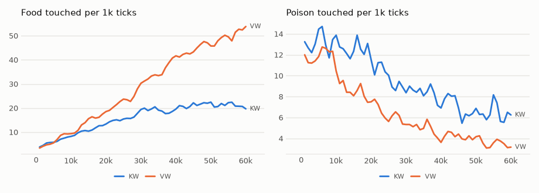
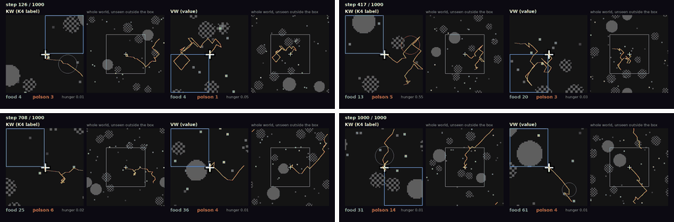

# vm-00091: A World Larger Than the View

**Date:** 2026-11-13
**Status:** Complete
**Source:** `exp/vm-00091` (code: `visual-motor-agent/dev/`)
**Outputs:** `~/data/research/visual-motor-agent/exp_00091/`
**Task plan:** [`../tasks/00102-world-larger-than-view.md`](../tasks/00102-world-larger-than-view.md)

## Goal

In vm-00090 the value paid for the first time, in a 128 × 128 world the agent saw whole. Here the world stays 128 × 128, with 2 foods, but the agent sees only a 64 × 64 window centered on itself, so food is often out of sight. Two questions:
- When it cannot see food, does it head for food it saw a moment ago?
- Does the value still pay?

The design and the readings set before the results are in the task plan.

## Method

| Arm | Label | Model | World | Seeds |
|---|---|---|---|---|
| KW | K4 | 4 quarters × 8 layers, tolerance 0.002 (vm-00090's KB) | 128 × 128, 2 foods, view 64 (`U_view.json`) | 1–12 |
| VW | value, γ 0.9, n 4, fresh tail | the same (vm-00090's VB) | the same | 1–12 |

- **The window** (`env.view`, new): the frame is the 64 × 64 center of the full egocentric frame. Only the frame changes: food, poison, touches and hunger are the world's. `tests/test_view.py` checks the crop, that view 0 is the old frame bit for bit, and that `foods_in_view` (scoring only) agrees with the food's pixels.
- **The world** (`configs/U_view.json`): `U_big.json` with 2 foods instead of 4 (8 poisons, 32 dots). With 4 foods a 64 px window hides all of them only 12% of the time; with 2, 37–39%.
- **The model** is the small world's, `img` 64: each quarter transformer covers 32 × 32 px. Its context is 8 ticks: a food seen more than 8 ticks ago is no longer in its input.
- **Scripted walkers** (`eval_food_gap.py --view 64`): a walker turns to the nearest food it can see, and otherwise goes straight on a heading it redraws about every 32 ticks.

| Walker, 2 foods | Food per 1k | No food in view |
|---|---|---|
| Blind | 9.9 | |
| Turns to food within 16 px | 34.6 | |
| Turns to food within 24 px | 54.4 | |
| Chases any food in the 64 px window | 96.2 | .39 of ticks |
| Chases always, whole world in view | 136.7 | 0 |

- **Each seed's two lives on one card:** seeds 1–7 on the RTX 4090, 8–12 on the RTX 3090, all under MPS. 60k ticks.
- **Frozen tests:** `eval_hunger.py chain` and `reach` at 1,500 ticks, `value` at 2,000.
  - `chain` also scores the window. On ticks with no food in view, it scores the aim at the nearest (unseen) food, binned by ticks since any food was last in view (1–8, within the context; 9–32; 33+).
  - The baseline is blind: the same moves scored against another world's food, on that world's own out-of-view ticks. Food leaves the view mostly because the agent moves away from it, so even an agent without memory aims away from it. The blind baseline carries that bias too.
  - **A correction after the first results:** a tick right after a meal also has no food in view, because the food was just eaten, and the blind world rarely eats. `chain` therefore also scores the out-of-view ticks with no meal since food was last in view. The task plan named this check. The rerun repeated every other number exactly.
- **Run notes:**
  - the 24 lives ran 2026-11-13 11:56–15:56;
  - the frozen tests ran until 16:23, and the chain rerun until 16:34;
  - every run's `info.json` has `env.size` 128, `env.view` 64, `env.foods` 2, `model.img` 64, `n_layer` 8 and `instinct_tol` 0.002. No errors.

## Results

### R1. Lived, ticks 40–60k, 12 seeds, 95% interval (t, df 11)

| Arm | Food per 1k | Poison per 1k | Mean hunger | Instinct overrides | Move CE | Smoothness |
|---|---|---|---|---|---|---|
| KW | 21.2 ± 1.4 | 6.67 ± 0.60 | .138 ± .039 | .355 | .366 | .25 |
| VW | 47.6 ± 6.1 | 3.85 ± 0.42 | .058 ± .023 | .292 | .268 | .47 |

Paired by seed, VW − KW:

| Food | Positive | Poison | Mean hunger | Overrides | Move CE | Smoothness |
|---|---|---|---|---|---|---|
| +26.4 ± 5.9 | 12 of 12 | −2.82 ± 0.66 (lower in 12) | −.080 ± .050 (lower in 11) | −.063 ± .052 | −.099 ± .041 (lower in 11) | +.217 ± .055 (12 of 12) |

VW − KW food by seed: +15.9, +22.2, +10.0, +39.0, +27.2, +24.2, +33.9, +18.8, +33.6, +27.9, +40.8, +23.2.

Food per 1k by 10k ticks of life, mean of 12 seeds:

| Arm | 0–10k | 10–20k | 20–30k | 30–40k | 40–50k | 50–60k |
|---|---|---|---|---|---|---|
| KW | 6.4 | 11.5 | 16.2 | 19.1 | 21.4 | 20.9 |
| VW | 7.0 | 15.2 | 24.3 | 36.0 | 44.6 | 50.5 |

Mean hunger by the same blocks:

| Arm | 0–10k | 10–20k | 20–30k | 30–40k | 40–50k | 50–60k |
|---|---|---|---|---|---|---|
| KW | .554 | .319 | .228 | .173 | .128 | .148 |
| VW | .513 | .198 | .123 | .069 | .071 | .045 |

### R2. Aim at food out of view (`eval_hunger.py chain`)

Aim is the cosine of the move to the nearest food. Seen − blind is paired over 12 seeds.

| Ticks since food was last in view | KW: share of ticks | KW: seen − blind | VW: share of ticks | VW: seen − blind |
|---|---|---|---|---|
| **All out-of-view ticks** | | | | |
| 1–8 | .191 | +.058 ± .016 (12 of 12) | .219 | +.138 ± .022 (12 of 12) |
| 9–32 | .220 | −.017 ± .011 (3 of 12) | .178 | −.036 ± .016 (1 of 12) |
| 33+ | .114 | −.019 ± .018 (2 of 12) | .026 | −.000 ± .025 (5 of 12) |
| **No meal since food was last in view** | | | | |
| 1–8 | .143 | +.035 ± .013 (11 of 12) | .101 | +.062 ± .017 (12 of 12) |
| 9–32 | .154 | −.020 ± .014 (3 of 12) | .074 | −.022 ± .016 (1 of 12) |
| 33+ | .075 | −.009 ± .022 (5 of 12) | .011 | +.002 ± .046 (5 of 12) |

- No food in view: KW .525 of frozen ticks, VW .423 (VW − KW −.103 ± .027, lower in 12 of 12).
- In the 1–8 bin, 25% of KW's out-of-view ticks follow a meal and 54% of VW's (42–65% by seed).
- Without those ticks, the raw aims at 1–8 are still negative: KW −.072 seen against −.107 blind, VW −.094 against −.156. Both turn away from food that has just left the window, only less than chance would.
- VW − KW in the 1–8 gap without meals: +.027 ± .027 (9 of 12).

### R3. Frozen value (`eval_hunger.py value`), 2,000 ticks on 16 bodies

| Arm | Predicted | Realized | Abs bias, mean (max) | Bias, share of realized | Correlation | Spread, median (min) |
|---|---|---|---|---|---|---|
| KW | .116 | .128 | .0120 (.0153) | −10% (−14% to −6%) | .96 (.92 to .98) | .0031 (.0027) |
| VW | .030 | .042 | .0128 (.0238) | −29% (−42% to −2%) | .84 (.76 to .88) | .0026 (.0010) |

VW's bias by seed: −.0238, −.0128, −.0140, −.0150, −.0141, −.0191, −.0063, −.0225, −.0004, −.0093, −.0093, −.0075.

### R4. Frozen chain and reach

| Arm | Seen | Blind | Blind + perfect grab | Seen − grab | Poison seen | Smoothness | Eaten when in reach | In reach |
|---|---|---|---|---|---|---|---|---|
| KW | 21.4 ± 1.8 | 5.5 ± 0.5 | 8.8 ± 0.8 | +12.5 ± 1.4 | 4.89 | .249 | .865 | .025 |
| VW | 54.4 ± 5.3 | 9.3 ± 0.5 | 15.6 ± 0.9 | +38.8 ± 4.6 | 3.82 | .521 | .738 | .073 |

Aim by the gap from the cursor to the food's edge, seen, 12 seeds (any food, in view or not):

| Arm | Share of ticks beyond 24 px | 0–4 px | 4–8 | 8–12 | 12–16 | 16–24 | 24+ |
|---|---|---|---|---|---|---|---|
| KW | .810 | .845 | .826 | .763 | .580 | .273 | .049 |
| VW | .629 | .730 | .720 | .693 | .656 | .585 | .168 |

Paired by seed, VW − KW:

| Aim 12–24 px | Aim 24+ px | Aim 24+ px, blind | Lead over grab | Frozen food | Frozen poison | Eaten when in reach | In reach |
|---|---|---|---|---|---|---|---|
| +.267 ± .041 (12 of 12) | +.119 ± .025 (12 of 12) | +.010 ± .005 | +26.2 ± 4.0 (12 of 12) | +33.0 ± 5.0 (12 of 12) | −1.07 ± 0.91 (lower in 9) | −.127 ± .036 (0 of 12) | +.049 ± .004 (12 of 12) |

## Readings

1. **Plumbing: met.** The view tests pass. All 24 lives ran 60k ticks with 64 × 64 frames, `env.view` 64, `env.size` 128 and 2 foods, without errors.
2. **The window hides food: met.** KW has no food in view on .525 of its frozen ticks (bar .25).
3. **Short memory (the main one): met, at half the size first measured.** 1–8 ticks after food was last in view, VW aims at the unseen food above the blind baseline by +.138 ± .022 (12 of 12). Without the ticks after a meal: +.062 ± .017 (12 of 12).
4. **Memory past the context: fails, as expected.** At 9–32 ticks VW aims below the blind baseline (−.036 ± .016; without meals −.022 ± .016, 1 of 12).
5. **The value in the window: met.** VW − KW lived food +26.4 ± 5.9 (12 of 12); frozen +33.0 ± 5.0.
6. **The value holds: fails on bias.** Correlation .76 to .88 (bar .5) and median spread at least .0010 (bar .0005) pass. The bias is beyond .0141 in seeds 1, 4, 6 and 8 (worst −.0238).
7. **Poison is still seen: met.** VW's lived poison is −2.82 ± 0.66 below KW's, lower in all 12 seeds.

**The outcome set in the plan:** 3 holds and 4 fails. The agent uses what it saw while it is in its context, and no longer. Next is a memory that outlasts the context, tested in this world. By reading 5 the value stays the label.

<!-- figures -->
## Figures

*The world of this experiment as its model sees it, every 12 ticks. Moves are random: this shows the world, not the trained agent.*

*From each run's `metrics.jsonl`, the mean of its seeds by arm, smoothed.*

*Stills from this experiment's video, in time order. Seed 5 at 60k, frozen, KW and VW from the same start. Each arm's 64 x 64 view (the blue square: the quarter transformer whose move it was), and beside it the whole world, centered on the cursor the same way, with the window outlined: plain circles are food, checkered ones poison.*
<!-- /figures -->

## Analysis

- **The value pays more here than with the whole world in view.**
  - VW eats 2.2 times KW's food (47.6 against 21.2), against 1.4 times in vm-00090's full view (79.2 against 56.4). Both arms are lower than in vm-00090, which had 4 foods and no window.
  - So the value's gain in vm-00090 was not only about seeing far. Where food is often out of sight, the 4-tick label loses the most.
- **KW forages poorly in the window.**
  - It eats 21 per 1k and flattens out from 40k, below the walker that turns to food only within 16 px (34.6).
  - Its aim past 24 px is near chance (.049), and 81% of its frozen ticks have the nearest food beyond 24 px.
  - Its gait is jittery (smoothness .25). A jittery gait covers little ground, so with no food in view KW rarely finds any: blind + grab gives it 8.8, against VW's 15.6 and the walker's 9.9 blind.
  - It stays hungry (lived .138, against VW's .058).
- **VW finds food partly by its gait and mostly by its aim.**
  - Its gait is about twice as smooth (.47 lived), and blind it eats 9.3 against KW's 5.5. That is the gait alone, with no sight of food.
  - Its lead over a perfect grab, +38.8 against KW's +12.5, is about seeing: it aims at food 12–24 px away (.585 at 16–24 against .273).
  - It keeps food in view more: no food in view .423 of ticks, against KW's .525.
  - It is still learning: 44.6 → 50.5 food from 40–50k to 50–60k, while KW is flat.
- **What the "memory" is.**
  - Within the 8-tick context both agents turn away from food that has just left the window less than chance would: +.062 (VW) and +.035 (KW) above blind, without the ticks after a meal. VW − KW in this gap is +.027 ± .027, not separated.
  - The raw aim is still negative (VW −.094). The agent is not heading back for the food: it turns away a little less.
  - This fits food that is still in the model's input for up to 8 ticks, and a gait that keeps turning gently. It does not show a plan to return.
  - Beyond 8 ticks the aim is at or below blind for both arms. Nothing carries a food's place past the context.
  - The first measure overstated the effect by about half: more than half of VW's out-of-view ticks in the 1–8 bin come right after it ate.
- **The value's calibration.**
  - VW predicts 29% below the hunger it gets, better than vm-00090's 39%. Its correlation (.84) is higher than there (.68).
  - The bar on absolute bias (.0141) was set in the small world, where hunger was lower. Here the realized label is about twice vm-00090's (.042 against .022), and four seeds miss the bar by up to .0097. Read as a share, the value is no worse calibrated than before. Read as the bar was set, reading 6 fails.
- **The value's grab is still weak.** With food one move away VW eats it .738 of the time, against KW's .865 (lower in all 12), as in vm-00090 (.634 against .848). It is in reach three times as often (.073 against .025), which more than makes up for it.
- **Room above both.** A walker that chases whatever it sees eats 96 per 1k; VW eats 48 lived and 54 frozen, about the walker that turns to food within 24 px (54.4). Seeing everything in the window is worth twice VW's food, and memory or a search for food out of view would be worth more again (137 with the whole world in view).

## Conclusions

1. In a world larger than the view, the value pays more than it did with the whole world in view: VW eats 47.6 per 1k against KW's 21.2 (+26.4 ± 5.9, 12 of 12 seeds), with less poison in every seed, and is still rising at 60k.
2. The agent's memory of food that left the view lasts as long as its 8-tick context. Within it, it turns away from the food less than chance would (+.062 for VW, without the ticks after a meal). Beyond it, nothing.
3. A first reading of the memory measure was inflated about twofold by ticks right after a meal. Out-of-view measures must exclude them.
4. The value's absolute bias passes the small world's bar in 8 of 12 seeds. As a share of the label it is better than in vm-00090 (−29% against −39%).

## Next steps

- **A memory that outlasts the context,** tested in this world with VW's settings: a longer context, or a summary carried across windows. vm-00082 found no gain from a longer context in the small world, where nothing needed remembering. Here food out of view is 40–50% of ticks, and the walker gap (96 against 137) bounds what memory can win.
- **Exploration:** with no food in view, VW's gait is a smooth wander. A search pattern would help both arms; the value could learn one only if its horizon reaches past the window.
- **The value's grab,** as in vm-00090: a tolerance that follows the label's scale.
- **The value bar** should be stated as a share of the realized label, so it carries across worlds of different hunger.
