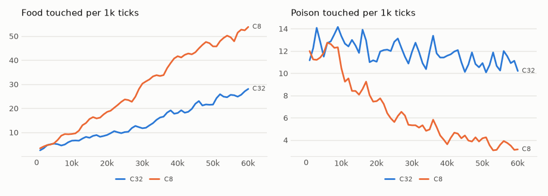
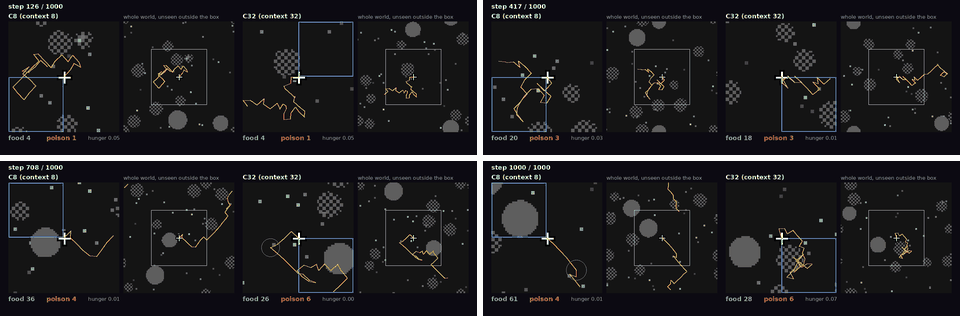

# vm-00092: A Longer Context in a World Larger Than the View

**Date:** 2026-11-14
**Status:** Complete (pending tag)
**Source:** `dev/` (pending tag `exp/vm-00092`)
**Outputs:** `~/data/research/visual-motor-agent/exp_00092/`
**Task plan:** [`../tasks/00103-context-in-the-window.md`](../tasks/00103-context-in-the-window.md)

## Goal

In vm-00091 the value agent (VW) seemed to remember food that left its 64 × 64 window for as long as its 8-tick context, and no longer. Here the same agent, in the same world, gets a context of 32 ticks (C32). Does it then aim at food it saw 9–32 ticks ago, and does that pay? The control is vm-00091's VW, here called C8. The design and the readings set before the results are in the task plan.

## Method

| Arm | Label | Model | Context | Seeds |
|---|---|---|---|---|
| C8 = vm-00091's VW (not rerun) | value, γ 0.9, n 4, fresh tail | 4 quarters × 8 layers, tolerance 0.002 | 8 | 1–12 |
| C32 | the same | the same | 32 | 1–12 |

- **The world** (`configs/U_view.json`, vm-00091's): 128 × 128, 2 foods, 8 poisons and 32 dots, seen through a 64 × 64 window centered on the cursor.
- **A context of 32** (`--set model.ctx=32`, nothing else changes):
  - each move reads the last 32 frames;
  - each update trains on 8 windows of 32 ticks, 4 times C8's tokens;
  - memory chunks are 32 ticks long, and replay stays 100k ticks.
- **C8 is not rerun.** The training code is unchanged since vm-00091, and GPU lives do not repeat run to run anyway, so the arms are compared over seeds.
  - Its frozen tests are rerun with the finer bins below.
  - They repeat vm-00091's food, poison, aim, out-of-view share and smoothness exactly, seed by seed.
- **Cards and speed:** seeds 1–6 on the RTX 4090, 7–12 on the RTX 3090, six lives per card under MPS.
  - A life at context 32 takes about 2.9 GB; twelve per card ran out of memory in the timing.
  - A C32 life runs at 1.3 ticks/s on the 4090 and 0.7 on the 3090. C8 ran at 4.8 and 3.3 with twelve lives per card.
  - Per card, C32 gets through a seventh (4090) to a tenth (3090) of C8's ticks per second.
- **Frozen tests** (`eval_hunger.py`): `chain` and `reach` at 1,500 ticks, `value` at 2,000, as in vm-00091.
  - `chain`'s out-of-view bins are finer: 1–8, 9–16, 17–32, 33–64 and 65+ ticks since any food was last in view, so that a 32-tick memory shows in its own bins. Each row carries its bin names, and vm-00091's rows still print under their old bins.
  - The memory measure is vm-00091's corrected one: aim at the nearest unseen food, seen − blind, on out-of-view ticks with no meal since food was last in view. `show --base C8` pairs it by seed and bin.
- **Run notes:**
  - the 12 lives ran on 2026-11-14, 00:01–12:33 on the 4090 and 00:01–23:43 on the 3090, all 60k ticks;
  - the frozen tests of seeds 1–6 ran early on the idle 4090 (20:42–21:11). Those of seeds 7–12 ran after the lives (23:43–00:02), with chain and value on the 4090 and reach on the 3090;
  - every run's `info.json` has `model.ctx` 32, `env.view` 64, `env.foods` 2, `n_layer` 8, `instinct_tol` 0.002, `value_gamma` 0.9 and `value_refresh` 1. No errors.

## Results

### R1. Lived, ticks 40–60k, 12 seeds, 95% interval (t, df 11)

| Arm | Food per 1k | Poison per 1k | Mean hunger | Instinct overrides | Move CE | Smoothness |
|---|---|---|---|---|---|---|
| C8 | 47.6 ± 6.1 | 3.85 ± 0.42 | .058 ± .023 | .292 | .268 | .47 |
| C32 | 23.4 ± 3.6 | 11.00 ± 0.49 | .177 ± .054 | .524 | .116 | .27 |

Paired by seed, C32 − C8:

| Food | Positive | Poison | Mean hunger | Overrides | Move CE | Smoothness |
|---|---|---|---|---|---|---|
| −24.2 ± 6.0 | 0 of 12 | +7.16 ± 0.72 (higher in 12) | +.119 ± .068 (higher in 11) | +.231 ± .055 (higher in 12) | −.152 ± .037 (lower in 12) | −.200 ± .043 (lower in 12) |

C32 − C8 food by seed: −17.9, −13.1, −11.5, −33.7, −22.1, −29.9, −31.2, −10.4, −25.4, −24.5, −40.6, −29.6.

By 10k ticks of life, mean of 12 seeds:

| Measure | Arm | 0–10k | 10–20k | 20–30k | 30–40k | 40–50k | 50–60k |
|---|---|---|---|---|---|---|---|
| Food per 1k | C8 | 7.0 | 15.2 | 24.3 | 36.0 | 44.6 | 50.5 |
| | C32 | 5.0 | 8.1 | 11.0 | 16.4 | 20.8 | 25.9 |
| Poison per 1k | C8 | 11.6 | 8.4 | 6.2 | 4.8 | 4.2 | 3.5 |
| | C32 | 12.9 | 12.2 | 12.1 | 11.7 | 11.1 | 10.9 |
| Mean hunger | C8 | .513 | .198 | .123 | .069 | .071 | .044 |
| | C32 | .592 | .433 | .377 | .212 | .186 | .167 |
| Instinct overrides | C8 | .458 | .390 | .399 | .385 | .315 | .269 |
| | C32 | .382 | .338 | .455 | .565 | .543 | .504 |

### R2. Aim at food out of view (`eval_hunger.py chain`)

Aim is the cosine of the move to the nearest food. Seen − blind is paired over 12 seeds within each arm, and C32 − C8 is paired by seed.

Ticks with no meal since food was last in view (the measure of reading 2):

| Ticks since food was last in view | C8: seen − blind | C32: seen − blind | C32 − C8 |
|---|---|---|---|
| 1–8 | +.062 ± .017 (12 of 12) | +.031 ± .011 (12 of 12) | −.031 ± .021 (2 of 12) |
| 9–16 | −.029 ± .018 (2 of 12) | −.010 ± .018 (5 of 12) | +.018 ± .025 (7 of 12) |
| 17–32 | −.011 ± .027 (6 of 12) | −.019 ± .014 (1 of 12) | −.008 ± .032 (6 of 12) |
| 33–64 | −.013 ± .060 (4 of 12) | −.039 ± .030 (3 of 12) | −.026 ± .060 (5 of 12) |
| 65+ | +.117 ± .174 (7 of 12) | −.028 ± .071 (5 of 12) | −.145 ± .144 (4 of 12) |

All out-of-view ticks, with their share of the frozen ticks:

| Ticks since food was last in view | C8: share | C8: seen − blind | C32: share | C32: seen − blind | C32 − C8 |
|---|---|---|---|---|---|
| 1–8 | .219 | +.138 ± .022 (12 of 12) | .187 | +.056 ± .013 (12 of 12) | −.081 ± .026 (0 of 12) |
| 9–16 | .105 | −.048 ± .017 (1 of 12) | .100 | −.006 ± .014 (5 of 12) | +.042 ± .024 (11 of 12) |
| 17–32 | .073 | −.016 ± .024 (4 of 12) | .098 | −.021 ± .016 (2 of 12) | −.005 ± .022 (4 of 12) |
| 33–64 | .023 | −.014 ± .036 (5 of 12) | .057 | −.039 ± .025 (2 of 12) | −.025 ± .038 (5 of 12) |
| 65+ | .003 | +.022 ± .114 (7 of 12) | .018 | −.029 ± .061 (6 of 12) | −.051 ± .099 (4 of 12) |

- No food in view: C8 on .423 of frozen ticks, C32 on .460 (C32 − C8 +.037 ± .021, higher in 10 of 12).
- In each bin, 45–61% of C8's out-of-view ticks follow a meal, against 32–42% of C32's: C32 eats half as often.

### R3. Frozen value (`eval_hunger.py value`), 2,000 ticks on 16 bodies

| Arm | Predicted | Realized | Abs bias, mean (max) | Bias, share of realized | Correlation | Spread, median (min) |
|---|---|---|---|---|---|---|
| C8 | .030 | .042 | .0128 (.0238) | −29% (−42% to −2%) | .84 (.76 to .88) | .0026 (.0010) |
| C32 | .121 | .176 | .0552 (.0762) | −32% (−40% to −23%) | .86 (.81 to .90) | .0058 (.0013) |

C32's bias by seed: −.0498, −.0704, −.0762, −.0629, −.0390, −.0674, −.0496, −.0628, −.0445, −.0387, −.0488, −.0529.

### R4. Frozen chain and reach

| Arm | Seen | Blind | Blind + perfect grab | Seen − grab | Poison seen | Smoothness | Eaten when in reach | In reach |
|---|---|---|---|---|---|---|---|---|
| C8 | 54.4 ± 5.3 | 9.3 ± 0.5 | 15.6 ± 0.9 | +38.8 ± 4.6 | 3.82 | .521 | .738 | .073 |
| C32 | 26.3 ± 3.3 | 6.8 ± 0.4 | 11.6 ± 1.2 | +14.8 ± 3.0 | 10.52 | .281 | .625 | .042 |

Aim by the gap from the cursor to the food's edge, seen, 12 seeds (any food, in view or not):

| Arm | Share of ticks beyond 24 px | 0–4 px | 4–8 | 8–12 | 12–16 | 16–24 | 24+ |
|---|---|---|---|---|---|---|---|
| C8 | .629 | .730 | .720 | .693 | .656 | .585 | .168 |
| C32 | .701 | .588 | .521 | .439 | .376 | .293 | .068 |

Paired by seed, C32 − C8:

| Aim 12–24 px | Aim 24+ px | Aim 24+ px, blind | Lead over grab | Frozen food | Frozen poison | Eaten when in reach | In reach |
|---|---|---|---|---|---|---|---|
| −.290 ± .059 (lower in 12) | −.101 ± .025 (lower in 12) | −.005 ± .003 | −24.0 ± 5.6 (lower in 12) | −28.1 ± 5.7 (lower in 12) | +6.70 ± 1.26 (higher in 12) | −.114 ± .023 (lower in 12) | −.032 ± .006 (lower in 12) |

## Readings

1. **Plumbing: met.** All 12 lives ran 60k ticks with `model.ctx` 32 and `env.view` 64, without errors.
2. **Memory reaches further (the main one): fails.** C32 − C8 in the aim at unseen food (seen − blind, without the ticks after a meal) is +.018 ± .025 at 9–16 ticks (7 of 12) and −.008 ± .032 at 17–32 (6 of 12). Neither is above its interval.
3. **Memory pays: fails.** C32's lived food is 24.2 ± 6.0 below C8's, lower in all 12 seeds.
4. **Poison is still seen: met as written, and that is the bad outcome.** C32's lived poison is 7.16 ± 0.72 above C8's (12 of 12), more than vm-00082's +5.45 at context 32.
   - The plan contradicts itself here. The reading asks for poison above C8's, but the follow-up for vm-00082's poison cost was filed under "if 4 fails."
   - That follow-up describes this outcome, so it applies.
5. **The share out of view falls: fails.** It rises: C32 has no food in view on .460 of frozen ticks against C8's .423 (+.037 ± .021, higher in 10 of 12).

**The outcome set in the plan:**
- Reading 2 fails, so the context is not the bottleneck: the model does not keep what is in its input as a place to return to. Next is a summary carried across windows, written up below for the owner's decision.
- vm-00082's poison cost carries over, so its cause (each update spread over more ticks) is tested before a longer context is used again.

<!-- figures -->
## Figures

*The world of this experiment as its model sees it, every 12 ticks. Moves are random: this shows the world, not the trained agent.*

*From each run's `metrics.jsonl`, the mean of its seeds by arm, smoothed.*

*Stills from this experiment's video, in time order. Seed 5 at 60k, frozen, C8 and C32 from the same start, laid out as in vm-00091: each arm's 64 x 64 view (the blue square: the quarter transformer whose move it was), and beside it the whole world with the window outlined. Plain circles are food, checkered ones poison.*
<!-- /figures -->

## Analysis

- **The frames are in the input, and the model does not use them.**
  - For food that left the view 9–32 ticks ago, C32 still has the frames that showed it. Yet it aims at that food no better than its own blind run, just like C8, which no longer has those frames.
  - Even within 8 ticks, C32 turns away from the lost food less than chance by only half as much as C8 (+.031 against +.062).
  - So the context was not what limited the memory in vm-00091. What vm-00091 measured at 1–8 ticks is likely the gait, with the food's last frames still in the input, rather than a model that tracks food it cannot see.
- **The longer context costs a lot, from the start.**
  - Food is lower from the first 10k ticks, and the gap grows: at 50–60k C32 eats what C8 ate at 20–30k.
  - C8 learns to avoid poison (11.6 → 3.5 per 1k over its life). C32 hardly does (12.9 → 10.9).
  - C32's aim at food in view is worse at every distance (.59 against .73 at 0–4 px, .29 against .59 at 16–24 px). It also eats less of the food within one move (.625 against .738).
  - It loses food from view more often (.460 against .423), which follows from aiming worse.
  - **The cause is not tested.** vm-00082 found the same poison cost with one transformer in the small world, where nothing needed remembering. The plan's candidate is the update: each one is spread over windows of 32 ticks, 4 times C8's.
- **C32 predicts its own moves far better, and moves worse.** Its move CE is .116 against .268, lower in all 12 seeds: with 32 past moves in its input, the next move is easy to guess. Its gait is more jittery (smoothness .27 against .47).
- **The instinct takes over as C32 lives.**
  - C32's overrides rise from .34 at 10–20k to .50–.57 after 30k, while C8's fall from .46 to .27.
  - A hungrier agent predicts larger drops for its food moves, which the instinct acts on: in both arms, the share of predicted drops above the tolerance rises with hunger.
  - So the overrides may follow from C32's hunger rather than cause it. Not separated.
- **The value is as good as C8's in relative terms.** It predicts 32% below the realized label (C8 29%), with correlation .86 (C8 .84). But C32 is hungrier, so its label is 4 times C8's, and its absolute bias (.039–.076) misses the small world's bar of .0141 in every seed. As vm-00091 suggested, the bar should be a share of the label.
- **The memory measure over all out-of-view ticks misleads again.**
  - On all out-of-view ticks, C32 − C8 at 9–16 is +.042 ± .024 (11 of 12).
  - That comes from meals. Per bin, 45–61% of C8's out-of-view ticks follow a meal, against 32–42% of C32's, and C8's after-meal ticks pull its 9–16 figure down.
  - Without those ticks, the difference is +.018 ± .025.

## Conclusions

1. A 32-tick context does not give the agent a memory of food that left its view. At 9–32 ticks after the last sight, C32 aims at the unseen food no better than its own blind run, and no better than C8 (+.018 ± .025 and −.008 ± .032, paired over 12 seeds).
2. It costs half the food (23.4 against 47.6 per 1k lived, lower in all 12 seeds) and nearly three times the poison (11.0 against 3.8). Each life also ran about 4 times slower (3.6 times on the 4090, 4.7 on the 3090), with half as many lives per card.
3. The cost shows from the first 10k ticks, and C32 never learns to avoid poison, as vm-00082 found in the small world.
4. The value's calibration as a share of the label is unchanged (−32% against −29%). Bars on absolute bias do not carry across worlds of different hunger.

## Next steps

Both were set in the plan before the results.

- **A summary carried across windows (for the owner's decision).** vm-00092 shows that having the past in the input is not enough. A summary is a state the model writes and reads back, so what it keeps is learned rather than given.
  - **What:** one more token per step, a state. Its input is the previous step's state output, and every token of later steps can read it. The model stays at context 8, with C8's speed.
  - **How it trains** is the choice to make:
    - (a) The state is stored with each tick in memory, as `vh` is, and fed in at the start of each replayed window. Gradient flows only within the window, as R2D2 does with stored recurrent states. The cost per update is about C8's.
    - (b) Each sample is two consecutive windows, the second starting from the first's state, with gradient through both, as in a recurrent memory transformer. This costs about twice as much per update, and it teaches the model to write what is needed one window later.
  - **The test,** as here against C8 over 12 seeds: aim at unseen food 9–16 and 17–32 ticks after the last sight (seen − blind, without meals), and lived food.
- **The cost of a longer context,** before one is used again. Run C32 with the loss only on the newest 8 ticks of each 32-tick window. If it forages like C8, the cost is in the update; if like C32, it is in reading the longer input.
- **The value bar** as a share of the realized label, as vm-00091 suggested.
