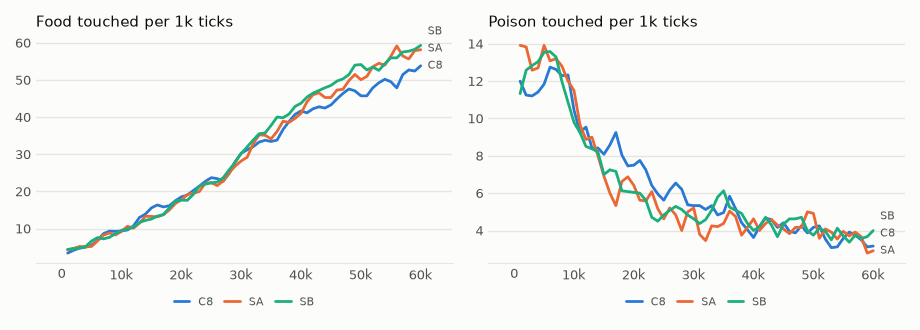
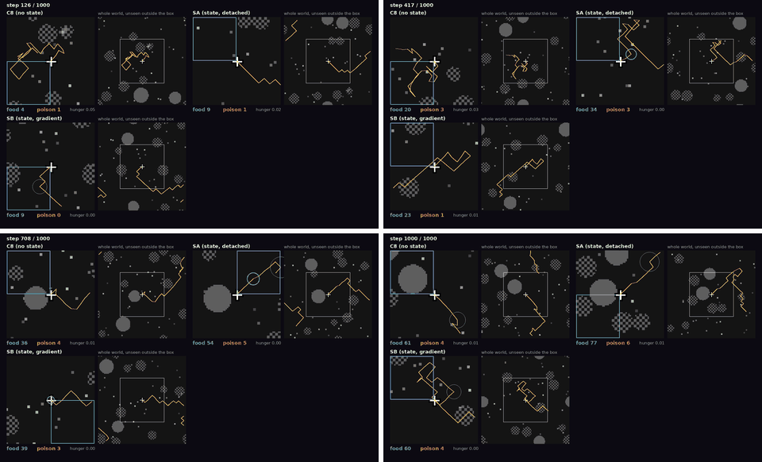

# vm-00093: A State Carried Across Windows

**Date:** 2026-11-16
**Status:** Complete
**Source:** `exp/vm-00093` (code: `visual-motor-agent/dev/`)
**Outputs:** `~/data/research/visual-motor-agent/exp_00093/`
**Task plan:** [`../tasks/00104-state-across-windows.md`](../tasks/00104-state-across-windows.md)

## Goal

In vm-00091 the value agent remembered food that left its 64 × 64 window only for its 8-tick context. In vm-00092 a context of 32 ticks did not help: the frames of the lost food were in its input, and it did not use them. Here the agent keeps its 8-tick context and gets a state it writes and reads back: a note of 64 numbers written every tick and read 8 ticks later. The model is trained through that link, so what it keeps is learned. Does it then aim at food it saw 9–16 ticks ago, and does that pay? The design and the readings set before the results are in the task plan.

## Method

| Arm | Label | Model | State | Seeds |
|---|---|---|---|---|
| C8 = vm-00091's VW (not rerun) | value, γ 0.9, n 4, fresh tail | 4 quarters × 8 layers, tolerance 0.002, context 8 | none | 1–12 |
| SA | the same | the same | read and write tokens, the carry detached | 1–12 |
| SB | the same | the same | read and write tokens, the gradient through the carry | 1–12 |

- **The state** (`model.state = 1`):
  - Each step of each quarter transformer gets two more tokens after the body (32 → 34). The **write** has no values and no target; its expected values, 64 numbers in [0, 1] from the shared head, are the state. The **read**'s values are the state written by the same transformer 8 ticks earlier.
  - The write sees the step's body and every earlier step, but not its own frame; a frame reaches the state through the next step's write.
- **Training on pairs of windows:**
  - Each update keeps C8's 8 windows, taken as 4 pairs of consecutive windows, so it is spread over no more ticks than C8's (the candidate cause of C32's cost in vm-00092).
  - The first window reads the states stored while acting; the second reads the first's fresh writes, step k reading step k − 8.
  - SB passes the second window's loss back through those writes into the first window (`online.state_grad = 1`). SA reads them as given (`0`).
- **Acting:** each transformer keeps a queue of its last 8 writes, and the ring computes each new step's read and write. Memory stores each tick's reads (half precision, about 64 MB a life), so a replayed first window starts from the state it had while acting; the refreshed value's bootstrap windows read theirs.
- **Code checks** (`dev/tests/test_state.py`, 32 tests; the full suite otherwise unchanged, its one known failure aside):
  - forward passes with given states, and the GPU's pair update (loss and every gradient, both arms), against the PyTorch reference;
  - the ring with its queue against full passes; the C++ model with a blank state.
  - **A copy task:** a value shown only in the first window is asked for in the second. SB learns it (error 0.0001, by update 750 in 3 of 3 seeds with 32 bins). SA learns part of it (0.04, against 0.083 for a guess): with the carry detached, the reader still learns to decode what the untrained writes happen to carry.
- **Frozen tests** (`eval_hunger.py`, vm-00092's): `chain` and `reach` at 1,500 ticks, `value` at 2,000. Memory is the aim at the nearest unseen food, seen − blind, on out-of-view ticks with no meal since food was last in view, binned by ticks since. C8's rows are vm-00092's, which repeat vm-00091's exactly.
  - **Ablations:** `--state blank` (every read 0.5). Added after the first results: `--state shuffle` (body b reads body b − 1's note, another world's: a note of the usual kind with no information about this body's past).
  - **The state's spread:** the standard deviation of the reads over the test's ticks, the mean over bodies, transformers and values. As first coded it included the 8 blank ticks at the start of each test; corrected after the first results (both are reported).
- **Cards and speed:** seeds 1–8 of both arms on the RTX 4090 (16 lives), 9–12 on the RTX 3090 (8), under MPS, about 3.1–3.2 ticks/s per life: the state costs about a fifth of the speed (C8 4.8 and 3.3 with 12 lives per card).
- **Run notes:**
  - the 24 lives ran on 2026-11-16 14:44–20:07, all 60k ticks;
  - the frozen tests 20:07–20:45; the shuffle ablation and a live rerun 20:47–21:08 (the rerun repeated the first chain exactly);
  - every run's `info.json` has `model.state` 1, `online.state_grad` by arm, `model.ctx` 8, `env.view` 64, `env.foods` 2, `n_layer` 8, `instinct_tol` 0.002, `value_gamma` 0.9 and `value_refresh` 1. No errors.

## Results

### R1. Lived, ticks 40–60k, 12 seeds, 95% interval (t, df 11)

| Arm | Food per 1k | Poison per 1k | Mean hunger | Instinct overrides | Move CE | Smoothness | State spread |
|---|---|---|---|---|---|---|---|
| C8 | 47.6 ± 6.1 | 3.85 ± 0.42 | .058 ± .023 | .292 | .268 | .47 | |
| SA | 51.9 ± 4.5 | 3.95 ± 0.33 | .049 ± .019 | .237 | .231 | .49 | .051 (.035 to .068) |
| SB | 53.1 ± 5.9 | 4.05 ± 0.65 | .054 ± .027 | .234 | .208 | .49 | .009 (.002 to .015) |

Paired by seed:

| | Food | Positive | Poison | Overrides | Move CE |
|---|---|---|---|---|---|
| SB − C8 | +5.5 ± 7.3 | 9 of 12 | +0.20 ± 0.78 | −.059 ± .059 | −.060 ± .049 (lower in 10) |
| SA − C8 | +4.4 ± 6.9 | 6 of 12 | +0.10 ± 0.51 | −.056 ± .041 (lower in 7) | −.036 ± .046 |
| SB − SA | +1.1 ± 7.4 | 5 of 12 | +0.10 ± 0.79 | −.003 ± .045 | −.024 ± .041 |

By 10k ticks of life, mean of 12 seeds:

| Measure | Arm | 0–10k | 10–20k | 20–30k | 30–40k | 40–50k | 50–60k |
|---|---|---|---|---|---|---|---|
| Food per 1k | C8 | 7.0 | 15.2 | 24.3 | 36.0 | 44.6 | 50.5 |
| | SA | 6.9 | 13.9 | 23.3 | 36.7 | 47.7 | 56.1 |
| | SB | 6.9 | 13.8 | 24.0 | 38.8 | 49.9 | 56.2 |
| Instinct overrides | C8 | .458 | .390 | .399 | .385 | .315 | .269 |
| | SA | .420 | .356 | .306 | .290 | .258 | .215 |
| | SB | .421 | .335 | .285 | .283 | .252 | .215 |
| State spread | SA | .090 | .073 | .068 | .059 | .053 | .050 |
| | SB | .039 | .005 | .008 | .012 | .011 | .008 |

SB's spread fell between ticks 5k and 8k in every seed (seed 1 by 1k ticks: .076, .096, .078, .065, .025, .014, .015, .006, .005, then .002 to .008).

### R2. Aim at food out of view (`chain`), without the ticks after a meal

Seen − blind, paired over 12 seeds within each arm; the differences between arms are paired by seed.

| Ticks since food was last in view | C8 | SA | SB | SB − C8 | SB − SA |
|---|---|---|---|---|---|
| 1–8 | +.062 ± .017 (12 of 12) | +.052 ± .012 (12 of 12) | +.057 ± .016 (12 of 12) | −.005 ± .030 | +.006 ± .016 |
| 9–16 | −.029 ± .018 (2 of 12) | −.023 ± .032 (4 of 12) | −.040 ± .025 (2 of 12) | −.011 ± .022 | −.017 ± .043 |
| 17–32 | −.011 ± .027 (6 of 12) | +.012 ± .022 (8 of 12) | −.009 ± .025 (4 of 12) | +.002 ± .034 | −.021 ± .026 |

No food in view: C8 .423 of frozen ticks, SA .413, SB .420 (SB − C8 −.003 ± .024).

### R3. The state's spread and the ablations (frozen chain, each arm against itself)

| Arm | Spread, without the first 8 ticks | As first coded |
|---|---|---|
| SA | .047 (.028 to .059), above .02 in 12 of 12 | .058 |
| SB | .003 (.001 to .007), above .02 in 0 of 12 | .026 (.021 to .032) |

| Ablation | Food | Aim 12–24 px | Memory 9–16 | No food in view |
|---|---|---|---|---|
| SB, every read blank | −20.9 ± 8.3 (lower in 12) | −.145 ± .069 | +.011 ± .034 | +.061 ± .034 |
| SB, another body's note | −0.3 ± 1.3 | +.004 ± .010 | −.010 ± .027 | +.002 ± .008 |
| SA, every read blank | −8.9 ± 5.5 (lower in 11) | −.055 ± .036 | +.001 ± .031 | +.033 ± .025 |
| SA, another body's note | −0.0 ± 1.1 | −.000 ± .011 | −.001 ± .031 | +.001 ± .006 |

### R4. Frozen chain, value and reach

| Arm | Seen | Blind | Blind + perfect grab | Seen − grab | Poison seen | Smoothness | Eaten when in reach | In reach |
|---|---|---|---|---|---|---|---|---|
| C8 | 54.4 ± 5.3 | 9.3 ± 0.5 | 15.6 ± 0.9 | +38.8 ± 4.6 | 3.82 | .521 | .738 | .073 |
| SA | 58.4 ± 3.9 | 9.4 ± 0.8 | 16.4 ± 1.1 | +42.1 ± 3.1 | 3.33 | .546 | .766 | .076 |
| SB | 56.8 ± 6.5 | 9.4 ± 0.9 | 15.7 ± 1.5 | +41.1 ± 5.1 | 3.64 | .514 | .752 | .075 |

Paired by seed: frozen food SB − C8 +2.4 ± 9.0, SA − C8 +4.0 ± 6.1, SB − SA −1.6 ± 8.4; aim 12–24 px SB − C8 +.009 ± .075, SA − C8 +.035 ± .047.

| Arm | Predicted | Realized | Abs bias, mean (max) | Bias, share of realized | Correlation |
|---|---|---|---|---|---|
| C8 | .030 | .042 | .0128 (.0238) | −29% | .84 (.76 to .88) |
| SA | .025 | .034 | .0097 (.0163) | −28% | .82 (.71 to .88) |
| SB | .026 | .037 | .0106 (.0193) | −27% | .81 (.76 to .85) |

## Readings

1. **Plumbing: the tests pass and all 24 lives ran 60k ticks without errors. SB's state alive: fails.** Its spread is .003 in the frozen test (above .02 in 0 of 12 seeds) and .009 in life at 40–60k.
   - As first coded, the frozen spread included the 8 blank ticks at the start of each test and read .021 to .032 for SB (12 of 12 above the bar).
   - Those were the jump from the blank 0.5 to SB's collapsed note, not the note varying. Corrected after the first results.
2. **Memory reaches further (the main one): fails.** SB − C8 in the aim at unseen food at 9–16 ticks, without meals: −.011 ± .022.
3. **The gradient does it: fails.** SB − SA at 9–16 ticks: −.017 ± .043.
4. **The memory is in the state: fails.** Blanking SB's reads leaves its 9–16 memory as it was (+.011 ± .034), and so does giving it another body's note (−.010 ± .027).
   - Blanking does cost SB 20.9 ± 8.3 food (lower in 12 of 12) and its aim at visible food. That is not memory: another body's note, as usual in kind but without information about this body's past, costs nothing (−0.3 ± 1.3).
   - A blank 0.5 is a read SB never had once its note collapsed.
5. **Memory pays: fails.** SB − C8 in lived food at 40–60k: +5.5 ± 7.3 (9 of 12).
6. **The pairs cost nothing: met.** SA − C8 in lived food: +4.4 ± 6.9.
7. **Further than one link (no bar):** SB at 17–32 ticks against C8 +.002 ± .034, against SA −.021 ± .026. Nothing.

**The outcome set in the plan:** reading 2 failed, so one link of gradient through a 64-number state is not enough to make the model keep where the food was. Next is the flexible layer F (W = S + F), the other memory the plan names.

<!-- figures -->
## Figures

*The world of this experiment as its model sees it, every 12 ticks. Moves are random: this shows the world, not the trained agent.*

*From each run's `metrics.jsonl`, the mean of its seeds by arm, smoothed.*

*Stills from this experiment's video, in time order. Seed 5 at 60k, frozen, C8, SA and SB from the same start, laid out as in vm-00091: each arm's 64 x 64 view (the blue square: the quarter transformer whose move it was), and beside it the whole world with the window outlined. Plain circles are food, checkered ones poison.*
<!-- /figures -->

## Analysis

- **The gradient through the carry silenced the note.**
  - SB's state varied at birth like SA's. Between ticks 5k and 8k it went nearly constant in every seed and stayed so; SA's untrained note kept varying (.05).
  - Likely, though not tested: early on, the first window's writes are only noise to the second window's predictions. The cheapest way to make them harmless is to make them constant, and once they are, there is nothing for the reader to use and no gradient that would make them informative.
  - The copy task did not collapse because there the information was the whole target. In the life, where the food went 9–16 ticks ago is a weak signal against that noise.
- **SA's note varies and carries nothing the agent uses.** Each body reading another body's note changes neither its food, its aim nor its memory. The copy task's partial decoding of untrained writes did not happen here, or it did not matter.
- **A blank read measures a change of input, not memory.** It cost SB 21 food and SA 9, and in both it lowered the aim at food in view. Another body's note, which keeps the reads' usual values, costs nothing. For an input the model has learned to expect, shuffling it between bodies is the ablation; a blank is not.
- **The state costs no food, unlike a longer context.** Both state arms forage at least as well as C8 (lived +4 to +6, frozen +2 to +4, within noise) and lean less on the instinct (overrides −.06). SB predicts its own moves better (move CE −.060 ± .049). The notes' content plays no part in this (the shuffle), so it comes from the extra tokens or the training on pairs; which one was not tested.
- **No arm remembers past its context.** At 9–16 ticks every arm aims at the unseen food no better than its blind run, as C8 and C32 did. At 1–8 ticks all three turn away from it less than chance (+.05 to +.06), as in vm-00091.

## Conclusions

1. A 64-number state written every tick and read back 8 ticks later, trained through one link, does not give the agent a memory of food that left its view: at 9–16 ticks it aims at the unseen food no better than without the state (SB − C8 −.011 ± .022).
2. Training through the link collapsed the state to a constant in every seed within about 8k ticks of life. Without the link the state keeps varying, but carries nothing the agent uses.
3. The state costs no food, unlike the longer context of vm-00092, and about a fifth of the speed.
4. To ablate a learned input, give it values of the usual kind without the information (another body's); a blank value measures how the model copes with an unfamiliar input.

## Next steps

- **The flexible layer F (W = S + F)**, the next step set in the plan: weights trained fast on every tick and decaying with a half-life of about 70 ticks, a memory between the context and the weights (ARCHITECTURE.md, "Two layers of weights"). It needs no new token, so a note that can collapse is not part of it.
- **If the note is tried again:** keep a constant from being a resting point (noise on the reads), or give the note a job of its own (predicting the frame of 8 ticks back from the read), so that it has to carry something before the reader can use it.
