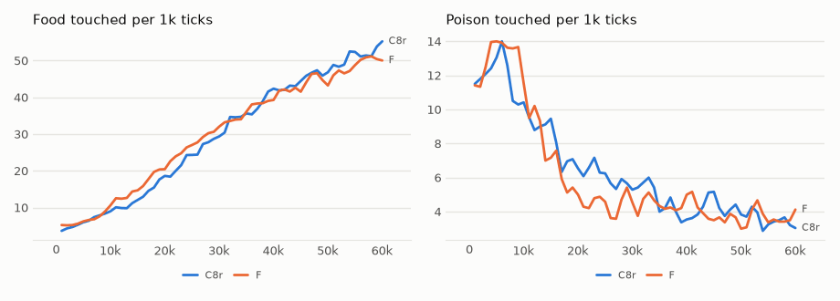
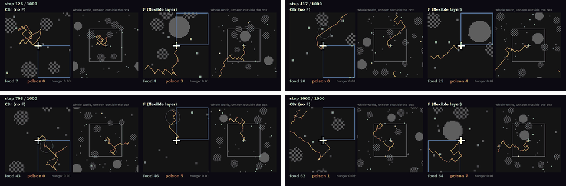

# vm-00094: The Flexible Layer, W = S + F

**Date:** 2026-11-16
**Status:** Complete (pending tag)
**Source:** `dev/` (pending tag `exp/vm-00094`)
**Outputs:** `~/data/research/visual-motor-agent/exp_00094/`
**Task plan:** [`../tasks/00105-flexible-layer.md`](../tasks/00105-flexible-layer.md)

## Goal

Three ways to remember food that left the 64 × 64 window have failed in this world: the 8-tick context (vm-00091), a 32-tick context (vm-00092), and a state written and read back across windows (vm-00093), which collapsed to a constant when trained through. Here the agent gets the plan's other memory: fast weights. W = S + F, where S learns as before and F learns only from the newest window, fading by 1% a tick (a half-life of 69 ticks). Does a trace of the last ticks in the weights hold where the food went? The design and the readings set before the results are in the task plan.

## Method

| Arm | Label | Model | F | Seeds |
|---|---|---|---|---|
| C8r = vm-00091's VW, rerun | value, γ 0.9, n 4, fresh tail | 4 quarters × 8 layers, tolerance 0.002, context 8 | none | 1–12 |
| F | the same | the same | λ .99, k 1, from the newest window | 1–12 |

- **The flexible layer** (`online.fast = 0.99`, `online.fast_k = 1`):
  - The parameters hold S + F. S takes the usual AdamW step on the batch.
  - Then F ← .99 F − k lr clamp(g / √v̂, −1, 1): g is the newest window's gradient alone, and v̂ is the slow update's Adam second moment.
  - The parameters change by F's change, so S is untouched by it. F is saved at the end of each life (`ckpt_final_pK_fast.npy`).
- **k = 1, changed from 10 before the runs** (the owner's choice). In 2,000-tick lives, k = 10 kept F at about a third of S's size (.34) and made prediction worse (patch CE 1.050 against .951); k = 1 kept it at 7% and falling.
- **Memory in life** (`online.mem_score = 1`): a frozen test cannot see F, which only lives while learning.
  - Each life scores, every tick, its move's aim at the nearest unseen food by ticks since food was last in view, without the ticks after a meal.
  - It scores the same moves in a blind world stepped alongside. This is `eval_hunger.py chain`'s code (`MemoryScore`), now shared.
  - C8 is rerun with the measure (C8r).
- **Code checks** (`dev/tests/test_fast.py`, 3 tests):
  - the fast step against numpy;
  - F decaying as .99^t with no gradient;
  - S = P − F untouched by fast steps;
  - MemoryScore on a hand-made sequence.
  - `chain`'s rows are unchanged by the move to MemoryScore: a rerun of one vm-00093 run matched in every field but the corrected state spread.
- **Frozen tests** as in vm-00093 (`chain`, `value`, `reach`). They show S + F as it stood at 60k, not learning.
- **Cards and speed:** seeds 1–8 of both arms on the RTX 4090 (16 lives), 9–12 on the RTX 3090 (8), under MPS. The timing of 600-tick lives was 5.15 ticks/s per life on the 4090 (14 lives) and 3.97 on the 3090 (10).
- **Run notes:**
  - the 24 lives ran 2026-11-16 21:45 to 2026-11-17 02:08, all 60k ticks, and the frozen tests until 02:37;
  - every run's `info.json` has `online.fast` and `online.fast_k` by arm, `online.mem_score` 1, `model.ctx` 8, `env.view` 64, `env.foods` 2, `n_layer` 8, `instinct_tol` 0.002, `value_gamma` 0.9 and `value_refresh` 1. No errors.

## Results

### R1. Lived, ticks 40–60k, 12 seeds, 95% interval (t, df 11)

| Arm | Food per 1k | Poison per 1k | Mean hunger | Instinct overrides | Move CE | Patch CE | Smoothness |
|---|---|---|---|---|---|---|---|
| C8 (vm-00091) | 47.6 ± 6.1 | 3.85 ± 0.42 | .058 ± .023 | .292 | .268 | .7544 | .47 |
| C8r | 48.4 ± 4.3 | 3.84 ± 0.39 | .030 ± .013 | .274 | .255 | .7543 | .48 |
| F | 46.5 ± 5.3 | 3.75 ± 0.38 | .051 ± .021 | .215 | .262 | .7670 | .43 |

Paired by seed, F − C8r:

| Food | Positive | Poison | Overrides | Move CE | Patch CE | Smoothness |
|---|---|---|---|---|---|---|
| −1.9 ± 7.5 | 7 of 12 | −0.10 ± 0.57 | −.060 ± .032 (lower in 11) | +.007 ± .031 | +.0128 ± .0017 (higher in 12) | −.044 ± .049 |

C8r against C8: food +0.8 ± 4.7, poison −0.00 ± 0.44. The rerun reproduces vm-00091.

By 10k ticks of life, mean of 12 seeds:

| Measure | 0–10k | 10–20k | 20–30k | 30–40k | 40–50k | 50–60k |
|---|---|---|---|---|---|---|
| Food per 1k, C8r | 6.6 | 13.6 | 25.2 | 37.2 | 45.0 | 51.7 |
| Food per 1k, F | 7.1 | 16.6 | 28.1 | 36.7 | 43.7 | 49.2 |
| F's size against S | .067 | .039 | .028 | .025 | .022 | .021 |
| Patch CE, F − C8r | +.083 | +.041 | +.025 | +.018 | | |

- **F's size:** .020 at 60k (.019 to .021), the largest tensor .065 at 40–60k.
- **F's early food lead is not real:** at 10–30k it is +2.9 ± 6.9.

### R2. Memory in life (`online.mem_score`), ticks 40–60k

Seen − blind, pooled over 40–60k for each life, then over 12 seeds; F − C8r paired by seed. Without the ticks after a meal (reading 2's measure):

| Ticks since food was last in view | C8r | F | F − C8r | Ticks per life (C8r, F) |
|---|---|---|---|---|
| 1–8 | +.049 ± .017 (12 of 12) | +.086 ± .020 (12 of 12) | +.037 ± .021 (10 of 12) | 2,109, 1,831 |
| 9–16 | −.045 ± .022 (1 of 12) | −.056 ± .029 (2 of 12) | −.010 ± .033 (6 of 12) | 1,005, 862 |
| 17–32 | −.019 ± .018 (3 of 12) | −.029 ± .032 (4 of 12) | −.011 ± .039 (7 of 12) | 734, 722 |
| 33–64 | −.023 ± .045 | +.003 ± .038 | +.026 ± .071 | 284, 326 |

On all out-of-view ticks, meals included: 1–8 C8r +.111, F +.142 (F − C8r +.031 ± .034); 9–16 −.065 and −.068; 17–32 −.019 and −.045.

### R3. Frozen tests (F as it stood at 60k)

| Arm | Seen | Blind | Blind + perfect grab | Seen − grab | Poison seen | Smoothness | Eaten when in reach | In reach |
|---|---|---|---|---|---|---|---|---|
| C8r | 54.0 ± 4.4 | 9.1 ± 0.6 | 15.3 ± 0.9 | +38.7 ± 3.7 | 3.69 | .520 | .743 | .072 |
| F | 49.6 ± 4.9 | 8.5 ± 0.8 | 13.7 ± 1.4 | +35.9 ± 3.8 | 3.57 | .470 | .706 | .070 |

- **Paired F − C8r:**
  - food −4.4 ± 6.9;
  - aim 12–24 px −.004 ± .042;
  - memory without meals: 1–8 ticks +.025 ± .024, 9–16 −.005 ± .031, 17–32 −.024 ± .041.
- **The value:** C8r predicts .029 against .040 realized (−28%, correlation .82); F .030 against .042 (−27%, .82).

## Readings

1. **Plumbing: met.** The tests pass, and all 24 lives ran 60k ticks without errors. F stayed bounded: .020 of S at 60k, below .1 in 12 of 12 seeds.
2. **Memory in life (the main one): fails.** F − C8r at 9–16 ticks −.010 ± .033, at 17–32 −.011 ± .039.
3. **Memory pays: fails.** Lived food at 40–60k, F − C8r −1.9 ± 7.5.
4. **No harm: fails on prediction.** Poison is not higher (−0.10 ± 0.57), but the patch CE is higher by .0128 ± .0017, in 12 of 12 seeds (1.7%).
5. **The measure in life agrees with the frozen one: met.** C8r in life: +.049, −.045, −.019 at 1–8, 9–16, 17–32 ticks. C8 frozen (vm-00092): +.062, −.029, −.011.

**The outcome set in the plan:** reading 4 failed, so "F's step is too large for this learner: halve k and rerun before reading 2." That rerun (k = 0.5) was not run. The owner's next step (2026-11-17) is a world with inertia (task 00106).

<!-- figures -->
## Figures

*The world of this experiment as its model sees it, every 12 ticks. Moves are random: this shows the world, not the trained agent.*

*From each run's `metrics.jsonl`, the mean of its seeds by arm, smoothed.*

*Stills from this experiment's video, in time order. Seed 5 at 60k, frozen, C8r and F from the same start, laid out as in vm-00091: each arm's 64 x 64 view (the blue square: the quarter transformer whose move it was), and beside it the whole world with the window outlined. Plain circles are food, checkered ones poison. F is frozen at its value at 60k: it does not learn here.*
<!-- /figures -->

## Analysis

- **F carries the last ticks, not a place.**
  - With F the agent turns away from food that has just left the view less than C8r does: +.037 at 1–8 ticks, in 10 of 12 seeds, in life (frozen +.025). Past the context, nothing.
  - Likely, though not tested: F learns what the recent frames looked like, in the egocentric view. Once the agent turns or moves on, "food on the left of the frame" no longer points to the food.
  - A memory of a place in this world would have to move with the agent's own movement. Neither a longer context, a note, nor a trace in the weights does that by itself, and next-frame prediction rewards it only weakly.
- **F costs a little prediction and nothing else measured.**
  - The patch CE is 1.7% higher at 40–60k. The cost was largest early (+.083 at 0–10k), when F was largest against S (.067), and shrank as S grew.
  - Food, poison and the value are not changed beyond noise. The instinct overrides the model less often (−.06), and its gait is a little less smooth (n.s.).
- **The measure in life works:** C8r's profile in life has the frozen profile's shape, and the rerun of C8 reproduces vm-00091 (food +0.8 ± 4.7). It is the measure for any memory that exists only while learning.
- **Four tries in this world** (context 8, context 32, a note, fast weights) gave no memory past 8 ticks.

## Conclusions

1. Fast weights trained on the newest window (k = 1, half-life 69 ticks) do not give the agent a memory of food that left its view: at 9–32 ticks after the last sight its aim at the unseen food is no better than C8r's.
2. They strengthen the effect within the context: +.037 at 1–8 ticks (10 of 12 seeds).
3. They cost 1.7% of the patch prediction, and no food or poison beyond noise.
4. Memory can be measured in life, against a blind world; C8r's profile there matches the frozen one.

## Next steps

- **The plan's rule after reading 4:** F at half the step (k = 0.5) before reading 2 again. Not run: the owner's next step is the inertia world (task 00106).
- **Memory that moves with the agent:** a place kept in a frame that the agent's own moves update. Not designed yet.
- **A world that needs memory more** (hidden food, vm-00081), where a trace could matter more than here.
