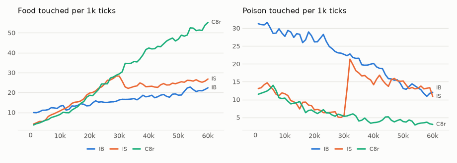
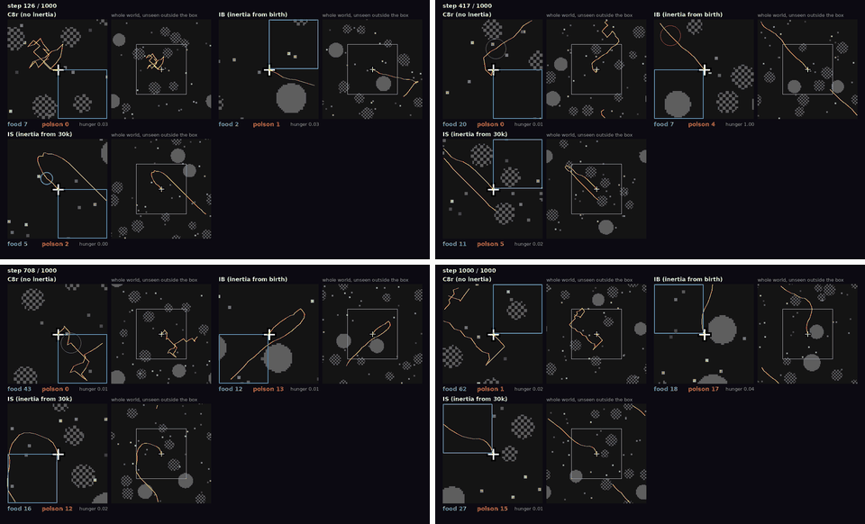

# vm-00095: A World With Inertia

**Date:** 2026-11-17
**Status:** Complete
**Source:** `exp/vm-00095` (code: `visual-motor-agent/dev/`)
**Outputs:** `~/data/research/visual-motor-agent/exp_00095/`
**Task plan:** [`../tasks/00106-inertia-world.md`](../tasks/00106-inertia-world.md)

## Goal

Until now the agent's move has been its displacement: what it asks for, it gets, at once. Here the world gets inertia. The move pushes a body that keeps its velocity, and changing direction takes several ticks of pushing. The model is unchanged: the value agent of vm-00091–00094 (C8). Does it learn to forage in this world from birth, and does a model raised without inertia adapt when the world changes under it in mid-life? The design and the readings set before the results are in the task plan.

## Method

| Arm | World | Seeds |
|---|---|---|
| C8r (vm-00094, not rerun) | no inertia | 1–12 |
| IB | inertia from birth, k = 4 | 1–12 |
| IS | no inertia until tick 30k, then k = 4 | 1–12 |

- **The world** (`env.inertia = k`, task 00106): vel ← clip(vel + move × 4 px / k, ±4 px per axis), and the cursor moves by vel.
  - A full push from rest takes k = 4 ticks to reach full speed, and 8 to reverse.
  - With no push the body keeps moving: no drag.
  - Top speed is the old world's.
  - With `inertia = 0` the world is the old one, unchanged: its tests and the JS replica's equivalence pass.
- **The model** is C8's everywhere else:
  - `configs/U_view.json`: 128 × 128, 2 foods, a 64 × 64 window;
  - value γ .9 with n 4 and a fresh tail;
  - 4 quarter transformers of 8 layers, tolerance .002, context 8.
- **The switch** (IS): `online.env_sched = {"inertia": [[30000, 4]]}`, applied before tick 30,000's move. The body keeps moving as it last moved.
- **Frozen tests**, each run in the world its life ended in (inertia 4 for IB and IS):
  - `eval_hunger.py chain`, `value` and `reach`, as in vm-00094.
  - **Added during the runs** (descriptive; the readings are unchanged):
    - C8r frozen in the inertia world (`chain --env inertia=4`, rows `C8r-inertia4`): a model raised without inertia that does not learn.
    - `eval_hunger.py move`: how the body moves (speed, top speed, braking, speed and aim by the gap to food and poison), on all four.
    - `chain`'s aim scores the move. Under inertia the move is a push, not the motion, so `move` scores both.
  - **Added during the analysis** (`make frozen2`), after frozen C8r out-ate both learners:
    - IS's own checkpoint at tick 30k frozen in the inertia world (`--step 30000`): the model at the switch, before any learning with inertia.
    - Every arm's mean hunger, the agent's own objective (`eval_hunger.py poison`).
- **A fix made during the runs:** `reach`'s "food one move away" and `chain`'s perfect-grab baseline assumed that the move is the displacement. They now ask the world where a move lands (`CircleWorld.push_of`, which `step()` uses too), so they follow inertia. Without inertia nothing changes.
- **Cards:** seeds 1–8 of both arms on the RTX 4090 (16 lives), 9–12 on the RTX 3090 (8), under MPS, at 4.4 ticks/s per life.
- **Run notes:**
  - the 24 lives ran 2026-11-17 07:25 to 11:16, all 60k ticks, without errors;
  - every run's `info.json` has `env.inertia` 4 (IB) or the schedule (IS), and C8's settings otherwise;
  - every IS life's metrics carry `env_inertia` 0 before tick 30k and 4 from it.

## Results

### R1. Lived, ticks 40–60k, 12 seeds, 95% interval (t, df 11)

| Arm | Food per 1k | Poison per 1k | Mean hunger | Instinct overrides | Move CE | Patch CE | Body CE | Smoothness |
|---|---|---|---|---|---|---|---|---|
| C8r | 48.4 ± 4.3 | 3.84 ± 0.39 | .030 ± .013 | .274 | .255 | .7543 | .386 | .48 |
| IB | 19.9 ± 0.9 | 14.3 ± 1.2 | .230 ± .053 | .697 | .408 | .7646 | .616 | .24 |
| IS | 25.0 ± 1.8 | 14.1 ± 1.1 | .202 ± .048 | .578 | .334 | .7689 | .547 | .43 |

Paired by seed (in brackets: seeds above 0, of 12):

| Contrast | Food | Poison | Overrides | Move CE | Patch CE | Body CE | Smoothness |
|---|---|---|---|---|---|---|---|
| IB − C8r | −28.5 ± 4.3 (0) | +10.5 ± 1.3 (12) | +.422 ± .039 (12) | +.153 ± .037 (12) | +.0104 ± .0019 (12) | +.230 ± .016 (12) | −.240 ± .028 (0) |
| IS − C8r | −23.4 ± 3.9 (0) | +10.3 ± 1.2 (12) | +.303 ± .029 (12) | +.079 ± .029 (12) | +.0147 ± .0010 (12) | +.161 ± .015 (12) | −.053 ± .040 (2) |
| IS − IB | +5.1 ± 2.2 (11) | −0.2 ± 1.5 (3) | −.119 ± .043 (0) | −.073 ± .031 (1) | +.0043 ± .0018 (12) | −.069 ± .020 (0) | +.188 ± .041 (12) |

### R2. Over the life, by 5k ticks, mean of 12 seeds

| Measure | Arm | 0–5k | 5–10k | 10–15k | 15–20k | 20–25k | 25–30k | 30–35k | 35–40k | 40–45k | 45–50k | 50–55k | 55–60k |
|---|---|---|---|---|---|---|---|---|---|---|---|---|---|
| Food per 1k | C8r | 5.0 | 8.2 | 11.0 | 16.3 | 22.3 | 28.0 | 34.6 | 39.8 | 43.4 | 46.6 | 50.4 | 52.9 |
| | IB | 10.6 | 12.5 | 12.5 | 13.7 | 15.3 | 15.8 | 16.6 | 17.9 | 18.3 | 18.5 | 21.3 | 21.5 |
| | IS | 5.5 | 9.9 | 13.6 | 17.8 | 22.5 | 27.5 | 22.7 | 23.7 | 23.6 | 24.5 | 25.8 | 26.1 |
| Poison per 1k | C8r | 12.4 | 11.3 | 9.1 | 6.7 | 6.4 | 5.5 | 5.1 | 4.1 | 4.5 | 4.0 | 3.7 | 3.3 |
| | IB | 30.7 | 28.8 | 28.1 | 27.3 | 26.3 | 23.1 | 21.8 | 19.8 | 17.5 | 14.5 | 13.7 | 11.6 |
| | IS | 13.8 | 11.7 | 8.8 | 8.5 | 6.6 | 5.6 | 19.1 | 15.4 | 15.4 | 15.5 | 13.1 | 12.4 |
| Instinct overrides | C8r | .52 | .43 | .40 | .37 | .38 | .39 | .37 | .34 | .31 | .29 | .27 | .24 |
| | IB | .52 | .46 | .50 | .55 | .58 | .65 | .70 | .72 | .72 | .71 | .69 | .67 |
| | IS | .53 | .44 | .41 | .39 | .39 | .39 | .59 | .59 | .60 | .59 | .57 | .56 |
| Move CE | C8r | .373 | .219 | .220 | .219 | .230 | .247 | .256 | .259 | .257 | .258 | .254 | .252 |
| | IB | .302 | .194 | .209 | .224 | .246 | .285 | .322 | .351 | .380 | .401 | .419 | .431 |
| | IS | .379 | .227 | .224 | .223 | .234 | .247 | .286 | .297 | .315 | .329 | .341 | .353 |

IS before the switch is C8r again: at 20–30k, IS − C8r food −0.2 ± 5.4, poison +0.1 ± 1.0, patch CE +.0001 ± .0014.

### R3. The switch

Food per 1k by 1k ticks, mean of 12 seeds (the row at N covers ticks N − 999 to N; inertia from tick 30,000):

| Arm | 26k | 27k | 28k | 29k | 30k | 31k | 32k | 33k | 34k | 35k | 36k | 37k | 38k | 39k | 40k |
|---|---|---|---|---|---|---|---|---|---|---|---|---|---|---|---|
| C8r | 25.8 | 28.8 | 26.8 | 30.6 | 28.2 | 32.7 | 36.7 | 32.5 | 36.9 | 34.3 | 36.4 | 37.3 | 40.5 | 42.7 | 42.1 |
| IB | 15.8 | 14.8 | 15.9 | 15.3 | 17.2 | 15.9 | 17.2 | 16.0 | 17.4 | 16.5 | 16.2 | 18.5 | 18.8 | 16.9 | 19.3 |
| IS | 26.8 | 25.9 | 28.3 | 28.2 | 28.2 | 23.2 | 22.4 | 21.8 | 23.3 | 22.8 | 23.9 | 25.8 | 22.5 | 23.3 | 22.8 |

- **The cost of the change:** IS at 30–35k against its own 25–30k: food −4.8 ± 2.8 (lower in 10 of 12), poison +13.4 ± 1.5 (higher in 12), body CE +.101 ± .008, patch CE +.0107 ± .0005. Over the same ticks C8r's food rose by 6.6 ± 1.9.
- **Recovery:** IS's food over 3k ticks came back to its own level of 25–30k in 9 of 12 seeds, a median of 7,000 ticks after the switch (3,000 to 26,000). The three that did not had foraged best before it (35.2, 47.0 and 30.4 per 1k). Poison fell from 19.1 per 1k in the first 5k with inertia to 12.4 at 55–60k.
- **What carries over:** IS's food at 50–60k follows its food before the switch, correlation .73 over seeds (IB's at 50–60k against the same seeds' IS before: −.08). IS's range at 50–60k is 21.8 to 33.2, IB's 18.0 to 24.4.
- **Savings** (reading 6): IS's first 10k ticks with inertia against IB's first 10k: food +11.6 ± 2.6, poison −12.5 ± 2.5 (both 12 of 12). At the same ages (30–40k), IS against IB: food +5.9 ± 3.1, poison −3.5 ± 2.3 (lower in 11).

### R4. Frozen in the inertia world

These runs act without learning, 1,500 ticks × 16 bodies, in the world with inertia unless marked otherwise.
- **IS at 30k** is IS's own checkpoint at tick 30,000: the model at the switch, before any learning with inertia.
- **C8r** is vm-00094's control, raised without inertia, tested in the inertia world (`--env inertia=4`).
- **Blind:** the same moves in another world. **Blind + perfect grab:** those moves, but taking the food whenever one move can touch it.
- **Mean hunger** is the agent's own objective (`eval_hunger.py poison`). A meal resets hunger to 0; a poison adds 0.5.

| Arm | Food | Blind | Blind + perfect grab | Seen − grab | Poison | Mean hunger | Smoothness |
|---|---|---|---|---|---|---|---|
| C8r in its own world | 54.0 ± 4.4 | 9.1 | 15.3 | +38.7 ± 3.7 | 3.7 ± 0.6 | .042 ± .006 | .52 |
| C8r | 33.3 ± 3.5 | 9.6 | 11.6 | +21.7 ± 3.7 | 16.5 ± 1.4 | .218 ± .037 | .60 |
| IS at 30k | 23.0 ± 3.1 | 9.9 | 11.7 | +11.4 ± 3.3 | 21.3 ± 1.9 | .355 ± .055 | .44 |
| IS (60k) | 25.9 ± 2.2 | 9.3 | 11.0 | +15.0 ± 2.0 | 10.7 ± 0.7 | .156 ± .020 | .43 |
| IB (60k) | 22.2 ± 1.6 | 9.5 | 11.0 | +11.2 ± 1.3 | 12.0 ± 1.7 | .199 ± .026 | .25 |

Paired by seed (in brackets: seeds above 0, of 12):

| Contrast | Food | Poison | Mean hunger |
|---|---|---|---|
| IS − IS at 30k: what 30k ticks of learning with inertia did | +2.9 ± 2.3 (9) | −10.6 ± 2.0 (0) | −.199 ± .050 (0) |
| IS − C8r | −7.3 ± 3.4 (0) | −5.9 ± 1.2 (0) | −.062 ± .030 (2) |
| IB − C8r | −11.1 ± 3.5 (0) | −4.5 ± 1.9 (0) | −.019 ± .043 (5) |
| IS − IB | +3.8 ± 3.1 (10) | −1.3 ± 1.9 (3) | −.043 ± .035 (3) |
| C8r: inertia − its own world | −20.7 ± 3.5 (0) | +12.8 ± 1.3 (12) | +.176 ± .036 (12) |

- **IS at 30k, frozen in the inertia world, is IS's lived drop:** its 23.0 food and 21.3 poison match IS's first 5k ticks with inertia (22.7 and 19.1). The drop at the switch is the old model in the new world; what follows it is learning.
- **The move's aim at the food, by the gap to its edge:**

| Arm | 0–4 px | 4–8 | 8–12 | 12–16 | 16–24 | 24+ |
|---|---|---|---|---|---|---|
| C8r | .77 | .75 | .71 | .66 | .58 | .15 |
| IS at 30k | .67 | .63 | .55 | .48 | .37 | .09 |
| IS | .69 | .61 | .53 | .45 | .34 | .06 |
| IB | .40 | .33 | .27 | .22 | .15 | .03 |

### R5. How the body moves (`eval_hunger.py move`, frozen)

Measures:
- **Speed:** the displacement in px a tick. Top speed is 4 px a tick per axis.
- **Top speed:** the share of ticks at full speed on an axis.
- **Braking:** the share of ticks at 1 px a tick or more whose move points against the velocity kept (cosine below −0.5).
- **Aim:** the cosine with the direction to the food, of the move (the push) or of the motion.

| Arm | Speed | Top speed | Braking | Food within 8 px: speed, move's aim, motion's aim | Poison within 8 px: share of ticks, speed, motion away |
|---|---|---|---|---|---|
| C8r in its own world | 4.76 | .59 | .08 | 4.83, .74, .74 | .07, 4.74, +.08 |
| C8r | 4.27 | .67 | .13 | 4.32, .76, .34 | .16, 4.02, −.14 |
| IS at 30k | 4.27 | .62 | .16 | 4.45, .64, .35 | .18, 4.12, −.18 |
| IS | 3.97 | .51 | .21 | 4.31, .65, .40 | .13, 3.62, −.08 |
| IB | 3.90 | .46 | .23 | 4.23, .36, .45 | .15, 3.84, −.12 |

- **IS − IS at 30k, all in 12 of 12 seeds:**
  - speed −0.30 ± 0.11 px a tick;
  - braking +.047 ± .013;
  - the motion's aim at food within 8 px +.052 ± .011;
  - the motion away from poison within 8 px +.094 ± .016;
  - speed within 8 px of poison −0.50 ± 0.14.
- **No arm slows down near food.** Each moves as fast within 8 px of food as more than 32 px from it, or faster.

### R6. The instinct and the value (frozen)

| Arm | Predicted label | Realized | Bias | Correlation | Candidate spread | Spread / realized |
|---|---|---|---|---|---|---|
| C8r in its own world (vm-00094) | .029 | .040 | −28% | .82 | .0023 | .058 |
| IB | .151 | .196 | −22% | .87 | .0120 | .061 |
| IS | .109 | .153 | −29% | .82 | .0107 | .070 |

- **The reach test,** food one move away. Under inertia, one push changes the next position by at most 1 px per axis.
  - Food is in reach in .026 (IB) and .029 (IS) of ticks, against C8r's .072 in its own world.
  - It is eaten when in reach .86 and .90 of the time (C8r .74).
  - Over all ticks, by hunger, the instinct overrides the model's move .57–.79 (IB) and .47–.74 (IS) of the time, against C8r's .16–.58 in its own world.

## Readings

1. **Plumbing: met.** The world's tests pass; all 24 lives ran 60k ticks without errors; every IS life switched at tick 30k.
2. **The default model learns the inertia world: fails.** IB's lived food at 40–60k is 19.9 per 1k, .41 of C8r's 48.4, against a bar of .5. Only one seed reaches .5 (.51); the others are .32 to .49.
3. **It adapts after a change: met.** At 50–60k IS is not below IB but above it: food +4.5 ± 2.0, in 12 of 12 seeds. Having learned the old dynamics first leaves no lasting cost; it helps.
4. **The change is felt: met.** IS's food at 30–35k is below its 25–30k by 4.8 ± 2.8, and its poison is up by 13.4 ± 1.5.
5. **Poison** (descriptive): IB − C8r at 40–60k +10.5 ± 1.3 per 1k, higher in 12 of 12 (3.7 times C8r's).
6. **Savings** (descriptive): yes. In its first 10k ticks with inertia IS eats 11.6 ± 2.6 more than IB in its first 10k, with 12.5 ± 2.5 less poison.

**The outcome set in the plan:** reading 2 failed, so "the model does not learn to forage with inertia. Its instinct looks one move ahead and its hunger label 4 ticks, while a push pays only over several ticks. Next is the instinct's horizon (`online.instinct_h`) or the value's." Reading 3 held: adapting to the change costs nothing lasting.

<!-- figures -->
## Figures

*The world of this experiment as its model sees it, every 12 ticks. Moves are random: this shows the world, not the trained agent.*

*From each run's `metrics.jsonl`, the mean of its seeds by arm, smoothed. C8r is vm-00094's control in the world without inertia; IS lives without inertia until tick 30k, then with it.*

*Stills from this experiment's video, in time order. Seed 5 at 60k, frozen, from the same start: C8r in its own world (no inertia), IB and IS in the world with inertia (each arm's world as its life ended). Each arm's 64 x 64 view (the blue square: the quarter transformer whose move it was), and beside it the whole world with the window outlined. Plain circles are food, checkered ones poison.*
<!-- /figures -->

## Analysis

- **The model adapts to the change without any change to itself, and by its own measure the gain is large.**
  - Frozen at the switch (IS at 30k), it touches 21 poison per 1k in the inertia world and lives at mean hunger .355.
  - After 30k ticks of learning with inertia (IS at 60k), its poison is halved (10.7), its food is a little higher (+2.9), and its hunger is .156: lower in 12 of 12 seeds.
  - The lived curves say the same. IS's drop at the switch is the old model in the new world (frozen IS at 30k matches IS's first 5k ticks with inertia), and what follows is learning.
- **What it learned is to manage its momentum around poison.**
  - It brakes more often (.21 of moving ticks, against .16).
  - It slows near poison (3.6 px a tick within 8 px, against 4.1).
  - It moves away from poison, where the model at the switch moved toward it (−.08 against −.18).
  - Its motion aims a little better at food within 8 px (+.05).
  - Each of these holds in 12 of 12 seeds.
  - It never learns to slow down for food: it touches food on the way, where its course happens to cross it.
- **It stays well short of the world without inertia.** The same agent without inertia eats twice the food (lived 52 against 26 at 50–60k) with a quarter of the poison, at mean hunger .042 against .156 (frozen). Raised with inertia from birth (IB) it does worse: .41 of C8r's food (reading 2), hunger .199.
- **Frozen C8r eats the most food in the inertia world, and pays in poison.**
  - Its moves keep pointing at food (.76 within 8 px). The body carries on into poison it cannot swerve from: 16.5 per 1k, and its motion within 8 px of poison heads toward it.
  - By hunger it beats IS at 30k (.218 against .355). It was the better forager before the change, with 30k more ticks of practice.
  - It loses to IS after adapting (IS − C8r −.062 ± .030, lower in 10 of 12). Learning with inertia gave up some food for much less poison.
- **Learning the world without inertia first helps.**
  - IS beats IB at every age after the switch: food +5.9 at 30–40k and +4.5 at 50–60k (12 of 12), and frozen hunger −.043 (lower in 9).
  - IS's level after the switch follows its level before (correlation .73). Seeing food and approaching it carry over; the new world adds steering a body that keeps moving.
- **Where learning stalls (presumed, not tested):**
  - The instinct overrides the model's own move in 58–70% of ticks at 40–60k (C8r 27%). In IB it overrides more as the life goes on (.46 at 5–10k, .72 at 40–45k), where C8r's overrides fall (.43 to .24).
  - The moves it imposes change from tick to tick (smoothness .24 in IB, against .48), and the model predicts its own move worse and worse (move CE .19 to .43 in IB).
  - The candidates' predicted labels spread five times as widely as C8r's. That is in proportion to the labels themselves, 6–7% of the realized label in each arm; the labels are five times larger because hunger is higher.
  - The tolerance (.002) is fixed. Against these labels it is five times smaller, so the instinct overrides on differences that one push can barely make: a push moves the body's next position by at most 1 px per axis.

## Conclusions

1. The default model adapts to a world that gains inertia in mid-life without any change to itself. Learning with inertia halves its poison and its mean hunger against the same model frozen at the switch (12 of 12 seeds). Its food returns to its level before the change in a median of 7k ticks (9 of 12).
2. It does not reach its level without inertia: half the food, 3.7 times the poison (lived, 40–60k) and 3.7 times the mean hunger (frozen). Raised with inertia from birth it does worse (reading 2 fails: .41 of C8r's food).
3. What it learns is braking and steering around poison. It never learns to slow down for food.
4. Learning the world without inertia first helps rather than hurts (reading 3: IS above IB at 50–60k in 12 of 12 seeds).
5. Presumed, not tested: the instinct's fixed tolerance is small against this world's larger labels, so the instinct overrides most moves, and the model cannot learn the moves it imposes.

## Next steps

- **The plan's rule after reading 2:** the instinct's horizon (`online.instinct_h = 4`: each candidate held for 4 ticks, a course rather than a single push) or the value's.
- **A direct test of the presumed cause:** IB with the tolerance scaled to its labels (.01 instead of .002), against IB. It is one setting in the same world.
- **Then:** stronger inertia (k = 8), switches back and forth, and drag (`env.inertia_drag`) for a gentler world.
