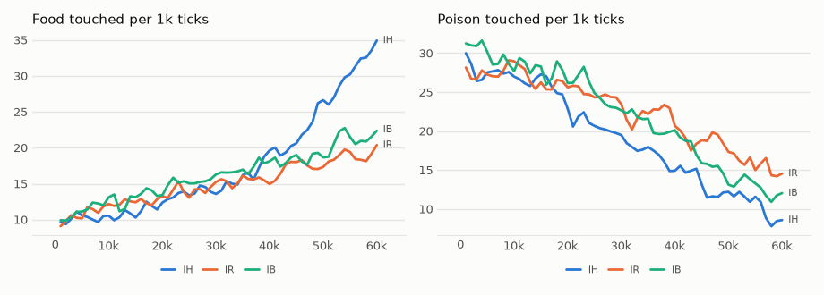
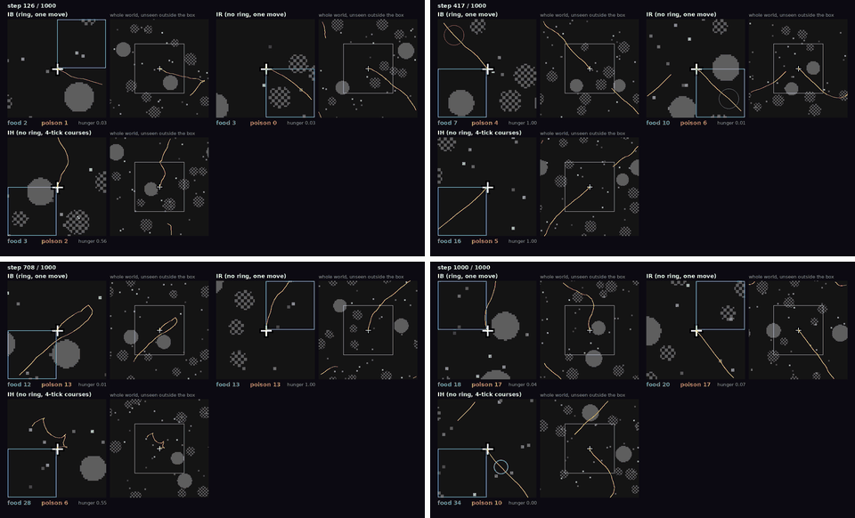

# vm-00096: The Instinct's Horizon in the World With Inertia

**Date:** 2026-11-17
**Status:** Complete
**Source:** `exp/vm-00096` (code: `visual-motor-agent/dev/`)
**Outputs:** `~/data/research/visual-motor-agent/exp_00096/`
**Task plan:** [`../tasks/00107-instinct-horizon-inertia.md`](../tasks/00107-instinct-horizon-inertia.md)

## Goal

In vm-00095 the default agent learned the world with inertia poorly from birth: .41 of its food without inertia. Its instinct compares 16 candidate moves one push ahead, and a push changes the body's next position by at most 1 px per axis. Here each candidate is held for 4 ticks, the ticks after the first imagined by the model, so the instinct compares courses the body can actually take. Does that let the agent learn this world? The design and the readings set before the results are in the task plan.

## Method

| Arm | Ring | Instinct's horizon | Seeds |
|---|---|---|---|
| IB (vm-00095, not rerun) | yes | 1 | 1–12 |
| IR | no | 1 | 1–12 |
| IH | no | 4 (one Jacobi pass a step, pair decoding) | 1–12 |

- **All in the world with inertia from birth** (`env.inertia = 4`), with C8's settings otherwise:
  - `configs/U_view.json`;
  - value γ .9, n 4, fresh tail;
  - 4 quarter transformers of 8 layers, tolerance .002, context 8.
- **The horizon** (`online.instinct_h = 4`, task 00029's `uni_lookahead`):
  - each of the 16 candidates is held for 4 ticks, the 3 after the first imagined by the model;
  - candidates are scored by the predicted label after the last;
  - with k = 4 a candidate is a course: 4 ticks of one push take the body from rest to full speed.
- **Without the ring:** the horizon needs acting on full windows (`online.ring = 0`). The ring and full windows are not the same computation, so IR is the same agent without the ring and with the one-move instinct, and IH − IR isolates the horizon.
- **The lookahead for the quarter transformers** (task 00107): each piece predicts only its own block, so its imagined frames are the current frame with that block replaced. Before this the lookahead failed for pieces.
- **The imagination's settings, by the rule set beforehand:**
  - J = 2 with pair decoding unless 60k ticks would take more than about 10 h.
  - Timing put J = 2 at about 10.8 h on the 4090 (24 lives at once: IH 1.4 ticks/s, IR 2.1), so IH runs J = 1.
  - One life alone on the 4090 runs at 11.2 ticks/s with J = 1, 7.6 with J = 2, and 27.3 without the horizon.
- **Frozen tests in the inertia world,** each agent acting as it lived (full windows, its own horizon), 1,000 ticks × 16 bodies:
  - `chain` and `move` for both arms; `move` now also gives the mean hunger.
  - `value` and `reach` for IR only. Under H = 4 the value test's predicted label is that after 4 imagined ticks, not comparable, and `reach` scores one-push candidates.
  - A frozen IH tick takes about 0.75 s for 16 bodies (the lookahead over 256 candidate windows a pass).
- **Cards:** seeds 1–8 of both arms on the RTX 4090, 9–12 on the RTX 3090, under MPS.
- **Run notes:**
  - the lives ran 2026-11-17 14:19 to 2026-11-18 00:05, all 60k ticks, without errors; the frozen tests ran until 04:23;
  - every run's `info.json` has `env.inertia` 4, `online.ring` 0, `instinct_h` 1 (IR) or 4 with J 1 and pair decoding (IH), and C8's settings otherwise.

## Results

### R1. Lived, ticks 40–60k, 12 seeds, 95% interval (t, df 11)

| Arm | Food per 1k | Poison per 1k | Mean hunger | Instinct overrides | Move CE | Patch CE | Body CE | Smoothness |
|---|---|---|---|---|---|---|---|---|
| C8r (vm-00094, no inertia) | 48.4 ± 4.3 | 3.84 ± 0.39 | .030 ± .013 | .274 | .255 | .7543 | .386 | .48 |
| IB (vm-00095, ring) | 19.9 ± 0.9 | 14.3 ± 1.2 | .230 ± .053 | .697 | .408 | .7646 | .616 | .24 |
| IR | 18.2 ± 1.7 | 17.1 ± 1.6 | .319 ± .067 | .624 | .376 | .7654 | .630 | .18 |
| IH | 26.7 ± 3.2 | 11.6 ± 1.7 | .226 ± .050 | .771 | .399 | .7651 | .589 | .22 |

Paired by seed (in brackets: seeds above 0, of 12):

| Contrast | Food | Poison | Mean hunger | Overrides | Body CE | Smoothness |
|---|---|---|---|---|---|---|
| IH − IR | +8.5 ± 3.6 (12) | −5.5 ± 2.2 (1) | −.093 ± .067 (2) | +.147 ± .048 (12) | −.041 ± .017 (1) | +.041 ± .031 (9) |
| IR − IB | −1.7 ± 1.5 (2) | +2.7 ± 1.7 (10) | +.089 ± .067 (9) | −.073 ± .036 (2) | +.014 ± .017 (9) | −.056 ± .027 (1) |
| IH − IB | +6.8 ± 3.1 (12) | −2.8 ± 1.9 (3) | −.005 ± .065 (7) | +.075 ± .042 (9) | −.027 ± .018 (4) | −.014 ± .036 (5) |

### R2. Over the life, by 5k ticks, mean of 12 seeds

| Measure | Arm | 0–5k | 5–10k | 10–15k | 15–20k | 20–25k | 25–30k | 30–35k | 35–40k | 40–45k | 45–50k | 50–55k | 55–60k |
|---|---|---|---|---|---|---|---|---|---|---|---|---|---|
| Food per 1k | IB | 10.6 | 12.5 | 12.5 | 13.7 | 15.3 | 15.8 | 16.6 | 17.9 | 18.3 | 18.5 | 21.3 | 21.5 |
| | IR | 10.1 | 11.8 | 12.4 | 12.8 | 13.8 | 14.6 | 15.3 | 15.4 | 17.4 | 17.4 | 19.0 | 19.0 |
| | IH | 10.2 | 10.2 | 10.6 | 12.1 | 13.5 | 14.0 | 15.5 | 17.9 | 19.8 | 24.7 | 28.7 | 33.5 |
| Poison per 1k | IB | 30.7 | 28.8 | 28.1 | 27.3 | 26.3 | 23.1 | 21.8 | 19.8 | 17.5 | 14.5 | 13.7 | 11.6 |
| | IR | 27.2 | 28.1 | 26.7 | 25.7 | 25.0 | 24.1 | 21.7 | 22.2 | 18.7 | 18.6 | 15.9 | 15.2 |
| | IH | 27.6 | 27.3 | 26.8 | 24.3 | 21.3 | 19.8 | 17.8 | 15.9 | 14.3 | 11.7 | 11.7 | 8.5 |
| Overrides | IB | .52 | .46 | .50 | .55 | .58 | .65 | .70 | .72 | .72 | .71 | .69 | .67 |
| | IR | .55 | .46 | .48 | .50 | .52 | .55 | .59 | .60 | .61 | .63 | .63 | .62 |
| | IH | .67 | .59 | .62 | .65 | .68 | .72 | .75 | .77 | .78 | .78 | .78 | .74 |

IH − IR by 10k ticks, paired by seed:

| | 0–10k | 10–20k | 20–30k | 30–40k | 40–50k | 50–60k |
|---|---|---|---|---|---|---|
| Food | −0.8 ± 1.6 | −1.2 ± 1.5 | −0.5 ± 1.8 | +1.4 ± 1.8 | +4.8 ± 2.7 (11) | +12.1 ± 4.8 (12) |
| Poison | −0.2 ± 3.0 | −0.7 ± 1.9 | −4.0 ± 2.5 | −5.1 ± 2.2 | −5.6 ± 2.5 | −5.4 ± 2.0 |

### R3. Frozen in the inertia world (1,000 ticks × 16 bodies)

| Arm | Food | Blind | Blind + perfect grab | Seen − grab | Poison | Mean hunger | Smoothness |
|---|---|---|---|---|---|---|---|
| IR | 18.8 ± 2.2 | 9.3 | 10.6 | +8.2 ± 2.3 | 13.6 ± 2.2 | .244 | .19 |
| IH | 34.2 ± 4.9 | 9.0 | 10.8 | +23.3 ± 4.9 | 8.1 ± 1.3 | .130 | .30 |

- **IH − IR, paired by seed:**
  - food +15.4 ± 4.8 (12 of 12);
  - poison −5.5 ± 2.2 (lower in 11);
  - mean hunger −.114 ± .038 (lower in 11);
  - the move's aim at food 12–24 px away +.17 ± .07.
- **For comparison, vm-00095's frozen agents in the same world** (1,500 ticks):

| Agent | Food | Poison | Mean hunger |
|---|---|---|---|
| IB | 22.2 | 12.0 | .199 |
| IS, adapted after the switch | 25.9 | 10.7 | .156 |
| C8r, raised without inertia | 33.3 | 16.5 | .218 |

### R4. How the body moves (`eval_hunger.py move`, frozen)

- **Speed** is the displacement in px a tick.
- **Braking** is the share of moving ticks whose move points against the velocity kept.
- **Aim** is the cosine with the direction to the food, of the move (the push) or of the motion.
- **The vm-00095 rows** are 1,500 ticks; their move rows have no hunger.

| Arm | Speed | Top speed | Braking | Food within 8 px: speed, move's aim, motion's aim | Motion's aim, food 8–16 px; 16–32 px | Poison within 8 px: share, speed, motion away |
|---|---|---|---|---|---|---|
| C8r in its own world | 4.76 | .59 | .08 | 4.83, .74, .74 | .69; .51 | .07, 4.74, +.08 |
| C8r in the inertia world | 4.27 | .67 | .13 | 4.32, .76, .34 | .32; .32 | .16, 4.02, −.14 |
| IB | 3.90 | .46 | .23 | 4.23, .36, .45 | .31; .18 | .15, 3.84, −.12 |
| IR | 3.71 | .38 | .25 | 4.02, .30, .41 | .27; .16 | .16, 3.64, −.13 |
| IH | 3.82 | .47 | .22 | 3.94, .47, .53 | .45; .31 | .12, 3.69, −.09 |

- **IH − IR, paired by seed:**
  - the motion's aim at food within 8 px +.124 ± .032 (12 of 12), and at 16–32 px +.154 ± .053 (12 of 12);
  - the motion away from poison within 8 px +.043 ± .029 (10 of 12).
- **Not different:** speed (+0.10 ± 0.30), braking (−.03 ± .05), speed near food (−0.07 ± 0.28) and near poison.

### R5. IR's value and reach (frozen)

- **The value:** IR predicts .201 against .244 realized (−17%, correlation .87, candidate spread .0119).
- **Reach:** food is one move away in .023 of ticks and is eaten then .815 of the time.

## Readings

1. **Plumbing: met.**
   - The lookahead and `Life` tests pass (`tests/test_lookahead.py`, 40), and all 24 lives ran 60k ticks without errors.
   - Every run's `info.json` has its arm's settings.
2. **The horizon helps the inertia world: met.**
   - IH − IR at 40–60k: food +8.5 ± 3.6 (12 of 12).
   - Its mean hunger is not higher but lower: −.093 ± .067 (lower in 10).
3. **Enough to forage: met.** IH's lived food at 40–60k is .55 of C8r's (26.7 against 48.4), against vm-00095's bar of .5. Per seed it ranges from .36 to .84; IR's is .38 and IB's .41.
4. **The ring alone** (descriptive): IR − IB at 40–60k, food −1.7 ± 1.5, poison +2.7 ± 1.7, hunger +.089 ± .067.
5. **How it moves** (descriptive):
   - IH steers its momentum toward food better and from farther away (motion's aim +.12 within 8 px, +.15 at 16–32 px), and away from poison a little more.
   - It does not brake more or slow near food.

**The outcome set in the plan:** reading 2 held, so "the horizon is what this world needs. Next is its cost (H = 4 in the world without inertia, against C8r), and the switch (IS) with it." Also listed there: action repeat, deciding every 4 ticks and holding the move (ARCHITECTURE.md section 9).

<!-- figures -->
## Figures

*The world of this experiment as its model sees it, every 12 ticks. Moves are random: this shows the world, not the trained agent.*

*From each run's `metrics.jsonl`, the mean of its seeds by arm, smoothed. All in the world with inertia from birth; IB is vm-00095's (the ring), IR and IH act without it.*

*Stills from this experiment's video, in time order. Seed 5 at 60k, frozen, from the same start, all in the world with inertia: IB (vm-00095, the ring, the one-move instinct), IR (no ring, the one-move instinct) and IH (no ring, each candidate held for 4 imagined ticks). Each arm's 64 x 64 view (the blue square: the quarter transformer whose move it was), and beside it the whole world with the window outlined. Plain circles are food, checkered ones poison.*
<!-- /figures -->

## Analysis

- **With the horizon the default agent learns the world with inertia.**
  - The gap opens after 30k and keeps growing: IH − IR food +4.8 at 40–50k, +12.1 at 50–60k.
  - IH is still climbing at 60k: 33.5 food per 1k at 55–60k, 63% of C8r's at the same age (52.9), with poison down to 8.5.
  - Frozen, IH is the best agent in this world so far: 34.2 food, 8.1 poison, hunger .130. That beats IB, the adapted IS, and C8r raised without inertia (which matched it on food with twice the poison).
- **What it learned is to steer a body that keeps moving.**
  - Its motion heads for food much better, and from farther away (16–32 px: .31 against .16), with the same speed and no more braking.
  - It also turns away from poison a little more.
  - A candidate held for 4 ticks is a course the body can follow, so the candidates differ in what would actually happen. That is the likely reason, not tested apart from the imagination itself; action repeat would test it.
- **It learns late.** Up to 30k IH forages no better than IR (food −0.5 to −1.2), though its poison falls from 20k on.
  - Likely, though not tested: the lookahead scores imagined frames, and those are only as good as the model's prediction, which takes the first part of the life to learn.
- **The instinct overrides more with the horizon** (.77 against .62). Its moves are smoother late in life (.28 at 55–60k) and the model's prediction of its own move is no worse (move CE +.02 ± .03), so the overrides here are courses the model can follow.
- **The ring alone costs a little:** IR − IB food −1.7 ± 1.5, poison +2.7 ± 1.7, hunger +.09 ± .07. In the ring a cached step keeps what it read when new, reaching further back than a full window, and that seems to help slightly with inertia. IH's gain is over IR, and it beats IB as well (+6.8 ± 3.1, 12 of 12).
- **The cost:**
  - acting takes 2.4 times as long per life (J = 1);
  - the lives took 9.8 h for this pair of arms on both cards, against about 3.8 h for two arms without the horizon (vm-00095);
  - frozen tests of IH are about 12 times slower than IR's.

## Conclusions

1. Holding each of the instinct's 16 candidates for 4 imagined ticks lets the default agent learn the world with inertia. At 40–60k it eats 47% more than the same agent with the one-move instinct (26.7 against 18.2 per 1k, 12 of 12 seeds), with less poison (−5.5) and lower hunger (−.09), and it is still improving at 60k.
2. It reaches .55 of the food the same agent finds without inertia, vm-00095's bar; the one-move instinct reached .38–.41.
3. It does so by steering its momentum toward food from farther away, not by braking or slowing for food.
4. Acting on full windows instead of the ring costs a little (−1.7 food per 1k).
5. Acting costs 2.4 times as long per life.

## Next steps

- **The plan's next steps:** the horizon's cost in the world without inertia (H = 4 against C8r), and the switch (IS) with the horizon.
- **Action repeat** (ARCHITECTURE.md section 9): decide every 4 ticks and hold the move. If it matches IH at a quarter of the acting, the commitment helped, not the imagination.
- **Longer lives:** IH is still climbing at 60k.
- **The meal label** (task 00108, vm-00097, running) is the other answer to vm-00095's presumed cause: a label on one scale in every world. It could later run with the horizon.
