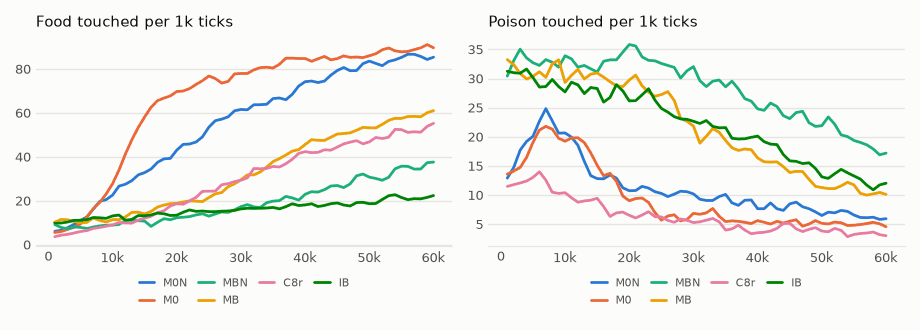
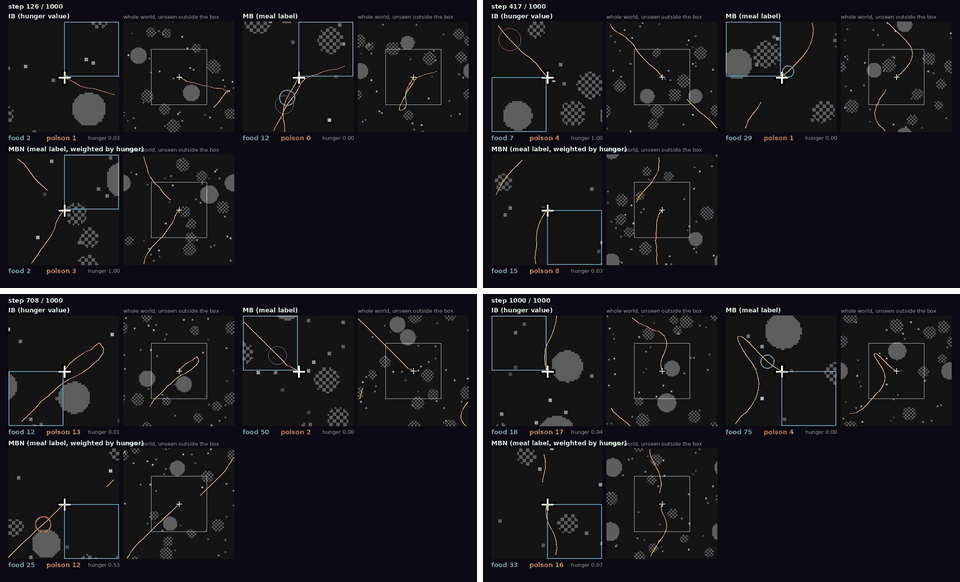

# vm-00097: A Meal Label, Learned Back in Time

**Date:** 2026-11-18
**Status:** Complete
**Source:** `exp/vm-00097` (code: `visual-motor-agent/dev/`)
**Outputs:** `~/data/research/visual-motor-agent/exp_00097/`
**Task plan:** [`../tasks/00108-meal-label.md`](../tasks/00108-meal-label.md)

## Goal

The default agent's value label is roughly how hungry it is × how soon it eats, so its differences between moves grow with hunger. In the world with inertia that made the instinct's fixed tolerance relatively small (vm-00095, presumed). The owner's idea is a label that says only how soon the next meal comes. A meal is worth 1, and every earlier tick is worth 0.95 × its transformer's own prediction for the next tick, less the hunger the tick added, so the meal's value travels back in time through one-step predictions. Does the agent learn it, and does it forage better with inertia and no worse without? A second batch weighs the label by hunger when choosing. The design and the readings set before the results are in the task plan.

## Method

| Arm | World | Label | Choosing | Seeds |
|---|---|---|---|---|
| C8r (vm-00094, linked) | no inertia | hunger value (γ .9) | lowest label | 1–12 |
| IB (vm-00095, linked) | inertia from birth | hunger value (γ .9) | lowest label | 1–12 |
| M0 | no inertia | meal label (γ .95) | lowest label | 1–12 |
| MB | inertia from birth | meal label (γ .95) | lowest label | 1–12 |
| M0N | no inertia | meal label (γ .95) | weighted by hunger | 1–12 |
| MBN | inertia from birth | meal label (γ .95) | weighted by hunger | 1–12 |

- **The label** (`online.value_target = meal`, `value_gamma` 0.95, `value_n` 1, `value_refresh` 1), read from the hunger alone:
  - a tick whose hunger falls is a meal: V = 1;
  - any other tick is worth minus the hunger it added (a poison's 0.5, the drift's 0.001), plus 0.95 × its transformer's own prediction for the next tick, made fresh before every update;
  - V is clipped to [−1, 1] and stored as T = (1 − V)/2 in the hunger channel, so that lower is better and the instinct is unchanged;
  - each transformer learns its own version of the label.
- **Weighted by hunger** (`online.need = 1`): the predicted differences between candidates are multiplied by the current hunger, that is, the instinct's tolerance is divided by max(hunger, .05). Hunger is the same for every candidate, so this changes only whether the instinct overrides the model's own move.
- **The in-life monitor** (the owner's request): each tick's predicted V of the move taken waits for the body's next meal, when its true value is known exactly. Predicted and true V add up by ticks to that meal (0, 1, 2–3, 4–7, 8–15, 16–31, 32–63) in every metrics row (field `meal`).
- **Everything else is C8's:** `configs/U_view.json`, 4 quarter transformers of 8 layers, tolerance .002, context 8, the ring.
- **Frozen tests** (1,500 ticks × 16 bodies; `value` 2,000): `chain`, `value` (with the meal label realized from the real future, by ticks to the next real meal), `reach` and `move`, each in the run's own world.
- **Cards:** two batches, MB and M0 then MBN and M0N, each 24 lives, seeds 1–8 on the RTX 4090 and 9–12 on the RTX 3090, under MPS. They started automatically after vm-00096 while the owner slept.
- **Run notes:**
  - batch 1 ran 2026-11-18 04:24 to 08:55 (frozen tests until 09:27), batch 2 from 09:28 to 13:51 (frozen tests until 14:22);
  - all 48 lives ran 60k ticks without errors, and every run's `info.json` has its arm's settings.

## Results

### R1. Lived, ticks 40–60k, 12 seeds, 95% interval (t, df 11)

| Arm | Food per 1k | Poison per 1k | Mean hunger | Instinct overrides | Move CE | Patch CE | Smoothness |
|---|---|---|---|---|---|---|---|
| C8r | 48.4 ± 4.3 | 3.84 ± 0.39 | .030 ± .013 | .274 | .255 | .7543 | .48 |
| M0 | 87.1 ± 12.6 | 5.13 ± 0.72 | .029 ± .012 | .240 | .089 | .7542 | .71 |
| M0N | 81.8 ± 14.1 | 7.15 ± 0.86 | .041 ± .018 | .074 | .104 | .7536 | .72 |
| IB | 19.9 ± 0.9 | 14.3 ± 1.2 | .230 ± .053 | .697 | .408 | .7646 | .24 |
| MB | 54.2 ± 6.6 | 12.3 ± 1.2 | .093 ± .028 | .586 | .234 | .7605 | .51 |
| MBN | 31.0 ± 8.6 | 21.4 ± 4.6 | .292 ± .149 | .204 | .193 | .7554 | .49 |

(The body CE is left out: in the meal arms the hunger channel's target is the meal label, so it is not comparable.)

Paired by seed (in brackets: seeds above 0, of 12):

| Contrast | Food | Poison | Mean hunger | Overrides | Move CE | Smoothness |
|---|---|---|---|---|---|---|
| M0 − C8r | +38.7 ± 12.4 (11) | +1.3 ± 0.6 (12) | −.001 ± .021 (7) | −.034 ± .040 (4) | −.166 ± .026 (0) | +.230 ± .038 (12) |
| MB − IB | +34.3 ± 6.5 (12) | −2.1 ± 1.7 (3) | −.137 ± .066 (1) | −.111 ± .054 (0) | −.174 ± .040 (0) | +.269 ± .061 (12) |
| M0N − M0 | −5.2 ± 14.8 (4) | +2.0 ± 1.1 (10) | +.012 ± .019 (9) | −.166 ± .030 (0) | | |
| MBN − MB | −23.2 ± 8.9 (1) | +9.2 ± 4.4 (12) | +.199 ± .136 (11) | −.382 ± .040 (0) | | |

### R2. Over the life, by 5k ticks, mean of 12 seeds

| Measure | Arm | 0–5k | 5–10k | 10–15k | 15–20k | 20–25k | 25–30k | 30–35k | 35–40k | 40–45k | 45–50k | 50–55k | 55–60k |
|---|---|---|---|---|---|---|---|---|---|---|---|---|---|
| Food per 1k | C8r | 5.0 | 8.2 | 11.0 | 16.3 | 22.3 | 28.0 | 34.6 | 39.8 | 43.4 | 46.6 | 50.4 | 52.9 |
| | M0 | 7.7 | 21.8 | 49.9 | 67.6 | 73.6 | 75.8 | 80.3 | 84.6 | 84.8 | 85.6 | 88.2 | 89.4 |
| | M0N | 8.7 | 19.6 | 30.6 | 39.8 | 49.3 | 59.2 | 64.7 | 70.1 | 76.5 | 81.3 | 83.8 | 85.5 |
| | IB | 10.6 | 12.5 | 12.5 | 13.7 | 15.3 | 15.8 | 16.6 | 17.9 | 18.3 | 18.5 | 21.3 | 21.5 |
| | MB | 10.5 | 11.4 | 13.7 | 18.1 | 20.5 | 27.0 | 34.7 | 43.2 | 48.7 | 52.2 | 56.4 | 59.6 |
| | MBN | 7.9 | 8.4 | 10.8 | 11.0 | 13.2 | 15.9 | 18.4 | 21.9 | 25.5 | 30.0 | 32.5 | 36.1 |
| Poison per 1k | C8r | 12.4 | 11.3 | 9.1 | 6.7 | 6.4 | 5.5 | 5.1 | 4.1 | 4.5 | 4.0 | 3.7 | 3.3 |
| | M0 | 16.2 | 20.7 | 17.5 | 11.2 | 7.8 | 6.4 | 6.5 | 5.4 | 5.4 | 5.1 | 5.1 | 5.0 |
| | M0N | 17.7 | 22.3 | 15.3 | 12.0 | 10.8 | 10.3 | 9.4 | 8.3 | 8.2 | 7.4 | 7.0 | 6.0 |
| | IB | 30.7 | 28.8 | 28.1 | 27.2 | 26.3 | 23.1 | 21.8 | 19.8 | 17.5 | 14.5 | 13.7 | 11.6 |
| | MB | 31.2 | 31.0 | 31.0 | 29.5 | 28.0 | 23.4 | 20.0 | 17.3 | 15.0 | 12.4 | 11.6 | 10.0 |
| | MBN | 33.2 | 33.1 | 31.7 | 34.5 | 33.1 | 31.3 | 29.0 | 26.6 | 24.2 | 22.9 | 20.8 | 17.8 |
| Overrides | C8r | .52 | .43 | .40 | .37 | .38 | .39 | .37 | .34 | .31 | .29 | .27 | .24 |
| | M0 | .17 | .29 | .42 | .37 | .30 | .27 | .27 | .25 | .25 | .24 | .24 | .23 |
| | M0N | .12 | .14 | .12 | .11 | .10 | .10 | .09 | .09 | .08 | .08 | .07 | .06 |
| | IB | .52 | .46 | .50 | .55 | .58 | .65 | .70 | .72 | .72 | .71 | .69 | .67 |
| | MB | .22 | .19 | .22 | .29 | .36 | .43 | .51 | .54 | .58 | .60 | .59 | .58 |
| | MBN | .12 | .09 | .09 | .10 | .13 | .15 | .15 | .17 | .19 | .21 | .21 | .21 |

### R3. The label in life: predicted against true V by ticks to the next meal (the in-life monitor)

M0, pooled over 12 seeds (true V in the last row is that of 40–60k; it hardly changes over the life):

| Life | 0 | 1 | 2–3 | 4–7 | 8–15 | 16–31 | 32–63 | Bias over all ticks |
|---|---|---|---|---|---|---|---|---|
| 0–2k | .10 | .10 | .10 | .09 | .08 | .08 | .08 | −.224 ± .034 |
| 2–5k | .29 | .27 | .24 | .20 | .15 | .12 | .12 | −.157 ± .043 |
| 5–10k | .80 | .72 | .63 | .48 | .23 | .14 | .13 | −.070 ± .031 |
| 10–20k | .98 | .93 | .84 | .69 | .37 | .31 | .26 | +.014 ± .011 |
| 20–40k | 1.00 | .95 | .88 | .74 | .46 | .43 | .40 | +.030 ± .005 |
| 40–60k | 1.00 | .95 | .88 | .75 | .50 | .46 | .42 | +.034 ± .002 |
| true V, 40–60k | 1.00 | .95 | .87 | .73 | .53 | .30 | .07 | |

The bias over all ticks (predicted − true V, per seed, 95% interval) by life stage:

| Arm | 0–2k | 2–5k | 5–10k | 10–20k | 20–40k | 40–60k |
|---|---|---|---|---|---|---|
| M0 | −.224 | −.157 | −.070 | +.014 | +.030 | +.034 ± .002 (12 of 12 above 0) |
| MB | −.189 | −.128 | −.069 | −.049 | −.015 | +.024 ± .007 (11) |
| M0N | −.211 | −.145 | −.055 | −.042 | −.003 | +.019 ± .008 (11) |
| MBN | −.218 | −.162 | −.098 | −.074 | −.051 | −.036 ± .023 (1) |

MB's label spreads back more slowly: at 40–60k its predictions for 4–7 and 8–15 ticks before a meal are .70 and .41 (true .72 and .50).

### R4. The label frozen: predicted against true V by ticks to the next real meal (`value`, 2,000 ticks × 16 bodies)

| Ticks to the meal | 0 | 1 | 2 | 4 | 6 | 8 | 10 | 15 | 20 | 30 |
|---|---|---|---|---|---|---|---|---|---|---|
| 0.95^k | 1.000 | .950 | .902 | .815 | .735 | .663 | .599 | .463 | .358 | .215 |
| M0 predicted | .999 | .952 | .904 | .806 | .724 | .551 | .496 | .490 | .484 | .479 |
| M0 true | 1.000 | .948 | .895 | .794 | .707 | .631 | .564 | .426 | .316 | .169 |
| MB predicted | .993 | .947 | .893 | .791 | .701 | .526 | .466 | .433 | .420 | .410 |
| MB true | 1.000 | .949 | .896 | .788 | .694 | .612 | .539 | .389 | .272 | .118 |

- **Over all ticks** (on the scale T): M0 predicts .151 against .165 true (correlation .84), and MB .198 against .236 (.74). In V that is +.03 and +.08 optimistic.
- **The candidates' spread** (frozen `value`):

| | C8r | M0 | M0N | IB | MB | MBN |
|---|---|---|---|---|---|---|
| Spread | .0023 | .0020 | .0040 | .0120 | .0235 | .0155 |

### R5. Frozen foraging (`chain`, 1,500 ticks × 16 bodies)

| Arm | Food | Blind | Blind + perfect grab | Seen − grab | Poison | Smoothness |
|---|---|---|---|---|---|---|
| C8r | 54.0 ± 4.4 | 9.1 | 15.3 | +38.7 ± 3.7 | 3.7 ± 0.6 | .52 |
| M0 | 89.5 ± 12.0 | 11.8 | 20.4 | +69.1 ± 12.4 | 4.5 ± 0.6 | .70 |
| M0N | 88.2 ± 14.3 | 12.4 | 20.8 | +67.4 ± 13.8 | 5.5 ± 0.8 | .72 |
| IB | 22.2 ± 1.6 | 9.5 | 11.0 | +11.2 ± 1.3 | 12.0 ± 1.7 | .25 |
| MB | 57.3 ± 9.0 | 10.6 | 12.4 | +44.9 ± 9.0 | 10.9 ± 3.2 | .54 |
| MBN | 36.0 ± 9.1 | 11.0 | 12.1 | +23.9 ± 8.8 | 17.0 ± 5.2 | .46 |

Paired by seed: M0 − C8r food +35.5 ± 12.0 (11 of 12), poison +0.8 ± 1.0; MB − IB food +35.1 ± 9.1 (12 of 12), poison −1.1 ± 4.3; M0N − M0 food −1.3 ± 15.7; MBN − MB food −21.2 ± 12.5 (lower in 10), poison +6.1 ± 4.7.

### R6. How the body moves, and food in reach (`move` and `reach`, frozen)

| Arm | Mean hunger | Speed | Braking | Food within 8 px: speed, motion's aim | Motion's aim, 8–16 px; 16–32 px | Poison within 8 px: share, motion away | Food in reach | Eaten when in reach |
|---|---|---|---|---|---|---|---|---|
| C8r | .042 | 4.76 | .08 | 4.83, .74 | .69; .51 | .07, +.08 | .072 | .74 |
| M0 | .028 | 5.20 | .02 | 5.12, .84 | .83; .74 | .14, +.02 | .092 | .98 |
| M0N | .032 | 5.25 | .02 | 5.25, .84 | .81; .70 | .15, +.02 | .092 | .96 |
| IB | .199 | 3.90 | .23 | 4.23, .45 | .31; .18 | .15, −.12 | .026 | .86 |
| MB | .105 | 4.38 | .11 | 4.51, .71 | .65; .51 | .17, −.09 | .060 | .96 |
| MBN | .231 | 4.59 | .09 | 4.66, .56 | .45; .28 | .18, −.13 | .038 | .94 |

(C8r's and IB's mean hunger are from vm-00095's frozen `poison` test.)

## Readings

1. **Plumbing: met.** The label's tests pass (`tests/test_meal_label.py`, 12, among them the owner's check of propagation and of healing from all-optimistic), and all 48 lives ran 60k ticks without errors.
2. **The label is learned: partly met.**
   - Frozen, the predicted V matches 0.95^k and the true V within .03 out to 6 ticks before a meal, in both worlds (R4).
   - From about 8 ticks out it flattens: M0 predicts .48–.55 where the truth falls from .63 to .32 at 20 ticks, and MB .42–.53. So the plan's "near 0.95^k for k up to 20" fails past 6 ticks.
3. **It helps with inertia: met.**
   - MB − IB mean hunger −.137 ± .066 (lower in 11), overrides −.111 ± .054 (lower in 12).
   - Food +34.3 ± 6.5 (12 of 12).
4. **No harm without inertia: met.**
   - M0 − C8r mean hunger −.001 ± .021.
   - Food +38.7 ± 12.4 (11 of 12); poison +1.3 ± 0.6 (higher in 12).
5. **One scale (descriptive): no.** The candidates' spread with inertia is 12 times that without (MB .0235, M0 .0020), as it was 5 times for the hunger value (IB .0120, C8r .0023).

**The outcome set in the plan:** readings 3 and 4 held, so "the meal label becomes the candidate default (the owner's decision). Next are need weighting (the second batch), then the movement cost." The second batch ran with it: see the analysis.

<!-- figures -->
## Figures

*The world of this experiment as its model sees it, every 12 ticks. Moves are random: this shows the world, not the trained agent.*

*From each run's `metrics.jsonl`, the mean of its seeds by arm, smoothed. C8r, M0 and M0N live without inertia, IB, MB and MBN with it; C8r and IB have the hunger value, the M arms the meal label, the N arms weighted by hunger when choosing.*

*Stills from this experiment's video, in time order. Seed 5 at 60k, frozen, from the same start, in the world with inertia: IB (the hunger value), MB (the meal label) and MBN (the meal label weighted by hunger when choosing). Each arm's 64 x 64 view (the blue square: the quarter transformer whose move it was), and beside it the whole world with the window outlined. Plain circles are food, checkered ones poison. The same arms without inertia are in videos/vm97_plain_s5.*
<!-- /figures -->

## Analysis

- **The meal label is far better than the hunger value, in both worlds.**
  - Without inertia, M0 eats 1.8 times C8r's food (87 against 48 per 1k at 40–60k) at the same mean hunger, and learns much faster: 49.9 per 1k at 10–15k against C8r's 11.0, and past C8r's final level (52.9) by 15k ticks.
  - With inertia, MB eats 2.7 times IB's food (54 against 20) with less poison and less hunger. That is more than C8r eats without inertia, and twice vm-00096's instinct horizon (IH, 26.7), with no extra acting.
- **Why it works (the likely reasons, not tested apart):**
  - The target is clean and learnable. Near food the label is exact: frozen, out to 6 ticks before a meal the prediction is within .03 of the truth.
  - The policy and the instinct agree. The model predicts its own moves far better (move CE .09 against .26 without inertia, .23 against .41 with) and moves more smoothly (.71 against .48; .51 against .24). The instinct overrides less, and food one move away is eaten 96–98% of the time (C8r 74%, IB 86%).
- **The value travels back in time, as the owner wanted to see.** In life the predictions near a meal become right first (by 5–10k ticks, .80 at the meal itself), then further back (by 20k ticks exact out to 7 ticks). Without inertia it spreads faster than with it: MB is still short at 4–15 ticks by 60k.
- **Past the view it is an average.** From about 8–10 ticks before a meal the prediction flattens at about .48 (M0) or .42 (MB).
  - That is roughly where food leaves the 64 × 64 window at 4–5 px a tick, so the model predicts the average for food it cannot see.
  - Bins by true time to the meal look optimistic far away (.42 predicted against .07 at 32–63 ticks), but that is hindsight: those ticks are the unlucky ones the model could not foresee.
- **The owner's worry, a label too optimistic: it healed and stayed small.** Over all ticks the label starts pessimistic (−.22, all predictions near nothing), crosses zero by 10–20k ticks and settles slightly optimistic: +.034 (M0) and +.024 (MB) at 40–60k, steady over the last 40k ticks. This is unlike vm-00085's hunger value, which was 30–55% optimistic.
- **The premise of one scale did not hold:** with inertia the candidates' spread is 12 times larger. The gain in the world with inertia comes from the label itself, not from the tolerance meaning the same.
- **Weighing the label by hunger, as implemented, throttles the instinct.**
  - Dividing the tolerance by hunger makes the instinct harder to trigger at every hunger below 1: at hunger .05 (the floor) the tolerance is .04, 20 times the usual. M0N's mean hunger was .04, so its instinct sat at the floor almost all the time (overrides .07 against .24).
  - Without inertia that changed little: food −5 ± 15, poison +2.0 ± 1.1, hunger the same.
  - With inertia the agent needs its instinct to dodge poison it is heading into. MBN overrode .20 against .59, touched poison +9.2 ± 4.4 more, ate 23 ± 9 less, and its motion turned away from poison less (−.04, lower in 10).
  - One label holds both the meal and the poison, so weakening the instinct when sated also weakens its avoidance. The plan noted this cost in advance.
  - Batch 2 does not show that need is a bad idea, only that this scaling is.
- **Poison:** M0 touches slightly more poison than C8r (+1.3 per 1k), yet its mean hunger is the same, because meals come twice as often and clear it.

## Conclusions

1. The meal label (a meal worth 1, carried back in time by the model's own one-step predictions with γ .95, costs subtracted) makes the default agent forage far better.
   - Without inertia: 1.8 times the food (87 against 48 per 1k) at the same hunger.
   - With inertia: 2.7 times (54 against 20) at lower hunger, beating the instinct's horizon (vm-00096) with no extra acting.
2. The label is learned exactly near meals and spreads back in time over the life, as the in-life monitor shows. Beyond about 8 ticks, mostly beyond the view, it flattens to an average.
3. It heals from its pessimistic start and stays slightly optimistic and steady (+.02 to +.03 in V).
4. Weighing it by hunger when choosing, as implemented (the tolerance divided by hunger), throttles the instinct at every usual hunger. With one label for meal and poison that also weakens poison avoidance: no gain without inertia, a large loss with it.

## Next steps

- **The meal label as the default** (the owner's decision).
- **Need, done fairly:**
  - two labels, the next meal's nearness and the poison ahead (ARCHITECTURE.md section 9), so that need weighs the meal alone;
  - hunger relative to its usual level (current against the life's running mean), so the instinct is as active as now at usual hunger.
- **The meal label with the instinct's horizon** (vm-00096's IH) in the world with inertia: do they add?
- **The movement cost** (ARCHITECTURE.md section 9): with this label, a hunger cost per movement is automatically a penalty, so standing still becomes an option.
- **Beyond the view:** the plateau is lack of information, not slow propagation, so hindsight labels would not lift it; a memory of where food went would.
