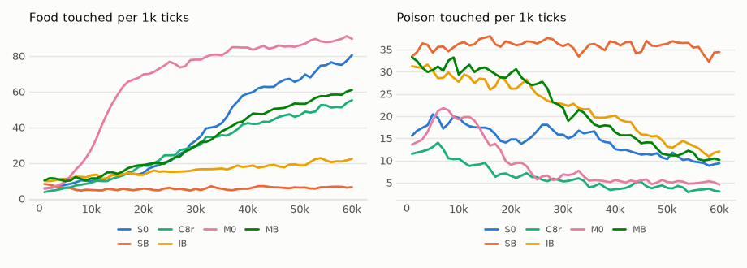
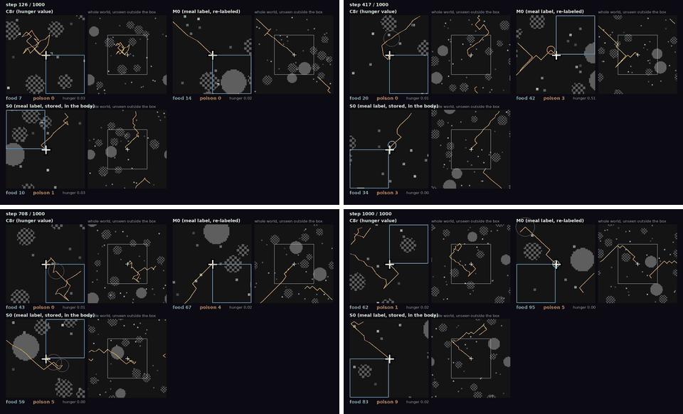

# vm-00098: The Label as a Body Value, Stored Once

**Date:** 2026-11-18
**Status:** Complete
**Source:** `exp/vm-00098` (code: `visual-motor-agent/dev/`)
**Added after the tag:** R8, poison and the instinct's candidates (2026-11-19, the owner's question; `dev/eval_candidates.py`, `make candidates`)
**Outputs:** `~/data/research/visual-motor-agent/exp_00098/`
**Task plan:** [`../tasks/00109-stored-label-body.md`](../tasks/00109-stored-label-body.md)

## Goal

In vm-00097 the meal label made the default agent forage far better. But memory kept only the raw facts, and every replay re-labeled old memories with the current model's prediction: in the owner's words, a cheat. Here the label is the owner's original idea: computed once, when the experience happens, from what the agent predicted then, and stored in memory as the truth. It is also a property of the body, like hunger, with its own learned parameters. Does the agent still learn it, and does the value still travel back in time? The design and the readings set before the results are in the task plan.

## Method

| Arm | World | Label | Seeds |
|---|---|---|---|
| C8r (vm-00094), IB (vm-00095), linked | C8r no inertia, IB inertia from birth | the hunger value | 1–12 |
| M0, MB (vm-00097), linked | M0 no inertia, MB inertia from birth | meal label in the hunger channel, re-labeled at each replay | 1–12 |
| S0 | no inertia | stored meal label, its own body channel | 1–12 |
| SB | inertia from birth | stored meal label, its own body channel | 1–12 |

- **The body's label** (`model.body_label = 1`): a third body value with its own channel (input embedding, output rows and bias). Its input is blank (0.5), since a move's label is known only after the next prediction; the move token predicts it, and the instinct reads it. Hunger is plain hunger again.
- **The stored label** (`online.label = meal`, `label_gamma` 0.95):
  - when acting, each transformer scores the move actually made;
  - one tick later step t's label for each transformer is written into memory, once: a meal 1, otherwise 0.95 × that transformer's prediction for the next step's move, less the hunger a poison added (no cost for the drift);
  - it is never re-labeled, and each transformer trains on its own stored labels.
- **Two monitors in life:** the predictions, and the labels stored in memory, against what really happened, by ticks to the next meal (metrics `meal`, `meal_stored`). Labels are never re-labeled, so the second is what memory holds; the planned extra sample of memory at the end of each life was not taken.
- **Everything else is C8's:** `configs/U_view.json`, 4 quarter transformers of 8 layers, tolerance .002, context 8, the ring.
- **Frozen tests** (1,500 ticks × 16 bodies; `value` 2,000), each in the run's own world: `chain`, `value` (the stored label realized from the real future, by ticks to the next real meal), `reach` and `move`.
- **Videos** (`compare_video.py`, frozen at 60k, 1,000 ticks, 8 worlds): `videos/vm98_plain_s5` and `vm98_plain_s12` (C8r, M0, S0), `videos/vm98_inertia_s5` and `vm98_inertia_s12` (IB, MB, SB), and `videos/vm98_inertia_s3` (IB, MB, SB on seed 3, where SB starved; `make video_stuck`).
- **Cards:** 24 lives, seeds 1–8 on the RTX 4090 and 9–12 on the RTX 3090, under MPS.
- **Run notes:**
  - the 24 lives ran 2026-11-18 from 15:26 to 18:18;
  - **the disk filled** at about 18:18, as they ended (every experiment's intermediate checkpoints; most were then deleted with the owner's agreement). Four lives died saving their last checkpoints, for that reason only:
    - SB_s10 while writing its final: restored by copying its checkpoint at 60k, which is byte-identical to the final in every complete life;
    - S0_s11, SB_s9 and SB_s11 at their 60k checkpoint, their metrics complete to 59k: rerun from tick 0 with the same commands, on the RTX 3090 as before (19:34 to 20:58). The first tries are kept in `exp_00098/failed_disk_full`;
  - the frozen tests ran from 19:34 to 21:30, the videos at the same time;
  - every run's `info.json` has its arm's settings.

## Results

### R1. Lived, ticks 40–60k, 12 seeds, 95% interval (t, df 11)

| Arm | Food per 1k | Poison per 1k | Mean hunger | Instinct overrides | Move CE | Patch CE | Smoothness |
|---|---|---|---|---|---|---|---|
| C8r | 48.4 ± 4.3 | 3.84 ± 0.38 | .030 ± .013 | .274 | .255 | .7543 | .48 |
| M0 | 87.0 ± 12.6 | 5.12 ± 0.72 | .029 ± .012 | .240 | .089 | .7542 | .71 |
| S0 | 69.8 ± 8.7 | 10.66 ± 0.93 | .083 ± .025 | .526 | .153 | .7524 | .64 |
| IB | 19.9 ± 0.9 | 14.34 ± 1.17 | .230 ± .053 | .697 | .408 | .7646 | .24 |
| MB | 54.2 ± 6.6 | 12.26 ± 1.23 | .093 ± .028 | .586 | .234 | .7605 | .51 |
| SB | 6.4 ± 3.2 | 35.50 ± 2.48 | .827 ± .102 | .255 | .118 | .7450 | .68 |

(The body CE is left out: in the M arms the hunger channel's target is the meal label, and in the S arms the body token also predicts the label, so it is not comparable.)

Paired by seed (in brackets: seeds above 0, of 12):

| Contrast | Food | Poison | Mean hunger | Overrides | Move CE | Smoothness |
|---|---|---|---|---|---|---|
| S0 − C8r | +21.5 ± 7.9 (11) | +6.8 ± 1.0 (12) | +.053 ± .027 (11) | +.251 ± .053 (12) | −.102 ± .028 (0) | +.162 ± .051 (12) |
| S0 − M0 | −17.2 ± 14.2 (1) | +5.5 ± 1.1 (12) | +.054 ± .026 (11) | +.285 ± .062 (12) | +.064 ± .022 (11) | −.068 ± .048 (3) |
| SB − IB | −13.5 ± 3.6 (0) | +21.2 ± 2.6 (12) | +.596 ± .099 (12) | −.442 ± .164 (0) | −.290 ± .054 (0) | +.443 ± .139 (12) |
| SB − MB | −47.8 ± 7.2 (0) | +23.2 ± 2.7 (12) | +.734 ± .114 (12) | −.331 ± .176 (1) | −.116 ± .067 (2) | +.175 ± .136 (9) |

### R2. Over the life, by 5k ticks, mean of 12 seeds

| Measure | Arm | 0–5k | 5–10k | 10–15k | 15–20k | 20–25k | 25–30k | 30–35k | 35–40k | 40–45k | 45–50k | 50–55k | 55–60k |
|---|---|---|---|---|---|---|---|---|---|---|---|---|---|
| Food per 1k | C8r | 5.0 | 8.2 | 11.0 | 16.3 | 22.3 | 28.0 | 34.6 | 39.8 | 43.4 | 46.6 | 50.4 | 52.9 |
|  | M0 | 7.7 | 21.8 | 49.9 | 67.6 | 73.6 | 75.8 | 80.3 | 84.6 | 84.8 | 85.6 | 88.2 | 89.4 |
|  | S0 | 6.9 | 9.7 | 12.3 | 14.1 | 19.5 | 28.7 | 40.6 | 55.2 | 62.5 | 67.0 | 72.2 | 77.6 |
|  | IB | 10.6 | 12.5 | 12.5 | 13.7 | 15.3 | 15.8 | 16.6 | 17.9 | 18.3 | 18.5 | 21.3 | 21.5 |
|  | MB | 10.5 | 11.4 | 13.7 | 18.1 | 20.5 | 27.0 | 34.7 | 43.2 | 48.7 | 52.2 | 56.4 | 59.6 |
|  | SB | 7.0 | 5.0 | 5.1 | 5.2 | 5.4 | 5.2 | 5.9 | 5.2 | 6.8 | 6.1 | 6.2 | 6.6 |
| Poison per 1k | C8r | 12.4 | 11.3 | 9.0 | 6.7 | 6.4 | 5.5 | 5.1 | 4.0 | 4.5 | 4.0 | 3.6 | 3.3 |
|  | M0 | 16.2 | 20.7 | 17.5 | 11.2 | 7.8 | 6.4 | 6.5 | 5.4 | 5.4 | 5.1 | 5.1 | 5.0 |
|  | S0 | 18.2 | 18.7 | 17.5 | 15.0 | 15.3 | 16.7 | 16.1 | 13.9 | 11.9 | 11.1 | 10.4 | 9.2 |
|  | IB | 30.7 | 28.8 | 28.1 | 27.2 | 26.3 | 23.1 | 21.8 | 19.8 | 17.5 | 14.5 | 13.7 | 11.6 |
|  | MB | 31.2 | 31.0 | 31.0 | 29.5 | 28.0 | 23.4 | 20.0 | 17.3 | 15.0 | 12.4 | 11.6 | 10.0 |
|  | SB | 34.9 | 35.8 | 36.9 | 36.5 | 36.4 | 36.8 | 35.1 | 36.0 | 35.8 | 36.1 | 36.1 | 34.0 |
| Mean hunger | C8r | .52 | .35 | .26 | .21 | .18 | .10 | .12 | .06 | .04 | .02 | .03 | .03 |
|  | M0 | .58 | .40 | .18 | .07 | .05 | .02 | .04 | .04 | .02 | .03 | .04 | .02 |
|  | S0 | .63 | .53 | .46 | .42 | .40 | .28 | .25 | .12 | .15 | .08 | .02 | .08 |
|  | IB | .71 | .61 | .63 | .51 | .43 | .43 | .38 | .44 | .24 | .21 | .23 | .24 |
|  | MB | .74 | .67 | .57 | .55 | .42 | .36 | .19 | .23 | .10 | .13 | .04 | .10 |
|  | SB | .77 | .81 | .89 | .84 | .89 | .82 | .87 | .81 | .87 | .81 | .82 | .80 |
| Overrides | C8r | .52 | .43 | .40 | .37 | .38 | .39 | .37 | .34 | .31 | .29 | .27 | .24 |
|  | M0 | .17 | .29 | .42 | .37 | .30 | .27 | .27 | .25 | .25 | .24 | .24 | .23 |
|  | S0 | .19 | .13 | .14 | .18 | .23 | .37 | .43 | .51 | .52 | .52 | .53 | .53 |
|  | IB | .52 | .46 | .50 | .55 | .58 | .65 | .70 | .72 | .72 | .71 | .69 | .67 |
|  | MB | .22 | .19 | .21 | .29 | .35 | .43 | .51 | .54 | .58 | .60 | .59 | .58 |
|  | SB | .21 | .08 | .07 | .07 | .10 | .11 | .12 | .15 | .25 | .25 | .25 | .27 |

### R3. The label in life: predicted and stored against the true V, by ticks to the next meal (the two monitors)

S0's predictions for the moves it made, pooled over 12 seeds (true V in the last row is that of 40–60k; it hardly changes over the life):

| Life | 0 | 1 | 2–3 | 4–7 | 8–15 | 16–31 | 32–63 | Bias over all ticks |
|---|---|---|---|---|---|---|---|---|
| 0–2k | .15 | .10 | .07 | .06 | .05 | .04 | .05 | −.234 ± .021 |
| 2–5k | .55 | .31 | .15 | .07 | .05 | .05 | .06 | −.222 ± .022 |
| 5–10k | .84 | .57 | .24 | .08 | .05 | .05 | .05 | −.205 ± .018 |
| 10–20k | .93 | .76 | .42 | .14 | .06 | .05 | .06 | −.190 ± .023 |
| 20–40k | .98 | .90 | .72 | .44 | .23 | .19 | .14 | −.097 ± .027 |
| 40–60k | 1.00 | .94 | .85 | .64 | .37 | .34 | .31 | −.008 ± .007 |
| true V, 40–60k | 1.00 | .95 | .87 | .72 | .51 | .25 | .02 | |

S0's labels as stored in memory:

| Life | 0 | 1 | 2–3 | 4–7 | 8–15 | 16–31 | 32–63 | Bias over all ticks |
|---|---|---|---|---|---|---|---|---|
| 0–2k | 1.00 | .06 | .04 | .02 | .01 | .01 | .02 | −.245 ± .017 |
| 2–5k | 1.00 | .31 | .10 | .03 | .02 | .02 | .02 | −.246 ± .014 |
| 5–10k | 1.00 | .59 | .21 | .04 | .01 | .01 | .01 | −.235 ± .012 |
| 10–20k | 1.00 | .77 | .39 | .08 | .01 | .01 | .01 | −.228 ± .013 |
| 20–40k | 1.00 | .88 | .67 | .33 | .13 | .09 | .06 | −.180 ± .017 |
| 40–60k | 1.00 | .93 | .81 | .55 | .25 | .21 | .19 | −.097 ± .012 |
| true V, 40–60k | 1.00 | .95 | .87 | .72 | .51 | .25 | .02 | |

SB's predictions:

| Life | 0 | 1 | 2–3 | 4–7 | 8–15 | 16–31 | 32–63 | Bias over all ticks |
|---|---|---|---|---|---|---|---|---|
| 0–2k | .16 | .11 | .08 | .06 | .05 | .06 | .05 | −.242 ± .023 |
| 2–5k | .64 | .35 | .15 | .08 | .07 | .09 | .08 | −.200 ± .022 |
| 5–10k | .89 | .61 | .25 | .10 | .07 | .08 | .09 | −.181 ± .041 |
| 10–20k | .94 | .77 | .40 | .11 | .06 | .07 | .08 | −.185 ± .030 |
| 20–40k | .93 | .78 | .49 | .16 | .08 | .09 | .09 | −.162 ± .038 |
| 40–60k | .90 | .74 | .48 | .20 | .12 | .13 | .14 | −.142 ± .047 |
| true V, 40–60k | 1.00 | .95 | .87 | .73 | .50 | .23 | .02 | |

SB's labels as stored:

| Life | 0 | 1 | 2–3 | 4–7 | 8–15 | 16–31 | 32–63 | Bias over all ticks |
|---|---|---|---|---|---|---|---|---|
| 0–2k | 1.00 | .07 | .04 | .02 | .01 | .02 | .02 | −.258 ± .019 |
| 2–5k | 1.00 | .34 | .11 | .03 | .03 | .03 | .03 | −.237 ± .014 |
| 5–10k | 1.00 | .60 | .22 | .04 | .02 | .03 | .04 | −.225 ± .026 |
| 10–20k | 1.00 | .75 | .36 | .06 | .02 | .02 | .03 | −.224 ± .019 |
| 20–40k | 1.00 | .76 | .43 | .10 | .03 | .03 | .04 | −.211 ± .025 |
| 40–60k | 1.00 | .71 | .42 | .13 | .05 | .06 | .06 | −.199 ± .029 |
| true V, 40–60k | 1.00 | .95 | .87 | .73 | .50 | .23 | .02 | |

The bias over all ticks (predicted or stored − true V, per seed, 95% interval) by life stage, M0 and MB from vm-00097:

| Arm | 0–2k | 2–5k | 5–10k | 10–20k | 20–40k | 40–60k |
|---|---|---|---|---|---|---|
| M0 predicted | −.224 | −.157 | −.070 | +.014 | +.030 | +.034 ± .002 (12 of 12 above 0) |
| S0 predicted | −.234 | −.222 | −.205 | −.190 | −.097 | −.008 ± .007 (2 of 12 above 0) |
| S0 stored | −.245 | −.246 | −.235 | −.228 | −.180 | −.097 ± .012 (0 of 12 above 0) |
| MB predicted | −.189 | −.128 | −.069 | −.049 | −.015 | +.024 ± .007 (11 of 12 above 0) |
| SB predicted | −.242 | −.200 | −.181 | −.185 | −.162 | −.142 ± .047 (0 of 11 above 0) |
| SB stored | −.258 | −.237 | −.225 | −.224 | −.211 | −.199 ± .029 (0 of 11 above 0) |

### R4. The label frozen: predicted against true V by ticks to the next real meal (`value`, 2,000 ticks × 16 bodies)

| Ticks to the meal | 0 | 1 | 2 | 4 | 6 | 8 | 10 | 15 | 20 | 30 |
|---|---|---|---|---|---|---|---|---|---|---|
| 0.95^k | 1.000 | .950 | .902 | .815 | .735 | .663 | .599 | .463 | .358 | .215 |
| M0 predicted | .999 | .952 | .904 | .806 | .724 | .551 | .496 | .490 | .484 | .479 |
| M0 true | 1.000 | .948 | .895 | .794 | .707 | .631 | .564 | .426 | .316 | .169 |
| S0 predicted | .998 | .948 | .898 | .773 | .639 | .456 | .407 | .389 | .385 | .378 |
| S0 true | 1.000 | .949 | .894 | .787 | .694 | .614 | .545 | .403 | .291 | .140 |
| MB predicted | .993 | .947 | .893 | .791 | .701 | .526 | .466 | .433 | .420 | .410 |
| MB true | 1.000 | .949 | .896 | .788 | .694 | .612 | .539 | .389 | .272 | .118 |
| SB predicted | .779 | .638 | .499 | .261 | .159 | .108 | .106 | .098 | .110 | .141 |
| SB true | 1.000 | .949 | .898 | .789 | .694 | .616 | .548 | .402 | .294 | .138 |

| Arm | T predicted | T true | Correlation | Candidates' spread |
|---|---|---|---|---|
| M0 | .151 | .165 | .84 | .0020 |
| S0 | .195 | .199 | .78 | .0275 |
| MB | .198 | .236 | .74 | .0235 |
| SB | .439 | .472 | .32 | .0059 |

(With the hunger value the candidates' spread was .0023 for C8r and .0120 for IB, vm-00097.)

### R5. Frozen foraging (`chain`, 1,500 ticks × 16 bodies)

| Arm | Food | Blind | Blind + perfect grab | Seen − grab | Poison | Smoothness |
|---|---|---|---|---|---|---|
| C8r | 54.0 ± 4.4 | 9.1 | 15.3 | +38.7 ± 3.7 | 3.7 ± 0.6 | .52 |
| M0 | 89.5 ± 12.0 | 11.8 | 20.4 | +69.1 ± 12.4 | 4.5 ± 0.6 | .70 |
| S0 | 77.2 ± 6.9 | 11.0 | 18.7 | +58.4 ± 6.9 | 9.0 ± 1.7 | .63 |
| IB | 22.2 ± 1.6 | 9.5 | 11.0 | +11.2 ± 1.3 | 12.0 ± 1.7 | .25 |
| MB | 57.3 ± 9.0 | 10.6 | 12.4 | +44.9 ± 9.0 | 10.9 ± 3.2 | .54 |
| SB | 7.3 ± 3.1 | 6.1 | 6.6 | +0.7 ± 1.0 | 35.1 ± 2.5 | .66 |

Paired by seed, food and poison (in brackets: seeds above 0): S0 − C8r: food +23.2 ± 7.8 (12), poison +5.3 ± 1.7 (12); S0 − M0: food −12.3 ± 11.5 (2), poison +4.4 ± 1.9 (11); SB − IB: food −14.8 ± 4.2 (0), poison +23.1 ± 2.4 (12); SB − MB: food −49.9 ± 10.1 (0), poison +24.2 ± 4.5 (12).

### R6. How the body moves, and food in reach (`move` and `reach`, frozen)

| Arm | Mean hunger | Speed | Braking | Food within 8 px: speed, motion's aim | Motion's aim, 8–16 px; 16–32 px | Poison within 8 px: share, motion away | Food in reach | Eaten when in reach |
|---|---|---|---|---|---|---|---|---|
| C8r | .042 | 4.76 | .08 | 4.83, .74 | .69; .51 | .07, +.08 | .072 | .74 |
| M0 | .028 | 5.20 | .02 | 5.12, .84 | .83; .74 | .14, +.02 | .092 | .98 |
| S0 | .062 | 5.01 | .05 | 4.99, .86 | .82; .70 | .20, +.02 | .081 | .95 |
| IB | .199 | 3.90 | .23 | 4.23, .45 | .31; .18 | .15, −.12 | .026 | .86 |
| MB | .105 | 4.38 | .11 | 4.51, .71 | .65; .51 | .17, −.09 | .060 | .96 |
| SB | .765 | 5.27 | .04 | 5.14, .21 | .10; .04 | .21, −.23 | .008 | .89 |

(C8r's, M0's, IB's and MB's rows are vm-00097's; C8r's and IB's mean hunger is from vm-00095's frozen `poison` test.)

### R7. SB seed by seed (lived; frozen spread, food and blind food from `value` and `chain`)

| Seed | Food 0–10k | Food 50–60k | Mean hunger 40–60k | Overrides 40–60k | Smoothness 40–60k | Frozen spread | Frozen food, blind food |
|---|---|---|---|---|---|---|---|
| 1 | 9.4 | 10.4 | .68 | .65 | .44 | .0104 | 12.4, 9.5 |
| 2 | 2.4 | 0.0 | 1.00 | .01 | .99 | .0000 | 0.7, 0.4 |
| 3 | 1.0 | 0.0 | 1.00 | .00 | 1.00 | .0000 | 0.2, 0.5 |
| 4 | 10.6 | 9.8 | .73 | .10 | .34 | .0004 | 9.8, 8.7 |
| 5 | 4.1 | 11.0 | .93 | .46 | .63 | .0061 | 10.0, 8.1 |
| 6 | 8.7 | 0.6 | 1.00 | .04 | .94 | .0000 | 1.0, 1.2 |
| 7 | 5.7 | 5.1 | .76 | .06 | .81 | .0001 | 6.8, 7.5 |
| 8 | 11.6 | 14.5 | .52 | .57 | .48 | .0088 | 13.3, 8.4 |
| 9 | 1.2 | 0.2 | 1.00 | .02 | .60 | .0001 | 2.4, 2.5 |
| 10 | 8.5 | 10.1 | .73 | .59 | .50 | .0061 | 9.6, 7.4 |
| 11 | 3.9 | 5.0 | .86 | .08 | .78 | .0293 | 10.2, 9.2 |
| 12 | 4.6 | 10.2 | .71 | .50 | .68 | .0095 | 11.7, 10.2 |

For comparison, at 50–60k IB's seeds eat 18.0–24.4 food per 1k and MB's 39.9–71.2.

### R8. Poison, and how different the instinct's candidates are (frozen; added after the write-up)

Added on 2026-11-19 after the owner asked why SB is so bad with poison.

**What a poison step stores:** a poison adds .5 hunger, capped at 1, and the stored label subtracts the rise:
- −.5 at hunger .5 or below;
- −(1 − hunger) above it;
- nothing from hunger .99, where the rise is under the .01 that counts as a poison.

**Poison in reach** (the frozen `reach` test, on ticks where some of a piece's candidates would touch poison and others neither food nor poison), mean over 12 seeds, 95% interval:

| Arm | Poison moves rated worse by (T) | Worse by more than .002 | The instinct's pick is a poison move |
|---|---|---|---|
| C8r | .029 ± .006 | .60 ± .03 | .18 ± .01 |
| M0 | .085 ± .010 | .82 ± .02 | .14 ± .02 |
| S0 | .098 ± .011 | .83 ± .02 | .14 ± .02 |
| IB | .023 ± .004 | .61 ± .02 | .35 ± .02 |
| MB | .040 ± .009 | .74 ± .05 | .26 ± .04 |
| SB | .004 ± .002 | .30 ± .09 | .53 ± .04 |

**The instinct's candidates** (`make candidates`: `dev/eval_candidates.py`, 300 ticks × 16 bodies in each run's own world). The instinct chooses among 16 candidate moves that `uni_act` samples from the model's own move prediction, so a model sure of its move proposes the same move 16 times. The table shows each piece's candidates per tick, mean over 12 seeds:

| Arm | Distinct moves among the 16 | Ticks with all 16 the same move | Label spread (median) | Food per 1k (this test) | Mean hunger |
|---|---|---|---|---|---|
| C8r | 5.7 ± 0.7 | .06 ± .02 | .0025 ± .0006 | 48.6 ± 4.3 | .09 |
| M0 | 2.2 ± 0.2 | .38 ± .05 | .0020 ± .0011 | 85.8 ± 12.1 | .05 |
| S0 | 4.0 ± 0.5 | .13 ± .04 | .0251 ± .0062 | 72.7 ± 6.8 | .09 |
| IB | 9.5 ± 0.5 | .02 ± .01 | .0145 ± .0025 | 20.5 ± 1.7 | .25 |
| MB | 5.7 ± 0.9 | .07 ± .02 | .0241 ± .0059 | 53.1 ± 8.1 | .15 |
| SB | 3.7 ± 1.2 | .30 ± .17 | .0058 ± .0052 | 8.3 ± 2.4 | .70 |

SB seed by seed:

| SB seed | 1 | 2 | 3 | 4 | 5 | 6 | 7 | 8 | 9 | 10 | 11 | 12 |
|---|---|---|---|---|---|---|---|---|---|---|---|---|
| Ticks with all 16 the same move | .05 | .70 | .79 | .33 | .07 | .51 | .42 | .08 | .41 | .13 | .01 | .04 |
| Distinct moves | 6.7 | 1.5 | 1.4 | 2.5 | 4.4 | 2.0 | 2.3 | 6.1 | 2.4 | 4.2 | 6.2 | 5.0 |
| Label spread | .0086 | .0000 | .0000 | .0006 | .0074 | .0000 | .0002 | .0090 | .0001 | .0053 | .0280 | .0104 |

## Readings

1. **Plumbing: met, after the reruns.**
   - The label's tests pass (`tests/test_body_label.py`, 29, and `tests/test_stored_label.py`, 7, with the owner's mechanism on a table).
   - A stored label is written once and handed out unchanged (tested).
   - All 24 lives ran 60k ticks; three of them twice, because their first tries died when the disk filled (run notes), not from an error of the code.
2. **The front moves back: met without inertia, partly with it** (R3).
   - S0: the predicted V one tick before a meal rises from .10 (0–2k ticks) to .94 (40–60k), two to three ticks before from .07 to .85, four to seven from .06 to .64.
   - SB: it moves back for the first 10–20k ticks (one tick before a meal from .11 to .77 by 10–20k), then stalls (.74 at 40–60k; four to seven ticks .20).
3. **It still forages: fails.**
   - S0 − C8r food +21.5 ± 7.9, higher in 11 of 12 seeds (met for S0).
   - SB − IB food −13.5 ± 3.6, lower in 12 of 12: SB eats 6.4 per 1k against IB's 19.9 (fails).
4. **Stored against re-labeled** (descriptive; two changes are confounded):
   - S0 − M0 food −17.2 ± 14.2 (lower in 11), mean hunger +.054 ± .026;
   - SB − MB food −47.8 ± 7.2 (lower in 12), mean hunger +.734 ± .114.
5. **Optimism** (descriptive): **none.** At 40–60k S0's predictions are −.008 ± .007 over all ticks (M0's re-labeled ones +.034), its stored labels −.097 ± .012; SB's predictions −.142 ± .047.

**The outcome set in the plan:** reading 3 failed on SB, so: "re-labeling did work that stored labels cannot do in a life of 60k ticks. Next is splitting the two changes: stored labels in the hunger channel, and re-labeled ones in the body channel." Without inertia readings 2 and 3 held, which is the plan's other branch: there the stored label in the body is the honest version, the base for need done fairly and the two labels.

<!-- figures -->
## Figures

*The world of this experiment as its model sees it, every 12 ticks. Moves are random: this shows the world, not the trained agent.*

*From each run's `metrics.jsonl`, the mean of its seeds by arm, smoothed. C8r, M0 and S0 live without inertia, IB, MB and SB with it; C8r and IB have the hunger value, M0 and MB the meal label re-labeled at every replay (vm-00097), S0 and SB the meal label stored once, in its own body channel.*

*Stills from this experiment's video, in time order. Seed 5 at 60k, frozen, from the same start, in the world without inertia: C8r (the hunger value), M0 (the meal label, re-labeled at every replay) and S0 (the meal label stored once, in its own body channel). Each arm's 64 x 64 view (the blue square: the quarter transformer whose move it was), and beside it the whole world with the window outlined. Plain circles are food, checkered ones poison. The same comparison with inertia (IB, MB, SB) is in videos/vm98_inertia_s5.*
<!-- /figures -->

## Analysis

- **Without inertia the owner's stored label works as designed.**
  - **The front moves back as the owner described it** (R3). At first memory holds little more than the meal's own 1: the label stored one tick before a meal is .06 at 0–2k ticks. Then it rises to .31, .59, .77, .88 and .93 by 40–60k (true .95). Two to three ticks out it reaches .81 (true .87), four to seven .55 (true .72).
  - **It is slower than re-labeling.** At 20–40k ticks S0 predicts .44 at four to seven ticks before a meal, where M0 predicted .74. Presumably because each stored label carries only what the model knew one tick later: a better prediction reaches older ticks only through new experience, while re-labeling carried it through the whole memory at every replay.
  - **Food follows the front** (R2): like C8r's for the first 25k ticks (19.5 per 1k at 20–25k, against M0's 73.6), past C8r's final level by 35–40k, and still climbing at 60k (77.6 at 55–60k, against M0's 89.4). At 40–60k S0 eats 1.4 times C8r's food and 0.80 of M0's. Frozen (R5) it eats 77.2 per 1k against C8r's 54.0 (+23.2 ± 7.8, higher in 12 of 12) and M0's 89.5, and it aims at food near it as well as M0 does (R6).
  - **No optimism.** Over all ticks S0's predictions end within .01 of the truth (−.008 ± .007 at 40–60k), where M0's re-labeled ones were +.034, above 0 in 12 of 12 seeds. The stored labels sit below the truth (−.097 ± .012), mostly four to fifteen ticks before a meal (.55 and .25 against .72 and .51), presumably because each is 0.95 × a prediction that is still rising there.
  - **Past the view it is an average, as in vm-00097.** Frozen (R4), S0's label is within .02 of the truth out to four ticks before a meal, below it at six and eight (.64 and .46 against .69 and .61), and flat at .38–.41 from ten ticks on, where M0's stayed at .48–.50.
  - **Twice M0's poison.** S0 touches 10.7 poison per 1k at 40–60k (M0 5.1, C8r 3.8). Its instinct overrides twice as often (.53 against .24) and its candidates' spread, frozen, is 14 times M0's (.0275 against .0020). At the last step it dodges poison as M0 does: its label rates a move into poison .098 worse in T (M0 .085), and the instinct picks one on .14 of such ticks (M0 .14, R8). It touches more because it is near poison more often (within 8 px on .20 of ticks, M0 .14, R6). Being near poison costs nothing in the stored label: only the move that touches pays, and the step before gets 0.95 × the next prediction, which is ordinary when the next move dodges. Why M0 stays further from poison is not tested.
- **With inertia the stored label fails, through a trap.**
  - **SB's food never rises** (R2): 7.0 per 1k at 0–5k, 5 to 7 to the end, against IB's 20 and MB's 54 at 40–60k; its poison stays near 35 per 1k and its mean hunger is .83 at 40–60k. Its best seed eats less than IB's worst at 50–60k (R7).
  - **Four of 12 seeds starve** (R7): from about 10k ticks they eat almost nothing, hunger sits at the cap (1.00) and the instinct almost never overrides (.00 to .04). Three of them (seeds 2, 3 and 6) lock into one straight push (smoothness .94 to 1.00). The video of seed 3 (`videos/vm98_inertia_s3`) shows one straight diagonal for all 1,000 ticks; over its 8 worlds SB touches 39.6 poisons and 0.5 food per 1k. Frozen, the candidates' spread of these three is exactly 0 (seed 9's .0001), and not because the label is flat: the candidates are the same move. The instinct's 16 candidates are samples of the model's own move prediction, and in the starving seeds it has collapsed onto one move. On .41 to .79 of ticks all 16 candidates are the same move (R8; MB .07 on average), so the instinct has nothing to choose from and the model's own move repeats. Frozen, SB eats no more than a blind walker with a perfect grab (seen − grab +0.7 ± 1.0, R5), and its label is .78 at the meal itself and .26 four ticks before (true 1.00 and .79; correlation .32, R4).
  - **The likely mechanism** (not tested apart):
    1. Early in life the stored label is near 0 everywhere but at the meal itself, so the candidates hardly differ and the instinct is quiet in both stored arms (overrides .07–.11 at 5–30k in SB, .13–.18 at 5–20k in S0, against MB's .19–.43).
    2. The agent then moves by habit, its move token's prediction of its own move, and the instinct can only choose among moves that habit proposes. Without inertia a habit still finds food now and then (S0 eats as C8r does for 25k ticks), and every meal feeds the front. With inertia a habit of one push is a straight line at full speed.
    3. Hunger climbs to the cap, and at the cap a poison adds no hunger, so the stored penalty (the hunger a poison added) is 0. With no meals and no penalties every stored label is 0.95 × a prediction near 0, and the label stays flat: the trap closes.
  - **What the owner saw in the videos:** SB moves in a straight line at full speed and changes direction only now and then, as if the moves it could choose from hardly differed. They hardly do:
    - with inertia 4 one tick's push changes the velocity by at most a quarter of full speed, so the 16 candidates' next positions differ by at most 1 px either way on each axis (4 px without inertia);
    - SB's stored label has values only one to three ticks before a meal (R3), and a push shows in the path over several ticks;
    - frozen, the median gap between the best and the worst candidate's label is .0001 or less in the four starving seeds and .0059 on average over SB's seeds, against MB's .0235 and S0's .0275 (R4, R7), and the instinct overrides the model's own move only for a gain above .002;
    - even an override is lost in the momentum: turning takes 4 to 8 ticks of pushing the same way, and the instinct chooses one tick at a time;
    - and in the starving seeds there is often no choice at all: the 16 candidates are samples of the model's own move prediction, and on .41 to .79 of ticks they are all the same move (R8).
  - **The other seeds eat a little and do not improve.** Two (7 and 11) eat about 5 per 1k with an almost silent instinct (overrides .06 and .08), and six plateau at 10 to 15. SB's front stalls after 10k ticks at about .74 one tick before a meal and .20 at four to seven ticks, while under inertia a meal is decided several ticks ahead (vm-00096).
  - **SB's label hardly sees poison** (R8): it rates a move into poison only .004 worse in T (MB .040, IB .023), and the instinct picks one on .53 of such ticks (MB .26, IB .35). The stored penalty is the rise of hunger, and at SB's hunger (.83 at 40–60k, 1.00 in the starving seeds) a poison adds little or nothing. There is little poison in its labels to learn from.
  - **A sure move prediction is not bad in itself:** M0's 16 candidates are one and the same move on .38 of ticks, the most of any arm (R8), and it forages best, because its own moves are good. In SB the instinct cannot correct a bad habit, because the habit is also where its alternatives come from.
  - **MB, the same label re-labeled in the hunger channel, never fell into it:** every MB seed climbs, to 40–71 food per 1k at 50–60k. Which of the two changes made the difference is open (the plan's caveat).

## Conclusions

1. Without inertia the owner's stored label works. Computed once from the agent's own prediction a tick later and never re-labeled, it moves back in time over the life as described, the predictions trained on it end unbiased, and the agent eats 1.4 times C8r's food, still climbing at 60k. It is slower than re-labeling (0.80 of M0's food at 40–60k) and touches twice M0's poison.
2. With inertia it fails: no seed learns to forage (6.4 food per 1k against IB's 19.9 and MB's 54.2). A third of the lives starve at the hunger cap, three of them locked into one straight push. There the instinct's candidates, samples of the model's own move prediction, are mostly one and the same move, and a poison costs nothing.
3. In the world with inertia re-labeling did work that the stored label could not do within 60k ticks. Whether it was the re-labeling or the channel is open.
4. Poison (R8, after the write-up). Without inertia the stored label sees it as M0's does: S0 dodges at the last step as often, but goes near poison more. With inertia SB's label hardly sees it, since a poison adds little or no hunger near the cap.

## Next steps

- **The step set in the plan** (reading 3 failed): split the two changes in the world with inertia, stored labels in the hunger channel and re-labeled ones in the body channel.
- **The trap** (the owner's decision):
  - a poison cost that shows at any hunger: let hunger rise above 1, so that a poison always shows as a rise; or the two labels, meal and poison (ARCHITECTURE.md section 9);
  - real alternatives for the instinct: draw some of the 16 candidates from fixed directions, not only from the model's own move prediction, so that a collapsed habit cannot leave it without a choice (R8).
- **Choices that last** (what the owner saw: the candidates hardly differ under inertia), so that the candidates differ by what they really do:
  - the instinct's horizon, each candidate held for 4 imagined ticks (vm-00096: +8.5 food per 1k over the one-tick instinct in the world with inertia);
  - or the owner's action repeat (ARCHITECTURE.md section 9): decide every 4 ticks and hold the move, the label then belonging to the held move.
- **A longer life for S0:** it is still climbing at 60k, so where stored labels end up is not yet known.
