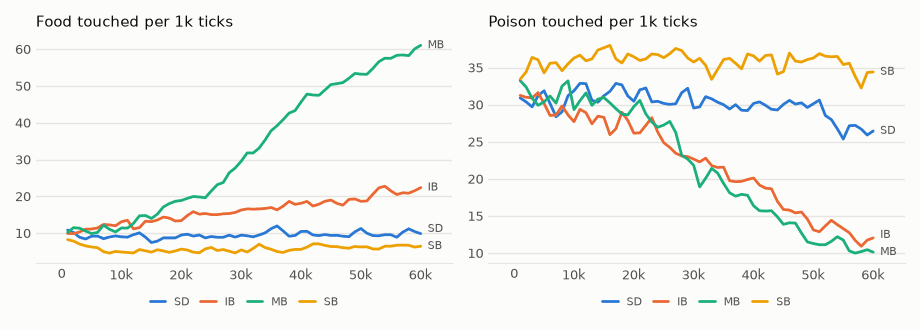
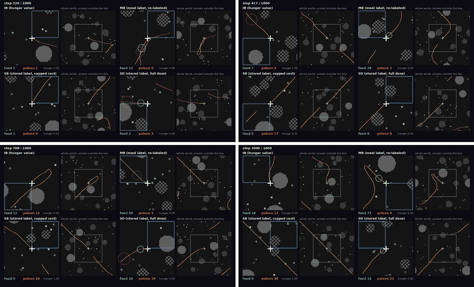

# vm-00099: A Poison Costs Its Full Dose at Any Hunger

**Date:** 2026-11-20
**Status:** Complete
**Source:** `exp/vm-00099` (code: `visual-motor-agent/dev/`)
**Outputs:** `~/data/research/visual-motor-agent/exp_00099/`
**Task plan:** [`../tasks/00110-full-dose-poison.md`](../tasks/00110-full-dose-poison.md)

## Goal

In vm-00098 the owner's stored label failed in the world with inertia: SB ate 6.4 food per 1k against IB's 19.9, and a third of its lives starved at the hunger cap. Hunger is clipped to [0, 1], and the stored label's poison cost is the rise of hunger, so near the cap a poison costs little and at the cap nothing. Here a poison costs its full dose at any hunger, while what the model senses stays as it was. Does the label then carry value back in time in the world with inertia? The design and the readings set before the results are in the task plan.

## Method

| Arm | World | Label | Seeds |
|---|---|---|---|
| SB (vm-00098), MB (vm-00097), IB (vm-00095), linked | inertia from birth | stored, capped cost; re-labeled; hunger value | 1–12 |
| SD | inertia from birth | stored, full dose (`online.full_dose = 1`) | 1–12 |

- **The full dose:** the world reports how much hunger the clip at 1 cut off (`info["hunger_cut"]`, 0 below the cap). Memory keeps it, and the stored label counts it in the rise, so a poison always costs 0.5. The monitors and the frozen `value` test count it the same way.
- **Everything else is SB's:** `configs/U_view.json`, 4 quarter transformers of 8 layers, tolerance .002, context 8, the ring, `model.body_label = 1`, `online.label = meal`, `label_gamma` 0.95, `env.inertia = 4`.
- **Card:** since the reboot of 2026-11-20 only the RTX 3090; 12 lives at once under MPS, 4.1 ticks/s each (2026-11-20 08:31 to 12:32).
- **Frozen tests:** `eval_hunger.py` chain, value, reach and move, and `eval_candidates.py`, as in vm-00098; the controls' rows are theirs.

## Results

### R1. Lived, ticks 40–60k, 12 seeds, 95% interval (t, df 11)

| Arm | Food per 1k | Poison per 1k | Mean hunger | Instinct overrides | Move CE | Patch CE | Smoothness |
|---|---|---|---|---|---|---|---|
| IB | 19.9 ± 0.9 | 14.34 ± 1.17 | .230 ± .053 | .697 | .408 | .7646 | .24 |
| MB | 54.2 ± 6.6 | 12.26 ± 1.23 | .093 ± .028 | .586 | .234 | .7605 | .51 |
| SB | 6.4 ± 3.2 | 35.50 ± 2.48 | .827 ± .102 | .255 | .118 | .7450 | .68 |
| **SD** | **9.8 ± 2.1** | **28.58 ± 2.47** | **.647 ± .093** | .447 | .189 | .7529 | .43 |

Paired by seed (in brackets: seeds above 0, of 12):

| Contrast | Food | Poison | Mean hunger | Overrides | Move CE | Smoothness |
|---|---|---|---|---|---|---|
| SD − SB | +3.3 ± 4.3 (8) | −6.9 ± 3.5 (2) | −.180 ± .171 (4) | +.192 ± .207 (7) | +.071 ± .071 (9) | −.250 ± .172 (2) |
| SD − IB | −10.1 ± 2.1 (0) | +14.2 ± 3.1 (12) | +.417 ± .124 (12) | −.250 ± .083 (0) | −.219 ± .041 (0) | +.193 ± .114 (10) |
| SD − MB | −44.5 ± 5.4 (0) | +16.3 ± 2.3 (12) | +.554 ± .089 (12) | −.139 ± .088 (2) | −.045 ± .046 (5) | −.076 ± .111 (4) |

### R2. Over the life, by 5k ticks, mean of 12 seeds

| Measure | Arm | 0–5k | 5–10k | 10–15k | 15–20k | 20–25k | 25–30k | 30–35k | 35–40k | 40–45k | 45–50k | 50–55k | 55–60k |
|---|---|---|---|---|---|---|---|---|---|---|---|---|---|
| Food per 1k | IB | 10.6 | 12.5 | 12.5 | 13.7 | 15.3 | 15.8 | 16.6 | 17.9 | 18.3 | 18.5 | 21.3 | 21.5 |
|  | MB | 10.5 | 11.4 | 13.7 | 18.1 | 20.5 | 27.0 | 34.7 | 43.2 | 48.7 | 52.2 | 56.4 | 59.6 |
|  | SB | 7.0 | 5.0 | 5.1 | 5.2 | 5.4 | 5.2 | 5.9 | 5.2 | 6.8 | 6.1 | 6.2 | 6.6 |
|  | SD | 9.4 | 8.9 | 8.8 | 9.0 | 9.2 | 9.1 | 10.1 | 10.2 | 9.5 | 10.1 | 9.3 | 10.2 |
| Poison per 1k | IB | 30.7 | 28.8 | 28.1 | 27.2 | 26.3 | 23.1 | 21.8 | 19.8 | 17.5 | 14.5 | 13.7 | 11.6 |
|  | MB | 31.2 | 31.0 | 31.0 | 29.5 | 28.0 | 23.4 | 20.0 | 17.3 | 15.0 | 12.4 | 11.6 | 10.0 |
|  | SB | 34.9 | 35.8 | 36.9 | 36.5 | 36.4 | 36.8 | 35.1 | 36.0 | 35.8 | 36.1 | 36.1 | 34.0 |
|  | SD | 30.8 | 30.2 | 31.4 | 31.8 | 30.8 | 30.7 | 30.4 | 29.7 | 29.9 | 30.2 | 27.3 | 26.9 |
| Mean hunger | IB | .71 | .61 | .63 | .51 | .43 | .43 | .38 | .44 | .24 | .21 | .23 | .24 |
|  | MB | .74 | .67 | .57 | .55 | .42 | .36 | .19 | .23 | .10 | .13 | .04 | .10 |
|  | SB | .77 | .81 | .89 | .84 | .89 | .82 | .87 | .81 | .87 | .81 | .82 | .80 |
|  | SD | .69 | .67 | .66 | .79 | .77 | .74 | .73 | .70 | .57 | .61 | .73 | .68 |
| Overrides | IB | .52 | .46 | .50 | .55 | .58 | .65 | .70 | .72 | .72 | .71 | .69 | .67 |
|  | MB | .22 | .19 | .21 | .29 | .35 | .43 | .51 | .54 | .58 | .60 | .59 | .58 |
|  | SB | .21 | .08 | .07 | .07 | .10 | .11 | .12 | .15 | .25 | .25 | .25 | .27 |
|  | SD | .37 | .23 | .23 | .24 | .28 | .32 | .34 | .39 | .42 | .43 | .46 | .48 |

SD's food is flat from the start: about 9 per 1k at 0–5k and 10 at 55–60k. MB's rises from 10.5 to 59.6 over the same life.

### R3. The label in life: predicted and stored against the true V, by ticks to the next meal (the two monitors)

SD's predictions for the moves it made, pooled over 12 seeds (true V in the last row is that of 40–60k; with the full dose a poison is counted at 0.5 at any hunger, so far from a meal the true V is below 0):

| Life | 0 | 1 | 2–3 | 4–7 | 8–15 | 16–31 | 32–63 | Bias over all ticks |
|---|---|---|---|---|---|---|---|---|
| 0–2k | .14 | .09 | .06 | .04 | .04 | .05 | .04 | −.093 ± .025 |
| 2–5k | .66 | .34 | .13 | .06 | .05 | .06 | .06 | −.066 ± .044 |
| 5–10k | .89 | .56 | .22 | .06 | .05 | .05 | .06 | −.081 ± .026 |
| 10–20k | .93 | .75 | .38 | .08 | .03 | .05 | .05 | −.063 ± .024 |
| 20–40k | .95 | .82 | .51 | .13 | .04 | .04 | .06 | −.058 ± .015 |
| 40–60k | .92 | .79 | .53 | .18 | .05 | .05 | .07 | −.059 ± .023 |
| true V, 40–60k | 1.00 | .95 | .87 | .71 | .44 | .12 | −.16 | |

SD's labels as stored in memory:

| Life | 0 | 1 | 2–3 | 4–7 | 8–15 | 16–31 | 32–63 | Bias over all ticks |
|---|---|---|---|---|---|---|---|---|
| 0–2k | 1.00 | .05 | .01 | −.01 | −.01 | −.01 | −.01 | −.126 ± .023 |
| 5–10k | 1.00 | .59 | .17 | .00 | −.02 | −.02 | −.02 | −.147 ± .020 |
| 20–40k | 1.00 | .77 | .43 | .05 | −.04 | −.04 | −.02 | −.138 ± .012 |
| 40–60k | 1.00 | .74 | .44 | .08 | −.04 | −.04 | −.03 | −.147 ± .016 |
| true V, 40–60k | 1.00 | .95 | .87 | .71 | .44 | .12 | −.16 | |

Against SB's (vm-00098 R3), at 40–60k four to seven ticks before a meal: SD predicts .18 (SB .20), stores .08 (SB .13). Mean of the seeds' own values, paired: SD − SB −.001 ± .071 (11 seeds; one of SB's has no meals then).

The bias over all ticks, by stage:

| Arm | 0–2k | 2–5k | 5–10k | 10–20k | 20–40k | 40–60k |
|---|---|---|---|---|---|---|
| MB predicted | −.189 | −.128 | −.069 | −.049 | −.015 | +.024 ± .007 (11 of 12 above 0) |
| SB predicted | −.242 | −.200 | −.181 | −.185 | −.162 | −.142 ± .047 (0 of 11 above 0) |
| SB stored | −.258 | −.237 | −.225 | −.224 | −.211 | −.199 ± .029 (0 of 11 above 0) |
| SD predicted | −.093 | −.066 | −.081 | −.063 | −.058 | −.059 ± .023 (1 of 12 above 0) |
| SD stored | −.126 | −.127 | −.147 | −.134 | −.138 | −.147 ± .016 (0 of 12 above 0) |

### R4. The label frozen: predicted against true V by ticks to the next real meal (`value`, 2,000 ticks × 16 bodies)

| Ticks to the meal | 0 | 1 | 2 | 4 | 6 | 8 | 10 | 15 | 20 | 30 |
|---|---|---|---|---|---|---|---|---|---|---|
| 0.95^k | 1.000 | .950 | .902 | .815 | .735 | .663 | .599 | .463 | .358 | .215 |
| MB predicted | .993 | .947 | .893 | .791 | .701 | .526 | .466 | .433 | .420 | .410 |
| MB true | 1.000 | .949 | .896 | .788 | .694 | .612 | .539 | .389 | .272 | .118 |
| SB predicted | .779 | .638 | .499 | .261 | .159 | .108 | .106 | .098 | .110 | .141 |
| SB true | 1.000 | .949 | .898 | .789 | .694 | .616 | .548 | .402 | .294 | .138 |
| SD predicted | .912 | .761 | .580 | .271 | .121 | .061 | .054 | .051 | .052 | .080 |
| SD true | 1.000 | .949 | .897 | .784 | .684 | .590 | .500 | .321 | .181 | −.018 |

Over all ticks (T): MB predicted .198, true .236, correlation .74, candidates' spread .0235; SB .439 against .472, correlation .32, spread .0059; SD .455 against .532, correlation .42, spread .0101.

### R5. Frozen foraging (`chain`, 1,500 ticks × 16 bodies)

| Arm | Food | Blind | Blind + perfect grab | Seen − grab | Poison | Smoothness |
|---|---|---|---|---|---|---|
| IB | 22.2 ± 1.6 | 9.5 | 11.0 | +11.2 ± 1.3 | 12.0 ± 1.7 | .25 |
| MB | 57.3 ± 9.0 | 10.6 | 12.4 | +44.9 ± 9.0 | 10.9 ± 3.2 | .54 |
| SB | 7.3 ± 3.1 | 6.1 | 6.6 | +0.7 ± 1.0 | 35.1 ± 2.5 | .66 |
| SD | 10.9 ± 1.8 | 8.8 | 10.3 | +0.6 ± 0.7 | 27.9 ± 2.0 | .42 |

Paired: SD − SB food +3.6 ± 4.0 (9 above 0), poison −7.2 ± 3.3 (2); SD − IB food −11.3 ± 2.1 (0), poison +15.9 ± 2.5 (12).

"Seen − grab" is the food the arm eats beyond a blind body that grabs every food it touches: what seeing adds. For SD it is +0.6 ± 0.7, as for SB: neither forages by sight.

### R6. How the body moves, and food in reach (`move` and `reach`, frozen)

| Arm | Mean hunger | Speed | Braking | Food within 8 px: speed, motion's aim | Motion's aim, 8–16 px; 16–32 px | Poison within 8 px: share, motion away | Food in reach | Eaten when in reach |
|---|---|---|---|---|---|---|---|---|
| MB | .105 | 4.38 | .11 | 4.51, .71 | .65; .51 | .17, −.09 | .060 | .96 |
| SB | .765 | 5.27 | .04 | 5.14, .21 | .10; .04 | .21, −.23 | .008 | .89 |
| SD | .644 | 4.87 | .11 | 4.87, .28 | .14; .07 | .21, −.20 | .012 | .88 |

(The motion's aim is the cosine between the body's motion and the direction to the nearest food: 1 straight at it, 0 unrelated.) SD brakes more than SB and is at top speed less often (.77 of ticks against .92), but its motion still hardly points at food 8 px or more away (.14), where MB's does (.65).

### R7. Poison, and how different the instinct's candidates are (frozen)

The `reach` test's poison pairs (a move into poison against one that is not, from the same state) and `eval_candidates.py` (300 ticks × 16 bodies):

| Arm | Poison moves rated worse by (T) | Worse by more than .002 | The instinct's pick is a poison move |
|---|---|---|---|
| IB | .023 ± .004 | .61 ± .02 | .35 ± .02 |
| MB | .040 ± .009 | .74 ± .05 | .26 ± .04 |
| SB | .004 ± .002 | .30 ± .09 | .53 ± .04 |
| SD | .012 ± .003 | .55 ± .04 | .42 ± .04 |

Paired SD − SB: rated worse by +.008 ± .004 (10 of 12 above 0); the pick is a poison move −.105 ± .063 (2 of 12 above 0).

| Arm | Distinct moves among the 16 | Ticks with all 16 the same move | Label spread (median) | Food per 1k (this test) | Mean hunger |
|---|---|---|---|---|---|
| IB | 9.5 ± 0.5 | .02 ± .01 | .0145 ± .0025 | 20.5 ± 1.7 | .25 |
| MB | 5.7 ± 0.9 | .07 ± .02 | .0241 ± .0059 | 53.1 ± 8.1 | .15 |
| SB | 3.7 ± 1.2 | .30 ± .17 | .0058 ± .0052 | 8.3 ± 2.4 | .70 |
| SD | 5.4 ± 0.9 | .13 ± .05 | .0101 ± .0048 | 11.4 ± 1.4 | .59 |

SD's candidates are about as varied as MB's (5.4 distinct moves against 5.7), but its labels differ between them by less than half as much (spread .0101 against .0241).

### R8. SD seed by seed (lived; frozen spread from `value`, food and blind food from `chain`)

| Seed | Food 0–10k | Food 50–60k | Mean hunger 40–60k | Overrides 40–60k | Smoothness 40–60k | Frozen spread | Frozen food, blind food |
|---|---|---|---|---|---|---|---|
| 1 | 7.9 | 13.0 | .64 | .52 | .52 | .0100 | 10.1, 7.9 |
| 2 | 10.2 | 9.0 | .56 | .59 | .61 | .0156 | 9.3, 7.5 |
| 3 | 9.8 | 11.1 | .59 | .58 | .38 | .0121 | 13.7, 9.1 |
| 4 | 11.2 | 2.9 | .90 | .31 | .65 | .0010 | 11.6, 12.2 |
| 5 | 8.9 | 11.9 | .57 | .35 | .25 | .0025 | 12.2, 11.0 |
| 6 | 10.4 | 14.5 | .47 | .61 | .44 | .0101 | 14.2, 9.2 |
| 7 | 10.3 | 10.0 | .81 | .30 | .62 | .0237 | 10.2, 6.9 |
| 8 | 12.3 | 11.7 | .60 | .49 | .18 | .0071 | 13.9, 10.5 |
| 9 | 9.5 | 13.2 | .45 | .56 | .28 | .0284 | 11.2, 10.1 |
| 10 | 7.5 | 8.1 | .62 | .35 | .31 | .0029 | 9.1, 8.0 |
| 11 | 8.5 | 9.1 | .67 | .39 | .26 | .0056 | 11.0, 9.2 |
| 12 | 3.3 | 2.7 | .88 | .32 | .66 | .0023 | 4.1, 3.6 |

SB's food at 50–60k, for comparison: 10.4, 0.0, 0.0, 9.8, 11.0, 0.6, 5.1, 14.5, 0.2, 10.1, 5.0, 10.2. Mean hunger above .95 at 40–60k: SB seeds 2, 3, 6 and 9; none of SD's (the highest are seeds 4 at .90 and 12 at .88).

## Readings

1. **Plumbing: met.** The 7 tests of `tests/test_full_dose.py` and 242 world, label, value and memory tests pass; all 12 lives ran 60k ticks without an error.
2. **Poison is seen: met, partly** (R7). SD's label rates a poison move .012 worse in T (SB .004; paired +.008 ± .004, 10 of 12 seeds), and its instinct picks a poison move on .42 of such ticks (SB .53; paired −.105 ± .063, lower in 10 of 12). Both are still far from MB's (.040 and .26) and IB's (.023 and .35).
3. **No starvation trap: met.** No SD life starves at 40–60k (mean hunger above .95), against 4 of SB's 12. Two come close (seeds 4 and 12 at .90 and .88).
4. **The front moves back: fails** (R3). SD predicts .18 four to seven ticks before a meal at 40–60k (SB .20); paired −.001 ± .071. Its stored labels there are .08 (true .71).
5. **It forages: not resolved against SB, far below IB.** SD − SB food +3.3 ± 4.3 (higher in 8 of 12), poison −6.9 ± 3.5, mean hunger −.180 ± .171. SD eats 9.8 per 1k against IB's 19.9 (−10.1 ± 2.1, lower in all 12) and MB's 54.2.

**The outcome set in the plan:** readings 2 and 3 hold, and SD stays below IB, so the plan's branch is "the cap was one trap, and the one-tick choice under inertia is the remaining one". The results do not support the second half of that sentence (Analysis).

<!-- figures -->
## Figures

*The world of this experiment as its model sees it, every 12 ticks. Moves are random: this shows the world, not the trained agent.*

*From each run's `metrics.jsonl`, the mean of its seeds by arm, smoothed. All in the world with inertia from birth: IB the hunger value (vm-00095), MB the meal label re-labeled at every replay (vm-00097), SB the meal label stored once (vm-00098), SD stored once with the full dose of poison.*

*Stills from this experiment's video, in time order. Seed 5 at 60k, frozen, from the same start, in the world with inertia: IB (the hunger value), MB (the meal label, re-labeled at every replay), SB (stored once, capped poison cost) and SD (stored once, full dose). Each arm's 64 x 64 view (the blue square: the quarter transformer whose move it was), and beside it the whole world with the window outlined. Plain circles are food, checkered ones poison. Seed 3 (where SB starved) is in videos/vm99_s3.*
<!-- /figures -->

## Analysis

- **The cap was a trap, and the full dose removes it.**
  - No SD life starves; SB's seeds 2, 3, 6 and 9 sat at the cap and ate almost nothing at 50–60k.
  - SD eats a fifth less poison than SB (28.6 against 35.5 per 1k), its label sees poison three times as clearly, and its instinct steers more (overrides .45 against .26).
  - The lives that do not starve forage alike in the two arms: SB's healthy seeds eat 10–15 per 1k at 50–60k, SD's 8–15. The full dose mainly saves the lives that would have starved; it does not make the others forage better.
- **The label still reaches only two or three ticks back** (R3, R4).
  - Stored, the label four to seven ticks before a meal is .08 in SD and .13 in SB (true .71); frozen, at 8 ticks SD predicts .06 (true .59). With a value that is flat beyond three ticks, the instinct cannot tell a move that leads to food 10 ticks later from one that does not.
  - In SD it hardly moves after 20k ticks: the prediction four to seven ticks before a meal goes .13, .18 from 20–40k to 40–60k; MB's re-labeled label was at .79 at four ticks frozen.
  - So SD forages blind (R5): seeing adds +0.6 ± 0.7 food per 1k over a blind body that grabs every food it touches; IB's sight adds +11.2 and MB's +44.9. Its motion hardly aims at food 8 px or more away (R6).
- **Why this is not mainly the one-tick choice.**
  - MB has the same world with inertia, the same one-tick instinct, the same 16 candidates from the model's own move prediction, and even the capped poison cost; it eats 54.2 per 1k.
  - Its candidates are about as varied as SD's (5.7 and 5.4 distinct moves); what differs is how much their labels differ (.0241 against .0101) and how far back the label is right.
  - What separates MB from SB and SD is the label: re-labeled at every replay with the current model, in the hunger channel; or stored once from the model's prediction one tick later, in its own body channel. vm-00098 could not split these two changes, and neither can this experiment.
- **Why a stored label stalls** (a reading of R3, not tested). A stored label is .95 times what the model predicted one tick later, at the time. Ticks four or more before a meal were mostly stored while the model predicted about .1 there, and long-term memory keeps replaying them unchanged. The model learns those targets, so its prediction stays near .1, and new labels are stored from it. Re-labeling breaks this loop: every replay recomputes the target from the current model, so each improvement reaches the whole memory.
- **The stored labels are pessimistic** (R3): SD's stored labels are −.147 below the true V over all ticks, its predictions −.059. MB's predictions are slightly optimistic (+.024). A pessimistic label is not an optimism problem; it is the same stall seen as a bias.

## Conclusions

1. Counting a poison's full dose in the stored label removes the starvation trap in the world with inertia: no SD life starved, against 4 of SB's 12. The label sees poison three times as clearly as SB's, and SD eats a fifth less poison.
2. It does not make the stored label forage: SD eats 9.8 food per 1k against IB's 19.9 and MB's 54.2, and its label is right only two or three ticks before a meal.
3. The one-tick choice under inertia is not the main limit: MB has it too and eats five times as much. The difference is in the label, stored once against re-labeled at every replay (with the channel as a second, unsplit change).

## Next steps

- **Split the two changes** (as set in vm-00098's plan), in the world with inertia with the full dose:
  - the meal label re-labeled at every replay, in its own body channel (MB's mechanism, SD's channel);
  - and, if wanted, the stored label in the hunger channel.
  This shows whether the owner's "label computed once" is what costs the foraging, which needs the owner's view: the owner called re-labeling a cheat (vm-00098).
- **The full dose for MB:** it costs nothing and protects a re-labeled label in hungry stretches; MB's hunger stays low, so it was not tested here.
- **Breakout (task 00111)** needs a label right 30 to 60 ticks back, which neither stored arm reaches; it waits for the outcome above.
