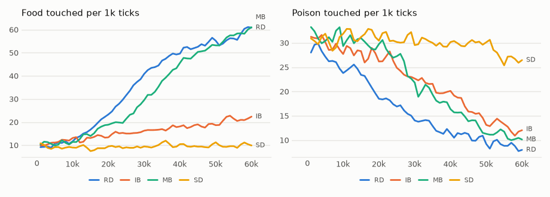
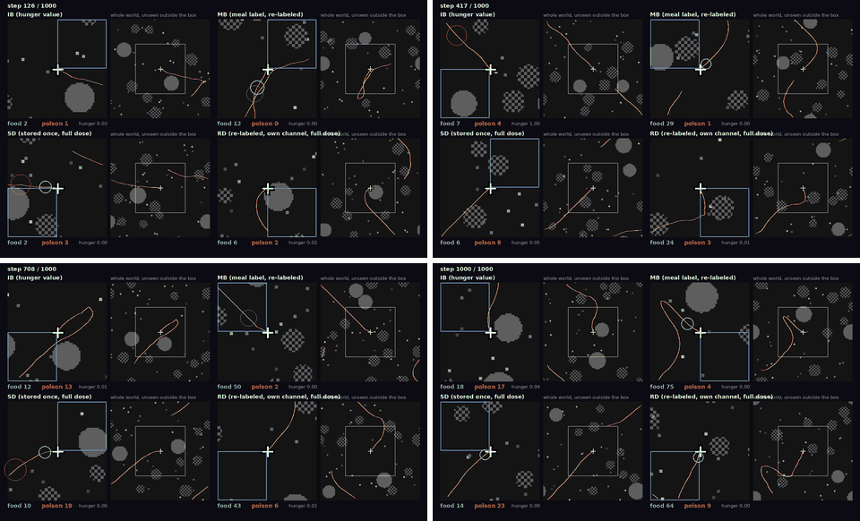

# vm-00100: The Body Label Re-labeled at Every Replay, with the Full Dose

**Date:** 2026-11-20
**Status:** Complete
**Source:** `exp/vm-00100` (code: `visual-motor-agent/dev/`)
**Outputs:** `~/data/research/visual-motor-agent/exp_00100/`
**Task plan:** [`../tasks/00112-relabeled-body-label.md`](../tasks/00112-relabeled-body-label.md)

## Goal

- **vm-00099:** the stored label with the full dose (SD) no longer starved, but it still foraged blind: 9.8 food per 1k against MB's 54.2. Its label was right only two or three ticks before a meal.
- **MB differs from SD in three ways:**
  1. it is re-labeled at every replay;
  2. its label is the hunger channel's target;
  3. its cost includes the drift, without the full dose.
- **Here only the first changes:** SD's label, in SD's channel, re-labeled at every update from each transformer's current prediction.
- **The question:** does storing once cost the foraging?

The design and the readings set before the results are in the task plan.

## Method

| Arm | World | Label | Seeds |
|---|---|---|---|
| SD (vm-00099), MB (vm-00097), IB (vm-00095), linked | inertia from birth | stored once, own channel, full dose; re-labeled in the hunger channel; hunger value | 1–12 |
| RD | inertia from birth | re-labeled at every update, own channel, full dose (`online.label_refresh = 1`) | 1–12 |

- **The re-labeling:**
  - memory keeps the facts: hunger before and after, the episode's end, the cut, and one step past each chunk;
  - at every update, each transformer's label of step t follows the stored label's rule, but with its current prediction (label channel) for the move made at t + 1. That prediction comes from a forward pass without gradient over the window one step later (MB's bootstrap window);
  - the stored labels are still written, as in SD, but not trained on. The monitor `meal_stored` shows them.
- **Everything else is SD's:**
  - `configs/U_view.json`, 4 quarter transformers of 8 layers, tolerance .002, context 8, the ring;
  - `model.body_label = 1`, `online.label = meal`, `label_gamma` 0.95, `online.full_dose = 1`, `env.inertia = 4`.
- **Card:** the RTX 3090, 12 lives at once under MPS, 3.0 ticks/s each (5.5 h; SD ran at 4.1).
- **Frozen tests at 60k:**
  - `eval_hunger.py` chain (1,500 ticks), value (2,000), reach (1,500) and move (1,500), × 16 bodies;
  - `eval_candidates.py` (300 ticks × 16 bodies).

## Results

### R1. Lived, ticks 40–60k, 12 seeds, 95% interval (t, df 11)

| Arm | Food per 1k | Poison per 1k | Mean hunger | Instinct overrides | Move CE | Patch CE | Smoothness |
|---|---|---|---|---|---|---|---|
| IB | 19.9 ± 0.9 | 14.34 ± 1.17 | .230 ± .053 | .697 | .408 | .7646 | .24 |
| MB | 54.2 ± 6.6 | 12.26 ± 1.23 | .093 ± .028 | .586 | .234 | .7605 | .51 |
| SD | 9.8 ± 2.1 | 28.58 ± 2.47 | .647 ± .093 | .447 | .189 | .7529 | .43 |
| **RD** | **55.5 ± 7.3** | **9.73 ± 0.63** | **.082 ± .023** | .488 | .179 | .7608 | .57 |

Paired by seed (in brackets: seeds above 0, of 12):

| Contrast | Food | Poison | Mean hunger | Overrides | Move CE | Smoothness |
|---|---|---|---|---|---|---|
| RD − SD | +45.8 ± 8.4 (12) | −18.8 ± 2.6 (0) | −.565 ± .095 (0) | +.041 ± .081 (6) | −.010 ± .041 (5) | +.136 ± .154 (8) |
| RD − MB | +1.3 ± 12.9 (7) | −2.5 ± 1.5 (1) | −.011 ± .043 (4) | −.098 ± .067 (2) | −.055 ± .041 (1) | +.060 ± .067 (9) |
| RD − IB | +35.6 ± 7.6 (12) | −4.6 ± 1.4 (0) | −.149 ± .060 (0) | −.209 ± .065 (0) | −.229 ± .043 (0) | +.328 ± .063 (12) |

No life of any arm starves (mean hunger above .95 at 40–60k). RD's highest is .14.

### R2. Over the life, by 5k ticks, mean of 12 seeds

| Measure | Arm | 0–5k | 5–10k | 10–15k | 15–20k | 20–25k | 25–30k | 30–35k | 35–40k | 40–45k | 45–50k | 50–55k | 55–60k |
|---|---|---|---|---|---|---|---|---|---|---|---|---|---|
| Food per 1k | IB | 10.6 | 12.5 | 12.5 | 13.7 | 15.3 | 15.8 | 16.6 | 17.9 | 18.3 | 18.5 | 21.3 | 21.5 |
|  | MB | 10.5 | 11.4 | 13.7 | 18.1 | 20.5 | 27.0 | 34.7 | 43.2 | 48.7 | 52.2 | 56.4 | 59.6 |
|  | SD | 9.4 | 8.9 | 8.8 | 9.0 | 9.2 | 9.1 | 10.1 | 10.2 | 9.5 | 10.1 | 9.3 | 10.2 |
|  | RD | 9.8 | 11.3 | 15.4 | 21.5 | 29.0 | 38.3 | 44.7 | 49.2 | 52.5 | 54.7 | 55.0 | 59.9 |
| Poison per 1k | IB | 30.7 | 28.8 | 28.1 | 27.2 | 26.3 | 23.1 | 21.8 | 19.8 | 17.5 | 14.5 | 13.7 | 11.6 |
|  | MB | 31.2 | 31.0 | 31.0 | 29.5 | 28.0 | 23.4 | 20.0 | 17.3 | 15.0 | 12.4 | 11.6 | 10.0 |
|  | SD | 30.8 | 30.2 | 31.4 | 31.8 | 30.8 | 30.7 | 30.4 | 29.7 | 29.9 | 30.2 | 27.3 | 26.9 |
|  | RD | 28.4 | 25.2 | 24.5 | 20.3 | 17.8 | 15.3 | 13.5 | 11.5 | 11.2 | 9.9 | 9.3 | 8.5 |
| Mean hunger | IB | .71 | .61 | .63 | .51 | .43 | .43 | .38 | .44 | .24 | .21 | .23 | .24 |
|  | MB | .74 | .67 | .57 | .55 | .42 | .36 | .19 | .23 | .10 | .13 | .04 | .10 |
|  | SD | .69 | .67 | .66 | .79 | .77 | .74 | .73 | .70 | .57 | .61 | .73 | .68 |
|  | RD | .68 | .45 | .56 | .40 | .20 | .14 | .09 | .11 | .11 | .10 | .03 | .09 |
| Overrides | IB | .52 | .46 | .50 | .55 | .58 | .65 | .70 | .72 | .72 | .71 | .69 | .67 |
|  | MB | .22 | .19 | .21 | .29 | .35 | .43 | .51 | .54 | .58 | .60 | .59 | .58 |
|  | SD | .37 | .23 | .23 | .24 | .28 | .32 | .34 | .39 | .42 | .43 | .46 | .48 |
|  | RD | .37 | .40 | .46 | .49 | .54 | .54 | .55 | .52 | .50 | .49 | .48 | .48 |

**RD against MB by stage,** paired by seed:

| Stage | Food | Poison | Mean hunger |
|---|---|---|---|
| 0–5k | −0.7 ± 2.2 (5) | −2.8 ± 3.0 (4) | −.059 ± .166 (4) |
| 5–10k | −0.1 ± 2.2 (6) | −5.8 ± 2.0 (0) | −.215 ± .167 (3) |
| 10–20k | +2.5 ± 3.4 (8) | −7.8 ± 2.6 (1) | −.087 ± .120 (4) |
| 20–40k | +9.0 ± 7.9 (9) | −7.7 ± 2.6 (0) | −.164 ± .082 (0) |
| 40–60k | +1.3 ± 12.9 (7) | −2.5 ± 1.5 (1) | −.011 ± .043 (4) |

- **RD learns to avoid poison earlier than MB:** it is lower from 5–10k on, in every seed.
- **It forages earlier:** it leads by 9 food per 1k at 20–40k.
- **MB catches up by 40–60k.**

### R3. The label in life: predicted and stored against the true V, by ticks to the next meal (the two monitors)

RD's predictions for the moves it made, pooled over 12 seeds. The true V in the last row is that of 40–60k.

| Life | 0 | 1 | 2–3 | 4–7 | 8–15 | 16–31 | 32–63 | Bias over all ticks |
|---|---|---|---|---|---|---|---|---|
| 0–2k | .07 | .04 | .03 | .02 | .00 | −.01 | −.01 | −.193 ± .029 |
| 2–5k | .44 | .31 | .21 | .10 | .00 | .01 | .02 | −.118 ± .035 |
| 5–10k | .79 | .64 | .46 | .24 | .05 | .05 | .06 | −.079 ± .024 |
| 10–20k | .92 | .84 | .68 | .41 | .11 | .10 | .12 | −.042 ± .012 |
| 20–40k | .98 | .93 | .83 | .64 | .31 | .27 | .26 | +.006 ± .007 |
| 40–60k | .99 | .94 | .87 | .71 | .43 | .37 | .36 | +.033 ± .005 |
| true V, 40–60k | 1.00 | .95 | .87 | .73 | .52 | .25 | .01 | |

SD's, for comparison (vm-00099 R3): 40–60k predicted .92, .79, .53, .18, .05, .05, .07 against true 1.00, .95, .87, .71, .44, .12, −.16.

RD's labels as SD's mechanism would have stored them (written each tick from RD's model, not trained on):

| Life | 0 | 1 | 2–3 | 4–7 | 8–15 | 16–31 | 32–63 | Bias over all ticks |
|---|---|---|---|---|---|---|---|---|
| 0–2k | 1.00 | −.03 | −.05 | −.06 | −.07 | −.08 | −.08 | −.238 ± .026 |
| 5–10k | 1.00 | .55 | .32 | .10 | −.08 | −.10 | −.08 | −.209 ± .020 |
| 20–40k | 1.00 | .88 | .76 | .54 | .19 | .13 | .11 | −.105 ± .010 |
| 40–60k | 1.00 | .92 | .82 | .65 | .33 | .26 | .24 | −.047 ± .007 |

**At 40–60k, four to seven ticks before a meal** (the mean of the seeds' own values): RD predicts .712, SD .164. Paired RD − SD +.548 ± .038, higher in all 12. SD stored .08 there, while RD's unused stored labels reach .65.

The bias over all ticks, by stage:

| Arm | 0–2k | 2–5k | 5–10k | 10–20k | 20–40k | 40–60k |
|---|---|---|---|---|---|---|
| MB predicted | −.189 | −.128 | −.069 | −.049 | −.015 | +.024 ± .007 (11 of 12 above 0) |
| SD predicted | −.093 | −.066 | −.081 | −.063 | −.058 | −.059 ± .023 (1 of 12 above 0) |
| SD stored | −.126 | −.127 | −.147 | −.134 | −.138 | −.147 ± .016 (0 of 12 above 0) |
| RD predicted | −.193 | −.118 | −.079 | −.042 | +.006 | +.033 ± .005 (12 of 12 above 0) |
| RD stored (not trained on) | −.238 | −.229 | −.209 | −.178 | −.105 | −.047 ± .007 (0 of 12 above 0) |

### R4. The label frozen: predicted against true V by ticks to the next real meal (`value`, 2,000 ticks × 16 bodies)

| Ticks to the meal | 0 | 1 | 2 | 4 | 6 | 8 | 10 | 15 | 20 | 30 |
|---|---|---|---|---|---|---|---|---|---|---|
| 0.95^k | 1.000 | .950 | .902 | .815 | .735 | .663 | .599 | .463 | .358 | .215 |
| MB predicted | .993 | .947 | .893 | .791 | .701 | .526 | .466 | .433 | .420 | .410 |
| MB true | 1.000 | .949 | .896 | .788 | .694 | .612 | .539 | .389 | .272 | .118 |
| SD predicted | .912 | .761 | .580 | .271 | .121 | .061 | .054 | .051 | .052 | .080 |
| SD true | 1.000 | .949 | .897 | .784 | .684 | .590 | .500 | .321 | .181 | −.018 |
| **RD predicted** | **.994** | **.948** | **.898** | **.797** | **.708** | **.515** | **.461** | **.424** | **.411** | **.403** |
| RD true | 1.000 | .949 | .897 | .791 | .699 | .620 | .549 | .398 | .282 | .120 |

**Over all ticks (T):**

| Arm | Predicted | True | Correlation | Candidates' spread |
|---|---|---|---|---|
| RD | .196 | .221 | .76 | .0159 |
| MB | .198 | .236 | .74 | .0235 |
| SD | .455 | .532 | .42 | .0101 |

- **RD's frozen label is MB's, almost value for value.** It is right to within .01 out to 6 ticks before a meal.
- **Further out, both level off near .41.** The true V falls to .12 at 30 ticks.

### R5. Frozen foraging (`chain`, 1,500 ticks × 16 bodies)

| Arm | Food | Blind | Blind + perfect grab | Seen − grab | Poison | Smoothness |
|---|---|---|---|---|---|---|
| IB | 22.2 ± 1.6 | 9.5 | 11.0 | +11.2 ± 1.3 | 12.0 ± 1.7 | .25 |
| MB | 57.3 ± 9.0 | 10.6 | 12.4 | +44.9 ± 9.0 | 10.9 ± 3.2 | .54 |
| SD | 10.9 ± 1.8 | 8.8 | 10.3 | +0.6 ± 0.7 | 27.9 ± 2.0 | .42 |
| **RD** | **59.3 ± 7.5** | 11.0 | 12.7 | **+46.6 ± 7.9** | **9.7 ± 1.3** | .58 |

**Paired:**

| Contrast | Food | Poison |
|---|---|---|
| RD − SD | +48.4 ± 8.4 (12) | −18.2 ± 2.7 (0) |
| RD − MB | +2.0 ± 12.9 (6) | −1.2 ± 3.8 (6) |
| RD − IB | +37.1 ± 7.8 (12) | −2.3 ± 2.3 (4) |

RD forages by sight: seeing adds +46.6 food per 1k over a blind body that grabs every food it touches (SD +0.6).

### R6. How the body moves, and food in reach (`move` and `reach`, frozen)

| Arm | Mean hunger | Speed | Braking | Food within 8 px: speed, motion's aim | Motion's aim, 8–16 px; 16–32 px | Poison within 8 px: share, motion away | Food in reach | Eaten when in reach |
|---|---|---|---|---|---|---|---|---|
| MB | .105 | 4.38 | .11 | 4.51, .71 | .65; .51 | .17, −.09 | .060 | .96 |
| SD | .644 | 4.87 | .11 | 4.87, .28 | .14; .07 | .21, −.20 | .012 | .88 |
| RD | .080 | 4.48 | .08 | 4.58, .72 | .66; .50 | .17, −.07 | .061 | .97 |

RD's motion aims at food 8–16 px away as MB's does (.66 against .65; SD .14). It is in reach of food five times as often as SD.

### R7. Poison, and how different the instinct's candidates are (frozen)

The `reach` test's poison pairs (a move into poison against one that is not, from the same state), and `eval_candidates.py` (300 ticks × 16 bodies):

| Arm | Poison moves rated worse by (T) | Worse by more than .002 | The instinct's pick is a poison move |
|---|---|---|---|
| IB | .023 ± .004 | .61 ± .02 | .35 ± .02 |
| MB | .040 ± .009 | .74 ± .05 | .26 ± .04 |
| SD | .012 ± .003 | .55 ± .04 | .42 ± .04 |
| **RD** | **.050 ± .007** | **.75 ± .02** | **.24 ± .03** |

| Arm | Distinct moves among the 16 | Ticks with all 16 the same move | Label spread (median) | Food per 1k (this test) | Mean hunger |
|---|---|---|---|---|---|
| IB | 9.5 ± 0.5 | .02 ± .01 | .0145 ± .0025 | 20.5 ± 1.7 | .25 |
| MB | 5.7 ± 0.9 | .07 ± .02 | .0241 ± .0059 | 53.1 ± 8.1 | .15 |
| SD | 5.4 ± 0.9 | .13 ± .05 | .0101 ± .0048 | 11.4 ± 1.4 | .59 |
| RD | 4.4 ± 0.7 | .10 ± .05 | .0174 ± .0060 | 54.3 ± 8.4 | .14 |

- **RD's candidates are the least varied of the four arms** (4.4 distinct moves; seed 10 has all 16 the same on .30 of ticks).
- **Yet RD forages as well as MB.** Seed 10 eats the most of all (77.9 per 1k in this test).

### R8. RD seed by seed (lived; frozen spread from `value`, food and blind food from `chain`)

| Seed | Food 0–10k | Food 50–60k | Mean hunger 40–60k | Overrides 40–60k | Smoothness 40–60k | Frozen spread | Frozen food, blind food |
|---|---|---|---|---|---|---|---|
| 1 | 9.7 | 49.7 | .14 | .50 | .59 | .0141 | 51.5, 12.1 |
| 2 | 8.0 | 65.4 | .04 | .53 | .54 | .0261 | 65.8, 9.0 |
| 3 | 12.3 | 72.5 | .01 | .63 | .54 | .0294 | 68.5, 9.5 |
| 4 | 10.8 | 44.8 | .07 | .41 | .41 | .0117 | 43.8, 12.0 |
| 5 | 10.5 | 50.3 | .09 | .51 | .59 | .0313 | 58.9, 10.7 |
| 6 | 11.5 | 50.4 | .12 | .50 | .60 | .0124 | 51.8, 11.2 |
| 7 | 13.9 | 40.6 | .12 | .46 | .43 | .0056 | 45.8, 12.4 |
| 8 | 8.7 | 42.0 | .07 | .41 | .72 | .0043 | 43.4, 12.2 |
| 9 | 10.7 | 63.1 | .08 | .44 | .57 | .0138 | 69.0, 10.5 |
| 10 | 9.5 | 76.3 | .11 | .33 | .63 | .0057 | 78.8, 10.7 |
| 11 | 10.6 | 61.2 | .06 | .53 | .61 | .0185 | 65.0, 10.2 |
| 12 | 10.5 | 72.7 | .08 | .60 | .58 | .0182 | 69.6, 11.5 |

**Food at 50–60k for comparison:**

| Arm | Seeds 1–12 |
|---|---|
| MB | 71.2, 67.9, 55.4, 43.1, 70.7, 66.9, 68.8, 63.7, 45.3, 39.9, 56.5, 46.4 |
| SD | 13.0, 9.0, 11.1, 2.9, 11.9, 14.5, 10.0, 11.7, 13.2, 8.1, 9.1, 2.7 |

## Readings

1. **Plumbing: met.**
   - The 5 tests of `tests/test_label_refresh.py` pass: on a table, the re-labeled label equals the stored label with the same next prediction; the bootstrap window is the training window one step later; the option checks; nothing changes with the option off.
   - 229 label, value, memory and world tests pass.
   - All 12 lives ran 60k ticks without an error.
2. **The front moves back: met** (R3). Four to seven ticks before a meal at 40–60k, RD predicts .71 (true .73) against SD's .16. Paired +.548 ± .038, higher in all 12 seeds.
3. **Re-labeling forages: met** (R1).
   - RD − SD food at 40–60k is +45.8 ± 8.4, higher in all 12 seeds: 55.5 per 1k against 9.8.
   - Poison −18.8 ± 2.6 and mean hunger −.565 ± .095, lower in all 12.
4. **Against MB (descriptive): level at the end, ahead before.**
   - At 40–60k, food is +1.3 ± 12.9 and mean hunger −.011 ± .043.
   - Poison is −2.5 ± 1.5 (lower in 11 of 12).
   - At 20–40k RD eats +9.0 ± 7.9 more and is lower in poison from 5–10k on (R2).
5. **Poison (descriptive):** RD rates a poison move .050 worse in T (MB .040, SD .012), and its instinct picks a poison move on .24 of such ticks (MB .26, SD .42).

**The outcome set in the plan:** reading 3 holds and RD comes up to MB.
- So storing once is what cost the foraging.
- The label in its own channel, re-labeled, with the full dose, is the candidate default; that is the owner's decision.
- Breakout (task 00111) is to be built on it.

<!-- figures -->
## Figures

*The world of this experiment as its model sees it, every 12 ticks. Moves are random: this shows the world, not the trained agent.*

*From each run's `metrics.jsonl`, the mean of its seeds by arm, smoothed. All in the world with inertia from birth: IB the hunger value (vm-00095), MB the meal label re-labeled at every replay in the hunger channel (vm-00097), SD stored once in its own channel with the full dose (vm-00099), RD re-labeled at every replay in its own channel with the full dose.*

*Stills from this experiment's video, in time order. Seed 5 at 60k, frozen, from the same start, in the world with inertia: IB (the hunger value), MB (the meal label, re-labeled, in the hunger channel), SD (stored once, own channel, full dose) and RD (re-labeled, own channel, full dose). Each arm's 64 x 64 view (the blue square: the quarter transformer whose move it was), and beside it the whole world with the window outlined. Plain circles are food, checkered ones poison. Seed 3 is in videos/vm100_s3.*
<!-- /figures -->

## Analysis

- **Storing once was the cost; the channel was not.**
  - RD differs from SD only in when the label is computed, and it eats 5.7 times as much with half the poison.
  - It differs from MB in the channel, the drift cost and the full dose, and ends level with MB.
  - So of vm-00098's two unsplit changes, re-labeling carries the whole effect. The label's own body channel costs nothing: hunger stays plain hunger, and the label is still enough.
- **The stall loop of vm-00099 is confirmed** (R3, the stored monitor).
  - RD writes the stored labels by exactly SD's rule but never trains on them. At 40–60k those labels are .65 four to seven ticks before a meal, where SD's were .08.
  - So the rule is not wrong: a label stored from a good model is close to right.
  - What fails in SD is the loop. Labels stored early in life, from a model that knew nothing, stay in long-term memory and keep being replayed unchanged. The model learns them, so it stays where it was, and new labels are stored from it.
  - Re-labeling makes every improvement of the model reach every replayed step, so the front moves back by about one tick per round of learning: .24 at 5–10k, .41 at 10–20k, .64 at 20–40k, .71 at 40–60k (four to seven ticks before a meal).
- **RD is earlier than MB, especially with poison** (R2). It avoids poison from 5–10k on, every seed, and leads on food at 20–40k.
  - A likely cause, not tested here: the full dose. Early in life hunger is high, and MB's capped cost makes a poison near the cap cost little, while RD's costs its full 0.5.
  - MB also pays the drift on every tick, which adds a constant to the label everywhere and may make the meal's signal slower to stand out.
- **Far from a meal the re-labeled label is optimistic** (R3, R4).
  - In life RD predicts .36 at 32–63 ticks where the true V is .01. Frozen it levels off at about .41 beyond 15 ticks (true .12 at 30); MB is the same.
  - Its bias over all ticks turned positive at 20–40k and is +.033 at 40–60k, in every seed.
  - So the label ranks moves well within about 10 ticks of food and not much further. Breakout needs 30 to 60.
- **Collapsed candidates did not stop RD** (R7).
  - It proposes the fewest distinct moves of the four arms (4.4), yet forages best.
  - In SB the collapse came with a flat label (spread .0058); here the spread is .0174, three times as large. Where the instinct has two or three different moves and a label that tells them apart, that is enough.
  - vm-00101, now running on RD, tests whether more varied candidates add anything.

## Conclusions

1. **Re-labeling the body label at every replay**, in its own channel with the full dose, makes the stored-label agent forage.
   - RD eats 55.5 food per 1k at 40–60k against SD's 9.8, higher in all 12 seeds.
   - It eats a third of the poison, and its label four to seven ticks before a meal is right (.71 against true .73).
2. **It ends level with MB**, the re-labeled label in the hunger channel, and gets there earlier, with less poison along the way. The label's own channel and the full dose cost nothing and may help.
3. **Storing the label once is what cost the foraging,** through a loop: early, ignorant labels are replayed unchanged and keep the model ignorant. The same rule applied to a good model gives good labels.
4. **The re-labeled label is right within about 10 ticks of food** and levels off at an optimistic .4 beyond.

## Next steps

- **The default (the owner's decision):** the label re-labeled in its own channel with the full dose (RD's settings) as the agent's body value. The owner called re-labeling a cheat (vm-00098); this experiment measures the price of not doing it.
- **vm-00101 (task 00113)** is running on RD: the instinct's candidates at temperature 2.
- **The label's horizon:** beyond 10 ticks the label is flat and optimistic. Breakout (task 00111) needs 30 to 60 ticks. Options:
  - a larger γ;
  - n-step real ticks before the bootstrap;
  - labels for moves not made (task 00114, Part A).
- **Why RD is earlier than MB:** the full dose for MB, or the drift cost for RD, splits it if it matters.
