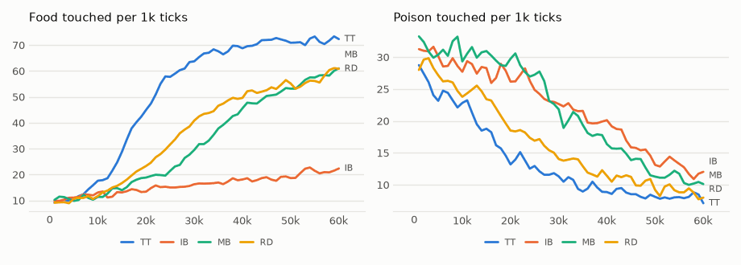
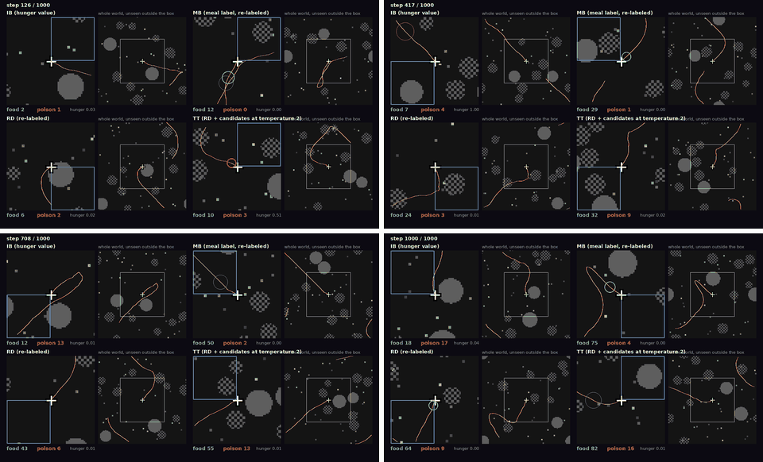

# vm-00101: The Instinct's Candidates at Temperature 2

**Date:** 2026-11-20
**Status:** Complete
**Source:** `exp/vm-00101` (code: `visual-motor-agent/dev/`)
**Outputs:** `~/data/research/visual-motor-agent/exp_00101/`
**Task plan:** [`../tasks/00113-candidate-temperature.md`](../tasks/00113-candidate-temperature.md)

## Goal

The instinct draws its 16 candidates from the model's own move prediction at temperature 1. Once the model is sure of its move, the draws are one and the same move: all 16 are the same on .30 of ticks in SB and .13 in SD (vm-00098, vm-00099), and the instinct has nothing to choose from. Here the first candidate stays the model's own move, and the other 15 are drawn at temperature 2. Does the instinct then find better moves? The design and the readings set before the results are in the task plan.

## Method

| Arm | World | Candidates | Seeds |
|---|---|---|---|
| the base: RD (vm-00100) or SD (vm-00099), linked | inertia from birth | temperature 1 | 1–12 |
| TT | inertia from birth | the first at temperature 1, the other 15 at temperature 2 (`online.instinct_temp = 2`) | 1–12 |

- **The base, by the rule set before vm-00100's results:** RD if RD − SD food at 40–60k, paired by seed, has a 95% interval above 0, else SD (`make base`).
- **Everything else is the base's:** `configs/U_view.json`, 4 quarter transformers of 8 layers, tolerance .002, context 8, the ring, `model.body_label = 1`, `online.label = meal`, `label_gamma` 0.95, `online.full_dose = 1`, `env.inertia = 4` (and `online.label_refresh = 1` on RD).
- **Card:** the RTX 3090, 12 lives at once under MPS, 3.0 ticks/s each (as RD).
- **The base chosen by the rule:** RD. RD − SD food at 40–60k was +45.76 ± 8.38, higher in all 12 seeds (`make base`, printed to the queue's output).
- **Controls linked, not rerun:** RD (vm-00100), MB (vm-00097), IB (vm-00095), with the same seeds.

## Results

### R1. Lived, ticks 40–60k, 12 seeds, 95% interval (t, df 11)

| Arm | Food per 1k | Poison per 1k | Mean hunger | Instinct overrides | Move CE | Patch CE | Smoothness |
|---|---|---|---|---|---|---|---|
| IB | 19.9 ± 0.9 | 14.34 ± 1.17 | .230 ± .053 | .697 | .408 | .7646 | .24 |
| MB | 54.2 ± 6.6 | 12.26 ± 1.23 | .093 ± .028 | .586 | .234 | .7605 | .51 |
| RD | 55.5 ± 7.3 | 9.73 ± 0.63 | .082 ± .023 | .488 | .179 | .7608 | .57 |
| **TT** | **71.6 ± 0.9** | **8.27 ± 0.48** | **.050 ± .020** | .737 | .428 | .7739 | .52 |

Paired by seed (in brackets: seeds above 0, of 12):

| Contrast | Food | Poison | Mean hunger | Overrides | Move CE | Smoothness |
|---|---|---|---|---|---|---|
| TT − RD | +16.1 ± 7.4 (11) | −1.5 ± 0.7 (2) | −.032 ± .029 (4) | +.249 ± .058 (12) | +.248 ± .040 (12) | −.051 ± .058 (2) |
| TT − MB | +17.4 ± 6.5 (12) | −4.0 ± 1.2 (0) | −.043 ± .034 (2) | +.152 ± .037 (12) | +.193 ± .028 (12) | +.009 ± .046 (6) |
| TT − IB | +51.7 ± 1.1 (12) | −6.1 ± 1.3 (0) | −.180 ± .052 (0) | +.040 ± .026 (9) | +.020 ± .034 (8) | +.278 ± .025 (12) |

- **TT's seeds are alike:** food at 40–60k has an interval of ±0.9 (RD ±7.3, MB ±6.6).
- **No life of any arm starves.** TT's highest mean hunger at 40–60k is .11.
- **Move CE is higher** because the instinct overrides the model's own move on .74 of ticks, and the move it makes is the target.

### R2. Over the life, by 5k ticks, mean of 12 seeds

| Measure | Arm | 0–5k | 5–10k | 10–15k | 15–20k | 20–25k | 25–30k | 30–35k | 35–40k | 40–45k | 45–50k | 50–55k | 55–60k |
|---|---|---|---|---|---|---|---|---|---|---|---|---|---|
| Food per 1k | IB | 10.6 | 12.5 | 12.5 | 13.7 | 15.3 | 15.8 | 16.6 | 17.9 | 18.3 | 18.5 | 21.3 | 21.5 |
|  | MB | 10.5 | 11.4 | 13.7 | 18.1 | 20.5 | 27.0 | 34.7 | 43.2 | 48.7 | 52.2 | 56.4 | 59.6 |
|  | RD | 9.8 | 11.3 | 15.4 | 21.5 | 29.0 | 38.3 | 44.7 | 49.2 | 52.5 | 54.7 | 55.0 | 59.9 |
|  | TT | 10.2 | 15.0 | 23.6 | 41.3 | 54.9 | 62.1 | 67.4 | 68.7 | 71.0 | 71.8 | 71.8 | 71.8 |
| Poison per 1k | IB | 30.7 | 28.8 | 28.1 | 27.2 | 26.3 | 23.1 | 21.8 | 19.8 | 17.5 | 14.5 | 13.7 | 11.6 |
|  | MB | 31.2 | 31.0 | 31.0 | 29.5 | 28.0 | 23.4 | 20.0 | 17.3 | 15.0 | 12.4 | 11.6 | 10.0 |
|  | RD | 28.4 | 25.2 | 24.5 | 20.3 | 17.8 | 15.3 | 13.5 | 11.5 | 11.2 | 9.9 | 9.3 | 8.5 |
|  | TT | 25.4 | 23.5 | 19.8 | 15.0 | 13.6 | 11.5 | 10.0 | 9.4 | 9.0 | 8.1 | 8.0 | 7.9 |
| Mean hunger | IB | .71 | .61 | .63 | .51 | .43 | .43 | .38 | .44 | .24 | .21 | .23 | .24 |
|  | MB | .74 | .67 | .57 | .55 | .42 | .36 | .19 | .23 | .10 | .13 | .04 | .10 |
|  | RD | .68 | .45 | .56 | .40 | .20 | .14 | .09 | .11 | .11 | .10 | .03 | .09 |
|  | TT | .64 | .44 | .31 | .19 | .07 | .06 | .05 | .03 | .03 | .07 | .05 | .05 |
| Overrides | IB | .52 | .46 | .50 | .55 | .58 | .65 | .70 | .72 | .72 | .71 | .69 | .67 |
|  | MB | .22 | .19 | .21 | .29 | .35 | .43 | .51 | .54 | .58 | .60 | .59 | .58 |
|  | RD | .37 | .40 | .46 | .49 | .54 | .54 | .55 | .52 | .50 | .49 | .48 | .48 |
|  | TT | .68 | .81 | .84 | .83 | .81 | .78 | .77 | .76 | .75 | .74 | .73 | .73 |

**TT against RD by stage,** paired by seed:

| Stage | Food | Poison | Mean hunger |
|---|---|---|---|
| 0–5k | +0.4 ± 1.6 (7) | −3.0 ± 2.5 (2) | −.043 ± .125 (5) |
| 5–10k | +3.8 ± 1.8 (11) | −1.7 ± 2.3 (4) | −.012 ± .152 (6) |
| 10–20k | +14.0 ± 3.8 (12) | −5.0 ± 1.6 (0) | −.229 ± .130 (2) |
| 20–40k | +23.0 ± 5.3 (12) | −3.4 ± 1.7 (1) | −.084 ± .050 (1) |
| 40–60k | +16.1 ± 7.4 (11) | −1.5 ± 0.7 (2) | −.032 ± .029 (4) |

- **TT learns to forage far sooner:** it eats 41 per 1k at 15–20k, which RD reaches only at 30–35k.
- **It stops at about 72 per 1k from 40k on,** in every seed (69–76 at 50–60k). RD and MB are still rising at 55–60k (59.9, 59.6), so part of the gap at 40–60k is speed of learning.

### R3. The label in life: predicted and stored against the true V, by ticks to the next meal (the two monitors)

TT's predictions for the moves it made, pooled over 12 seeds. The true V in the last row is that of 40–60k.

| Life | 0 | 1 | 2–3 | 4–7 | 8–15 | 16–31 | 32–63 | Bias over all ticks |
|---|---|---|---|---|---|---|---|---|
| 0–2k | .06 | .06 | .04 | .02 | −.00 | .01 | .00 | −.174 ± .025 |
| 2–5k | .43 | .33 | .22 | .13 | .06 | .06 | .08 | −.090 ± .025 |
| 5–10k | .79 | .64 | .46 | .27 | .15 | .13 | .15 | −.026 ± .022 |
| 10–20k | .94 | .86 | .71 | .50 | .32 | .26 | .23 | −.001 ± .012 |
| 20–40k | .99 | .94 | .85 | .69 | .50 | .41 | .38 | +.037 ± .003 |
| 40–60k | 1.00 | .95 | .88 | .74 | .54 | .48 | .46 | +.050 ± .004 |
| true V, 40–60k | 1.00 | .95 | .87 | .73 | .53 | .28 | .04 | |

RD's, for comparison (vm-00100 R3): 40–60k predicted .99, .94, .87, .71, .43, .37, .36 against true 1.00, .95, .87, .73, .52, .25, .01.

The bias over all ticks, by stage:

| Arm | 0–2k | 2–5k | 5–10k | 10–20k | 20–40k | 40–60k |
|---|---|---|---|---|---|---|
| MB predicted | −.189 | −.128 | −.069 | −.049 | −.015 | +.024 ± .007 (11 of 12 above 0) |
| RD predicted | −.193 | −.118 | −.079 | −.042 | +.006 | +.033 ± .005 (12 of 12 above 0) |
| TT predicted | −.174 | −.090 | −.026 | −.001 | +.037 | +.050 ± .004 (12 of 12 above 0) |

- **Within 15 ticks of a meal TT's label is right** (.74 against true .73 at 4–7 ticks, .54 against .53 at 8–15).
- **Further out it is more optimistic than RD's:** .46 at 32–63 ticks where the true V is .04.

### R4. The label frozen: predicted against true V by ticks to the next real meal (`value`, 2,000 ticks × 16 bodies)

| Ticks to the meal | 0 | 1 | 2 | 4 | 6 | 8 | 10 | 15 | 20 | 30 |
|---|---|---|---|---|---|---|---|---|---|---|
| 0.95^k | 1.000 | .950 | .902 | .815 | .735 | .663 | .599 | .463 | .358 | .215 |
| MB predicted | .993 | .947 | .893 | .791 | .701 | .526 | .466 | .433 | .420 | .410 |
| RD predicted | .994 | .948 | .898 | .797 | .708 | .515 | .461 | .424 | .411 | .403 |
| RD true | 1.000 | .949 | .897 | .791 | .699 | .620 | .549 | .398 | .282 | .120 |
| **TT predicted** | **.996** | **.951** | **.903** | **.808** | **.729** | **.609** | **.552** | **.502** | **.489** | **.476** |
| TT true | 1.000 | .950 | .898 | .794 | .704 | .624 | .551 | .401 | .289 | .131 |

**Over all ticks (T):**

| Arm | Predicted | True | Correlation | Candidates' spread |
|---|---|---|---|---|
| MB | .198 | .236 | .74 | .0235 |
| RD | .196 | .221 | .76 | .0159 |
| TT | .154 | .184 | .78 | .0374 |

- **TT's frozen label is right out to 10 ticks before a meal** (.552 against .551); RD's falls off at 8 (.515 against .620).
- **Beyond 15 ticks it levels off near .48** (RD .40). The true V is .13 at 30.

### R5. Frozen foraging (`chain`, 1,500 ticks × 16 bodies)

| Arm | Food | Blind | Blind + perfect grab | Seen − grab | Poison | Smoothness |
|---|---|---|---|---|---|---|
| IB | 22.2 ± 1.6 | 9.5 | 11.0 | +11.2 ± 1.3 | 12.0 ± 1.7 | .25 |
| MB | 57.3 ± 9.0 | 10.6 | 12.4 | +44.9 ± 9.0 | 10.9 ± 3.2 | .54 |
| RD | 59.3 ± 7.5 | 11.0 | 12.7 | +46.6 ± 7.9 | 9.7 ± 1.3 | .58 |
| **TT** | **71.4 ± 1.4** | 10.4 | 12.3 | **+59.0 ± 1.5** | **8.1 ± 1.0** | .51 |

**Paired:**

| Contrast | Food | Poison |
|---|---|---|
| TT − RD | +12.0 ± 7.7 (11) | −1.6 ± 1.5 (2) |
| TT − MB | +14.1 ± 8.8 (10) | −2.8 ± 3.6 (5) |
| TT − IB | +49.2 ± 2.0 (12) | −3.9 ± 1.8 (1) |

TT forages by sight: seeing adds +59.0 food per 1k over a blind body that grabs every food it touches (RD +46.6).

### R6. How the body moves, and food in reach (`move` and `reach`, frozen)

| Arm | Mean hunger | Speed | Braking | Food within 8 px: speed, motion's aim | Motion's aim, 8–16 px; 16–32 px | Poison within 8 px: share, motion away | Food in reach | Eaten when in reach |
|---|---|---|---|---|---|---|---|---|
| MB | .105 | 4.38 | .11 | 4.51, .71 | .65; .51 | .17, −.09 | .060 | .96 |
| RD | .080 | 4.48 | .08 | 4.58, .72 | .66; .50 | .17, −.07 | .061 | .97 |
| TT | .051 | 4.27 | .14 | 4.42, .78 | .76; .64 | .15, −.07 | .074 | .96 |

- **TT aims at food from further away:** motion's aim at food 16–32 px away is .64 (RD .50), and 8–16 px .76 (RD .66).
- **It moves a little slower and brakes more** (top speed on .66 of ticks, RD .80), and is in reach of food on .074 of ticks (RD .061).

### R7. Poison, and how different the instinct's candidates are (frozen)

The `reach` test's poison pairs (a move into poison against one that is not, from the same state), and `eval_candidates.py` (300 ticks × 16 bodies). Frozen tests use the run's own temperature, so TT's candidates are drawn at 2.

| Arm | Poison moves rated worse by (T) | Worse by more than .002 | The instinct's pick is a poison move |
|---|---|---|---|
| IB | .023 ± .004 | .61 ± .02 | .35 ± .02 |
| MB | .040 ± .009 | .74 ± .05 | .26 ± .04 |
| RD | .050 ± .007 | .75 ± .02 | .24 ± .03 |
| TT | .039 ± .001 | .77 ± .01 | .24 ± .01 |

| Arm | Distinct moves among the 16 | Ticks with all 16 the same move | Label spread (median) | Food per 1k (this test) | Mean hunger |
|---|---|---|---|---|---|
| IB | 9.5 ± 0.5 | .02 ± .01 | .0145 ± .0025 | 20.5 ± 1.7 | .25 |
| MB | 5.7 ± 0.9 | .07 ± .02 | .0241 ± .0059 | 53.1 ± 8.1 | .15 |
| RD | 4.4 ± 0.7 | .10 ± .05 | .0174 ± .0060 | 54.3 ± 8.4 | .14 |
| **TT** | **13.3 ± 0.3** | **.00 ± .00** | **.0424 ± .0020** | 64.1 ± 2.3 | .10 |

**TT − RD, paired:** distinct moves +8.9 ± 0.9 (12 of 12 above 0); ticks with all 16 the same −.102 ± .047 (0); label spread +.025 ± .007 (12); food in this test +9.9 ± 9.3 (9).

No TT seed has a tick with all 16 candidates the same; RD's seed 10 had .30.

### R8. TT seed by seed (lived; frozen spread from `value`, food and blind food from `chain`)

| Seed | Food 0–10k | Food 50–60k | Mean hunger 40–60k | Overrides 40–60k | Smoothness 40–60k | Frozen spread | Frozen food, blind food |
|---|---|---|---|---|---|---|---|
| 1 | 11.0 | 72.5 | .03 | .77 | .49 | .0393 | 75.9, 10.5 |
| 2 | 11.8 | 74.5 | .01 | .73 | .53 | .0356 | 71.7, 11.0 |
| 3 | 10.4 | 72.7 | .03 | .75 | .52 | .0320 | 75.0, 10.8 |
| 4 | 15.3 | 71.6 | .08 | .74 | .52 | .0375 | 70.9, 9.9 |
| 5 | 13.1 | 71.0 | .06 | .73 | .51 | .0341 | 69.1, 10.1 |
| 6 | 12.4 | 69.2 | .03 | .74 | .52 | .0379 | 67.9, 10.2 |
| 7 | 14.0 | 75.8 | .08 | .70 | .53 | .0420 | 72.3, 11.2 |
| 8 | 12.3 | 69.3 | .01 | .75 | .52 | .0401 | 70.8, 10.2 |
| 9 | 11.2 | 71.1 | .11 | .72 | .51 | .0399 | 70.0, 10.9 |
| 10 | 13.5 | 72.1 | .03 | .76 | .50 | .0366 | 70.0, 9.7 |
| 11 | 14.0 | 69.6 | .08 | .75 | .50 | .0338 | 72.0, 10.3 |
| 12 | 12.5 | 72.2 | .04 | .71 | .54 | .0400 | 70.8, 10.2 |

**Food at 50–60k for comparison:**

| Arm | Seeds 1–12 |
|---|---|
| MB | 71.2, 67.9, 55.4, 43.1, 70.7, 66.9, 68.8, 63.7, 45.3, 39.9, 56.5, 46.4 |
| RD | 49.7, 65.4, 72.5, 44.8, 50.3, 50.4, 40.6, 42.0, 63.1, 76.3, 61.2, 72.7 |

TT's lowest seed (69.2) eats more than 9 of RD's 12.

## Readings

1. **Plumbing: met.**
   - The 5 tests of `tests/test_instinct_temp.py` pass: at T = 1 the moves are the old draw exactly; at T = 2 the first candidate is kept and the others are more varied on a sharp distribution.
   - All 12 lives ran 60k ticks without an error.
2. **The candidates differ: met** (R7). TT has 13.3 distinct moves among the 16 against RD's 4.4 (+8.9 ± 0.9, all 12 seeds), and no tick with all 16 the same (RD .10).
3. **It forages: met** (R1). TT − RD food at 40–60k is +16.1 ± 7.4, higher in 11 of 12 seeds: 71.6 per 1k against 55.5.
4. **Descriptive:**
   - overrides rise from .49 to .74;
   - poison falls (−1.5 ± 0.7, lower in 10 of 12); the instinct's pick is a poison move on .24 of poison pairs, as RD;
   - smoothness .52 against .57 (−.051 ± .058): not clearly less smooth, and level with MB.

**The outcome set in the plan:** reading 3 holds. The candidates' temperature joins the instinct if the owner decides so, and Breakout (task 00111, vm-00102) is built with it.

<!-- figures -->
## Figures

*The world of this experiment as its model sees it, every 12 ticks. Moves are random: this shows the world, not the trained agent.*

*From each run's `metrics.jsonl`, the mean of its seeds by arm, smoothed. All in the world with inertia from birth: IB the hunger value (vm-00095), MB the meal label re-labeled at every replay in the hunger channel (vm-00097), RD re-labeled in its own channel with the full dose (vm-00100), TT RD with the instinct's candidates after the first drawn at temperature 2.*

*Stills from this experiment's video, in time order. Seed 5 at 60k, frozen, from the same start, in the world with inertia: IB (the hunger value), MB (the meal label, re-labeled, in the hunger channel), RD (re-labeled, own channel, full dose) and TT (RD with the candidates at temperature 2). Each arm's 64 x 64 view (the blue square: the quarter transformer whose move it was), and beside it the whole world with the window outlined. Plain circles are food, checkered ones poison. Seed 3 is in videos/vm101_s3.*
<!-- /figures -->

## Analysis

- **The candidates were a limit, and a large one.**
  - With the label of vm-00100, RD's instinct chose among 4.4 distinct moves; at temperature 2 it chooses among 13.3, and it eats 29% more.
  - The gain is largest at 10–40k (+14 to +23 per 1k, all 12 seeds), when the model is already sure of its move but not yet good at foraging.
- **Varied candidates also teach the label** (R3, R4).
  - TT's label is right further from a meal than RD's: frozen, out to 10 ticks (RD to 6), and the spread between candidates is .042 against .017.
  - The instinct makes moves the model would not have made, the label is trained on what they led to, and so it learns to tell moves apart. More choice gives a better label, and a better label gives better choices.
- **It also makes the seeds alike.** RD's seeds end anywhere from 41 to 76 per 1k; TT's from 69 to 76. A life whose candidates collapsed early had no way to find the moves that lead to food; with temperature 2 every life keeps proposing them.
- **TT levels off at about 72 per 1k from 40k on.** RD's and MB's best seeds reach 72–76 too, so this may be near what this agent can do in this world with a label of this horizon, not a limit of TT itself.
- **The label is still optimistic far from food** (.46 at 32–63 ticks, true .04), more so than RD's. The instinct compares moves from the same state, so a common offset does not matter, but a flat label beyond 15 ticks cannot rank moves that pay off later.
- **Its cost:** none measurable in speed; the model's own move is overridden on three ticks in four, so its move prediction (move CE .43) is worse as a predictor of what the body does.

## Conclusions

1. **Drawing the instinct's candidates at temperature 2**, with the first kept at 1, raises food at 40–60k from 55.5 to 71.6 per 1k (+16.1 ± 7.4, 11 of 12 seeds), with less poison and lower hunger.
2. **It removes the collapse of the candidates:** 13.3 distinct moves of 16, none of RD's ticks with all the same.
3. **TT learns to forage about twice as fast** (41 per 1k at 15–20k, RD at 30–35k) and its seeds end alike (69–76).
4. **Its label is right out to about 10 ticks before a meal,** against 6 for RD, and still flat and optimistic beyond 15.

## Next steps

- **The default (the owner's decision):** RD's settings with `online.instinct_temp = 2`.
- **Breakout (task 00111, vm-00102)** is to be built on the new default.
- **The label's horizon** is the next limit: a larger γ, n-step real ticks before the bootstrap, or labels for moves not made (task 00114, Part A).
- **The forecast panels (task 00115)** use RD's settings with T = 2 in their overnight proof of concept.
