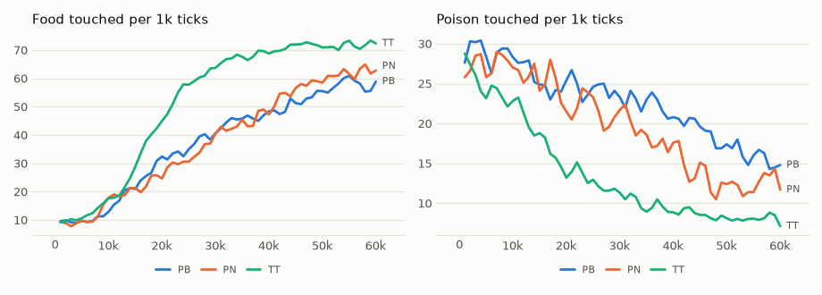
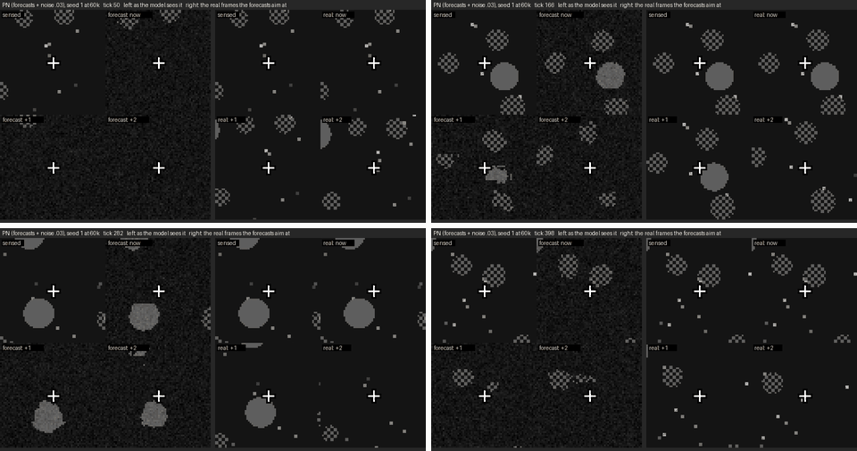

# vm-00102: Forecast Panels — the Model's Own Forecasts Fed Back Beside the Real Frame

**Date:** 2026-11-21
**Status:** Complete (pending tag)
**Source:** `dev/` (pending tag `exp/vm-00102`)
**Outputs:** `~/data/research/visual-motor-agent/exp_00102/`
**Task plan:** [`../tasks/00115-prediction-panels.md`](../tasks/00115-prediction-panels.md)

## Goal

The body builds the frame the model sees from four panels, one per quarter transformer:
- panel 1 is the real view;
- panels 2 to 4 are the forecasts made on the tick before by the transformers of panels 1 to 3, slightly noised;
- panel i is trained against the real frame i ticks after panel 1's, so the model learns to look 1 to 4 ticks ahead, each panel reading the forecast before it.

Do the forecasts help it predict and forage, against the same agent with noise in panels 2 to 4? The overnight pilot (task 00115) showed the forecasts are learned and used, but not whether they help. This is the first run with enough seeds to tell.

## Method

| Arm | Panels 2–4 | Seeds |
|---|---|---|
| PB | random grey noise, drawn anew each tick (the baseline) | 1–5 |
| PN | the forecasts (pair decoding) with Gaussian noise σ .03 | 1–5 |

- **Both arms:**
  - `configs/U_view.json`, 4 quarter transformers of 8 layers, `model.img = 128` (each transformer's quarter is one 64 × 64 panel), tolerance .002, context 8, the ring;
  - RD's label (vm-00100: `model.body_label = 1`, `online.label = meal`, `label_gamma` .95, `full_dose`, `label_refresh`), inertia 4, the candidates at temperature 2 (vm-00101);
  - none of these is a default; this run uses them as the best agent so far (the owner).
- **Who sees what:**
  - panel 1 is transformer 0's quarter, so it is the only transformer whose own patches show the real view; transformers 1 to 3 see it through the summaries;
  - panel 2 at tick t is transformer 0's forecast, made at t − 1, of the frame now in panel 1; panel 3 is transformer 1's of the next tick, and panel 4 transformer 2's of the tick after;
  - each transformer is trained on its own panel's target.
- **The owner's choices (2026-11-21):**
  - σ .03: at the pilot's .1 the forecasts were hidden under the noise;
  - no lag arm, so the run asks one question;
  - memory unchanged (100k steps), though it replays stale forecasts: "we need to see if it learn new stuff even with frozen predictions".
- **Cards:**
  - the lives: the RTX 3090 alone, 10 lives at once under MPS (about 2.2 GB each), 0.6–0.7 ticks/s each, about 26 hours;
  - the frozen tests (after a reboot that added the RTX 4090): both cards, 5 lives at a time each, without MPS (`make frozen GPU=… MPS= T=…`).
- **The control: TT** (vm-00101, seeds 1–5 unless said; its 12 seeds in the curves).
  - TT has the same settings without panels: a 64 × 64 frame, each transformer a 32 × 32 quarter of the real view.
  - It is not PB with the panels removed. PB's model sees four times the pixels, and three of its four transformers have noise in their own patches.

## Measures

- **Lived** by 5k and at 40–60k: food, poison, mean hunger, overrides; the prediction loss per panel in training batches (`uni_ce_patch_pK`).
- **Frozen** at 10k to 60k (`make frozen`): each life 600 ticks with learning off (`ppo.lr = 0`) in new worlds (seed 100 + s), scored after tick 200.
  - The measures are the prediction loss per panel, food and poison.
  - PN is also tested with its forecasts replaced by noise (PN blanked).
- **Frozen, longer** (`make long`): the 60k checkpoints, 2,000 ticks in new worlds (seed 300 + s), scored after tick 200; PB, PN and PN blanked.
- **A video** (`make video`, `dev/panel_video.py`): the panels as the model sees them beside the real frames the forecasts aim at. From it, which real frame each forecast panel is nearest to (R6).

## Readings, set before the results

1. **Plumbing:** all 10 lives run 60k ticks.
2. **The forecasts help prediction:** frozen, PN − PB loss on panels 2–4 at 40k–60k, paired by seed, below 0.
3. **They are used:** frozen, PN with its forecasts replaced by noise predicts worse than PN as it lived.
4. **Foraging (descriptive with 5 seeds):** PN − PB food at 40–60k, paired by seed; both against TT.

## Results

Intervals are 95% (t, df 4) over 5 seeds. In brackets: the seeds above 0 for contrasts of food, hunger and overrides, the seeds below 0 for contrasts of poison and loss. All contrasts are paired by seed.

### R1. Lived, ticks 40–60k

| Arm | Food per 1k | Poison per 1k | Mean hunger | Instinct overrides | Move CE | Smoothness |
|---|---|---|---|---|---|---|
| PB | 55.0 ± 8.4 | 17.23 ± 1.58 | .135 ± .100 | .794 | 1.028 | .45 |
| **PN** | **59.6 ± 2.3** | **12.71 ± 1.98** | .092 ± .049 | .786 | 1.384 | .50 |
| TT | 71.8 ± 1.8 | 8.42 ± 0.39 | .044 ± .035 | .743 | .436 | .52 |

| Contrast | Food (above 0) | Poison (below 0) | Mean hunger (above 0) | Overrides (above 0) |
|---|---|---|---|---|
| PN − PB | +4.5 ± 10.5 (3) | **−4.52 ± 2.00 (5)** | −.043 ± .126 (3) | −.008 ± .011 (0) |
| PN − TT | −12.2 ± 2.4 (0) | +4.29 ± 1.99 (0) | +.048 ± .072 (4) | +.042 ± .032 (5) |
| PB − TT | −16.7 ± 9.2 (0) | +8.81 ± 1.52 (0) | +.091 ± .087 (5) | +.050 ± .036 (5) |

**Seed by seed, 40–60k:**

| Arm | Food per 1k, seeds 1–5 | Poison per 1k, seeds 1–5 |
|---|---|---|
| PB | 45.2, 50.8, 60.0, 57.8, 61.2 | 17.6, 18.0, 16.4, 15.6, 18.7 |
| PN | 62.4, 59.6, 59.9, 58.2, 57.6 | 14.2, 12.4, 14.0, 10.2, 12.6 |
| TT | 71.4, 73.7, 72.6, 71.0, 70.1 | 8.6, 8.8, 8.2, 8.3, 8.2 |

- **PN eats about a quarter less poison than PB,** less in every seed.
- **Food is level on the paired test.** PN's seeds are close together (57.6–62.4); PB's are spread (45.2–61.2), and its seeds 1 and 2 are low.
- **Move CE is higher in PN** (+.36, all 5 seeds) at the same rate of overrides. Not explained here.

### R2. Over the life, by 5k ticks, mean of 5 seeds

| Measure | Arm | 0–5k | 5–10k | 10–15k | 15–20k | 20–25k | 25–30k | 30–35k | 35–40k | 40–45k | 45–50k | 50–55k | 55–60k |
|---|---|---|---|---|---|---|---|---|---|---|---|---|---|
| Food per 1k | PB | 9.5 | 11.5 | 19.6 | 28.8 | 34.0 | 39.5 | 45.3 | 46.8 | 49.6 | 54.4 | 58.7 | 57.4 |
|  | PN | 8.9 | 13.5 | 20.0 | 23.9 | 30.7 | 37.5 | 43.0 | 46.4 | 55.2 | 58.5 | 61.5 | 63.1 |
|  | TT | 10.8 | 13.9 | 24.9 | 40.9 | 54.1 | 61.4 | 67.3 | 69.4 | 71.0 | 71.1 | 72.0 | 73.0 |
| Poison per 1k | PB | 29.0 | 28.9 | 26.6 | 24.4 | 24.0 | 24.0 | 22.9 | 21.8 | 20.0 | 17.5 | 16.4 | 15.1 |
|  | PN | 26.9 | 28.0 | 25.4 | 24.4 | 23.1 | 20.4 | 19.4 | 17.5 | 14.2 | 12.0 | 11.6 | 13.1 |
|  | TT | 25.7 | 23.9 | 20.4 | 15.0 | 13.8 | 12.2 | 10.3 | 9.6 | 9.3 | 8.4 | 7.8 | 8.1 |
| Mean hunger | PB | .69 | .59 | .52 | .27 | .34 | .16 | .21 | .18 | .15 | .09 | .13 | .17 |
|  | PN | .76 | .58 | .40 | .46 | .32 | .44 | .15 | .09 | .15 | .03 | .03 | .15 |
|  | TT | .46 | .51 | .27 | .18 | .07 | .05 | .09 | .07 | .01 | .11 | .03 | .03 |
| Overrides | PB | .48 | .51 | .58 | .62 | .68 | .73 | .75 | .78 | .79 | .79 | .80 | .79 |
|  | PN | .51 | .59 | .66 | .72 | .77 | .80 | .82 | .82 | .81 | .79 | .78 | .77 |
|  | TT | .72 | .83 | .84 | .83 | .81 | .79 | .78 | .76 | .76 | .75 | .74 | .73 |

**PN − PB by stage:**

| Stage | Food (above 0) | Poison (below 0) | Mean hunger (above 0) | Overrides (above 0) |
|---|---|---|---|---|
| 0–5k | −0.6 ± 1.3 (1) | −2.1 ± 2.4 (5) | +.073 ± .332 (3) | +.031 ± .054 (4) |
| 5–10k | +2.0 ± 1.9 (4) | −0.9 ± 5.3 (3) | −.011 ± .477 (2) | +.077 ± .079 (4) |
| 10–20k | −2.3 ± 3.3 (1) | −0.5 ± 2.3 (2) | +.033 ± .253 (3) | +.086 ± .081 (5) |
| 20–40k | −2.0 ± 11.2 (2) | −3.1 ± 2.6 (5) | +.031 ± .096 (3) | +.067 ± .072 (5) |
| 40–60k | +4.5 ± 10.5 (3) | −4.5 ± 2.0 (5) | −.043 ± .126 (3) | −.008 ± .011 (0) |

- **PN falls behind on food at 10–40k and catches up after 40k.** It is still rising at 55–60k (63.1 per 1k), while PB is flat (57.4).
- **PN's poison is lower from 20k on,** and the gap grows.
- **PN is overridden more often at 5–40k** (in every seed at 10–40k), and not at 40–60k.
- **Both panel arms learn far slower than TT.** TT eats 41 per 1k at 15–20k; PB reaches that at 30–35k and PN at 30–35k.

### R3. The prediction loss per panel in training batches (nats per value), mean of 5 seeds

The batches replay memory, so PN's panels 2–4 hold the forecasts as they were made then, by older weights.

| Stage | PB, panels 1 / 2 / 3 / 4 | PN, panels 1 / 2 / 3 / 4 | PN − PB, panel 1 | Panel 2 | Panel 3 | Panel 4 |
|---|---|---|---|---|---|---|
| 0–5k | .9130 / .9712 / .9695 / .9708 | .9146 / .9733 / .9835 / .9906 | +.0016 ± .0094 (2) | +.0021 ± .0064 (2) | +.0140 ± .0064 (0) | +.0198 ± .0085 (0) |
| 5–10k | .8537 / .9098 / .9018 / .9073 | .8535 / .9133 / .9257 / .9336 | −.0002 ± .0074 (3) | +.0036 ± .0155 (2) | +.0239 ± .0147 (0) | +.0264 ± .0200 (0) |
| 10–20k | .8337 / .8889 / .8896 / .8952 | .8353 / .8969 / .9142 / .9229 | +.0016 ± .0102 (2) | +.0080 ± .0057 (0) | +.0247 ± .0107 (0) | +.0277 ± .0094 (0) |
| 20–40k | .8200 / .8839 / .8878 / .8973 | .8250 / .8888 / .9049 / .9194 | +.0050 ± .0122 (1) | +.0049 ± .0103 (1) | +.0171 ± .0105 (0) | +.0221 ± .0104 (0) |
| 40–60k | .8164 / .8816 / .8887 / .9033 | .8216 / .8841 / .8984 / .9195 | +.0052 ± .0097 (1) | +.0025 ± .0095 (2) | +.0097 ± .0087 (0) | +.0162 ± .0083 (0) |

- **In training batches PN predicts panels 3 and 4 worse than PB,** in every seed and stage. The gap is largest at 10–20k (+.025, +.028) and halves by 40–60k (+.010, +.016).
- This is the loss on the stale forecasts memory replays, not on live ones (R4).

### R4. Frozen at 10k to 60k: the prediction loss per panel, food and poison (600 ticks, scored after tick 200)

**PN − PB:**

| Checkpoint | Panel 1 | Panel 2 | Panel 3 | Panel 4 | Food per 1k (above 0) | Poison per 1k |
|---|---|---|---|---|---|---|
| 10k | +.004 ± .036 (2) | −.057 ± .066 (5) | −.032 ± .086 (3) | −.024 ± .086 (3) | +7.0 ± 12.1 (4) | −6.5 ± 26.8 (3) |
| 20k | +.007 ± .020 (1) | −.023 ± .025 (5) | −.017 ± .024 (4) | −.002 ± .018 (3) | −4.0 ± 11.9 (2) | +7.5 ± 10.3 (1) |
| 30k | −.011 ± .017 (4) | −.045 ± .027 (5) | −.037 ± .020 (5) | −.025 ± .018 (5) | −16.5 ± 30.4 (1) | −1.0 ± 16.5 (3) |
| 40k | −.003 ± .031 (3) | −.033 ± .042 (4) | −.026 ± .047 (3) | −.009 ± .035 (3) | +10.0 ± 14.6 (4) | −2.5 ± 13.2 (3) |
| 50k | −.004 ± .014 (2) | −.023 ± .014 (5) | −.032 ± .027 (5) | −.014 ± .042 (4) | +12.0 ± 10.6 (5) | −9.5 ± 5.1 (5) |
| 60k | −.012 ± .012 (4) | −.039 ± .011 (5) | −.038 ± .011 (5) | −.030 ± .024 (5) | +2.5 ± 4.9 (4) | −12.5 ± 4.4 (5) |
| **40–60k pooled** | −.006 ± .015 (4) | **−.032 ± .018 (5)** | **−.032 ± .024 (5)** | −.018 ± .023 (4) | **+8.2 ± 4.5 (5)** | **−8.2 ± 4.6 (5)** |

Panels 2–4 together, 40–60k pooled: **−.027 ± .020, below 0 in all 5 seeds** (seed by seed −.001, −.040, −.037, −.036, −.023).

**PN blanked − PN** (PN's weights, its forecasts replaced by noise):

| Checkpoint | Panel 1 | Panel 2 | Panel 3 | Panel 4 | Food per 1k (above 0) | Poison per 1k |
|---|---|---|---|---|---|---|
| 10k | +.031 ± .047 (1) | +.126 ± .075 (0) | +.095 ± .086 (0) | +.093 ± .085 (0) | −4.5 ± 18.4 (3) | +8.0 ± 19.1 (1) |
| 20k | +.036 ± .018 (0) | +.120 ± .038 (0) | +.069 ± .038 (0) | +.060 ± .033 (0) | −13.5 ± 19.9 (1) | +0.5 ± 19.2 (2) |
| 30k | +.034 ± .011 (0) | +.127 ± .030 (0) | +.063 ± .019 (0) | +.043 ± .034 (0) | −14.5 ± 23.2 (1) | +1.0 ± 17.4 (2) |
| 40k | +.038 ± .048 (0) | +.139 ± .035 (0) | +.043 ± .047 (0) | +.029 ± .061 (1) | −51.5 ± 14.7 (0) | +12.0 ± 8.9 (0) |
| 50k | +.041 ± .019 (0) | +.153 ± .036 (0) | +.071 ± .016 (0) | +.048 ± .026 (0) | −50.0 ± 16.6 (0) | +13.0 ± 6.4 (0) |
| 60k | +.043 ± .017 (0) | +.195 ± .061 (0) | +.082 ± .038 (0) | +.060 ± .041 (0) | −47.0 ± 11.9 (0) | +9.5 ± 4.6 (0) |
| **40–60k pooled** | +.041 ± .015 (0) | **+.162 ± .030 (0)** | +.065 ± .027 (0) | +.046 ± .031 (0) | **−49.5 ± 3.8 (0)** | +11.5 ± 4.5 (0) |

Panels 2–4 together, 40–60k pooled: **+.091 ± .026, above 0 in all 5 seeds.**

**The means at 60k:**

| Arm | Panel 1 | Panel 2 | Panel 3 | Panel 4 | Food per 1k | Poison per 1k |
|---|---|---|---|---|---|---|
| PB | .8693 | .9807 | 1.0041 | 1.0498 | 58.0 | 25.0 |
| PN | .8575 | .9412 | .9661 | 1.0201 | 60.5 | 12.5 |
| PN blanked | .9005 | 1.1365 | 1.0483 | 1.0803 | 13.5 | 22.0 |

- **Live forecasts help prediction.** Frozen, PN predicts panels 2–4 better than PB at every checkpoint, by about .02–.06 on panel 2, and in every seed at 30k and 60k. The training batches (R3) said the opposite: there PN was scored on stale forecasts.
- **Removing them hurts more than never having them.** PN blanked is worse than PB on every panel; the model relies on its forecasts.
- **PN blanked also loses three quarters of its food from 40k on** (60.5 to 13.5 per 1k at 60k). This test is also outside what PN ever saw: it never had noise in those panels.

### R5. Frozen at 60k, longer (2,000 ticks, scored after tick 200)

| Arm | Panel 1 | Panel 2 | Panel 3 | Panel 4 | Food per 1k | Poison per 1k | Mean hunger | Overrides |
|---|---|---|---|---|---|---|---|---|
| PB | .8671 | .9786 | 1.0070 | 1.0490 | 59.4 ± 8.4 | 15.4 ± 2.0 | .079 | .779 |
| **PN** | **.8599** | **.9478** | **.9771** | **1.0260** | **65.2 ± 4.3** | **10.1 ± 6.2** | .067 | .752 |
| PN blanked | .9020 | 1.1340 | 1.0530 | 1.0770 | 15.8 ± 9.1 | 25.6 ± 6.5 | .535 | .913 |

| Contrast | Panel 1 | Panel 2 | Panel 3 | Panel 4 | Food (above 0) | Poison (below 0) |
|---|---|---|---|---|---|---|
| PN − PB | −.007 ± .010 (4) | −.031 ± .014 (5) | −.030 ± .018 (5) | −.023 ± .024 (5) | +5.8 ± 5.5 (4) | −5.3 ± 5.3 (4) |
| PN blanked − PN | +.042 ± .014 (0) | +.187 ± .047 (0) | +.076 ± .021 (0) | +.052 ± .026 (0) | −49.4 ± 10.6 (0) | +15.4 ± 8.2 (0) |

Panels 2–4 together: PN − PB **−.028 ± .016, below 0 in all 5 seeds**; PN blanked − PN **+.105 ± .023, above 0 in all 5**.

| Arm | Food per 1k, seeds 1–5 | Poison per 1k, seeds 1–5 |
|---|---|---|
| PB | 55.0, 66.7, 50.0, 62.8, 62.8 | 16.7, 16.7, 15.0, 12.8, 16.1 |
| PN | 61.7, 66.1, 61.7, 69.4, 67.2 | 18.3, 8.9, 10.6, 5.6, 7.2 |
| PN blanked | 8.3, 24.4, 21.7, 8.9, 15.6 | 28.9, 20.6, 21.1, 24.4, 32.8 |

- **The longer test repeats R4.** It has three times the ticks and other worlds: PN predicts the forecast panels better in all 5 seeds, eats more (4 of 5) and less poison (4 of 5; seed 1 is the exception, 18.3 against 16.7).
- **Blanked, PN nearly starves:** mean hunger .54, overridden on .91 of ticks, a quarter of PN's food.
- For scale, TT's frozen foraging was 71.4 food and 8.1 poison per 1k (vm-00101 R5, `chain`, a different test).

### R6. What the forecasts look like (the video, PN seed 1 at 60k, 398 ticks)

The mean squared error between each forecast panel and the real view at each offset (values in [0, 1]; the real view changes by .0062 per tick):

| Forecast panel (aims at) | Real view now | Now + 1 | Now + 2 | Now − 1 |
|---|---|---|---|---|
| Panel 2 (now) | **.0039** | .0069 | .0096 | .0056 |
| Panel 3 (now + 1) | .0064 | **.0063** | .0081 | .0082 |
| Panel 4 (now + 2) | .0083 | **.0070** | .0072 | .0097 |

- **Panel 2 lands on its target.** This also confirms that the recorder and the video are aligned.
- **The further forecasts hedge toward the present.** Panel 3 is as near the frame now as its target; panel 4 is nearest the frame between now and its target.
- **They are blurred, not shifted.** The view moves with the body under inertia, and the model cannot yet tell where it will be.

## Readings

1. **Plumbing: met.**
   - All 10 lives ran 60k ticks without an error.
   - All 90 frozen lives and the 15 longer ones also ran without one.
2. **The forecasts help prediction: met** (R4, R5).
   - Frozen, PN − PB on panels 2–4 at 40–60k is −.027 ± .020, below 0 in all 5 seeds; in the 2,000-tick test at 60k −.028 ± .016, all 5.
   - Panels 2 and 3 are lower in all 5 seeds; panel 4 in 4.
3. **They are used: met** (R4, R5).
   - Replacing PN's forecasts with noise raises its loss on panels 2–4 by .091 ± .026 (all 5 seeds), and on panel 1 by .041; in the 2,000-tick test by .105 ± .023 (all 5).
   - From 40k on it also loses three quarters of its food.
4. **Foraging (descriptive):**
   - Lived at 40–60k, food is level (PN − PB +4.5 ± 10.5, 3 of 5 seeds) and poison lower (−4.5 ± 2.0, all 5).
   - Frozen at 40–60k, PN eats more (+8.2 ± 4.5, all 5) and less poison (−8.2 ± 4.6, all 5); in the 2,000-tick test at 60k, +5.8 ± 5.5 food and −5.3 ± 5.3 poison (4 of 5 each).
   - Both arms forage worse than TT: PN 12.2 food per 1k less and 4.3 poison more.

<!-- figures -->
## Figures

*The world of this experiment as its model sees it, every 12 ticks. Moves are random: this shows the world, not the trained agent.*

*From each run's `metrics.jsonl`, the mean of its seeds by arm, smoothed. All in the world with inertia, on TT's settings (vm-00101: RD's label with the candidates at temperature 2): PB and PN see a 128 x 128 composite of four 64 x 64 panels, panel 1 the real view and panels 2-4 noise (PB) or the model's own forecasts (PN); TT is vm-00101's 64 x 64 agent without panels (its 12 seeds).*

*Stills from this experiment's video, in time order. PN seed 1 at 60k, frozen, 400 ticks in a new world. Left: the 128 x 128 frame as the model sees it (panel 1 the real view; panels 2-4 the forecasts of the frame now, 1 tick ahead and 2 ahead, made on the tick before, with noise .03). Right: the real frames those forecasts aim at. The forecast further out hedges toward the present (R6).*
<!-- /figures -->

## Analysis

- **The forecasts help, but the training loss hides it.**
  - In training batches PN looked worse on panels 3 and 4 for the whole life (R3).
  - Frozen, with forecasts made live by the current weights, it predicts better than PB on every forecast panel (R4).
  - The difference is staleness. Memory replays the forecasts of older weights, which were worse, and PN is scored on predicting from them.
- **It learned to use its forecasts with stale ones in memory** (the owner's question). The stale-forecast gap in training batches halved from 20k to 60k, and the live advantage is largest at 60k.
- **The forecasts are evidence the model reads.**
  - Blanking them makes even panel 1 worse (+.041). Panel 1 is transformer 0's prediction of the next real frame, and transformer 0 never sees the forecasts in its own patches, only through the summaries.
  - Blanking also collapses foraging. Part of that is a model meeting an input it never saw, so it measures reliance, not benefit. The benefit is PN − PB.
- **They make the agent more careful with poison, not hungrier for food.**
  - Lived, poison is a quarter lower in every seed; food is level.
  - Frozen, both favour PN at 40–60k.
  - Seeing where the view will be in 1–2 ticks would warn of a poison the body is about to drift into under inertia.
- **The panel frame costs more than the forecasts give back.**
  - TT, at 64 × 64 without panels, eats 12 more per 1k and 4 less poison than PN, and learns about twice as fast.
  - In the panel arms only transformer 0's own patches show the real view, at full 64 × 64; in TT all four transformers see the real view.
  - The 128 × 128 frame is also slow: 10 panel lives at once on the RTX 3090 ran 0.6–0.7 ticks/s each, where TT's 12 ran 3.0 on the same card (vm-00101).
  - So the comparison with TT mixes the forecasts with a different split of the view, and does not say the forecasts are worth less than nothing.
- **The far forecasts are blurred** (R6). Without noise to clean up they would be worse; σ .03 is enough to see the forecasts and not enough to force a sharp one. Panel 4 is nearer the frame one tick ahead than the frame two ahead.

## Conclusions

1. **Live forecasts help prediction.** Frozen at 40–60k, PN predicts panels 2–4 better than PB by .027 ± .020 nats, in all 5 seeds; at 60k by .030–.039 on each forecast panel.
2. **The model relies on them:** replaced by noise, every panel is worse (+.091 on panels 2–4, +.041 on panel 1), and from 40k on it loses three quarters of its food.
3. **They make foraging safer:** lived, poison is a quarter lower (12.7 against 17.2 per 1k, all 5 seeds) with food level; frozen at 40–60k, more food and less poison in all 5 seeds, and in 4 of 5 in the 2,000-tick test.
4. **Training batches mislead with stale forecasts:** there PN looked worse on the far panels all life.
5. **The 128 × 128 panel frame forages worse than TT's 64 × 64 frame** (−12.2 food, +4.3 poison). The panels' cost, a view split differently and four times the pixels, is larger than the forecasts' gain.

## Next steps

- **Forecasts off the plane** (task 00115, noted 2026-11-22): keep the 64 × 64 frame and TT's split of the view, and put the horizons in the weights (a fast part, as vm-00094) or in depth (layers trained against further futures). That keeps what TT has, removes the stale forecasts, and asks whether the forecasts still help.
- **A fairer panel control:** a 128 × 128 frame with all four panels the real view at different lags, or TT's split with the forecasts added as extra tokens, to separate the cost of the frame from the gain of the forecasts.
- **The warm-up re-forecast** (task 00115): with live forecasts in memory, the training loss would measure what the frozen test does.
- **Real pixels mixed into the noise** (task 00115) needs a lag arm, not run here.
- **Breakout** (task 00111, vm-00103) waits for the owner's choice of what comes next.
